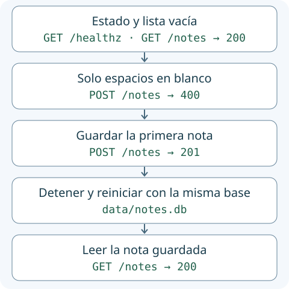

---
{
  "state": "draft",
  "language": "es",
  "translationKey": "2026-11-28-self-hosting-ai-notes",
  "title": "Cómo alojar una aplicación creada con IA en tu propio servidor: empieza con una API de notas",
  "description": "Pide a la IA una API de notas, detén el proceso y comprueba si la primera nota sigue en el mismo archivo SQLite.",
  "sourcePath": "src/content/posts/en/2026-11-28-self-hosting-ai-notes.md",
  "sourceSha256": "d16e16aa59b4f2d18acf7e0fec481da461f90a51d2078a296fed80335f251235"
}
---

La aplicación que te ha creado la IA acaba de guardar su primera nota. Ciérrala y vuelve a abrirla. ¿Sigue ahí la nota? Al empezar con el autoalojamiento conviene comprobar tanto que la aplicación responde como que los datos sobreviven a un reinicio. Aquí pedimos a la IA una pequeña aplicación de notas con instrucciones y probamos el resultado en nuestro ordenador. El ejemplo solo utiliza Python y SQLite.

## Describe las funciones y las condiciones de uso

Si solo pides «hazme una aplicación de notas», el modelo puede decidir cómo guardarlas y quién podrá conectarse. Indica desde el principio dónde deben quedar los datos, quién tendrá acceso y qué comprobarás para dar el trabajo por terminado.

**Petición** Crea una API personal de notas con la biblioteca estándar de Python y SQLite. Escucha solo en `127.0.0.1` y guarda las notas en `data/notes.db`. Haz que `GET /healthz` devuelva el estado y que `GET /notes` muestre la lista. `POST /notes` debe aceptar `{"text":"첫 메모"}` y rechazar con `400` el texto que solo contenga espacios en blanco. Incluye `app.py`, los comandos para iniciar y detener la aplicación y ejemplos con curl. Comprueba en este orden: consultar el estado → guardar una nota → detener el proceso → reiniciar con la misma base → leer la nota. Especifica la dirección de escucha y el archivo que se crea.

## Revisa la dirección y la ruta de almacenamiento antes de arrancar

Comprueba que el servidor escucha en `127.0.0.1` y que SQLite abre `data/notes.db` en disco. Una ruta relativa puede apuntar a otra base si arrancas desde otro directorio. El ejemplo calcula la ruta a partir del archivo de la aplicación. El módulo `http.server` de Python se usa aquí para practicar en local. [http.server](https://docs.python.org/3/library/http.server.html) · [sqlite3](https://docs.python.org/3/library/sqlite3.html)

Guarda el código siguiente como `app.py` en un directorio de prácticas vacío.

```python
import json
import sqlite3
from http.server import BaseHTTPRequestHandler, HTTPServer
from pathlib import Path

db_path = Path(__file__).resolve().parent / "data" / "notes.db"


class Notes(BaseHTTPRequestHandler):
    def reply(self, status, value):
        body = json.dumps(value, ensure_ascii=False).encode("utf-8")
        self.send_response(status)
        self.send_header("Content-Type", "application/json; charset=utf-8")
        self.send_header("Content-Length", str(len(body)))
        self.end_headers()
        self.wfile.write(body)

    def do_GET(self):
        if self.path == "/healthz":
            self.reply(200, {"status": "ok"})
        elif self.path == "/notes":
            rows = db.execute("SELECT text FROM notes ORDER BY id")
            self.reply(200, [{"text": text} for (text,) in rows])
        else:
            self.reply(404, {"error": "unknown path"})

    def do_POST(self):
        if self.path != "/notes":
            self.reply(404, {"error": "unknown path"})
            return
        try:
            size = int(self.headers.get("Content-Length", "0"))
            if not 0 < size <= 8192:
                raise ValueError
            data = json.loads(self.rfile.read(size))
            if not isinstance(data, dict):
                raise ValueError
            text = data.get("text")
            if not isinstance(text, str) or not text.strip():
                raise ValueError
        except ValueError:
            self.reply(400, {"error": "invalid note"})
            return
        with db:
            db.execute("INSERT INTO notes (text) VALUES (?)", (text,))
        self.reply(201, {"text": text})


if __name__ == "__main__":
    db_path.parent.mkdir(exist_ok=True)
    db = sqlite3.connect(db_path)
    try:
        db.execute("CREATE TABLE IF NOT EXISTS notes (id INTEGER PRIMARY KEY, text TEXT NOT NULL)")
        with HTTPServer(("127.0.0.1", 0), Notes) as server:
            print(f"http://127.0.0.1:{server.server_port}", db_path, sep="\n", flush=True)
            server.serve_forever()
    except KeyboardInterrupt:
        pass
    finally:
        db.close()
```

## Prueba las instrucciones de la IA con peticiones reales



Para comprobar que la nota llegó al disco, detén el proceso que la escribió y léela desde un proceso nuevo.

Ejecuta `python3 app.py` desde el directorio de la aplicación. La primera línea muestra la dirección con un puerto temporal y la siguiente, la ruta de la base. Ejecuta estos comandos en otra terminal y pega la dirección de la primera línea cuando `read` espere tu entrada.

```sh
read -r base
```

```sh
curl -i "$base/healthz"
curl -i "$base/notes"
curl -i -H 'Content-Type: application/json' -d '{"text":"   "}' "$base/notes"
curl -i -H 'Content-Type: application/json' -d '{"text":"첫 메모"}' "$base/notes"
```

Pulsa `Ctrl+C` en la terminal de la aplicación y espera a que vuelva el indicador de la consola. Ejecuta `python3 app.py` de nuevo, comprueba que la ruta de la base coincide e introduce la nueva dirección en la segunda terminal.

```sh
read -r base
```

```sh
curl -i "$base/notes"
```

Hicimos la prueba en un entorno local temporal con Python `3.13.0`, la dirección de bucle local y un puerto temporal. La consulta de estado y la lista inicialmente vacía devolvieron `200`, el texto compuesto solo por espacios devolvió `400` y el guardado de la primera nota devolvió `201`. Tras confirmar que el proceso había terminado y reiniciar con la misma base, obtuvimos `200` y la nota guardada al consultar la lista. Si aparece vacía, compara las rutas reales de ambos arranques. Pasa a la IA los comandos de inicio, las rutas de la base y las respuestas HTTP.

## Prepara la copia de seguridad y la restauración si vas a seguir usando la aplicación

«Si este ordenador falla, ¿podré abrir mis notas en otro sitio?» Pide a la IA que identifique la ruta de los datos y te explique cómo restaurar una copia en otro directorio y leer las notas allí. Al trasladar la aplicación a un servidor, revisa cómo se inicia tras reiniciar la máquina y quién tiene acceso. El ejercicio cubrió las peticiones locales, el guardado y la lectura tras un reinicio. No probamos el acceso externo ni la restauración de una copia. [Usar un MacBook como servidor personal en una red privada](https://youdozi.github.io/ko/posts/2026-11-23-macbook-personal-server/)
