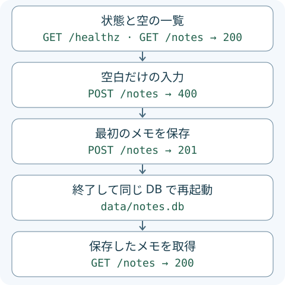

---
{
  "state": "draft",
  "language": "ja",
  "translationKey": "2026-11-28-self-hosting-ai-notes",
  "title": "AI が作ったアプリを自分のサーバーで動かすには？ メモ API で始めるセルフホスティング",
  "description": "AI にメモ API を頼み、プロセスを終了したあとも同じ SQLite ファイルから最初のメモを読み出せるか確かめます。",
  "sourcePath": "src/content/posts/en/2026-11-28-self-hosting-ai-notes.md",
  "sourceSha256": "d16e16aa59b4f2d18acf7e0fec481da461f90a51d2078a296fed80335f251235"
}
---

AI が作ったメモアプリで、最初のメモを保存できました。いったん終了して起動し直してみましょう。メモは残っていますか。セルフホスティングで最初に確かめたいのは、画面が開くことと、再起動後もデータを読めることです。ここでは AI に小さなメモアプリと実行手順を頼み、自分のパソコンで確かめます。使うのは Python と SQLite だけです。

## 機能と一緒に運用条件を伝える

「メモアプリを作って」だけでは、保存方法や接続できる範囲はモデルの判断に委ねられます。データをどこに置くか、誰が接続できるか、何を確認したら完成とするかを先に決めます。

**プロンプト** Python の標準ライブラリと SQLite で個人用のメモ API を作ってください。`127.0.0.1` だけで待ち受け、メモは `data/notes.db` に保存してください。`GET /healthz` は状態を返し、`GET /notes` は一覧を返すようにしてください。`POST /notes` は `{"text":"첫 메모"}` を受け取り、空白だけの入力は `400` で拒否してください。`app.py` と起動・終了コマンド、curl による確認例を示してください。状態確認 → メモを保存 → プロセス終了 → 同じ DB で再起動 → メモを取得、の順で検証します。待ち受けアドレスと作成されるファイルも明記してください。

## 実行前にアドレスと保存先を確認する

サーバーが `127.0.0.1` にバインドされ、SQLite がディスク上の `data/notes.db` を開くことを確認します。相対パスだけだと、起動するディレクトリによって別の DB が開くことがあります。下の例ではアプリのファイルを基準にパスを決めます。Python の `http.server` はローカルでの学習用に使います。 [http.server](https://docs.python.org/3/library/http.server.html) · [sqlite3](https://docs.python.org/3/library/sqlite3.html)

空の練習用ディレクトリに次のコードを `app.py` として保存します。

```python
import json
import sqlite3
from http.server import BaseHTTPRequestHandler, HTTPServer
from pathlib import Path

db_path = Path(__file__).resolve().parent / "data" / "notes.db"


class Notes(BaseHTTPRequestHandler):
    def reply(self, status, value):
        body = json.dumps(value, ensure_ascii=False).encode("utf-8")
        self.send_response(status)
        self.send_header("Content-Type", "application/json; charset=utf-8")
        self.send_header("Content-Length", str(len(body)))
        self.end_headers()
        self.wfile.write(body)

    def do_GET(self):
        if self.path == "/healthz":
            self.reply(200, {"status": "ok"})
        elif self.path == "/notes":
            rows = db.execute("SELECT text FROM notes ORDER BY id")
            self.reply(200, [{"text": text} for (text,) in rows])
        else:
            self.reply(404, {"error": "unknown path"})

    def do_POST(self):
        if self.path != "/notes":
            self.reply(404, {"error": "unknown path"})
            return
        try:
            size = int(self.headers.get("Content-Length", "0"))
            if not 0 < size <= 8192:
                raise ValueError
            data = json.loads(self.rfile.read(size))
            if not isinstance(data, dict):
                raise ValueError
            text = data.get("text")
            if not isinstance(text, str) or not text.strip():
                raise ValueError
        except ValueError:
            self.reply(400, {"error": "invalid note"})
            return
        with db:
            db.execute("INSERT INTO notes (text) VALUES (?)", (text,))
        self.reply(201, {"text": text})


if __name__ == "__main__":
    db_path.parent.mkdir(exist_ok=True)
    db = sqlite3.connect(db_path)
    try:
        db.execute("CREATE TABLE IF NOT EXISTS notes (id INTEGER PRIMARY KEY, text TEXT NOT NULL)")
        with HTTPServer(("127.0.0.1", 0), Notes) as server:
            print(f"http://127.0.0.1:{server.server_port}", db_path, sep="\n", flush=True)
            server.serve_forever()
    except KeyboardInterrupt:
        pass
    finally:
        db.close()
```

## 実際にリクエストを送って AI の説明を確かめる



ディスクに保存されたか確かめるには、書き込んだプロセスを終了し、新しいプロセスで読み出します。

アプリのディレクトリで `python3 app.py` を実行します。最初の行に一時ポートを含むアドレス、その次に DB のパスが表示されます。別のターミナルで以下を実行し、`read` が入力を待ったら最初の行のアドレスを貼り付けます。

```sh
read -r base
```

```sh
curl -i "$base/healthz"
curl -i "$base/notes"
curl -i -H 'Content-Type: application/json' -d '{"text":"   "}' "$base/notes"
curl -i -H 'Content-Type: application/json' -d '{"text":"첫 메모"}' "$base/notes"
```

アプリ側のターミナルで `Ctrl+C` を押し、シェルのプロンプトに戻ったら `python3 app.py` を再度実行します。DB のパスが同じことを確認し、もう一方のターミナルに新しいアドレスを入力します。

```sh
read -r base
```

```sh
curl -i "$base/notes"
```

Python `3.13.0` の一時的なローカル環境で、ループバックアドレスと一時ポートを使って確認しました。状態と初期の空の一覧は `200`、空白だけの入力は `400`、最初のメモの保存は `201` でした。プロセスの終了を確認して同じ DB で再起動すると、一覧の取得で `200` と保存済みメモが返りました。一覧が空なら、起動時に表示された DB のパスを見比べます。AI に相談するときは実行コマンド、DB のパス、HTTP レスポンスを渡します。

## 使い続けるならバックアップと復元の手順を用意する

「このパソコンが壊れたら、別の場所でメモを開けるだろうか」。AI にデータのパスを示してもらい、バックアップを新しいディレクトリに復元してメモを読めるか確かめる手順を尋ねます。サーバーに移すときはマシン再起動後のアプリの起動方法とアクセス権限も確認します。今回試したのはローカルでのリクエスト、保存、再起動後の読み出しまでです。外部からの接続とバックアップの復元は試していません。 [MacBook をプライベートネットワークの個人サーバーとして使う](https://youdozi.github.io/ko/posts/2026-11-23-macbook-personal-server/)
