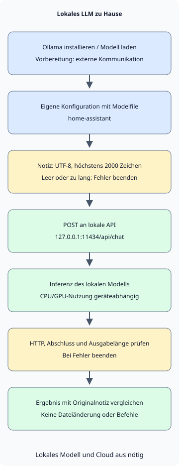

Für ein persönliches LLM zu Hause beginnen Sie damit, **Ollama zu installieren, ein Modell für den eigenen PC herunterzuladen und es mit einer kleinen Aufgabe zu verbinden**. Dieser Artikel konzentriert sich auf koreanische Unterhaltung und das Zusammenfassen kurzer Notizen; Beispielanweisungen und Notiz sind auf Koreanisch. Die Ausführung und Anweisungen eines vorhandenen Modells werden an die eigenen Bedürfnisse angepasst; ein Modell wird nicht von Grund auf trainiert.

Probieren Sie zuerst in Ollama eine Unterhaltung mit einem lokalen Modell. Rufen Sie danach dasselbe Modell aus Python auf, um eine Notiz zusammenzufassen. Die Erklärungen zu Installation und API beruhen auf offizieller Dokumentation, die am 5. November 2026 geprüft wurde. [Ollama-Schnellstart](https://docs.ollama.com/quickstart)

## Reicht Arbeitsspeicher in Größe der Modelldatei aus?

Das Beispielmodell ist `qwen3:4b-instruct-2507-q4_K_M`. Ollama führt es als Q4_K_M-Modell mit etwa 2,5 GB. Q4_K_M ist ein Quantisierungsformat, das Gewichte mit weniger Bits darstellt. Die Dateigröße ist nicht der gesamte zur Ausführung benötigte Speicher. [Modelldateien und Lizenz](https://ollama.com/library/qwen3:4b-instruct-2507-q4_K_M)

Zur Laufzeit benötigt das Modell zusätzlich zu seinen Gewichten einen KV-Cache für den Gesprächskontext und weitere Laufzeitressourcen. Betriebssystem und andere Apps verwenden ebenfalls Speicher. Ein größerer Kontext erhöht den Bedarf; deshalb setzt das Beispiel `num_ctx` auf 4096. Das bedeutet nicht, dass ein Heim-PC den maximal unterstützten Modellkontext nutzen kann. [Ollama: Kontextlänge und Speicher](https://docs.ollama.com/context-length)

| Ressource | Zu berücksichtigen |
| --- | --- |
| GPU- oder vereinheitlichter Speicher | VRAM einer externen GPU vom Systemspeicher unterscheiden. Apple Silicon teilt vereinheitlichten Speicher mit anderen Apps. |
| Zur Laufzeit verfügbarer Speicher | Bei Mangel mit kleinerem Modell oder kürzerem Kontext beginnen. Die Dateigröße nicht als Mindest-RAM behandeln. |
| Freier Speicherplatz | Platz für Modelldateien und weitere Downloads vorsehen. Mehrere Modelle belegen mehr Speicherplatz. |
| GPU- und Treiberunterstützung | Vor der Modellwahl prüfen, ob Betriebssystem und Gerät unterstützt werden. |

Ollamas macOS-Dokumentation nennt macOS 14 oder neuer und unterstützt CPU-/GPU-Ausführung auf Apple-M-Geräten sowie CPU-Ausführung auf Intel-Macs. Windows benötigt Windows 10 22H2 oder neuer; Treiberanforderungen hängen von der GPU ab. Prüfen Sie vor dem Hardwarekauf Antwortgeschwindigkeit und Speicherverbrauch einer kleinen Aufgabe auf Ihrem vorhandenen PC. [macOS-Anforderungen](https://docs.ollama.com/macos), [Windows-Anforderungen](https://docs.ollama.com/windows), [GPU-Unterstützung](https://docs.ollama.com/gpu)

## Installieren und ausschließlich lokale Ausführung konfigurieren

Laden Sie unter macOS oder Windows das Installationsprogramm von der [offiziellen Downloadseite](https://ollama.com/download) und starten Sie die App. Unter Linux verwenden Sie den Befehl der offiziellen Dokumentation. Der folgende Linux-Befehl installiert Software und einen Dienst; führen Sie ihn daher auf dem PC aus, auf dem Ollama installiert werden soll. [Linux-Installation](https://docs.ollama.com/linux)

```sh
curl -fsSL https://ollama.com/install.sh | sh
```

Prüfen Sie nach der Installation die Version in einem neuen Terminal. Wenn App oder Dienst den Server bereits ausführen, muss `ollama serve` nicht erneut gestartet werden.

```sh
ollama --version
```

Prüfen Sie für eine lokale Verarbeitung personenbezogener Daten sowohl Modellwahl als auch Servereinstellungen. Ollama kann über seine lokale API auch Cloud-Modelle aufrufen. **Eine Localhost-Adresse allein belegt nicht, wo die Inferenz stattfindet.** [Lokale API und Cloud-Modelle](https://docs.ollama.com/api/authentication)

Für die Benutzer-App unter macOS oder Windows hinterlegen Sie folgende Einstellung in `~/.ollama/server.json` des Kontos, das den Server ausführt. Unter Windows bezeichnet `~` das Benutzerverzeichnis. Falls die Datei bereits existiert, ergänzen Sie den Eintrag unter Beibehaltung anderer Einstellungen und starten Sie die App neu. Dies deaktiviert Cloud-Modelle und Websuche; prüfen Sie im Serverlog `Ollama cloud disabled: true`, um die Anwendung zu bestätigen. Installation und Modell-Download benötigen Internetzugang. [Nur-lokal-Einstellungen](https://docs.ollama.com/faq#how-do-i-disable-ollamas-cloud-features)

```json
{
  "disable_ollama_cloud": true
}
```

Unter Linux kann der systemd-Dienst unter einem anderen Konto als dem angemeldeten Benutzer laufen. Setzen Sie in diesem Fall Dienst-Umgebungsvariablen mit `sudo systemctl edit ollama.service`. Speichern Sie die folgende Konfiguration und starten Sie den Dienst neu. [Linux-Dienstkonfiguration](https://docs.ollama.com/linux#customizing)

```ini
[Service]
Environment="OLLAMA_NO_CLOUD=1"
Environment="OLLAMA_HOST=127.0.0.1:11434"
```

```sh
sudo systemctl daemon-reload
sudo systemctl restart ollama.service
```

Wenn Sie den Server direkt statt als Dienst ausführen, lassen Sie die POSIX-Shell mit `OLLAMA_NO_CLOUD=1 OLLAMA_HOST=127.0.0.1:11434 ollama serve` geöffnet. Starten Sie keinen weiteren Server, falls bereits einer läuft. Bestätigen Sie in beiden Fällen vor Eingabe personenbezogener Daten, dass Cloud-Funktionen deaktiviert sind.

Laden Sie das Beispielmodell herunter und beginnen Sie mit folgendem Befehl eine Unterhaltung. Es handelt sich um eine Non-Thinking-Variante; eine separate Thinking-Option wird nicht verwendet. Kurze Tags können andere Varianten bezeichnen, verwenden Sie daher das vollständige Tag. [Qwen-Modellkarte](https://huggingface.co/Qwen/Qwen3-4B-Instruct-2507)

```sh
ollama pull qwen3:4b-instruct-2507-q4_K_M
ollama run qwen3:4b-instruct-2507-q4_K_M
```

Eine erste Frage könnte lauten: „한국어로 답해 줘. 내가 적은 메모를 요약할 때 확인할 기준 세 가지를 알려 줘“ („Antworte auf Koreanisch. Nenne mir drei Kriterien, die ich beim Zusammenfassen einer selbst verfassten Notiz prüfen sollte.“) Prüfen Sie, ob die Antwort koreanisch ist und im angeforderten Rahmen bleibt, und beenden Sie die Unterhaltung mit `/bye`. Prüfen Sie in einem anderen Terminal die Modell-ID mit `ollama list` und CPU-/GPU-Zuordnung sowie Speicherstatus mit `ollama ps`. Halten Sie installierte Ollama-Version und Modell-ID zusammen mit dem Modell-Tag fest, um spätere Unterschiede leichter zu vergleichen. [Modellausführung prüfen](https://docs.ollama.com/faq#how-can-i-tell-if-my-model-was-loaded-onto-the-gpu)

## Standardanweisungen für den eigenen Gebrauch festlegen

Speichern Sie die folgende Datei in einem leeren Arbeitsverzeichnis. `FROM` wählt das Basismodell, `SYSTEM` legt seine Standardanweisungen fest. `num_predict` begrenzt die erzeugten Token, während `temperature` den Zufall beeinflusst. Die folgenden Werte sind Beispiele für kurze Notizzusammenfassungen. Eine niedrige Temperatur garantiert keine sachliche Richtigkeit. [Modelfile-Syntax](https://docs.ollama.com/modelfile)

### `Modelfile`

```text
FROM qwen3:4b-instruct-2507-q4_K_M
PARAMETER num_ctx 4096
PARAMETER num_predict 512
PARAMETER temperature 0.2
SYSTEM """
한국어로 간결하게 답하세요.
제공된 자료에서 확인할 수 없는 내용은 추측하지 말고 모른다고 말하세요.
원문에 있는 사실과 제안을 구분하세요.
"""
```
Erstellen Sie mit folgendem Befehl eine eigene Modellkonfiguration namens `home-assistant`:

```sh
ollama create home-assistant -f Modelfile
ollama run home-assistant
```

Allein durch geänderte Anweisungen lernt das Modell kein neues Wissen und kann keine Dateien von Ihrer Festplatte lesen. Übergeben Sie das relevante Material in der Anfrage, wie im nächsten Beispiel. Für viele Dokumente kann Retrieval-Augmented Generation (RAG) gesondert entworfen werden, um relevante Passagen zu suchen und bereitzustellen. Prüfen Sie zunächst die Zusammenfassungsqualität anhand einer kurzen Datei.

## Eine ausgewählte Notiz mit Python zusammenfassen

Das Beispiel verwendet nur die Standardbibliothek von Python 3. Es liest eine gespeicherte Datei, sendet sie an `127.0.0.1:11434/api/chat` und gibt das Ergebnis aus. Es verwendet keine HTTP-Proxy-Einstellungen der Umgebung und gibt dem Modell keine Werkzeuge zum Durchsuchen von Dateien oder Ausführen von Befehlen.



In der Grafik sind Installation und Modell-Download vorbereitende Schritte mit externer Kommunikation. Die spätere Inferenz setzt ein gewähltes lokales Modell und deaktivierte Cloud-Funktionen voraus. Scheitert die Eingabe- oder Antwortprüfung, beendet sich das Programm mit Fehler ohne Zusammenfassung.

### `notes.txt`

```text
2026-11-05 집 서버 정리
결정: 사진 백업용 디스크 상태를 주말에 점검한다.
후속 작업: 작업 전 복구 테스트 방법을 찾아본다.
담당자와 정확한 시각은 정하지 않았다.
```
### `summarize.py`

```python
import json
from pathlib import Path
import sys
from urllib.request import ProxyHandler, Request, build_opener

ENDPOINT = "http://127.0.0.1:11434/api/chat"
MODEL = "home-assistant"
MAX_CHARS = 2000


def summarize(path):
    text = path.read_text(encoding="utf-8")
    if not text.strip() or len(text) > MAX_CHARS:
        raise ValueError(f"메모는 비어 있지 않은 {MAX_CHARS}자 이하의 UTF-8 텍스트여야 합니다.")
    prompt = (
        "다음 메모의 결정 사항과 후속 작업을 나누어 한국어로 요약하세요. "
        "원문에 없는 담당자나 기한을 추가하지 마세요.\n\n<자료>\n"
        + text + "\n</자료>"
    )
    payload = {
        "model": MODEL,
        "messages": [{"role": "user", "content": prompt}],
        "stream": False,
        "options": {"num_ctx": 4096, "num_predict": 512},
        "keep_alive": 0,
    }
    request = Request(
        ENDPOINT,
        data=json.dumps(payload, ensure_ascii=False).encode("utf-8"),
        headers={"Content-Type": "application/json"},
        method="POST",
    )
    opener = build_opener(ProxyHandler({}))
    with opener.open(request, timeout=120) as response:
        result = json.load(response)
    message = result.get("message") if isinstance(result, dict) else None
    answer = message.get("content") if isinstance(message, dict) else None
    if not isinstance(answer, str) or not answer.strip() or result.get("done") is not True:
        raise RuntimeError("완료된 텍스트 응답을 받지 못했습니다.")
    if result.get("done_reason") == "length":
        raise RuntimeError("출력 길이 제한에 도달했습니다. 메모나 요청 범위를 줄이세요.")
    return answer


if __name__ == "__main__":
    if len(sys.argv) != 2:
        raise SystemExit("사용법: python3 summarize.py notes.txt")
    try:
        print(summarize(Path(sys.argv[1])))
    except (OSError, ValueError, RuntimeError) as error:
        print(f"요약 실패: {error}", file=sys.stderr)
        raise SystemExit(1)
```
Speichern Sie beide Dateien im selben Ordner und führen Sie sie aus. Verwenden Sie unter Windows je nach Python-Installation `py -3` statt `python3`.

```sh
python3 summarize.py notes.txt
```

`stream: false` fordert eine einzelne JSON-Antwort an. Das Beispiel weist leere Eingaben und mehr als 2000 Zeichen zurück und behandelt HTTP-Fehler, ungültige Antworten und Ausgabelängenlimits als Fehler. Ein Zeichenlimit entspricht keiner exakten Tokenzahl; prüfen Sie daher zusätzlich, ob Eingabe und Antwort in das Kontextfenster passen. `keep_alive: 0` fordert das Entladen des Modells nach der Verarbeitung an, sodass wiederholte Läufe es eventuell neu laden müssen. [Chat-API und Antwortfelder](https://docs.ollama.com/api/chat)

Normale Verarbeitung und Fehlerbehandlung des Clients wurden mit einem lokalen Mock-HTTP-Server unter Python 3.13.0 geprüft. Ollama-Installation, Modelfile-Build, Modell-Download, Inferenzgeschwindigkeit und Zusammenfassungsqualität wurden in der Umgebung dieses Artikels nicht ausgeführt oder verifiziert. Vergleichen Sie nach der Installation das Ergebnis mit der obigen Notiz. Das Netzwerk-Timeout von 120 Sekunden bestätigt nicht, dass der Server die Modellaufgabe beendet hat.

Prüfen Sie drei Punkte: ob die Prüfung des Festplattenstatus eine Entscheidung bleibt, ob die Suche nach einer Wiederherstellungstestmethode als Folgeaufgabe getrennt ist und ob das Modell keine verantwortliche Person oder genaue Uhrzeit erfindet. Flüssige Sätze und Treue zum Original werden getrennt bewertet.

## Alltagsaufgaben und Abbruchkriterien wählen

| Aufgabe | Kleine Starteingabe | Vor Verwendung prüfen |
| --- | --- | --- |
| Persönliche Notizen ordnen | Eine kurze Besprechungs- oder Lernnotiz | Sind Entscheidungen, Vorschläge und offene Punkte getrennt? |
| Einen Entwurf verbessern | Ein selbst geschriebener Absatz und gewünschter Stil | Bleiben Bedeutung, Zahlen und Quellen erhalten? |
| Code verstehen | Ein öffentliches Beispiel oder eine kleine teilbare Funktion | Passt die Erklärung zu Code und Ausführungsergebnissen? |

Dieser Client gibt nur Antworten aus; er ändert keine Dateien und führt keine Shell-Befehle aus. Falls Sie ihn zu einem Agenten erweitern, der erzeugte Befehle automatisch ausführt, entwerfen Sie Ausführungsrechte und Freigaben getrennt, wie unter [Berechtigungsgrenzen von KI-Agenten](/ko/posts/2026-11-01-ai-agent-permission-boundaries/) beschrieben. Auch ein lokales Modell kann durch bösartige Anweisungen in Dokumenten beeinflusst werden und falsche Antworten liefern.

Die API bindet standardmäßig an eine lokale Adresse und benötigt lokal keine Authentifizierung. Beginnen Sie auf einem PC und geben Sie Port 11434 nicht über Router-Portweiterleitung frei. Für Zugriff durch Familienmitglieder oder andere Geräte ist eine separate Konfiguration mit definierten Authentifizierungs- und Zugriffsgrenzen nötig. Prüfen Sie auch, ob verbundene Apps, Plugins, Logs oder Backups Daten extern speichern oder übertragen; lokale Inferenz allein beantwortet diese Frage nicht. [Standardbindung](https://docs.ollama.com/faq#how-can-i-expose-ollama-on-my-network), [Authentifizierungsumfang](https://docs.ollama.com/api/authentication)

Bei langsamen Antworten prüfen Sie zuerst CPU-/GPU-Zuordnung mit `ollama ps` und den von anderen Apps genutzten Speicher. Reduzieren Sie lange Eingaben und große Kontexte und vergleichen Sie dieselbe Aufgabe erneut. Bei verweigerter Verbindung prüfen Sie, ob App oder Dienst laufen. Wird ein Modell nicht gefunden, prüfen Sie `ollama list` und ob `home-assistant` erstellt wurde. Statt abgelaufene Anfragen anzuhäufen, prüfen Sie zuerst bereits laufende Arbeit.

Halten Sie einige Notizen konstant und vergleichen Sie Auslassungen, Vermutungen und Wartezeiten, wenn Modell oder Einstellungen geändert werden.
