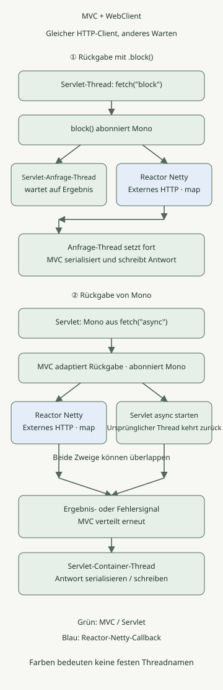

**WebClient kann in Spring MVC nichtblockierendes HTTP verwenden; ein `.block()` im Controller lässt jedoch den MVC-Anfrage-Thread auf das Ergebnis warten.** Gibt der Controller das `Mono` zurück, kann MVC es an asynchrone Servlet-Verarbeitung anpassen und den ursprünglichen Anfrage-Thread freigeben. Client-Kommunikation und serverseitige Anfrageverarbeitung sind getrennte Fragen.

Dieser Artikel behandelt **Spring MVC auf Tomcat und WebClient mit Reactor Netty**. Andere HTTP-Connectoren können andere Thread-Namen und Ressourcen nutzen. Das Beispiel wurde mit Spring Boot 3.5.16, JDK 21 und Gradle 8.14.3 reproduziert; es verifiziert nicht jede aktuelle Boot-Version.

## Führt WebClient dazu, dass der Server WebFlux verwendet?

Serverseitiges MVC und WebClient für ausgehende Aufrufe haben verschiedene Aufgaben. Hier verarbeiten Tomcat und `DispatcherServlet` eingehende Anfragen, während WebClients Reactor-Netty-Connector ausgehendes HTTP übernimmt.

Mit Boot 3.5 wählt die gleichzeitige Verwendung von `spring-boot-starter-web` und `spring-boot-starter-webflux` standardmäßig MVC. So können Anwendungen den WebFlux-Starter für WebClient ergänzen. Prüfen Sie getrennt, ob der Anwendungstyp ausdrücklich geändert oder eine andere Serverkonfiguration genutzt wird. [MVC- und WebFlux-Auswahl in Boot](https://docs.spring.io/spring-boot/3.5/reference/web/reactive.html#web.reactive.webflux)

## Worin unterscheiden sich `.block()` und die Rückgabe von `Mono`?



Grün zeigt Servlet- und MVC-Aufgaben, Blau Reactor Netty. Die beiden Zweige des asynchronen Pfads können überlappen; die externe Antwort muss nicht erst nach Rückgabe des ursprünglichen Anfrage-Threads eintreffen. Das Diagramm konzentriert sich auf Erfolgssignale; Fehlersignale im Code werden vor der MVC-Fehlerbehandlung HTTP-Statuscodes zugeordnet.

| Phase | Wert nach `.block()` zurückgeben | `Mono` zurückgeben |
| --- | --- | --- |
| Abonnement | Durch `.block()` | MVC abonniert den Rückgabetyp |
| Warten auf ausgehendes HTTP | Anfrage-Thread wartet | Asynchrone Servlet-Verarbeitung kann den ursprünglichen Anfrage-Thread freigeben |
| Nach Empfang des Antwortkörpers | Client-Callback liefert das Ergebnis und beendet das Warten | Ergebnissignal wird an die asynchrone MVC-Verarbeitung übergeben |
| Endgültige HTTP-Antwort | MVC serialisiert und schreibt den Rückgabewert | MVC verteilt erneut, serialisiert und schreibt dann |

`retrieve().bodyToMono(...)` setzt die Anfrage-Pipeline zusammen. Die unten neu erstellte WebClient-Pipeline muss abonniert werden, bevor sie eine HTTP-Anfrage startet. Zweifaches Abonnieren kann eine weitere Anfrage auslösen; Vorsicht daher bei Code, der einmal mit `.block()` liest und anschließend die Pipeline erneut zurückgibt.

MVC passt ein `Mono` mit einem Wert ähnlich wie `DeferredResult` an. Ist das Ergebnis bereit, verteilt MVC erneut an den Servlet-Container, um die Antwort abzuschließen. Der Pool kann denselben Thread wiederverwenden; nehmen Sie daher nicht an, dass der Thread der erneuten Verteilung zwingend ein anderer ist. Verbindung und Ressourcen der asynchronen Anfrage bleiben bei offener Antwort ebenfalls bestehen. Die Rückgabe von `Mono` macht nicht das gesamte Schreiben der Servlet-Antwort nichtblockierend. Dieses Beispiel liefert JSON mit einem Wert; Streaming und SSE sind andere Fälle. [Asynchrone MVC-Verarbeitung und reaktive Rückgabetypen](https://docs.spring.io/spring-framework/reference/6.2/web/webmvc/mvc-ann-async.html)

## Dieselbe externe API auf zwei Arten aufrufen

Speichern Sie die folgenden Dateien in einem Projekt. Es verwendet das Plugin `application` statt des Boot-Gradle-Plugins und fixiert die Java-Toolchain auf 21. Lokale Prüfungen nutzten Azul JDK 21.0.1; diese historische Patchversion ist keine Empfehlung für neue Produktionsumgebungen.

### `settings.gradle`

```groovy
rootProject.name = 'mvc-webclient-execution'
```

### `build.gradle`

```groovy
plugins {
    id 'java'
    id 'application'
}
repositories { mavenCentral() }
java { toolchain { languageVersion = JavaLanguageVersion.of(21) } }
dependencies {
    implementation platform('org.springframework.boot:spring-boot-dependencies:3.5.16')
    implementation 'org.springframework.boot:spring-boot-starter-web'
    implementation 'org.springframework.boot:spring-boot-starter-webflux'
    testImplementation 'org.springframework.boot:spring-boot-starter-test'
    testRuntimeOnly 'org.junit.platform:junit-platform-launcher'
}
application { mainClass = 'example.DemoApplication' }
test {
    useJUnitPlatform()
    systemProperty 'demo.virtual', providers.gradleProperty('virtual').getOrElse('false')
}
```

### `src/main/resources/application.yml`

```yaml
upstream:
  base-url: http://127.0.0.1:9091
  timeout: 3s
spring:
  mvc:
    async:
      request-timeout: 5s
```

`WebClient` wird als Bean wiederverwendet und nutzt ausdrücklich den Reactor-Netty-Connector. Das `HttpClient.create()` dieses Beispiels verwendet standardmäßig den gemeinsamen Event-Loop und Verbindungspool; es erzeugt nicht pro ausgehender Anfrage einen eigenen Netty-Thread. `callbackThread` führt `map` nach Bereitstellung des Antwortkörpers aus und ist nicht zwingend der Thread, der die endgültige Servlet-Antwort schreibt. Ein Scheduler-Wechsel wie `publishOn` wird hier nicht ergänzt. [WebClient-Connectoren und gemeinsame Ressourcen](https://docs.spring.io/spring-framework/reference/6.2/web/webflux-webclient/client-builder.html)

### `src/main/java/example/DemoApplication.java`

```java
package example;

import java.time.Duration;
import java.util.concurrent.TimeoutException;

import org.springframework.beans.factory.annotation.Value;
import org.springframework.boot.SpringApplication;
import org.springframework.boot.autoconfigure.SpringBootApplication;
import org.springframework.context.annotation.Bean;
import org.springframework.http.HttpStatus;
import org.springframework.http.client.reactive.ReactorClientHttpConnector;
import org.springframework.web.bind.annotation.GetMapping;
import org.springframework.web.bind.annotation.RestController;
import org.springframework.web.reactive.function.client.WebClient;
import org.springframework.web.reactive.function.client.WebClientResponseException;
import org.springframework.web.server.ResponseStatusException;

import reactor.core.publisher.Mono;
import reactor.core.scheduler.Schedulers;
import reactor.netty.http.client.HttpClient;

@SpringBootApplication
public class DemoApplication {
    public static void main(String[] args) {
        SpringApplication.run(DemoApplication.class, args);
    }

    @Bean
    WebClient upstreamClient(WebClient.Builder builder,
                             @Value("${upstream.base-url}") String baseUrl) {
        return builder.baseUrl(baseUrl)
                .clientConnector(new ReactorClientHttpConnector(HttpClient.create()))
                .build();
    }

    public record Observation(String mode, String requestThread, boolean requestVirtual,
                              String callbackThread, boolean callbackVirtual, boolean callbackNonBlocking,
                              String value) {}

    @RestController
    static class DemoController {
        private final WebClient client;
        private final Duration deadline;

        DemoController(WebClient client, @Value("${upstream.timeout}") Duration deadline) {
            this.client = client;
            this.deadline = deadline;
        }

        private Mono<Observation> fetch(String mode) {
            Thread request = Thread.currentThread();
            String name = request.getName();
            boolean virtual = request.isVirtual();
            return client.get().uri("/value").retrieve().bodyToMono(String.class)
                    .timeout(deadline)
                    .map(value -> new Observation(mode, name, virtual,
                            Thread.currentThread().getName(), Thread.currentThread().isVirtual(),
                            Schedulers.isInNonBlockingThread(), value))
                    .onErrorMap(WebClientResponseException.class, error ->
                            new ResponseStatusException(HttpStatus.BAD_GATEWAY,
                                    "upstream HTTP error", error))
                    .onErrorMap(TimeoutException.class, error ->
                            new ResponseStatusException(HttpStatus.GATEWAY_TIMEOUT,
                                    "upstream deadline", error));
        }

        @GetMapping("/block")
        Observation blocking() {
            return fetch("block").block();
        }

        @GetMapping("/async")
        Mono<Observation> asynchronous() {
            return fetch("async");
        }
    }
}
```

`/block` ist ein Vergleichspfad. Ein Controller, der mit einer asynchronen Rückgabe abschließen kann, kann wie `/async` das resultierende `Mono` zurückgeben, damit MVC es abonniert. Ein direkter Aufruf von `.subscribe()` mit vorheriger Antwort trennt ausgehendes Ergebnis und Fehler von der ursprünglichen HTTP-Anfrage. [Synchrone WebClient-Nutzung und Controller-Rückgaben](https://docs.spring.io/spring-framework/reference/web/webflux-webclient/client-synchronous.html)

Das `timeout` des Beispiels von drei Sekunden begrenzt den Zeitraum vom Abonnement bis zur Lieferung eines Werts. Zeitüberschreitungen für Pool-Erwerb, Verbindung oder einzelne Lesevorgänge der Antwort werden nicht gesondert konfiguriert. HTTP-Fehler werden auf 502 und Pipeline-Timeouts auf 504 abgebildet. Definieren Sie für Verbindungsfehler, leere Antwortkörper und fachliche Fehler eigene Verträge. `retrieve()` behandelt HTTP 4xx und 5xx standardmäßig als Fehler. [Fehlerbehandlung bei retrieve](https://docs.spring.io/spring-framework/reference/6.2/web/webflux-webclient/client-retrieve.html)

### Lokal ausführen

Starten Sie statt eines externen Dienstes einen lokalen HTTP-Server mit Python 3. `/value` liefert `hello` nach 0,2 Sekunden. Diese Verzögerung dient als Eingabe zur Verhaltensbeobachtung, nicht als Leistungsmessung.

### `upstream.py`

```python
from http.server import BaseHTTPRequestHandler, ThreadingHTTPServer
from time import sleep


class Handler(BaseHTTPRequestHandler):
    def do_GET(self):
        if self.path != '/value':
            self.send_error(404)
            return
        sleep(0.2)
        body = b'hello'
        self.send_response(200)
        self.send_header('Content-Type', 'text/plain; charset=utf-8')
        self.send_header('Content-Length', str(len(body)))
        self.end_headers()
        self.wfile.write(body)


ThreadingHTTPServer(('127.0.0.1', 9091), Handler).serve_forever()
```

Führen Sie ihn im ersten Terminal aus.

```sh
python3 upstream.py
```

Wählen Sie im zweiten Terminal JDK 21 und starten Sie mit Gradle 8.14.3.

```sh
gradle run
```

Rufen Sie im dritten Terminal beide Pfade auf:

```sh
curl --fail --show-error --silent http://127.0.0.1:8080/block
curl --fail --show-error --silent http://127.0.0.1:8080/async
```

Beide liefern JSON mit `hello`. Bei gewöhnlichen Anfrage-Threads wurde `requestVirtual=false` beobachtet; der Netty-Callback dieses Beispiels hatte `callbackVirtual=false` und `callbackNonBlocking=true`. Exakte Thread-Namen und Nummern unterscheiden sich zwischen Läufen. Das Feld `mode` im Antwort-JSON allein belegt nicht, dass der Anfrage-Thread während des Wartens freigegeben wurde.

## Was ändert sich durch virtuelle Threads?

Beenden Sie die vorherige Anwendung und führen Sie denselben Code mit aktivierten virtuellen Threads erneut aus.

```sh
gradle run --args='--spring.threads.virtual.enabled=true'
```

Mit dieser Einstellung wurde `requestVirtual` auf beiden Pfaden `true`. Im `.block()`-Pfad wartet der aufrufende virtuelle Thread weiterhin auf das Ergebnis; eine gewöhnlich parkbare Wartezeit unterscheidet sich aber vom dauerhaften Belegen eines Carrier-Plattform-Threads. Prüfen Sie Pinning und Unterschiede der tatsächlich verwendeten JDK-Version separat. [Scheduling und Pinning virtueller Threads in JDK 21](https://docs.oracle.com/en/java/javase/21/core/virtual-threads.html) **Das Aktivieren virtueller Threads machte den Reactor-Netty-Callback dieses Beispiels nicht zu einem virtuellen Thread.** [Boot-Konfiguration virtueller Threads](https://docs.spring.io/spring-boot/3.5/reference/features/spring-application.html#features.spring-application.virtual-threads)

Virtuelle Threads erhöhen weder die Verarbeitungskapazität eines externen Dienstes noch die Zahl von HTTP- oder DB-Verbindungen. Entwerfen Sie eine separate Begrenzung angesammelter Anfragen, wie unter [DB-Semaphoren und Zulassungssteuerung](/ko/posts/2026-11-03-virtual-threads-db-semaphore/).

## Darf JDBC in einem Callback aufgerufen werden?

Ein WebClient-Aufruf aus MVC bedeutet nicht, dass das folgende `map` ebenfalls auf dem MVC-Anfrage-Thread läuft. Eine JDBC-Abfrage oder ein langes Lesen einer Datei innerhalb des `map` dieses Beispiels kann den Netty-Event-Loop blockieren. Umgekehrt läuft nicht jedes `Mono` auf einem eigenen Thread. Die Ausführung von Operatoren hängt von Abonnement, Signalen und Scheduler-Wechseln ab. [Reactor-Threads und Scheduler](https://projectreactor.io/docs/core/release/reference/coreFeatures/schedulers.html)

Vergleichen Sie bei vielen synchronen Vorgängen die Begrenzung von Ressourcen im synchronen MVC-Aufruf mit der Isolierung blockierender Arbeit auf einem separaten Executor bei beibehaltener asynchroner Kette. Für einfache synchrone HTTP-Aufrufe siehe auch [RestClient oder WebClient wählen](/ko/posts/2026-10-31-webclient-restclient-comparison/). Ein Scheduler-Wechsel allein behebt keine Überlastung von Datenbank oder nachgelagerten Diensten.

## Was wurde tatsächlich geprüft?

Die [Verifikationstests](https://github.com/youdozi/youdozi.github.io/blob/main/.pipeline/drafts/2026-11-09-spring-mvc-webclient-execution/src/test/java/example/ExecutionTest.java) liefen mit **echtem Tomcat und einem lokalen HTTP-Server** auf zufälligen Ports. Sechzehn Prüfungen bestanden: je acht mit gewöhnlichen und virtuellen Anfrage-Threads.

- Auswahl von Servlet-Kontext, Tomcat und DispatcherServlet bei beiden Startern
- Keine Anfrage beim Zusammenstellen der Pipeline; Anfragen beim Abonnieren und erneuten Abonnieren
- Warten des Anfrage-Threads bei `.block()` und Eintritt in asynchrone Servlet-Verarbeitung für `Mono`, während die externe Antwort zurückgehalten wird
- Ob Anfrage-Threads virtuell sind und Antwort-Callbacks nichtblockierend oder virtuell
- Abbildung von HTTP-Fehlern auf 502 und Pipeline-Timeouts auf 504 für beide Pfade

Um die Tests selbst auszuführen, speichern Sie den obigen Prüfcode als `src/test/java/example/ExecutionTest.java` und starten Sie ihn.

```sh
gradle clean test
gradle test -Pvirtual=true --rerun-tasks
```

Die Tests beobachten den Zustand mit einem Latch, das die Antwort zurückhält; sie schließen nicht aus kurzer Laufzeit auf Asynchronität. Sie prüfen keine Durchsatzvergleiche, echten externen Dienste, DB oder TLS, Client-Abbrüche oder den Abbruch entfernter Seiteneffekte. Insbesondere garantiert Pipeline-Abbruch nicht den Abbruch der Arbeit eines entfernten Servers oder einen Transaktions-Rollback.
