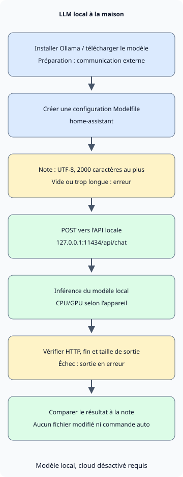

Pour utiliser un LLM personnel à la maison, commencez par **installer Ollama, télécharger un modèle pour votre PC et le relier à une petite tâche**. Cet article se concentre sur la conversation en coréen et le résumé de courtes notes ; les instructions et la note d’exemple sont en coréen. Il adapte l’exécution et les instructions d’un modèle existant à vos besoins ; il n’entraîne pas un modèle depuis zéro.

Essayez d’abord une conversation avec un modèle local dans Ollama. Appelez ensuite le même modèle depuis Python pour résumer une note. Les explications d’installation et d’API reposent sur la documentation officielle consultée le 5 novembre 2026. [Démarrage rapide Ollama](https://docs.ollama.com/quickstart)

## Une mémoire égale à la taille du fichier modèle suffit-elle ?

Le modèle d’exemple est `qwen3:4b-instruct-2507-q4_K_M`. Ollama le présente comme un modèle Q4_K_M d’environ 2,5 Go. Q4_K_M est un format de quantification représentant les poids avec moins de bits. La taille du fichier n’est pas la mémoire totale nécessaire à l’exécution. [Fichiers du modèle et licence](https://ollama.com/library/qwen3:4b-instruct-2507-q4_K_M)

À l’exécution, le modèle nécessite en plus des poids un cache KV pour le contexte de conversation et d’autres ressources. Le système et les autres apps utilisent aussi de la mémoire. Un contexte plus grand augmente le besoin ; cet exemple fixe donc `num_ctx` à 4096. Cela ne signifie pas qu’un PC domestique puisse utiliser le contexte maximal du modèle. [Longueur de contexte et mémoire Ollama](https://docs.ollama.com/context-length)

| Ressource | À examiner |
| --- | --- |
| Mémoire GPU ou unifiée | Distinguer VRAM d’un GPU externe et RAM système. Apple Silicon partage sa mémoire unifiée avec d’autres apps. |
| Mémoire disponible à l’exécution | En cas de manque, commencer avec un modèle plus petit ou un contexte plus court. Ne pas prendre la taille du fichier comme RAM minimale. |
| Espace disque libre | Prévoir les fichiers du modèle et les téléchargements supplémentaires. Plusieurs modèles occupent plus d’espace. |
| Prise en charge GPU et pilotes | Avant le choix, vérifier la prise en charge du système et de l’appareil actuels. |

La documentation macOS d’Ollama indique macOS 14 ou ultérieur et prend en charge CPU/GPU sur Apple série M et CPU sur Mac Intel. Windows exige Windows 10 22H2 ou ultérieur ; les pilotes requis dépendent du GPU. Avant d’acheter du matériel, vérifiez vitesse de réponse et mémoire d’une petite tâche sur votre PC actuel. [Prérequis macOS](https://docs.ollama.com/macos), [prérequis Windows](https://docs.ollama.com/windows), [prise en charge GPU](https://docs.ollama.com/gpu)

## Installer et configurer une exécution locale uniquement

Sur macOS ou Windows, téléchargez l’installateur depuis la [page officielle](https://ollama.com/download) et lancez l’app. Sous Linux, utilisez la commande de la documentation officielle. La commande Linux ci-dessous installe un logiciel et un service : exécutez-la donc sur le PC destiné à héberger Ollama. [Installation Linux](https://docs.ollama.com/linux)

```sh
curl -fsSL https://ollama.com/install.sh | sh
```

Après installation, vérifiez la version dans un nouveau terminal. Si l’app ou le service exécute déjà le serveur, il n’est pas nécessaire de relancer `ollama serve`.

```sh
ollama --version
```

Pour traiter localement des données personnelles, vérifiez le choix du modèle et les réglages du serveur. Ollama peut aussi appeler des modèles cloud via son API locale. **Une adresse localhost ne prouve pas à elle seule où l’inférence a lieu.** [API locale et modèles cloud](https://docs.ollama.com/api/authentication)

Pour l’app utilisateur macOS ou Windows, placez le réglage suivant dans `~/.ollama/server.json` du compte exécutant le serveur. Sous Windows, `~` désigne le dossier personnel. Si le fichier existe, ajoutez l’entrée sans supprimer les autres réglages puis redémarrez l’app. Cela désactive les modèles cloud et la recherche web ; vérifiez `Ollama cloud disabled: true` dans le journal du serveur. Installer et télécharger le modèle nécessite Internet. [Réglages locaux uniquement](https://docs.ollama.com/faq#how-do-i-disable-ollamas-cloud-features)

```json
{
  "disable_ollama_cloud": true
}
```

Sous Linux, le service systemd peut utiliser un compte différent de l’utilisateur connecté. Dans ce cas, définissez ses variables d’environnement avec `sudo systemctl edit ollama.service`. Enregistrez la configuration suivante puis redémarrez le service. [Configuration du service Linux](https://docs.ollama.com/linux#customizing)

```ini
[Service]
Environment="OLLAMA_NO_CLOUD=1"
Environment="OLLAMA_HOST=127.0.0.1:11434"
```

```sh
sudo systemctl daemon-reload
sudo systemctl restart ollama.service
```

Si vous exécutez le serveur directement plutôt que comme service, gardez ouvert le shell POSIX exécutant `OLLAMA_NO_CLOUD=1 OLLAMA_HOST=127.0.0.1:11434 ollama serve`. Ne démarrez pas un second serveur s’il en existe déjà un. Dans les deux cas, confirmez que les fonctions cloud sont désactivées avant de saisir des données personnelles.

Téléchargez le modèle d’exemple et commencez une conversation avec la commande suivante. Il s’agit d’une variante sans raisonnement, sans option de raisonnement séparée. Un tag court peut désigner une autre variante ; utilisez le tag complet. [Fiche du modèle Qwen](https://huggingface.co/Qwen/Qwen3-4B-Instruct-2507)

```sh
ollama pull qwen3:4b-instruct-2507-q4_K_M
ollama run qwen3:4b-instruct-2507-q4_K_M
```

Une première question pourrait être : « 한국어로 답해 줘. 내가 적은 메모를 요약할 때 확인할 기준 세 가지를 알려 줘 » (« Réponds en coréen. Donne-moi trois critères à vérifier pour résumer une note que j’ai écrite. ») Vérifiez que la réponse est en coréen et dans le périmètre demandé, puis terminez avec `/bye`. Dans un autre terminal, vérifiez l’identifiant du modèle avec `ollama list` et son placement CPU/GPU et sa mémoire avec `ollama ps`. Notez la version d’Ollama et l’identifiant avec le tag pour comparer plus facilement les changements ultérieurs. [Vérifier l’exécution du modèle](https://docs.ollama.com/faq#how-can-i-tell-if-my-model-was-loaded-onto-the-gpu)

## Définir des instructions par défaut

Enregistrez le fichier suivant dans un dossier de travail vide. `FROM` choisit le modèle de base et `SYSTEM` fixe ses instructions par défaut. `num_predict` limite les jetons générés ; `temperature` influence l’aléa. Les valeurs sont des exemples pour de courts résumés. Une température basse ne garantit pas l’exactitude factuelle. [Syntaxe Modelfile](https://docs.ollama.com/modelfile)

### `Modelfile`

```text
FROM qwen3:4b-instruct-2507-q4_K_M
PARAMETER num_ctx 4096
PARAMETER num_predict 512
PARAMETER temperature 0.2
SYSTEM """
한국어로 간결하게 답하세요.
제공된 자료에서 확인할 수 없는 내용은 추측하지 말고 모른다고 말하세요.
원문에 있는 사실과 제안을 구분하세요.
"""
```
Créez une configuration personnalisée nommée `home-assistant` avec la commande suivante :

```sh
ollama create home-assistant -f Modelfile
ollama run home-assistant
```

Changer les instructions seules n’enseigne pas de nouvelles connaissances au modèle et ne lui permet pas de lire les fichiers du disque. Fournissez les éléments pertinents dans la requête, comme dans l’exemple suivant. Pour de nombreux documents, une génération augmentée par récupération (RAG) peut être conçue séparément pour rechercher et fournir les passages pertinents. Vérifiez d’abord la qualité du résumé sur un court fichier.

## Résumer une note choisie en Python

Cet exemple utilise uniquement la bibliothèque standard Python 3. Il lit un fichier enregistré, l’envoie à `127.0.0.1:11434/api/chat` et affiche le résultat. Il n’utilise pas les réglages de proxy HTTP de l’environnement et ne donne au modèle aucun outil pour parcourir les fichiers ou exécuter des commandes.



Dans le schéma, installation et téléchargement sont des étapes préparatoires avec communication externe. L’inférence ultérieure suppose un modèle local sélectionné et les fonctions cloud désactivées. Si la validation de l’entrée ou de la réponse échoue, le programme se termine en erreur sans produire de résumé.

### `notes.txt`

```text
2026-11-05 집 서버 정리
결정: 사진 백업용 디스크 상태를 주말에 점검한다.
후속 작업: 작업 전 복구 테스트 방법을 찾아본다.
담당자와 정확한 시각은 정하지 않았다.
```
### `summarize.py`

```python
import json
from pathlib import Path
import sys
from urllib.request import ProxyHandler, Request, build_opener

ENDPOINT = "http://127.0.0.1:11434/api/chat"
MODEL = "home-assistant"
MAX_CHARS = 2000


def summarize(path):
    text = path.read_text(encoding="utf-8")
    if not text.strip() or len(text) > MAX_CHARS:
        raise ValueError(f"메모는 비어 있지 않은 {MAX_CHARS}자 이하의 UTF-8 텍스트여야 합니다.")
    prompt = (
        "다음 메모의 결정 사항과 후속 작업을 나누어 한국어로 요약하세요. "
        "원문에 없는 담당자나 기한을 추가하지 마세요.\n\n<자료>\n"
        + text + "\n</자료>"
    )
    payload = {
        "model": MODEL,
        "messages": [{"role": "user", "content": prompt}],
        "stream": False,
        "options": {"num_ctx": 4096, "num_predict": 512},
        "keep_alive": 0,
    }
    request = Request(
        ENDPOINT,
        data=json.dumps(payload, ensure_ascii=False).encode("utf-8"),
        headers={"Content-Type": "application/json"},
        method="POST",
    )
    opener = build_opener(ProxyHandler({}))
    with opener.open(request, timeout=120) as response:
        result = json.load(response)
    message = result.get("message") if isinstance(result, dict) else None
    answer = message.get("content") if isinstance(message, dict) else None
    if not isinstance(answer, str) or not answer.strip() or result.get("done") is not True:
        raise RuntimeError("완료된 텍스트 응답을 받지 못했습니다.")
    if result.get("done_reason") == "length":
        raise RuntimeError("출력 길이 제한에 도달했습니다. 메모나 요청 범위를 줄이세요.")
    return answer


if __name__ == "__main__":
    if len(sys.argv) != 2:
        raise SystemExit("사용법: python3 summarize.py notes.txt")
    try:
        print(summarize(Path(sys.argv[1])))
    except (OSError, ValueError, RuntimeError) as error:
        print(f"요약 실패: {error}", file=sys.stderr)
        raise SystemExit(1)
```
Enregistrez les deux fichiers dans le même dossier et exécutez-les. Sous Windows, utilisez `py -3` plutôt que `python3`, selon votre installation Python.

```sh
python3 summarize.py notes.txt
```

`stream: false` demande une réponse JSON unique. L’exemple refuse les entrées vides et de plus de 2000 caractères, et traite erreurs HTTP, réponses invalides et limites de longueur comme des erreurs. Une limite de caractères n’est pas un nombre exact de jetons ; vérifiez donc aussi que l’entrée et la réponse tiennent dans le contexte. `keep_alive: 0` demande le déchargement du modèle après traitement ; des exécutions répétées peuvent devoir le recharger. [API Chat et champs de réponse](https://docs.ollama.com/api/chat)

Le traitement normal et celui des erreurs ont été vérifiés avec un serveur HTTP fictif local sous Python 3.13.0. L’installation d’Ollama, le build Modelfile, le téléchargement du modèle, la vitesse d’inférence et la qualité du résumé n’ont pas été exécutés ni vérifiés dans l’environnement de préparation. Après installation, comparez le résultat à la note ci-dessus. Le délai réseau de 120 secondes ne confirme pas que le serveur a arrêté la tâche du modèle.

Vérifiez trois points : le contrôle de l’état du disque reste-t-il une décision, la recherche d’une méthode de test de récupération est-elle séparée comme suivi et le modèle évite-t-il d’inventer une personne responsable ou une heure précise ? La fluidité des phrases et la fidélité à l’original s’évaluent séparément.

## Choisir des tâches courantes et critères d’arrêt

| Tâche | Petite entrée initiale | Vérifier avant usage |
| --- | --- | --- |
| Organiser des notes personnelles | Une courte note de réunion ou d’étude | Décisions, propositions et points non décidés sont-ils séparés ? |
| Améliorer un brouillon | Un paragraphe personnel et le style souhaité | Sens, nombres et sources sont-ils conservés ? |
| Comprendre du code | Un exemple public ou une petite fonction partageable | L’explication correspond-elle au code et aux résultats d’exécution ? |

Ce client affiche seulement les réponses ; il ne modifie aucun fichier et n’exécute pas de commande shell. Si vous l’étendez en agent exécutant automatiquement les commandes générées, concevez séparément autorisations et approbations, comme dans [les limites de permission des agents IA](/ko/posts/2026-11-01-ai-agent-permission-boundaries/). Un modèle local peut aussi être affecté par des instructions malveillantes dans un document et produire des réponses incorrectes.

L’API écoute par défaut une adresse locale et ne demande aucune authentification locale. Commencez sur un seul PC et n’exposez pas le port 11434 par redirection du routeur. L’accès de membres de la famille ou d’autres appareils exige une configuration séparée avec authentification et périmètre définis. Vérifiez aussi si apps connectées, plugins, journaux ou sauvegardes stockent ou transmettent des données à l’extérieur ; l’inférence locale ne répond pas seule à cette question. [Adresse par défaut](https://docs.ollama.com/faq#how-can-i-expose-ollama-on-my-network), [périmètre d’authentification](https://docs.ollama.com/api/authentication)

Si les réponses sont lentes, vérifiez d’abord le placement CPU/GPU avec `ollama ps` et la mémoire des autres apps. Réduisez les entrées longues et les grands contextes puis comparez à nouveau la même tâche. Si la connexion est refusée, vérifiez que l’app ou le service fonctionne. Si un modèle est introuvable, vérifiez `ollama list` et la création de `home-assistant`. Plutôt que d’accumuler les requêtes expirées, vérifiez d’abord le travail déjà en cours.

Gardez quelques notes fixes et comparez omissions, suppositions et attentes lorsque le modèle ou ses réglages changent.
