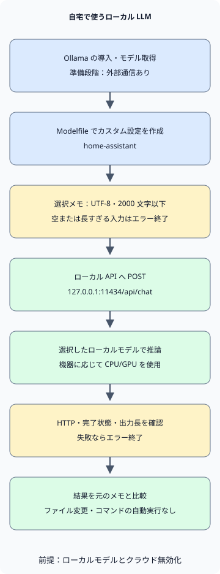

家庭で個人用 LLM を使うには、**Ollama をインストールし、PC で実行するモデルをダウンロードして、小さな作業につなぐ**ところから始めます。この記事は韓国語での会話と短いメモの要約が対象で、例の指示とメモも韓国語です。既存モデルの実行方法と指示を用途に合わせるもので、モデルを一から学習させる作業は含みません。

まず Ollama のローカルモデルと会話し、次に同じモデルを Python から呼び出してメモを要約します。インストールと API の説明は 2026 年 11 月 05 日に確認した公式文書に基づきます。[Ollama クイックスタート](https://docs.ollama.com/quickstart)

## モデルファイルと同じ容量のメモリで足りるか？

例のモデルは `qwen3:4b-instruct-2507-q4_K_M` です。Ollama では Q4_K_M モデルとして掲載され、その大きさは約 2.5GB です。Q4_K_M は重みを少ないビット数で表現する量子化形式です。ファイルサイズは実行に必要な全メモリ量ではありません。[モデルファイルとライセンス](https://ollama.com/library/qwen3:4b-instruct-2507-q4_K_M)

実行時には重みに加え、会話コンテキスト用の KV キャッシュとその他の実行資源が必要です。OS や他のアプリもメモリを使います。コンテキストを大きくすると使用量が増えるため、例では `num_ctx` を 4096 に設定します。モデルが対応する最大コンテキストを家庭の PC で使えるという意味ではありません。[Ollama のコンテキスト長とメモリ](https://docs.ollama.com/context-length)

| 資源 | 選択時に考慮すること |
| --- | --- |
| GPU または統合メモリ | 外付け GPU の VRAM とシステム RAM を区別します。Apple Silicon は他のアプリと統合メモリを共有します。 |
| 実行時に使えるメモリ | 不足する場合は小さいモデルか短いコンテキストから始めます。ファイルサイズを最小 RAM 要件とみなしません。 |
| ディスク空き容量 | モデルファイルと追加ダウンロード用の空きを確保します。複数モデルを保存すると使用量が増えます。 |
| GPU とドライバーの対応 | モデルを選ぶ前に、現在の OS と機器が対応しているか確認します。 |

Ollama の macOS 文書は macOS 14 以降を要件とし、Apple M 系では CPU/GPU、Intel Mac では CPU の実行を案内しています。Windows は Windows 10 22H2 以降が必要で、ドライバー条件は GPU により異なります。ハードウェアを買う前に、現在の PC で小さな作業の応答速度とメモリ使用量を確認します。[macOS の要件](https://docs.ollama.com/macos)、[Windows の要件](https://docs.ollama.com/windows)、[GPU 対応](https://docs.ollama.com/gpu)

## インストールしてローカル専用に設定する

macOS または Windows では[公式ダウンロードページ](https://ollama.com/download)からインストーラーを取得してアプリを起動します。Linux では公式文書のコマンドを使います。以下の Linux コマンドはソフトウェアとサービスをインストールするため、Ollama を入れる PC で実行します。[Linux のインストール](https://docs.ollama.com/linux)

```sh
curl -fsSL https://ollama.com/install.sh | sh
```

インストール後、新しい端末でバージョンを確認します。アプリやサービスがすでにサーバーを実行していれば、`ollama serve` を重ねて起動する必要はありません。

```sh
ollama --version
```

個人データをローカルで処理するには、モデルの選択とサーバー設定の両方を確認します。Ollama はローカル API 経由でもクラウドモデルを呼び出せます。**localhost アドレスだけでは推論がどこで動くか確定できません。** [ローカル API とクラウドモデル](https://docs.ollama.com/api/authentication)

macOS または Windows のユーザーアプリでは、サーバーを実行するアカウントの `~/.ollama/server.json` に次の設定を入れます。Windows の `~` はユーザーのホームディレクトリです。ファイルがあれば他の設定を残して追加し、アプリを再起動します。クラウドモデルと Web 検索が無効になるので、サーバーログの `Ollama cloud disabled: true` で適用を確認します。モデルのインストールとダウンロードにはインターネットが必要です。[ローカル専用設定](https://docs.ollama.com/faq#how-do-i-disable-ollamas-cloud-features)

```json
{
  "disable_ollama_cloud": true
}
```

Linux の systemd サービスはログインユーザーと異なるアカウントで動く場合があります。その場合は `sudo systemctl edit ollama.service` でサービスの環境変数を設定し、以下を保存してから再起動します。[Linux サービスの設定](https://docs.ollama.com/linux#customizing)

```ini
[Service]
Environment="OLLAMA_NO_CLOUD=1"
Environment="OLLAMA_HOST=127.0.0.1:11434"
```

```sh
sudo systemctl daemon-reload
sudo systemctl restart ollama.service
```

サービスを使わず直接サーバーを起動する場合、POSIX shell で `OLLAMA_NO_CLOUD=1 OLLAMA_HOST=127.0.0.1:11434 ollama serve` を実行した端末を開いたままにします。サーバーが動作中なら重複して起動しません。どちらの場合も、個人データを入力する前にクラウド機能が無効か確認します。

次のコマンドで例のモデルをダウンロードして会話を始めます。これは non-thinking 版なので、別の thinking オプションを使いません。短いタグは他の版を指す場合があるため、完全なタグを使います。[Qwen モデルカード](https://huggingface.co/Qwen/Qwen3-4B-Instruct-2507)

```sh
ollama pull qwen3:4b-instruct-2507-q4_K_M
ollama run qwen3:4b-instruct-2507-q4_K_M
```

最初の質問は「한국어로 답해 줘. 내가 적은 메모를 요약할 때 확인할 기준 세 가지를 알려 줘」（韓国語で答え、メモを要約する際の確認基準を三つ挙げてください）などで構いません。回答が韓国語で依頼の範囲内か確認し、`/bye` で会話を終えます。別の端末で `ollama list` によりモデル ID を、`ollama ps` により CPU/GPU の配置とメモリ状態を確認します。インストール済み Ollama のバージョンとモデル ID をタグとともに記録すれば、後で違いを比較しやすくなります。[モデルの実行状態を確認](https://docs.ollama.com/faq#how-can-i-tell-if-my-model-was-loaded-onto-the-gpu)

## 自分の用途に合わせた指示をデフォルトにする

次のファイルを空の作業ディレクトリに保存します。`FROM` はベースモデル、`SYSTEM` はデフォルト指示を指定します。`num_predict` は生成トークン数の上限、`temperature` はランダム性に影響します。次の値は短いメモ要約の例です。temperature が低くても事実の正確性は保証されません。[Modelfile の構文](https://docs.ollama.com/modelfile)

### `Modelfile`

```text
FROM qwen3:4b-instruct-2507-q4_K_M
PARAMETER num_ctx 4096
PARAMETER num_predict 512
PARAMETER temperature 0.2
SYSTEM """
한국어로 간결하게 답하세요.
제공된 자료에서 확인할 수 없는 내용은 추측하지 말고 모른다고 말하세요.
원문에 있는 사실과 제안을 구분하세요.
"""
```
次のコマンドで `home-assistant` というカスタムモデル設定を作ります。

```sh
ollama create home-assistant -f Modelfile
ollama run home-assistant
```

指示を変えただけで新しい知識を学習したり、ディスク上のファイルを読めるようになったりはしません。次の例のように必要な資料をリクエストに含めます。文書が多い場合は関連箇所を検索して渡す検索拡張生成（RAG）を別途設計できます。まずは短いファイル一つの要約品質を確認します。

## 選んだメモ一つを Python で要約する

この例は Python 3 の標準ライブラリのみを使います。保存済みファイルを一つ読み、`127.0.0.1:11434/api/chat` に送り、結果を出力します。環境の HTTP プロキシ設定は使わず、モデルにファイル参照やコマンド実行のツールも与えません。



図のインストールとモデルのダウンロードは外部通信を伴う準備段階です。その後の推論はローカルモデルの選択とクラウド機能の無効化が前提です。入力または応答の検証に失敗した場合、要約を出力せずエラー終了します。

### `notes.txt`

```text
2026-11-05 집 서버 정리
결정: 사진 백업용 디스크 상태를 주말에 점검한다.
후속 작업: 작업 전 복구 테스트 방법을 찾아본다.
담당자와 정확한 시각은 정하지 않았다.
```
### `summarize.py`

```python
import json
from pathlib import Path
import sys
from urllib.request import ProxyHandler, Request, build_opener

ENDPOINT = "http://127.0.0.1:11434/api/chat"
MODEL = "home-assistant"
MAX_CHARS = 2000


def summarize(path):
    text = path.read_text(encoding="utf-8")
    if not text.strip() or len(text) > MAX_CHARS:
        raise ValueError(f"메모는 비어 있지 않은 {MAX_CHARS}자 이하의 UTF-8 텍스트여야 합니다.")
    prompt = (
        "다음 메모의 결정 사항과 후속 작업을 나누어 한국어로 요약하세요. "
        "원문에 없는 담당자나 기한을 추가하지 마세요.\n\n<자료>\n"
        + text + "\n</자료>"
    )
    payload = {
        "model": MODEL,
        "messages": [{"role": "user", "content": prompt}],
        "stream": False,
        "options": {"num_ctx": 4096, "num_predict": 512},
        "keep_alive": 0,
    }
    request = Request(
        ENDPOINT,
        data=json.dumps(payload, ensure_ascii=False).encode("utf-8"),
        headers={"Content-Type": "application/json"},
        method="POST",
    )
    opener = build_opener(ProxyHandler({}))
    with opener.open(request, timeout=120) as response:
        result = json.load(response)
    message = result.get("message") if isinstance(result, dict) else None
    answer = message.get("content") if isinstance(message, dict) else None
    if not isinstance(answer, str) or not answer.strip() or result.get("done") is not True:
        raise RuntimeError("완료된 텍스트 응답을 받지 못했습니다.")
    if result.get("done_reason") == "length":
        raise RuntimeError("출력 길이 제한에 도달했습니다. 메모나 요청 범위를 줄이세요.")
    return answer


if __name__ == "__main__":
    if len(sys.argv) != 2:
        raise SystemExit("사용법: python3 summarize.py notes.txt")
    try:
        print(summarize(Path(sys.argv[1])))
    except (OSError, ValueError, RuntimeError) as error:
        print(f"요약 실패: {error}", file=sys.stderr)
        raise SystemExit(1)
```
両ファイルを同じフォルダーに保存して実行します。Windows では Python のインストール環境に応じて `python3` の代わりに `py -3` を使います。

```sh
python3 summarize.py notes.txt
```

`stream: false` は一つの JSON 応答を要求します。例は空入力と 2000 文字超の入力を拒否し、HTTP エラー、無効な応答、出力長の上限をエラーとして扱います。文字数の上限は正確なトークン数ではないため、入力と回答がコンテキストウィンドウ内に収まるかも確認します。`keep_alive: 0` は処理後のモデルのアンロードを要求するため、繰り返すと再ロードが必要な場合があります。[チャット API と応答フィールド](https://docs.ollama.com/api/chat)

クライアントの正常系・エラー処理は Python 3.13.0 のローカル模擬 HTTP サーバーで確認しました。この記事の準備環境では Ollama のインストール、Modelfile ビルド、モデルのダウンロード、推論速度、要約品質を実行・検証していません。インストール後に上のメモと結果を比較してください。120 秒のネットワークタイムアウトは、サーバーがモデルの処理を停止したことを確認するものではありません。

三点を確認します。ディスク状態の確認が決定事項として残っているか、復旧テスト方法の調査が後続作業として分かれているか、未定の担当者や正確な時刻をモデルが作り出していないかです。文章の滑らかさと原文への忠実さは別々に評価します。

## 日常の作業と停止基準を選ぶ

| 作業 | 小さく始める入力 | 使用前に確認すること |
| --- | --- | --- |
| 個人メモの整理 | 短い会議・学習メモ一つ | 決定、提案、未定事項が区別されているか |
| 草稿の推敲 | 自分の書いた段落と希望する文体 | 意味、数値、出典が保たれているか |
| コード理解の補助 | 共有可能な公開例または小さな関数 | 説明がコードと実行結果に一致するか |

このクライアントは応答を表示するだけで、ファイル変更や shell コマンド実行を行いません。生成したコマンドを自動実行するエージェントへ拡張する場合は、[AI エージェントの権限境界](/ko/posts/2026-11-01-ai-agent-permission-boundaries/)のように実行権限と承認を別途設計します。ローカルモデルも文書内の悪意ある指示の影響を受けたり、誤った回答を出したりすることがあります。

API はデフォルトでローカルアドレスにバインドされ、ローカル API に認証は必要ありません。まず一台の PC 内で使い、ルーターのポート転送で 11434 を公開しません。家族や他の機器からのアクセスには、認証とアクセス範囲を定めた別構成が必要です。接続アプリ、プラグイン、ログ、バックアップがデータを保存・外部送信するかも確認します。ローカル推論だけでは判断できません。[デフォルトのバインド](https://docs.ollama.com/faq#how-can-i-expose-ollama-on-my-network)、[認証範囲](https://docs.ollama.com/api/authentication)

回答が遅い場合は、まず `ollama ps` で CPU/GPU の配置と他のアプリのメモリ使用量を確認します。長い入力と大きなコンテキストを減らし、同じ作業で再比較します。接続を拒否されたらアプリやサービスが動いているか、モデルが見つからなければ `ollama list` と `home-assistant` の作成有無を確認します。タイムアウトした要求を積み重ねるより、すでに動く処理を先に確認します。

同じメモをいくつか固定し、モデルや設定を変えるたびに抜け、推測、待ち時間を比較します。
