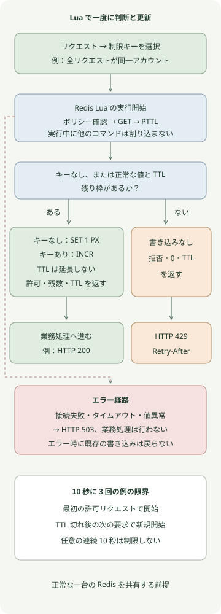

**複数のアプリケーションサーバーで同一ユーザーのリクエストを制限するには、Redis で許可判断とカウンター更新をまとめて行います。** 本記事では Lua で固定ウィンドウを実装し、上限超過には `429`、Redis が判断できない場合には `503` を返します。

例のポリシーは**アカウントごとに最初の許可リクエストから 10 秒間で最大三回**です。固定ウィンドウは最も単純な出発点で、トークンバケットやスライディングウィンドウと同じではありません。環境は Spring Boot 3.5.16、JDK 21、Gradle 8.14.3、Redis 8.2.1 です。再現用に固定したバージョンであり、運用環境の最新パッチとして推奨するものではありません。

## なぜアプリで GET の後に INCR してはいけないのか？

サーバー A と B がともにカウンター `2` を読むと、上限が `3` でも両方を許可する可能性があります。JVM の `synchronized` は他のプロセスをロックしません。`INCR` 自体はアトミックですが、その前の許可判断まで自動的に含みません。

`INCR` の後に別の `EXPIRE` を送る方法には、二つのコマンドの間でクライアントが停止すると TTL のないキーが残る問題もあります。Redis の[公式 INCR レート制限例](https://redis.io/docs/latest/commands/incr/)もこの競合と Lua の利用を説明しています。

以下のスクリプトは最初のリクエストで `SET ... PX` を使い値と TTL を同時に作成します。以降は Lua 内で上限を確認し、許可したリクエストだけを加算します。拒否時はカウンターも有効期限も変えません。

## どの順序で制限するのか？



青い領域は Redis 内の判断であり、HTTP 応答はアプリケーションが作ります。キーがなければ新しいウィンドウを開始します。既存キーには正の整数カウンターと有効な TTL が必要です。この制限は受付回数を数え、受付後の処理が失敗しても回数を返しません。

## Spring MVC と Redis Lua で制限を実装する

以下の六つのファイルを同じ Gradle プロジェクトに保存します。認証は実装していません。`/demo` はすべてのリクエストを単一の `demo-account` として扱うため、キーはユーザー別ポリシーを再現する固定例です。サーバーはローカルアドレスのみにバインドします。

実サービスでは、認証済みの `Principal` など、**サーバーが検証した主体**からキーを生成します。任意の `userId` リクエストヘッダーを信頼すると、呼び出し側が値を変えて制限を回避できます。例えば `rl:orders:v1:<tenant-and-subject-digest>` で操作範囲、ポリシーのバージョン、主体を区別し、個人情報の原文ではなくサーバー秘密鍵による HMAC などの識別子を検討します。転送された IP ヘッダーは信頼できるプロキシの境界内でのみ解釈します。

### `settings.gradle`

```groovy
rootProject.name = 'redis-lua-rate-limit'
```

### `build.gradle`

```groovy
plugins {
    id 'java'
    id 'application'
}
repositories { mavenCentral() }
java { toolchain { languageVersion = JavaLanguageVersion.of(21) } }
dependencies {
    implementation platform('org.springframework.boot:spring-boot-dependencies:3.5.16')
    implementation 'org.springframework.boot:spring-boot-starter-web'
    implementation 'org.springframework.boot:spring-boot-starter-data-redis'
    testImplementation 'org.springframework.boot:spring-boot-starter-test'
    testRuntimeOnly 'org.junit.platform:junit-platform-launcher'
}
application { mainClass = 'example.RateLimitApplication' }
test {
    useJUnitPlatform()
    systemProperty 'demo.redis.port', providers.gradleProperty('redisPort').getOrElse('6379')
}
```

### `src/main/resources/application.yml`

```yaml
server:
  address: 127.0.0.1
spring:
  data:
    redis:
      host: 127.0.0.1
      port: ${REDIS_PORT:6379}
      connect-timeout: 200ms
      timeout: 200ms
```

### `src/main/resources/rate-limit.lua`

```lua
local limit = tonumber(ARGV[1])
local window = tonumber(ARGV[2])
if not limit or limit < 1 or limit > 1000000 or limit ~= math.floor(limit)
   or not window or window < 1 or window > 3600000 or window ~= math.floor(window) then
    return redis.error_reply('invalid rate limit policy')
end

local raw = redis.call('GET', KEYS[1])
if raw then
    local count = tonumber(raw)
    local ttl = redis.call('PTTL', KEYS[1])
    if not count or count < 1 or count ~= math.floor(count) or ttl < 0 then
        return redis.error_reply('invalid counter state')
    end
    if count >= limit then
        return {0, 0, ttl}
    end
    local updated = redis.call('INCR', KEYS[1])
    return {1, limit - updated, ttl}
end

redis.call('SET', KEYS[1], 1, 'PX', window)
return {1, limit - 1, window}
```

### `src/main/java/example/RedisRateLimiter.java`

```java
package example;

import java.time.Duration;
import java.util.List;
import org.springframework.core.io.ClassPathResource;
import org.springframework.data.redis.core.StringRedisTemplate;
import org.springframework.data.redis.core.script.DefaultRedisScript;
import org.springframework.stereotype.Component;

@Component
public class RedisRateLimiter {
    private static final DefaultRedisScript<List> SCRIPT = new DefaultRedisScript<>();
    static {
        SCRIPT.setLocation(new ClassPathResource("rate-limit.lua"));
        SCRIPT.setResultType(List.class);
    }
    private final StringRedisTemplate redis;

    public RedisRateLimiter(StringRedisTemplate redis) {
        this.redis = redis;
    }

    public Decision check(String key, int limit, Duration window) {
        long milliseconds = window.toMillis();
        if (key == null || key.isBlank() || key.length() > 160 || limit < 1 || limit > 1_000_000
                || milliseconds < 1 || milliseconds > 3_600_000) {
            throw new IllegalArgumentException("Invalid rate limit policy");
        }
        List<?> result = redis.execute(SCRIPT, List.of(key),
                Integer.toString(limit), Long.toString(milliseconds));
        if (result == null || result.size() != 3) {
            throw new IllegalStateException("Invalid limiter result");
        }
        return new Decision(((Number) result.get(0)).longValue() == 1,
                ((Number) result.get(1)).longValue(), ((Number) result.get(2)).longValue());
    }

    public record Decision(boolean allowed, long remaining, long ttlMillis) {
        public long retryAfterSeconds() {
            return Math.max(1, (ttlMillis + 999) / 1000);
        }
    }
}
```

### `src/main/java/example/RateLimitApplication.java`

```java
package example;

import java.time.Duration;
import org.springframework.boot.SpringApplication;
import org.springframework.boot.autoconfigure.SpringBootApplication;
import org.springframework.dao.DataAccessException;
import org.springframework.http.ResponseEntity;
import org.springframework.web.bind.annotation.GetMapping;
import org.springframework.web.bind.annotation.RestController;

@SpringBootApplication
@RestController
public class RateLimitApplication {
    private final RedisRateLimiter limiter;

    public RateLimitApplication(RedisRateLimiter limiter) {
        this.limiter = limiter;
    }

    public static void main(String[] args) {
        SpringApplication.run(RateLimitApplication.class, args);
    }

    @GetMapping("/demo")
    public ResponseEntity<String> demo() {
        try {
            var decision = limiter.check("rl:demo:v1:demo-account", 3, Duration.ofSeconds(10));
            if (!decision.allowed()) {
                return ResponseEntity.status(429)
                        .header("Retry-After", Long.toString(decision.retryAfterSeconds()))
                        .body("rate limit exceeded\n");
            }
            return ResponseEntity.ok("ok\n");
        } catch (DataAccessException | IllegalStateException unavailable) {
            return ResponseEntity.status(503).body("limiter unavailable\n");
        }
    }
}
```

このスクリプトが使うキーは一つです。Redis Cluster では、そのキーを含むスロットで実行されます。一つのスクリプトで複数キーを制限するには、同一スロット制約を前提に再設計する必要があります。

`StringRedisTemplate` は文字列のキーと引数を使い、スクリプトの数値配列は `List` として返されます。`DefaultRedisScript` を再利用する理由と、デフォルト実行器が `EVALSHA` を使いキャッシュ未登録時に `EVAL` を使う動作は [Spring Data Redis スクリプト文書](https://docs.spring.io/spring-data/redis/reference/redis/scripting.html)を参照してください。

## どの応答が返るか？

Docker が使用でき、Redis のポート `16379` とアプリケーションのポート `8080` を他のプロセスが使っていない環境で実行します。Redis はホストのループバックアドレスのみに公開し、永続化と永続ボリュームは無効です。初回は Redis イメージと Maven 依存関係をダウンロードするためネットワークが必要です。

```sh
docker run --rm -d --name redis-rate-limit-demo \
  -p 127.0.0.1:16379:6379 \
  redis:8.2.1-alpine@sha256:987c376c727652f99625c7d205a1cba3cb2c53b92b0b62aade2bd48ee1593232 \
  redis-server --save '' --appendonly no
REDIS_PORT=16379 gradle run
```

サーバーの準備後、別の端末から 10 秒以内に四回呼び出します。

```sh
for attempt in 1 2 3 4; do
  curl -s -o /dev/null -w '%{http_code}\n' http://127.0.0.1:8080/demo
done
curl -i http://127.0.0.1:8080/demo
```

新しいウィンドウでこの四つのリクエストを連続して送った場合、期待するステータスは次の通りです。

```text
200
200
200
429
```

拒否応答の `Retry-After` は残り TTL を秒単位に切り上げた値で、最低一秒です。値は呼び出し時刻により変わります。`429` と任意の `Retry-After` の意味は [RFC 6585 の第 4 節](https://www.rfc-editor.org/rfc/rfc6585#section-4)に従います。他のリクエストを考慮した予約枠ではないため、待っている間に別のリクエストが枠を使えば、再試行も拒否されることがあります。

`gradle run` を停止し、テスト用コンテナも削除します。

```sh
docker stop redis-rate-limit-demo
```

## 同時実行とエラーについて何を検証したか？

別の再現テストではローカル Docker の実 Redis と組み込み Tomcat を使いました。これは動作の検証であり、スループットのベンチマークではありません。

| 条件 | 観測結果 |
| --- | --- |
| スレッドプールから同一キーに 40 回同時呼び出し | 3 回許可、Redis カウンターは 3 |
| 二つの制限器オブジェクトが同じ Redis とキーを使用 | 上限を共有。両オブジェクトは一つのクライアント bean を共有し、独立した二つの JVM を起動したテストではない |
| 三回の許可後のリクエスト | 拒否。カウンター増加と TTL 延長はなし |
| 別アカウントのキーと期限切れキー | 別キーは独立して許可、期限切れ後は新ウィンドウを開始 |
| 無効値または TTL のないキー | 任意に修復せずエラー |
| 実 HTTP の連続呼び出し | 200 が三回の後、`Retry-After` 付き 429 |
| 無効なカウンターの HTTP リクエスト | 503 |
| 接続は受け付けるが Redis 応答を返さない別の TCP エンドポイント | 制限器エラーを 503 に変換 |

検証済みカウンターには TTL が必要です。[PTTL 文書](https://redis.io/docs/latest/commands/pttl/)では `-1` は TTL なし、`-2` はキーなしを意味します。既存状態が無効なとき TTL を黙って追加して許可するとポリシーの誤りを隠す可能性があるため、この実装はエラーを返します。

**Lua のアトミック実行は、エラー時に書き込みが自動的にロールバックされることを意味しません。** [公式スクリプト文書](https://redis.io/docs/latest/develop/programmability/eval-intro/)の実行分離とエラー処理を区別します。別のスクリプトで `SET` の後に意図的にエラーを返した再現テストでも、値が残ることを確認しました。本文のスクリプトは書き込み前に入力と既存状態を検証し、書き込みは最後の `SET` または `INCR` のみに限定しています。

## 本番でどの制限と障害ポリシーを選ぶか？

**固定ウィンドウは任意の連続した 10 秒間で最大三回を保証しません。** ウィンドウの終了直前に残り枠を使い、次の開始直後に再び要求すると、短期間に集中することがあります。一定期間の正確な移動合計にはスライディングログやスライディングウィンドウ、平均到着率と許容バーストを別々に決めるにはトークンバケットを検討します。本記事ではこれらのアルゴリズムを実装・性能比較していません。

例は Redis エラー時にリクエストを通さない **fail-closed** を採用します。決済のように制限回避のコストが高い処理では候補になりますが、Redis の問題が API 可用性も下げます。読み取り API のように可用性が重要な場合は、制限付きローカルバケットで一時的に許可する選択肢もあります。総許容量はサーバー数に応じて増え得るため、グローバル上限と同じ保証ではありません。

200ms は接続・コマンドのタイムアウト設定であり、HTTP リクエスト全体が 200ms 以内に終わる保証ではありません。待ち行列、再接続、スケジューリングの時間も別に考慮します。コードはアプリケーション側の再試行を追加していません。クライアントの再接続とコマンド再送ポリシーも確認してください。Redis が許可を記録した後に応答が失われると、呼び出し側には失敗に見えても回数は消費され得ます。再試行を含む同一リクエストを一回だけ数えるには、リクエスト識別子と別の冪等性ポリシーが必要です。

メモリ圧迫で Redis キーが排除されたり、再起動・フェイルオーバーでカウンターが失われたりすると、次のリクエストが新ウィンドウとして許可されることがあります。アトミックな Lua だけで、複製や復旧を含むグローバル上限は実現しません。専用インスタンス、メモリ上限、排除ポリシー、ポリシー版を含むキー、拒否数・Redis エラー数・制限判断の遅延を合わせて管理します。キーごとの識別子をメトリクスラベルに直接入れるとカーディナリティも増えます。

この再現は単一 Redis の正常動作と一部のエラー処理が対象です。Redis Cluster のフェイルオーバー、複数リージョン、実際の Redis プロセス停止後の復旧、運用負荷での性能は試していません。リクエスト開始回数の制限だけでは DB の同時占有や長時間リクエストの数も制限されないため、必要な処理には別途同時実行制限を設けます。
