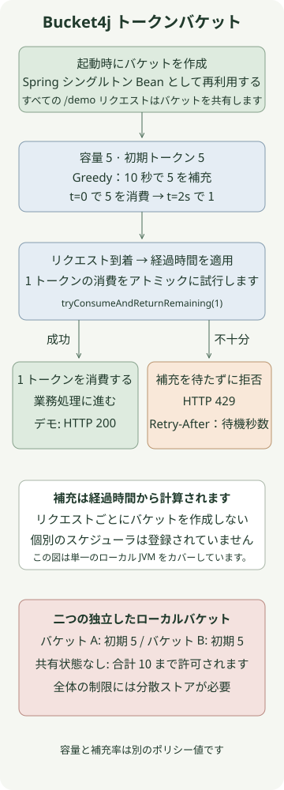

**Bucket4j は、トークンバケットの補充と消費を計算し、同時実行性を制御する Java レート制限ライブラリです。** Spring でバケットを共有し、リクエストごとにトークンを消費しようとすると、許可されるバーストとその後の補充レートを個別に設定できます。ローカル バケットは JVM ごとに独立しているため、ライブラリを追加するだけではサーバー全体にグローバルな制限が作成されません。

[前回の Redis Lua レート制限の記事](/ko/posts/2026-11-10-redis-lua-rate-limit/)では、最初に許可されたリクエストから一定期間を数える固定ウィンドウを実装しました。この記事では、**容量 5 の単一 JVM トークンバケットを実装し、5 トークンを 10 秒かけて補充**した後、Redis 分散モードへ移行した場合の変更点を説明します。

再現環境はBucket4j **8.22.0**、Spring Boot 3.5.16、JDK 21、Gradle 8.14.3です。 Bucket4j バージョンは、[公式リリース](https://github.com/bucket4j/bucket4j/releases) および [8.22.0 リファレンス](https://bucket4j.com/8.22.0/toc.html) に対して固定されました。依存関係名の `jdk17` は、JDK 17 ファミリのアーティファクトを示します。この例では、JDK 21 で実行します。

## 容量と補充速度はどのように異なりますか?

`capacity(5)` は、蓄積できるトークンの最大数です。デフォルトの初期数も 五 であるため、最初は一度に 五 つのリクエストを許可できます。 `refillGreedy(5, Duration.ofSeconds(10))` は、十 秒間に 五 トークンのレートを設定します。 一 つのリクエストで 一 つのトークンを消費する場合、`t=0` ですべてのトークンを消費した後、`t=2 seconds` で 一 つの新しいトークンが使用可能になります。

したがって、このポリシーを **「連続 十 秒間で最大 五 つのリクエスト」** と説明するのは誤りです。つまり、最初の 五 回のバーストとその後のリフィルの両方が許可されます。長いアイドル期間の後でも、バケットに蓄積されるのはその容量の 五 つだけです。

| 詰め替え方法は同じ容量・詰め替え量で | `refillGreedy(5, 10 seconds)` | `refillIntervally(5, 10 seconds)` |
| --- | --- | --- |
| `t=0` で 五 つすべてを消費する | 残り 0 | 残り 0 |
| それ以上消費せずに `t=2 seconds` でチェックしてください | 1 あり | 0 |
| それ以上消費せずに `t=10 seconds` でチェックしてください | 5 | 5 |

Greedy は時間の経過に応じて徐々に補充し、Intervally は期間の終了時にまとめて補充します。テーブルは、ゼロから始まる制御されたクロックでチェックされました。別のスケジューラーが定期的にトークンを追加する必要はありません。経過時間は、バケットがクエリまたは消費されるときに補充計算に反映されます。 API の詳細については、[Bucket4j リフィルに関するリファレンス](https://bucket4j.com/8.22.0/toc.html) を参照してください。

## Spring MVC リクエストはどのように制限できますか?



コントローラーは、トークン数を個別にクエリしてリクエストを許可するかどうかを推測する代わりに、`tryConsumeAndReturnRemaining(1)` の結果を使用します。 `ConsumptionProbe` は、成功、残りのトークン、および不十分な場合は同じ消費試行の待機時間を返します。

以下の五つのファイルを一つのプロジェクトに保存します。すべての `/demo` リクエストは 一 つのバケットを共有します。この例では、ユーザーごとの認証やバケット ストアは実装されておらず、サーバーはローカル アドレスにのみバインドされます。

### `settings.gradle`

```groovy
rootProject.name = 'bucket4j-token-bucket'
```

### `build.gradle`

```groovy
plugins {
    id 'java'
    id 'application'
}
repositories { mavenCentral() }
java { toolchain { languageVersion = JavaLanguageVersion.of(21) } }
dependencies {
    implementation platform('org.springframework.boot:spring-boot-dependencies:3.5.16')
    implementation 'org.springframework.boot:spring-boot-starter-web'
    implementation 'com.bucket4j:bucket4j_jdk17-core:8.22.0'
    testImplementation 'org.springframework.boot:spring-boot-starter-test'
    testRuntimeOnly 'org.junit.platform:junit-platform-launcher'
}
application { mainClass = 'example.RateLimitApplication' }
test { useJUnitPlatform() }
```

### `src/main/resources/application.yml`

```yaml
server:
  address: 127.0.0.1
```

### `src/main/java/example/BucketPolicy.java`

```java
package example;

import java.time.Duration;
import io.github.bucket4j.Bucket;
import io.github.bucket4j.TimeMeter;

public final class BucketPolicy {
    private BucketPolicy() {}

    public static Bucket local(TimeMeter clock) {
        return Bucket.builder()
                .withCustomTimePrecision(clock)
                .addLimit(limit -> limit.capacity(5).refillGreedy(5, Duration.ofSeconds(10)))
                .build();
    }
}
```

### `src/main/java/example/RateLimitApplication.java`

```java
package example;

import io.github.bucket4j.Bucket;
import io.github.bucket4j.TimeMeter;
import org.springframework.boot.SpringApplication;
import org.springframework.boot.autoconfigure.SpringBootApplication;
import org.springframework.context.annotation.Bean;
import org.springframework.http.ResponseEntity;
import org.springframework.web.bind.annotation.GetMapping;
import org.springframework.web.bind.annotation.RestController;

@SpringBootApplication
public class RateLimitApplication {
    public static void main(String[] args) {
        SpringApplication.run(RateLimitApplication.class, args);
    }

    @Bean
    Bucket demoBucket() {
        return BucketPolicy.local(TimeMeter.SYSTEM_NANOTIME);
    }

    @RestController
    public static class DemoController {
        private final Bucket bucket;

        public DemoController(Bucket bucket) {
            this.bucket = bucket;
        }

        @GetMapping("/demo")
        public ResponseEntity<String> demo() {
            var probe = bucket.tryConsumeAndReturnRemaining(1);
            if (probe.isConsumed()) {
                return ResponseEntity.ok("ok\n");
            }
            long seconds = Math.max(1, Math.ceilDiv(probe.getNanosToWaitForRefill(), 1_000_000_000L));
            return ResponseEntity.status(429)
                    .header("Retry-After", Long.toString(seconds))
                    .body("rate limit exceeded\n");
        }
    }
}
```

`Bucket` はデフォルトのシングルトン Spring Bean であるため、リクエスト間で状態を保持します。毎回コントローラー メソッド内で `Bucket.builder()` を呼び出すと、すべてのリクエストの初期トークンが作成されます。チェックが存在しても、実際の制限は強制されません。

トークンが不十分な場合、`tryConsumeAndReturnRemaining` はリクエスト スレッドを補充を待機させるのではなく、拒否を返します。これは、MVC サーバー全体をノンブロッキングにするわけではありません。別の待機 API を選択するには、スレッドの待機とリクエストのタイムアウトを再検討する必要があります。

## どのような反応を期待する必要がありますか?

JDK 21 と Gradle 8.14.3 がインストールされ、ポート 8080 が使用可能な状態でこれを実行します。 Boot Gradle プラグインも個別の Redis サーバーも必要ありません。 Maven Central の依存関係は、最初の実行時にダウンロードされます。

```sh
gradle run
```

サーバーの準備ができたら、別の端末から呼び出します。これは、他の呼び出しがなく、次のトークンが補充される前に 六 つの呼び出しがすべて終了する新しいバケットを想定しています。

```sh
for attempt in 1 2 3 4 5 6; do
  curl -s -o /dev/null -w '%{http_code}\n' http://127.0.0.1:8080/demo
done
curl -i http://127.0.0.1:8080/demo
```

予期されるステータス コードが続きます。実行に時間がかかる場合、または他のリクエストが介入する場合、補充と消費により結果が変わる可能性があります。

```text
200
200
200
200
200
429
```

拒否された応答の `Retry-After` は `getNanosToWaitForRefill()` を秒単位に切り上げたもので、最小値は 一 秒です。制御されたクロックでは、五 つのトークンをすべて消費した直後は `2`、1.5 秒後には `1` でした。 [HTTP 429 の Retry-After セマンティクス](https://www.rfc-editor.org/rfc/rfc6585#section-4) で説明されているように、再試行するまでの待ち時間をクライアントに伝えます。別のリクエストが最初に次のトークンを消費する可能性があるため、待機しても後続の許可は予約されません。

`gradle run` を実行している端末で、`Ctrl+C` を使用してサンプル サーバーを停止します。

トークンは作業の開始前に消費されるため、後で作業が失敗した場合、このコードはトークンを返しません。開始されたリクエストに対する制限と、成功した操作に対する制限を区別します。

## 同時リクエストとタイミングはどのようにチェックされましたか?

十 回の再現テストでは、実際の Bucket4j 8.22.0 を使用し、制御可能なクロックを `TimeMeter` に注入します。時間の経過を待つために `Thread.sleep` を使用しません。 [公式インターバルリフィルテスト](https://github.com/bucket4j/bucket4j/blob/8.22.0/bucket4j-core/src/test/java/io/github/bucket4j/core_algorithms/FixedIntervalRefillTest.java) も時間注入を実証しています。

| 試験条件 | 観測結果 |
| --- | --- |
| 40 回の呼び出しを 8 本のワーカースレッドから同じバケットへ送信。時計は固定 | 正確に 5 が許可されます |
| 2 秒の直前とちょうどその時点（5 個を消費後） | 直前は拒否。1 件を 2 秒時点で許可 |
| 長い経過時間 | 容量 5 を超えない |
| 同じクロックが Greedy と Intervally に適用される | リフィルの違いは上の表と一致します |
| 拒否されてから時間が経過する | 拒否されても補充開始は延期されません |
| 二 つの独立したバケット | それぞれ5、合計10消費可能 |
| リクエストごとにバケットを再作成する | 40 個の新しいバケットによって 40 リクエストが許可され、バイパスが再現されます |
| 二 つの帯域幅制限を持つ個別のバケット | 消費するには両方の制限を満たす必要があります |
| Spring MVC `MockMvc` 呼び出し | 200、429、および待機時間の秒数への丸めが検証済み |

`MockMvc` チェックは、実際のネットワーク リクエストとは異なります。これとは別に、パッケージ化されたアプリケーションが組み込み Tomcat 上で起動され、実際の HTTP `200` 応答が検証されました。同時呼び出し数は、スループットのベンチマークではなく、動作チェックへの入力です。

## Redis Lua または Bucket4j を選択するのはどのような場合ですか?

| 基準 | 前の Redis Lua の例 | このローカル Bucket4j の例 |
| --- | --- | --- |
| ポリシー | 最初のリクエストから始まる期間中に許可されるリクエスト | 初期バーストとその後の補充速度 |
| 共有状態 | 同じ Redis とキーを使用したリクエスト | 一 つの JVM で同じバケット オブジェクトを使用したリクエスト |
| リクエストごとの外部ストア呼び出し | Redis の実行が必要です | なし |
| サーバーを追加した場合の影響 | 同じキーの状態が共有されていると想定します | 独立したバケットにより合計許容量が増加します |

これは、Redis が固定ウィンドウのみをサポートする、または Bucket4j がローカル モードのみをサポートするという主張ではありません。これら 二 つの記事で実装されているポリシーとストレージの場所を比較します。

グローバル制限については、Bucket4j の分散ストア統合を検討してください。 [Redis 統合に関する 8.22.0 リファレンス](https://bucket4j.com/8.22.0/toc.html) は、Lettuce または別のクライアントを介して共通キーの下で `ProxyManager` とバケット状態を使用します。説明した CAS アプローチでは、クライアントは状態を読み取って計算し、それを Redis で比較して置き換えます。競合により失敗した比較は再試行されます。これは、一 回の Redis Lua 実行でバケット全体の計算を実行する前述の例とは異なります。

分散状態の有効期限も制限ポリシーの一部です。トークンがまだ不十分なまま短い TTL でバケットが削除された場合、次のアクセスで初期トークンを使用して新しいバケットが作成され、追加のリクエストが許可される可能性があります。 [公式有効期限戦略](https://github.com/bucket4j/bucket4j/blob/8.22.0/bucket4j-core/src/main/java/io/github/bucket4j/distributed/ExpirationAfterWriteStrategy.java) と同様に、バケットを完全に補充するのに必要な時間とマージンを考慮します。ただし、強制排除やデータ損失に対する同様の保証はありません。

ここで使用される `SYSTEM_NANOTIME` はローカル バケット用です。これを JVM 間の分散時間基準として恣意的に使用しないでください。分散実装の場合は、統合の時間基準、タイムアウト、および CAS 再試行設定に従います。 Redis が失敗したときにリクエストをブロックするか、制限されたローカル ポリシーに基づいてリクエストを一時的に許可するかを個別に決定します。ここのコードでは、Redis の統合やフェイルオーバーは実行されません。

ユーザーごとの制限については、認証されたプリンシパルとポリシー スコープからバケット キーを派生します。任意のリクエストヘッダー識別子を盲目的に信頼すると、クライアントはキーを変更することで制限を回避できます。ユーザーごとのバケットをローカルの `Map` に継続的に追加すると、メモリの使用量が増加し、不注意なエビクションや再作成によって初期トークンが繰り返し付与される可能性があります。状態をどこに、どのくらいの期間保持するかを決定します。

リクエストの開始を制限しても、同時にリソースを占有する長時間実行操作の数は制限されません。データベース接続または同時外部 API 呼び出しを保護することが目的の場合は、別の同時実行制限も設計します。
