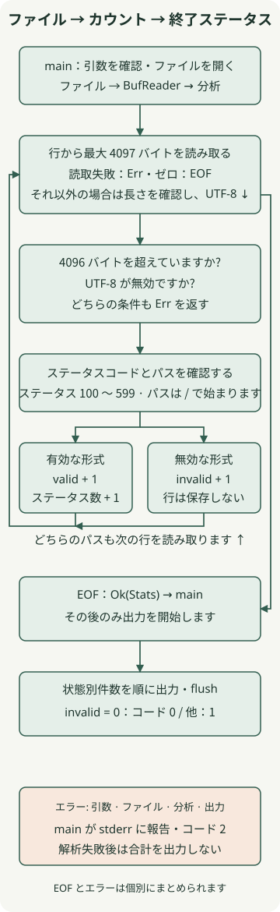

**明確な入力と結果を備えたファイル処理 CLI は、実際の作業で Rust の使用を開始する良い方法です。** この記事では、一度に 一 行ずつログを読み取り、HTTP ステータス コードごとにリクエストをカウントします。重要なのは、ファイル全体を文字列として保持することを避け、無効なレコードと読み取り失敗を区別することです。

[前の Rust 入門](/en/posts/2026-11-13-rust-ownership-guide/)で学んだ所有権、借用、`Result` をファイル I/O に適用します。例は **Rust 1.100.0、edition 2024、macOS arm64** で実行し、標準ライブラリのみを使います。外部パッケージやネットワーク接続は不要です。開発ツールがまだない場合は、[Rust 公式インストール手順](https://rust-lang.org/tools/install/)から始めてください。

## Rustに適した作品は何でしょうか?

ファイル変換、検証、集計ツールを繰り返し実行することは、Rust のリソース管理とエラー処理を学ぶのに役立ちます。バイナリをチームに配布するときは、ターゲットのオペレーティング システム、CPU、必要なシステム ライブラリを一致させてください。 一 つのマシン上でビルドされた実行可能ファイルは、すべての環境で実行できるわけではありません。

使い慣れたシェルまたは Python を使用すると、一 回限りの分析がより早く完了する可能性があります。スループットを推測するのではなく、ツールを繰り返しメンテナンスする必要性とチームの学習コストを比較検討します。この記事では、処理フローと障害の動作を検証します。速度やメモリ使用量を他の言語と比較するものではありません。

## ログ形式と障害ポリシーを定義する

この例では、二 つのフィールド `status-code path` の **簡易アクセス ログ**を読み取ります。これは、デフォルトの Nginx または Apache ログ形式のパーサーではありません。入力は、書き込みが完了した通常のファイルであると想定されます。回転、ライブ テーリング、解凍は範囲外です。

| 状態 | 取り扱い |
| --- | --- |
| 空白で区切られた 二 つのフィールド、100 ～ 599 の 三 桁の ASCII ステータス、および `/` で始まるパス | `valid` とそのステータスのカウントをインクリメントします |
| 空白行、フィールド数、ステータス、またはパスはルールに違反します。 | `invalid` をインクリメントし、次の行に進みます |
| ファイルを開くか読み取ることができない、無効な UTF-8、または 4096 バイトより長い行 | 分析が失敗し、合計を出力せずにコード 2 で終了します。 |
| 処理は、`invalid` が 0 と等しい EOF に達します | 合計を出力し、コード 0 で終了します |
| 少なくとも 1 の `invalid` で処理が EOF に達しました | 合計を出力し、コード 1 で終了します |

空白区切りには、連続するスペースとタブが含まれます。行の長さの制限には LF や CRLF などの行終了バイトが含まれ、最後の行は改行で終わる必要はありません。空のファイルは、`valid=0 invalid=0` の成功結果です。パスは形式をチェックするためにのみ使用され、合計には保存されません。

出力に失敗すると、終了コード 2 も生成されます。分析が完了する前に合計は出力されませんが、**書き込み中に出力デバイスに障害が発生した場合、一部の出力はすでに書き込まれている可能性があります**。実行コントラクトでは、結果を使用する前に終了コードをチェックします。

## プロジェクトを準備する

これらのコマンドと例では、macOS または Linux シェルを使用します。 macOS では、ネイティブ リンクに必要なコマンド ライン ツールもインストールします。

```bash
rustup toolchain install 1.100.0 --profile minimal --component rustfmt --component clippy
cargo +1.100.0 new access-summary --bin --edition 2024
cd access-summary
mkdir -p examples tests
```

以下のファイルを保存します。 Cargo は、`src/lib.rs` をライブラリとして接続し、`src/main.rs` を実行可能ファイルとして接続します。この分離により、ファイルのオープンと端末の出力を集計ロジックとは別にチェックできるようになります。

### `Cargo.toml`

```toml
[package]
name = "access-summary"
version = "0.1.0"
edition = "2024"

[dependencies]
```

### `rust-toolchain.toml`

```toml
[toolchain]
channel = "1.100.0"
profile = "minimal"
components = ["rustfmt", "clippy"]
```

### `examples/access.log`

```text
200 /api/orders
503 /api/orders
200 /health
404 /missing
broken-line
700 /outside-range
```

## BufReader と BTreeMap で集計する



ループ パスは、一 行が処理された後、次の行を読み取ることを示します。右側の線は、EOF と合計の戻り値を結びます。引数、ファイル、分析、および出力のエラーは、下部のエラー ボックスに要約されます。コードは、それらを `?` を使用して `main` に伝播します。

### `src/lib.rs`

```rust
use std::{
    collections::BTreeMap,
    io::{self, BufRead, Read},
    str,
};

pub const MAX_LINE_BYTES: usize = 4096;

#[derive(Default, Debug, PartialEq, Eq)]
pub struct Stats {
    pub valid: u64,
    pub invalid: u64,
    pub by_status: BTreeMap<u16, u64>,
}

fn parse_status(line: &str) -> Option<u16> {
    let mut fields = line.split_whitespace();
    let code = fields.next()?;
    let path = fields.next()?;
    if fields.next().is_some() || !path.starts_with('/') {
        return None;
    }
    if code.len() != 3 || !code.bytes().all(|byte| byte.is_ascii_digit()) {
        return None;
    }
    let status = code.parse::<u16>().ok()?;
    (100..=599).contains(&status).then_some(status)
}

pub fn analyze<R: BufRead>(mut reader: R) -> io::Result<Stats> {
    let mut stats = Stats::default();
    let mut buffer = Vec::new();
    loop {
        buffer.clear();
        let read = reader
            .by_ref()
            .take((MAX_LINE_BYTES + 1) as u64)
            .read_until(b'\n', &mut buffer)?;
        if read == 0 {
            return Ok(stats);
        }
        if buffer.len() > MAX_LINE_BYTES {
            return Err(io::Error::new(
                io::ErrorKind::InvalidData,
                "line exceeds 4096 bytes",
            ));
        }
        let line = str::from_utf8(&buffer)
            .map_err(|_| io::Error::new(io::ErrorKind::InvalidData, "input is not UTF-8"))?;
        match parse_status(line) {
            Some(status) => {
                stats.valid += 1;
                *stats.by_status.entry(status).or_default() += 1;
            }
            None => stats.invalid += 1,
        }
    }
}
```

[`BufReader`](https://doc.rust-lang.org/std/io/struct.BufReader.html) は、小さな読み取りリクエストをバッファーします。 `analyze<R: BufRead>` は具体的なファイル タイプではなくバッファ読み取り動作を必要とするため、テストではメモリ内の `Cursor` または失敗した入力を置き換えることができます。ジェネリックは、非同期または並列処理を意味するものではありません。

一 行ずつ読み取ること自体にはサイズ制限が課されません。 [`read_until`](https://doc.rust-lang.org/std/io/trait.BufRead.html#method.read_until) は、区切り文字または EOF までバッファーに追加します。非常に長い行を読み取ることができるため、この例では [`Read::take`](https://doc.rust-lang.org/std/io/trait.Read.html#method.take) を使用して、**一 回の反復で最大 4097 バイトを消費**してから、行が 4096 バイトを超えているかどうかを確認します。 `take` はバイト制限であり、読み取り時間の制限ではありません。

`buffer.clear()` は、次の行のバッファ長をリセットし、その割り当てを再利用します。集約ベクトルは現在の行を保持しており、`BufReader` が先を読んでいる可能性があります。読み取りバッファ、ベクトル割り当て、および集約マップにはそれぞれメモリが必要です。ステータス コードは最大 500 タイプに制限されているため、URL の数が増加してもマップのキー数は増加しません。これは実際のプロセス メモリの測定値ではありません。

`parse_status` は文字列を `&str` として借用し、それをチェックしてステータス コードのみを返します。 [`BTreeMap`](https://doc.rust-lang.org/std/collections/struct.BTreeMap.html) はキーの順序で反復されるため、ステータスを昇順で出力するのに適しています。 `entry(...).or_default()` は、欠落ステータス カウンターを 零 から開始します。

## mainで出力と終了コードを決定する

### `src/main.rs`

```rust
use access_summary::analyze;
use std::{
    env,
    fs::File,
    io::{self, BufReader, Write},
    process::ExitCode,
};

fn run() -> io::Result<u8> {
    let mut args = env::args_os().skip(1);
    let path = args
        .next()
        .filter(|_| args.next().is_none())
        .ok_or_else(|| {
            io::Error::new(io::ErrorKind::InvalidInput, "usage: access-summary <file>")
        })?;
    let stats = analyze(BufReader::new(File::open(path)?))?;
    let mut out = io::BufWriter::new(io::stdout().lock());
    writeln!(out, "valid={} invalid={}", stats.valid, stats.invalid)?;
    for (status, count) in &stats.by_status {
        writeln!(out, "status={status} count={count}")?;
    }
    out.flush()?;
    Ok(if stats.invalid == 0 { 0 } else { 1 })
}

fn main() -> ExitCode {
    match run() {
        Ok(code) => ExitCode::from(code),
        Err(error) => {
            let _ = writeln!(io::stderr().lock(), "error: {error}");
            ExitCode::from(2)
        }
    }
}
```

`args_os` は、ファイル パスをオペレーティング システムの文字列として受け取ります。アナライザーの `io::Result<Stats>` は `run` の `io::Result<u8>` に接続しているため、ファイル オープンと分析の失敗は `main` のエラー ブランチに到達する可能性があります。 `BufWriter` も出力をバッファリングし、`flush()?` は残りの出力の書き込みが失敗したかどうかを確認します。標準エラーへの診断の書き込み自体が失敗した場合、その書き込みエラーは無視され、終了コード 2 が保持されます。

`invalid` は、読み取り可能だがルールに違反したレコードをカウントします。したがって、出力だけではすべての入力が有効であるとは限りません。終了コード 1 は、少なくとも 一 つの無効なレコードを含む分析が完了したことを意味します。すべての行が無効な場合、`valid` は 0 になる可能性があります。コード 2 は実行が失敗したことを意味します。以下のテストと個別の CLI の実行では、その違いを確認します。

## サンプルを実行して結果を確認する

```bash
cargo check --offline
cargo fmt --check
cargo clippy --offline --all-targets -- -D warnings
cargo build --offline --release
./target/release/access-summary examples/access.log
echo $?
```

サンプルには 四 つの有効な行と 二 つの無効な行があります。実際の出力は次のとおりです。最後の `1` は、`echo $?` で観察された終了コードであり、合計の一部ではありません。

```text
valid=4 invalid=2
status=200 count=2
status=404 count=1
status=503 count=1
1
```

| 追加の入力または実行条件 | 標準出力 | 終了コード |
| --- | --- | --- |
| 有効な行のみを含むファイル | 合計 | 0 |
| 空のファイル | `valid=0 invalid=0` | 0 |
| 空白行 一 行 | `valid=0 invalid=1` | 1 |
| ファイル引数が欠落している、二 つの引数、またはファイルが存在しない | なし;標準エラー出力の理由 | 2 |
| 有効な行の後の無効な UTF-8 | なし;標準エラー出力の理由 | 2 |
| 4097 バイト行 | なし;標準エラー出力の理由 | 2 |

## ファイルなしでのテスト境界と失敗

`Cursor` を使用すると、メモリ内のバイトを入力のように読み取ることができます。ディスクやネットワークに依存せず、別のタイプでは、実際のファイルで作成するのが面倒な読み取りエラーも発生します。以下のファイルを保存してコマンドを実行します。

```bash
cargo test --offline
```

### `tests/stream.rs`

```rust
use access_summary::{MAX_LINE_BYTES, analyze};
use std::io::{self, BufRead, Cursor, Read};

#[test]
fn counts_valid_and_invalid_lines_in_status_order() {
    let stats = analyze(Cursor::new(include_bytes!("../examples/access.log"))).unwrap();
    assert_eq!((stats.valid, stats.invalid), (4, 2));
    assert_eq!(
        stats.by_status.into_iter().collect::<Vec<_>>(),
        vec![(200, 2), (404, 1), (503, 1)]
    );
}

#[test]
fn accepts_crlf_and_a_final_line_without_newline() {
    let stats = analyze(Cursor::new(b"200 /a\r\n503 /b")).unwrap();
    assert_eq!((stats.valid, stats.invalid), (2, 0));
}

#[test]
fn empty_file_and_blank_line_are_different() {
    assert_eq!(analyze(Cursor::new(b"")).unwrap().invalid, 0);
    assert_eq!(analyze(Cursor::new(b"\n")).unwrap().invalid, 1);
}

#[test]
fn rejects_malformed_status_and_fields_as_invalid_records() {
    let data = "099 /a\n600 /a\n+20 /a\n２００ /a\n200 relative\n200 /a extra\n200\n";
    let stats = analyze(Cursor::new(data.as_bytes())).unwrap();
    assert_eq!((stats.valid, stats.invalid), (0, 7));
}

#[test]
fn invalid_utf8_aborts_instead_of_reporting_partial_statistics() {
    let error = analyze(Cursor::new(b"200 /a\n\xff\n")).unwrap_err();
    assert_eq!(error.kind(), io::ErrorKind::InvalidData);
    assert_eq!(error.to_string(), "input is not UTF-8");
}

#[test]
fn accepts_exact_byte_limit_including_newline() {
    let mut data = b"200 /".to_vec();
    data.resize(MAX_LINE_BYTES - 1, b'a');
    data.push(b'\n');
    assert_eq!(analyze(Cursor::new(data)).unwrap().valid, 1);
}

#[test]
fn stops_consuming_an_oversized_line_after_limit_plus_one() {
    let mut reader = Cursor::new(vec![b'x'; 100_000]);
    let error = analyze(&mut reader).unwrap_err();
    assert_eq!(error.to_string(), "line exceeds 4096 bytes");
    assert_eq!(reader.position(), (MAX_LINE_BYTES + 1) as u64);
}

struct FailingReader;
impl Read for FailingReader {
    fn read(&mut self, _: &mut [u8]) -> io::Result<usize> {
        Err(io::Error::other("injected read failure"))
    }
}
impl BufRead for FailingReader {
    fn fill_buf(&mut self) -> io::Result<&[u8]> {
        Err(io::Error::other("injected read failure"))
    }
    fn consume(&mut self, _: usize) {}
}

#[test]
fn propagates_reader_failure() {
    assert_eq!(
        analyze(FailingReader).unwrap_err().to_string(),
        "injected read failure"
    );
}
```

実行された 八 つのテストはすべて合格しました。個別の CLI チェックでは、デバッグ モードとリリース モードの両方で出力と終了コードを比較し、100,000 の同一の有効な行の数を検証しました。この入力により集計精度がチェックされました。これは、スループット、最大ファイル サイズ、メモリ消費量を保証する負荷テストではありませんでした。

これを運用ツールに拡張するには、まず実際のログ形式に一致するパーサーを選択し、書き込みが終了したファイルから開始します。 URL レベルの集約またはライブ コレクションには、キー数、保持、ファイル ローテーション、再起動後の重複カウントについて個別の設計が必要です。この例のステータス コードの合計を単に拡張するだけでは、これらの問題は解決されません。
