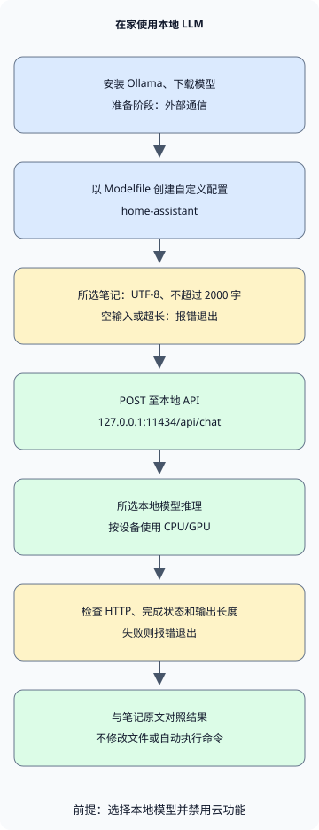

想在家使用个人 LLM，可以从**安装 Ollama、下载能在电脑运行的模型、将其连接到一个小任务**开始。本文以韩语对话和简短笔记摘要为目标；示例指令和笔记使用韩语。这是按个人需要调整已有模型的运行方式和指令，不涉及从头训练模型。

首先在 Ollama 中与本地模型对话，再从 Python 调用同一模型总结笔记。安装和 API 说明依据 2026 年 11 月 05 日确认的官方文档。[Ollama 快速入门](https://docs.ollama.com/quickstart)

## 内存只要等于模型文件大小就够了吗？

示例模型是 `qwen3:4b-instruct-2507-q4_K_M`。Ollama 将其列为 Q4_K_M 模型，大小约为 2.5GB。Q4_K_M 是用更少位数表示权重的量化格式。文件大小并非运行模型所需的全部内存。[模型文件和许可证](https://ollama.com/library/qwen3:4b-instruct-2507-q4_K_M)

运行时，除权重外，模型还需要保存对话上下文的 KV 缓存及其他运行资源。操作系统和其他应用也使用内存。上下文越大，内存使用越多，因此示例将 `num_ctx` 设为 4096。这不意味着家用电脑可以使用模型支持的最大上下文。[Ollama 上下文长度和内存](https://docs.ollama.com/context-length)

| 资源 | 选择时考虑的事项 |
| --- | --- |
| GPU 或统一内存 | 区分独立 GPU 的 VRAM 和系统 RAM。Apple Silicon 与其他应用共享统一内存。 |
| 运行时可用内存 | 不足时从更小的模型或更短的上下文开始。不要把文件大小当成最低 RAM 要求。 |
| 可用磁盘空间 | 为模型文件和额外下载留出空间。保存多个模型会增加用量。 |
| GPU 和驱动支持 | 选择模型前检查当前操作系统与设备是否受支持。 |

Ollama 的 macOS 文档要求 macOS 14 或更高版本，支持 Apple M 系列设备以 CPU/GPU 运行，Intel Mac 以 CPU 运行。Windows 要求 Windows 10 22H2 或更高版本，驱动要求随 GPU 而异。购买硬件前，先在现有电脑上检查小任务的响应速度和内存使用。[macOS 要求](https://docs.ollama.com/macos)、[Windows 要求](https://docs.ollama.com/windows)、[GPU 支持](https://docs.ollama.com/gpu)

## 安装并配置为仅本地运行

在 macOS 或 Windows 上，从[官方下载页面](https://ollama.com/download)下载安装程序并运行应用。Linux 使用官方文档中的命令。下方 Linux 命令会安装软件和服务，因此应在需要安装 Ollama 的电脑上运行。[Linux 安装](https://docs.ollama.com/linux)

```sh
curl -fsSL https://ollama.com/install.sh | sh
```

安装后在新终端检查版本。如果应用或服务已经运行服务器，无需再次启动 `ollama serve`。

```sh
ollama --version
```

要在本地处理个人资料，需要同时检查模型选择和服务器设置。Ollama 也能通过本地 API 调用云模型。**仅凭 localhost 地址不能确定推理在哪里运行。** [本地 API 与云模型](https://docs.ollama.com/api/authentication)

对于 macOS 或 Windows 用户应用，在运行服务器的账户的 `~/.ollama/server.json` 中加入以下设置。Windows 中 `~` 表示用户主目录。若文件已存在，在保留其他设置的同时添加该项，然后重启应用。这会禁用云模型和网页搜索；检查服务器日志中的 `Ollama cloud disabled: true` 以确认生效。安装与下载模型需要互联网。[仅本地设置](https://docs.ollama.com/faq#how-do-i-disable-ollamas-cloud-features)

```json
{
  "disable_ollama_cloud": true
}
```

在 Linux 上，systemd 服务可能以不同于登录用户的账户运行。此时使用 `sudo systemctl edit ollama.service` 设置服务环境变量，保存以下配置后重启服务。[Linux 服务配置](https://docs.ollama.com/linux#customizing)

```ini
[Service]
Environment="OLLAMA_NO_CLOUD=1"
Environment="OLLAMA_HOST=127.0.0.1:11434"
```

```sh
sudo systemctl daemon-reload
sudo systemctl restart ollama.service
```

如果不使用服务而直接运行服务器，保持执行 `OLLAMA_NO_CLOUD=1 OLLAMA_HOST=127.0.0.1:11434 ollama serve` 的 POSIX shell 打开。如果已有服务器运行，不要再启动一个。两种方式都应在输入个人资料前确认云功能已禁用。

使用以下命令下载示例模型并开始对话。这是非思考变体，因此不使用额外的 thinking 选项。短标签可能指向其他变体，应使用完整标签。[Qwen 模型卡](https://huggingface.co/Qwen/Qwen3-4B-Instruct-2507)

```sh
ollama pull qwen3:4b-instruct-2507-q4_K_M
ollama run qwen3:4b-instruct-2507-q4_K_M
```

第一个问题可以是：“한국어로 답해 줘. 내가 적은 메모를 요약할 때 확인할 기준 세 가지를 알려 줘”（请用韩语回答，并给出总结笔记时需确认的三个标准）确认回答是韩语且没有超出要求，再用 `/bye` 结束对话。在另一个终端用 `ollama list` 检查模型 ID，用 `ollama ps` 检查 CPU/GPU 分配和内存状态。记录已安装的 Ollama 版本、模型 ID 和标签，有助于日后比较变化。[检查模型运行状态](https://docs.ollama.com/faq#how-can-i-tell-if-my-model-was-loaded-onto-the-gpu)

## 为自己的用途设置默认指令

将以下文件保存到空工作目录。`FROM` 选择基础模型，`SYSTEM` 设置默认指令。`num_predict` 限制生成的令牌数，`temperature` 影响随机性。以下数值是短笔记摘要的示例；低 temperature 不保证事实准确。[Modelfile 语法](https://docs.ollama.com/modelfile)

### `Modelfile`

```text
FROM qwen3:4b-instruct-2507-q4_K_M
PARAMETER num_ctx 4096
PARAMETER num_predict 512
PARAMETER temperature 0.2
SYSTEM """
한국어로 간결하게 답하세요.
제공된 자료에서 확인할 수 없는 내용은 추측하지 말고 모른다고 말하세요.
원문에 있는 사실과 제안을 구분하세요.
"""
```
用以下命令创建名为 `home-assistant` 的自定义模型配置：

```sh
ollama create home-assistant -f Modelfile
ollama run home-assistant
```

仅更改指令不会让模型学习新知识或读取磁盘文件。应如下一示例般把相关材料放入请求。文档很多时，可以单独设计检索增强生成（RAG）来查找并提供相关段落。首先检查一个短文件的摘要质量。

## 用 Python 总结选定的一条笔记

此示例只使用 Python 3 标准库。它读取一个已保存文件，发送到 `127.0.0.1:11434/api/chat`，并打印结果。它不使用环境 HTTP 代理设置，也不给模型浏览文件或执行命令的工具。



图中的安装和模型下载是涉及外部通信的准备步骤。后续推理以选择本地模型且禁用云功能为前提。输入或响应验证失败时，程序报错退出，不输出摘要。

### `notes.txt`

```text
2026-11-05 집 서버 정리
결정: 사진 백업용 디스크 상태를 주말에 점검한다.
후속 작업: 작업 전 복구 테스트 방법을 찾아본다.
담당자와 정확한 시각은 정하지 않았다.
```
### `summarize.py`

```python
import json
from pathlib import Path
import sys
from urllib.request import ProxyHandler, Request, build_opener

ENDPOINT = "http://127.0.0.1:11434/api/chat"
MODEL = "home-assistant"
MAX_CHARS = 2000


def summarize(path):
    text = path.read_text(encoding="utf-8")
    if not text.strip() or len(text) > MAX_CHARS:
        raise ValueError(f"메모는 비어 있지 않은 {MAX_CHARS}자 이하의 UTF-8 텍스트여야 합니다.")
    prompt = (
        "다음 메모의 결정 사항과 후속 작업을 나누어 한국어로 요약하세요. "
        "원문에 없는 담당자나 기한을 추가하지 마세요.\n\n<자료>\n"
        + text + "\n</자료>"
    )
    payload = {
        "model": MODEL,
        "messages": [{"role": "user", "content": prompt}],
        "stream": False,
        "options": {"num_ctx": 4096, "num_predict": 512},
        "keep_alive": 0,
    }
    request = Request(
        ENDPOINT,
        data=json.dumps(payload, ensure_ascii=False).encode("utf-8"),
        headers={"Content-Type": "application/json"},
        method="POST",
    )
    opener = build_opener(ProxyHandler({}))
    with opener.open(request, timeout=120) as response:
        result = json.load(response)
    message = result.get("message") if isinstance(result, dict) else None
    answer = message.get("content") if isinstance(message, dict) else None
    if not isinstance(answer, str) or not answer.strip() or result.get("done") is not True:
        raise RuntimeError("완료된 텍스트 응답을 받지 못했습니다.")
    if result.get("done_reason") == "length":
        raise RuntimeError("출력 길이 제한에 도달했습니다. 메모나 요청 범위를 줄이세요.")
    return answer


if __name__ == "__main__":
    if len(sys.argv) != 2:
        raise SystemExit("사용법: python3 summarize.py notes.txt")
    try:
        print(summarize(Path(sys.argv[1])))
    except (OSError, ValueError, RuntimeError) as error:
        print(f"요약 실패: {error}", file=sys.stderr)
        raise SystemExit(1)
```
将两个文件保存在同一目录后运行。Windows 上可根据 Python 安装情况使用 `py -3` 代替 `python3`。

```sh
python3 summarize.py notes.txt
```

`stream: false` 请求单个 JSON 响应。示例拒绝空输入和超过 2000 字符的输入，并将 HTTP 错误、无效响应和输出长度限制视为错误。字符数限制不是精确令牌数，也要检查输入和回答是否都能放入上下文窗口。`keep_alive: 0` 请求处理后卸载模型，因此重复运行可能需要重新加载。[聊天 API 和响应字段](https://docs.ollama.com/api/chat)

客户端的正常和错误处理已使用 Python 3.13.0 的本地模拟 HTTP 服务器检查。在本文准备环境中，没有运行或验证 Ollama 安装、Modelfile 构建、模型下载、推理速度或摘要质量。安装后应将结果与上方笔记对照。120 秒网络超时不能确认服务器已停止模型任务。

检查三点：磁盘状态检查是否仍是决定事项；查找恢复测试方法是否单独列为后续任务；模型是否避免编造负责人或确切时间。语句流畅与忠实原文应分别评价。

## 选择日常任务和停止标准

| 任务 | 小范围起始输入 | 使用前检查 |
| --- | --- | --- |
| 整理个人笔记 | 一条简短会议或学习笔记 | 是否区分了决定、建议和未定事项？ |
| 修改草稿 | 自己写的一段文字与期望文风 | 含义、数字和来源是否保留？ |
| 辅助理解代码 | 可分享的公开示例或小函数 | 说明是否与代码和执行结果一致？ |

此客户端只打印响应，不修改文件或执行 shell 命令。若扩展为自动执行生成命令的代理，需要如[AI 代理的权限边界](/ko/posts/2026-11-01-ai-agent-permission-boundaries/)所述，单独设计执行权限和审批。本地模型也可能受文档中恶意指令影响并给出错误答案。

API 默认绑定本地地址，本地 API 不需要认证。先在一台电脑内使用，不要通过路由器端口转发公开 11434。家庭成员或其他设备访问需要另行配置并明确认证和访问范围。还要检查连接的应用、插件、日志或备份是否保存或向外传输数据；仅凭本地推理无法回答这个问题。[默认绑定](https://docs.ollama.com/faq#how-can-i-expose-ollama-on-my-network)、[认证范围](https://docs.ollama.com/api/authentication)

如果回答很慢，先用 `ollama ps` 检查 CPU/GPU 分配及其他应用的内存用量。缩短长输入和大上下文，再用同一任务比较。连接被拒绝时检查应用或服务是否运行；找不到模型时检查 `ollama list` 和是否已创建 `home-assistant`。不要不断堆积超时请求，应先检查已运行的工作。

固定几条笔记，每次更改模型或设置时比较遗漏、猜测和等待时间。
