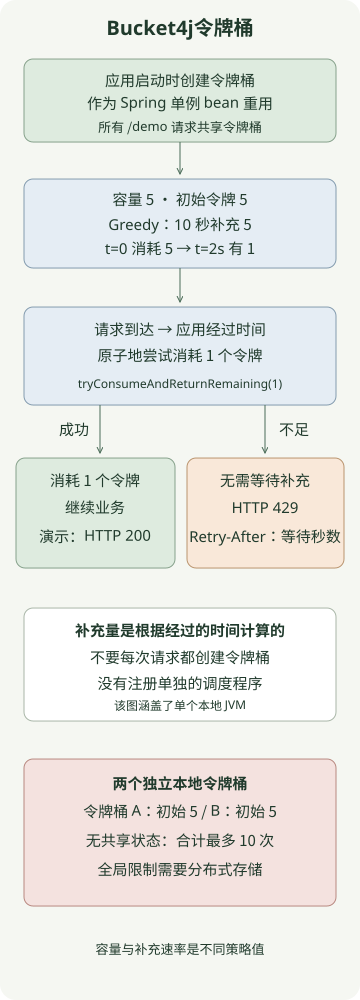

**Bucket4j 是一个 Java 速率限制库，用于计算令牌桶的填充和消耗并控制并发性。** 在 Spring 中共享令牌桶并尝试为每个请求消耗令牌可让您分别设置允许的突发和后续填充率。每个 JVM 的本地令牌桶都是独立的，因此单独添加库不会在服务器之间产生全局限制。

[上一篇 Redis Lua 限流文章](/ko/posts/2026-11-10-redis-lua-rate-limit/)实现了从首次允许的请求开始计数的固定窗口。本文实现**容量为 5、补充 5 个令牌需要 10 秒的单 JVM 令牌桶**，并解释迁移到 Redis 分布式模式时的变化。

复现环境为Bucket4j **8.22.0**、Spring Boot 3.5.16、JDK 21 和 Gradle 8.14.3。 Bucket4j 版本与 [官方版本](https://github.com/bucket4j/bucket4j/releases) 和 [8.22.0 参考](https://bucket4j.com/8.22.0/toc.html) 固定。依赖项名称中的 `jdk17` 表示 JDK 17 系列的工件；该示例在 JDK 21 上运行。

## 容量和填充率有何不同？

`capacity(5)` 是可以累积的最大令牌数量。默认初始计数也是 五，因此最初可以一次允许 五 个请求。 `refillGreedy(5, Duration.ofSeconds(10))` 设置十秒内五个令牌的速率。如果一个请求消耗 一 个 Token，则在 `t=0` 处消耗掉所有 Token 后，`t=2 seconds` 处会产生 一 个新的 Token。

因此，将该策略描述为**“任意连续十秒内最多五个请求”**是不正确的：它允许最初的五个请求和后续的重新填充。即使在长时间闲置之后，桶中的积聚也不会超过其容量 五。

| 加注方式，相同容量、加注量 | `refillGreedy(5, 10 seconds)` | `refillIntervally(5, 10 seconds)` |
| --- | --- | --- |
| 在 `t=0` 消耗全部五个 | 剩余0 | 剩余0 |
| 查看`t=2 seconds`，无需进一步消费 | 1 可用 | 0 |
| 查看`t=10 seconds`，无需进一步消费 | 5 | 5 |

Greedy 模式随时间逐渐补充；Intervally 模式在周期结束时批量补充。该表通过从零开始的受控时钟进行检查。不需要单独的调度程序定期添加令牌：查询或消耗令牌桶时，经过的时间会反映在重新填充计算中。有关 API 详细信息，请参阅[有关重新填充的 Bucket4j 参考](https://bucket4j.com/8.22.0/toc.html)。

## 如何限制 Spring MVC 请求？



控制器使用 `tryConsumeAndReturnRemaining(1)` 的结果，而不是单独查询令牌计数并猜测是否允许该请求。 `ConsumptionProbe` 返回成功、剩余令牌以及同一消费尝试的等待时间（如果不足）。

将以下五个文件保存在一个项目中。所有 `/demo` 请求共享一个令牌桶。该示例未实现按用户身份验证或令牌桶存储，并且服务器仅绑定到本地地址。

### `settings.gradle`

```groovy
rootProject.name = 'bucket4j-token-bucket'
```

### `build.gradle`

```groovy
plugins {
    id 'java'
    id 'application'
}
repositories { mavenCentral() }
java { toolchain { languageVersion = JavaLanguageVersion.of(21) } }
dependencies {
    implementation platform('org.springframework.boot:spring-boot-dependencies:3.5.16')
    implementation 'org.springframework.boot:spring-boot-starter-web'
    implementation 'com.bucket4j:bucket4j_jdk17-core:8.22.0'
    testImplementation 'org.springframework.boot:spring-boot-starter-test'
    testRuntimeOnly 'org.junit.platform:junit-platform-launcher'
}
application { mainClass = 'example.RateLimitApplication' }
test { useJUnitPlatform() }
```

### `src/main/resources/application.yml`

```yaml
server:
  address: 127.0.0.1
```

### `src/main/java/example/BucketPolicy.java`

```java
package example;

import java.time.Duration;
import io.github.bucket4j.Bucket;
import io.github.bucket4j.TimeMeter;

public final class BucketPolicy {
    private BucketPolicy() {}

    public static Bucket local(TimeMeter clock) {
        return Bucket.builder()
                .withCustomTimePrecision(clock)
                .addLimit(limit -> limit.capacity(5).refillGreedy(5, Duration.ofSeconds(10)))
                .build();
    }
}
```

### `src/main/java/example/RateLimitApplication.java`

```java
package example;

import io.github.bucket4j.Bucket;
import io.github.bucket4j.TimeMeter;
import org.springframework.boot.SpringApplication;
import org.springframework.boot.autoconfigure.SpringBootApplication;
import org.springframework.context.annotation.Bean;
import org.springframework.http.ResponseEntity;
import org.springframework.web.bind.annotation.GetMapping;
import org.springframework.web.bind.annotation.RestController;

@SpringBootApplication
public class RateLimitApplication {
    public static void main(String[] args) {
        SpringApplication.run(RateLimitApplication.class, args);
    }

    @Bean
    Bucket demoBucket() {
        return BucketPolicy.local(TimeMeter.SYSTEM_NANOTIME);
    }

    @RestController
    public static class DemoController {
        private final Bucket bucket;

        public DemoController(Bucket bucket) {
            this.bucket = bucket;
        }

        @GetMapping("/demo")
        public ResponseEntity<String> demo() {
            var probe = bucket.tryConsumeAndReturnRemaining(1);
            if (probe.isConsumed()) {
                return ResponseEntity.ok("ok\n");
            }
            long seconds = Math.max(1, Math.ceilDiv(probe.getNanosToWaitForRefill(), 1_000_000_000L));
            return ResponseEntity.status(429)
                    .header("Retry-After", Long.toString(seconds))
                    .body("rate limit exceeded\n");
        }
    }
}
```

`Bucket` 是默认的单例 Spring bean，因此它可以跨请求保留状态。每次在控制器方法内调用 `Bucket.builder()` 都会为每个请求创建初始令牌。即使存在检查，也无法真正实施限制。

当令牌不足时，`tryConsumeAndReturnRemaining` 返回拒绝，而不是让请求线程等待重新填充。这不会使整个 MVC 服务器成为非阻塞的。选择单独的等待 API 需要重新考虑线程等待和请求超时。

## 您应该期待什么回应？

在安装了 JDK 21 和 Gradle 8.14.3 且端口 8080 可用的情况下运行此程序。既不需要 Boot Gradle 插件，也不需要单独的 Redis 服务器。 Maven Central 依赖项在第一次运行时下载。

```sh
gradle run
```

服务器准备就绪后，从另一个终端调用它。这假设一个新的令牌桶没有其他调用，并且所有六个调用在下一个令牌重新填充之前完成。

```sh
for attempt in 1 2 3 4 5 6; do
  curl -s -o /dev/null -w '%{http_code}\n' http://127.0.0.1:8080/demo
done
curl -i http://127.0.0.1:8080/demo
```

接下来是预期的状态代码。如果执行时间较长或有其他请求介入，则重新填充和消耗可能会改变结果。

```text
200
200
200
200
200
429
```

被拒绝的响应的 `Retry-After` 是 `getNanosToWaitForRefill()`，向上取整到秒，最少为一秒。使用受控时钟，消耗完所有五个令牌后立即为 `2`，在 1.5 秒后为 `1`。正如[HTTP 429 的 Retry-After 语义](https://www.rfc-editor.org/rfc/rfc6585#section-4) 所描述的，它告诉客户端在重试之前需要等待多长时间。另一个请求可能会首先消耗下一个令牌，因此等待不会保留后续的配额。

在运行 `gradle run` 的终端中使用 `Ctrl+C` 停止示例服务器。

由于令牌在工作开始之前被消耗，因此如果稍后工作失败，此代码不会返回它。区分启动请求的限制和成功操作的限制。

## 如何检查并发请求和时间？

十次重现测试使用真实的Bucket4j 8.22.0，并向`TimeMeter`注入可控时钟。他们不使用 `Thread.sleep` 来等待时间过去。 [官方Intervally补充测试](https://github.com/bucket4j/bucket4j/blob/8.22.0/bucket4j-core/src/test/java/io/github/bucket4j/core_algorithms/FixedIntervalRefillTest.java)也演示了时间注射。

| 测试条件 | 观察结果 |
| --- | --- |
| 40 次调用由 8 个工作线程发送到同一个令牌桶，时钟固定 | 恰好允许 5 次 |
| 恰好 2 秒前一瞬及该时刻（已消耗 5 个令牌） | 之前拒绝；允许 1 次的时间为 2 秒 |
| 经过很长时间 | 从不超过容量 5 |
| 在 Greedy 和 Intervally 模式中使用同一时钟 | 补充差异与上表相符 |
| 拒绝后经过一段时间 | 拒绝不会推迟补货开始 |
| 两个独立的桶 | 5 每个，10 总计可消耗 |
| 每次请求都重新创建令牌桶 | 40 个新令牌桶允许了 40 次请求，重现了限制绕过 |
| 具有两个带宽限制的独立令牌桶 | 必须满足两个限制才能消费 |
| Spring MVC `MockMvc` 调用 | 验证了 200、429 和等待时间向上取整到秒 |

`MockMvc` 检查与真实的网络请求不同。另外，打包的应用程序在嵌入式 Tomcat 上启动，并验证了实际的 HTTP `200` 响应。并发调用计数是行为检查的输入，而不是吞吐量基准。

## 什么时候应该选择 Redis Lua 还是 Bucket4j？

| 标准 | 之前的 Redis Lua 示例 | 本地 Bucket4j 示例在这里 |
| --- | --- | --- |
| 政策 | 从第一个请求开始的一段时间内允许的请求 | 初始突发和之后的补充速率 |
| 共享状态 | 使用相同 Redis 和密钥的请求 | 在一个 JVM 中使用相同令牌桶对象的请求 |
| 每次请求是否调用外部存储 | 需要Redis执行 | 没有任何 |
| 添加服务器的效果 | 假设同一密钥共享状态 | 独立令牌桶使总允许量增加 |

这并不是说 Redis 仅支持固定窗口或 Bucket4j 仅支持本地模式。它比较了这两篇文章中实施的策略和存储位置。

对于全局限制，请考虑 Bucket4j 的分布式存储集成。 [有关 Redis 集成的 8.22.0 参考](https://bucket4j.com/8.22.0/toc.html) 通过 Lettuce 或其他客户端在公共密钥下使用 `ProxyManager` 和令牌桶状态。在所描述的CAS方法中，客户端读取并计算状态，然后在Redis中进行比较和替换；重试因争用而失败的比较。这与前面的示例不同，前面的示例在一次 Redis Lua 执行中执行整个令牌桶计算。

分布式状态过期也是限制策略的一部分。如果较短的 TTL 在令牌仍然不足的情况下删除了某个令牌桶，则下次访问可能会使用初始令牌创建一个新令牌桶并允许其他请求。与[官方过期策略](https://github.com/bucket4j/bucket4j/blob/8.22.0/bucket4j-core/src/main/java/io/github/bucket4j/distributed/ExpirationAfterWriteStrategy.java) 中一样，考虑完全重新填满令牌桶所需的时间以及余量。但这并不能提供对强制淘汰或数据丢失提供同样的保证。

这里使用的 `SYSTEM_NANOTIME` 用于本地令牌桶。不要随意将其用作跨 JVM 的分布式时间参考。对于分布式实施，请遵循集成的时间参考、超时和 CAS 重试设置。单独决定是在 Redis 发生故障时阻止请求，还是在有界本地策略下暂时允许请求。这里的代码不执行Redis集成或故障转移。

对于每用户限制，从经过身份验证的主体和策略范围派生令牌桶密钥。盲目信任任意请求标头标识符可以让客户端通过更改密钥来逃避限制。不断向本地 `Map` 添加每用户令牌桶会增加内存使用，并且不小心驱逐或重新创建可能会重复授予初始令牌。决定状态保留的位置和时间。

限制请求启动并不会限制同时占用资源的长时间运行操作的数量。如果目标是保护数据库连接或并发外部 API 调用，还需要设计单独的并发限制。
