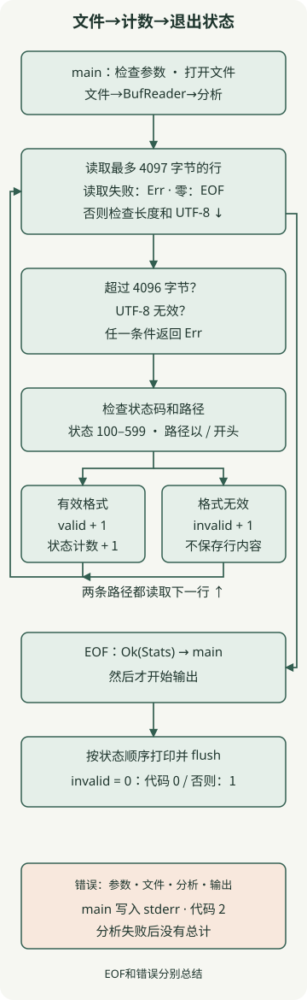

**具有清晰输入和结果的文件处理 CLI 是开始使用 Rust 进行实际工作的好方法。** 本文一次读取一行日志，并通过 HTTP 状态代码对请求进行计数。关键是避免将整个文件保存为字符串，并区分无效记录和读取失败。

本文将[之前的 Rust 入门](/en/posts/2026-11-13-rust-ownership-guide/)中的所有权、借用和 `Result` 应用于文件 I/O。示例在 **Rust 1.100.0、2024 版、macOS arm64** 上运行，只使用标准库，不需要外部包或网络连接。尚未安装开发工具时，请先阅读 [Rust 官方安装说明](https://rust-lang.org/tools/install/)。

## 什么工作适合 Rust？

重复运行文件转换、验证和聚合工具是学习 Rust 资源管理和错误处理的有用地方。向团队分发二进制文件时，请匹配目标操作系统、CPU 和所需的系统库。在一台机器上构建的可执行文件不会在每个环境中运行。

熟悉的 shell 或 Python 可能会更快地完成一次性分析。不要猜测吞吐量，而是权衡重复维护工具的需要与团队的学习成本。本文验证了处理流程和故障行为；它不与其他语言比较速度或内存使用情况。

## 定义日志格式和失败策略

该示例读取两个字段 `status-code path` 的**简化访问日志**。它不是默认 Nginx 或 Apache 日志格式的解析器。假设输入是一个写入已完成的常规文件；日志轮转、实时追踪追加内容以及解压缩均不在范围内。

| 条件 | 处理 |
| --- | --- |
| 两个由空白字符分隔的字段、100–599 中的三位数 ASCII 状态以及以 `/` 开头的路径 | 增加 `valid` 和该状态的计数 |
| 空行、或字段计数、状态或路径不符合规则 | 增加 `invalid` 并继续下一行 |
| 无法打开或读取文件、无效的 UTF-8 或行长于 4096 字节 | 分析失败并退出并显示代码 2 而不打印总数 |
| 处理到达 EOF，`invalid` 等于 0 | 打印总计并退出，代码为 0 |
| 处理达到 EOF，且 `invalid` 至少为 1 | 打印总计并退出，代码为 1 |

空白分隔包括连续的空格和制表符。行限制包括行结束字节，例如 LF 或 CRLF，并且最后一行不需要以换行符结束。空文件是 `valid=0 invalid=0` 的成功结果。该路径仅用于检查格式，不存储在总计中。

输出失败还会产生退出代码 2。在分析完成之前不会打印总计，但是**如果输出设备在写入时发生故障，则某些输出可能已经被写入**。执行合约是在使用结果之前检查退出代码。

## 准备项目

这些命令和示例使用 macOS 或 Linux shell。在 macOS 上，还安装本机链接所需的命令行工具。

```bash
rustup toolchain install 1.100.0 --profile minimal --component rustfmt --component clippy
cargo +1.100.0 new access-summary --bin --edition 2024
cd access-summary
mkdir -p examples tests
```

保存以下文件。 Cargo 将 `src/lib.rs` 作为库连接，将 `src/main.rs` 作为可执行文件连接。这种分离使您可以与聚合逻辑分开检查文件打开和终端输出。

### `Cargo.toml`

```toml
[package]
name = "access-summary"
version = "0.1.0"
edition = "2024"

[dependencies]
```

### `rust-toolchain.toml`

```toml
[toolchain]
channel = "1.100.0"
profile = "minimal"
components = ["rustfmt", "clippy"]
```

### `examples/access.log`

```text
200 /api/orders
503 /api/orders
200 /health
404 /missing
broken-line
700 /outside-range
```

## 使用 BufReader 和 BTreeMap 聚合



循环路径显示处理一行后读取下一行。右边的线将 EOF 连接到总计的返回值。参数、文件、分析和输出错误汇总在下方错误框中；代码将它们传播到 `?` 和 `main`。

### `src/lib.rs`

```rust
use std::{
    collections::BTreeMap,
    io::{self, BufRead, Read},
    str,
};

pub const MAX_LINE_BYTES: usize = 4096;

#[derive(Default, Debug, PartialEq, Eq)]
pub struct Stats {
    pub valid: u64,
    pub invalid: u64,
    pub by_status: BTreeMap<u16, u64>,
}

fn parse_status(line: &str) -> Option<u16> {
    let mut fields = line.split_whitespace();
    let code = fields.next()?;
    let path = fields.next()?;
    if fields.next().is_some() || !path.starts_with('/') {
        return None;
    }
    if code.len() != 3 || !code.bytes().all(|byte| byte.is_ascii_digit()) {
        return None;
    }
    let status = code.parse::<u16>().ok()?;
    (100..=599).contains(&status).then_some(status)
}

pub fn analyze<R: BufRead>(mut reader: R) -> io::Result<Stats> {
    let mut stats = Stats::default();
    let mut buffer = Vec::new();
    loop {
        buffer.clear();
        let read = reader
            .by_ref()
            .take((MAX_LINE_BYTES + 1) as u64)
            .read_until(b'\n', &mut buffer)?;
        if read == 0 {
            return Ok(stats);
        }
        if buffer.len() > MAX_LINE_BYTES {
            return Err(io::Error::new(
                io::ErrorKind::InvalidData,
                "line exceeds 4096 bytes",
            ));
        }
        let line = str::from_utf8(&buffer)
            .map_err(|_| io::Error::new(io::ErrorKind::InvalidData, "input is not UTF-8"))?;
        match parse_status(line) {
            Some(status) => {
                stats.valid += 1;
                *stats.by_status.entry(status).or_default() += 1;
            }
            None => stats.invalid += 1,
        }
    }
}
```

[`BufReader`](https://doc.rust-lang.org/std/io/struct.BufReader.html) 缓冲小型读取请求。 `analyze<R: BufRead>` 需要缓冲读取行为而不是具体的文件类型，因此测试可以替代内存中的 `Cursor` 或失败的输入。通用并不意味着异步或并行处理。

逐行读取本身并不施加大小限制。 [`read_until`](https://doc.rust-lang.org/std/io/trait.BufRead.html#method.read_until) 附加到缓冲区，直到分隔符或 EOF。它可以读取很长的行，因此该示例使用 [`Read::take`](https://doc.rust-lang.org/std/io/trait.Read.html#method.take) **在一次迭代中最多消耗 4097 字节**，然后再检查该行是否超过 4096 字节。 `take` 是字节限制，而不是读取时间限制。

`buffer.clear()` 重置下一行的缓冲区长度并重用其分配。聚合向量保存当前行，并且 `BufReader` 可能已提前读取。读缓冲区、向量分配和聚合映射都需要内存。由于状态代码仅限于最多 500 类型，因此 URL 数量的增加不会增加映射的键数量。这不是实际进程内存的测量。

`parse_status` 借用字符串作为 `&str`，检查它并仅返回状态代码。 [`BTreeMap`](https://doc.rust-lang.org/std/collections/struct.BTreeMap.html) 按按键顺序迭代，适合按升序打印状态。 `entry(...).or_default()` 将缺失状态计数器启动为零。

## 在 main 中决定输出和退出代码

### `src/main.rs`

```rust
use access_summary::analyze;
use std::{
    env,
    fs::File,
    io::{self, BufReader, Write},
    process::ExitCode,
};

fn run() -> io::Result<u8> {
    let mut args = env::args_os().skip(1);
    let path = args
        .next()
        .filter(|_| args.next().is_none())
        .ok_or_else(|| {
            io::Error::new(io::ErrorKind::InvalidInput, "usage: access-summary <file>")
        })?;
    let stats = analyze(BufReader::new(File::open(path)?))?;
    let mut out = io::BufWriter::new(io::stdout().lock());
    writeln!(out, "valid={} invalid={}", stats.valid, stats.invalid)?;
    for (status, count) in &stats.by_status {
        writeln!(out, "status={status} count={count}")?;
    }
    out.flush()?;
    Ok(if stats.invalid == 0 { 0 } else { 1 })
}

fn main() -> ExitCode {
    match run() {
        Ok(code) => ExitCode::from(code),
        Err(error) => {
            let _ = writeln!(io::stderr().lock(), "error: {error}");
            ExitCode::from(2)
        }
    }
}
```

`args_os` 将文件路径作为操作系统字符串。由于分析器的 `io::Result<Stats>` 连接到 `run` 的 `io::Result<u8>`，因此文件打开和分析失败可能会到达 `main` 中的错误分支。 `BufWriter`还缓冲输出，`flush()?`检查写入剩余输出是否失败。如果将诊断写入标准错误本身失败，则忽略该写入错误并保留退出代码 2。

`invalid` 统计可读但不符合规则的记录。因此，单独的输出并不意味着每个输入都是有效的。退出代码 1 表示分析已完成，但至少有一条无效记录；如果所有行均无效，则 `valid` 可以是 0。代码2表示执行失败。下面的测试和单独的 CLI 运行检查了这一区别。

## 运行示例并检查结果

```bash
cargo check --offline
cargo fmt --check
cargo clippy --offline --all-targets -- -D warnings
cargo build --offline --release
./target/release/access-summary examples/access.log
echo $?
```

该示例有四个有效行和两个无效行。实际输出如下。最终的 `1` 是使用 `echo $?` 观察到的退出代码，而不是总数的一部分。

```text
valid=4 invalid=2
status=200 count=2
status=404 count=1
status=503 count=1
1
```

| 附加输入或执行条件 | 标准输出 | 退出代码 |
| --- | --- | --- |
| 仅包含有效行的文件 | 完整总计 | 0 |
| 空文件 | `valid=0 invalid=0` | 0 |
| 一个空行 | `valid=0 invalid=1` | 1 |
| 缺少文件参数、两个参数或不存在的文件 | 没有任何; stderr 上的原因 | 2 |
| 有效行后的无效 UTF-8 | 没有任何; stderr 上的原因 | 2 |
| 一条 4097 字节线 | 没有任何; stderr 上的原因 | 2 |

## 在没有文件的情况下测试边界和故障

`Cursor` 允许像输入一样读取内存中的字节。在不依赖于磁盘或网络的情况下，单独的类型也会注入读取失败，这对于使用真实文件创建来说很麻烦。保存下面的文件并运行命令。

```bash
cargo test --offline
```

### `tests/stream.rs`

```rust
use access_summary::{MAX_LINE_BYTES, analyze};
use std::io::{self, BufRead, Cursor, Read};

#[test]
fn counts_valid_and_invalid_lines_in_status_order() {
    let stats = analyze(Cursor::new(include_bytes!("../examples/access.log"))).unwrap();
    assert_eq!((stats.valid, stats.invalid), (4, 2));
    assert_eq!(
        stats.by_status.into_iter().collect::<Vec<_>>(),
        vec![(200, 2), (404, 1), (503, 1)]
    );
}

#[test]
fn accepts_crlf_and_a_final_line_without_newline() {
    let stats = analyze(Cursor::new(b"200 /a\r\n503 /b")).unwrap();
    assert_eq!((stats.valid, stats.invalid), (2, 0));
}

#[test]
fn empty_file_and_blank_line_are_different() {
    assert_eq!(analyze(Cursor::new(b"")).unwrap().invalid, 0);
    assert_eq!(analyze(Cursor::new(b"\n")).unwrap().invalid, 1);
}

#[test]
fn rejects_malformed_status_and_fields_as_invalid_records() {
    let data = "099 /a\n600 /a\n+20 /a\n２００ /a\n200 relative\n200 /a extra\n200\n";
    let stats = analyze(Cursor::new(data.as_bytes())).unwrap();
    assert_eq!((stats.valid, stats.invalid), (0, 7));
}

#[test]
fn invalid_utf8_aborts_instead_of_reporting_partial_statistics() {
    let error = analyze(Cursor::new(b"200 /a\n\xff\n")).unwrap_err();
    assert_eq!(error.kind(), io::ErrorKind::InvalidData);
    assert_eq!(error.to_string(), "input is not UTF-8");
}

#[test]
fn accepts_exact_byte_limit_including_newline() {
    let mut data = b"200 /".to_vec();
    data.resize(MAX_LINE_BYTES - 1, b'a');
    data.push(b'\n');
    assert_eq!(analyze(Cursor::new(data)).unwrap().valid, 1);
}

#[test]
fn stops_consuming_an_oversized_line_after_limit_plus_one() {
    let mut reader = Cursor::new(vec![b'x'; 100_000]);
    let error = analyze(&mut reader).unwrap_err();
    assert_eq!(error.to_string(), "line exceeds 4096 bytes");
    assert_eq!(reader.position(), (MAX_LINE_BYTES + 1) as u64);
}

struct FailingReader;
impl Read for FailingReader {
    fn read(&mut self, _: &mut [u8]) -> io::Result<usize> {
        Err(io::Error::other("injected read failure"))
    }
}
impl BufRead for FailingReader {
    fn fill_buf(&mut self) -> io::Result<&[u8]> {
        Err(io::Error::other("injected read failure"))
    }
    fn consume(&mut self, _: usize) {}
}

#[test]
fn propagates_reader_failure() {
    assert_eq!(
        analyze(FailingReader).unwrap_err().to_string(),
        "injected read failure"
    );
}
```

所有八项执行的测试均通过。单独的 CLI 检查比较调试和发布模式下的输出和退出代码，并验证 100,000 相同有效行的计数。该输入检查了聚合准确性；这不是保证吞吐量、最大文件大小或内存消耗的负载测试。

要将其扩展为操作工具，首先选择与真实日志格式匹配的解析器，并从写入完成的文件开始。 URL 级聚合或实时收集需要单独设计键的数量、保留、文件轮换和重启后的重复计数。简单地扩展此示例的状态代码总数并不能解决这些问题。
