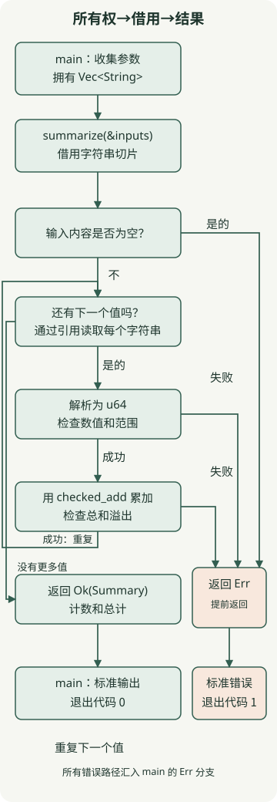

**Rust 在编译时通过所有权和类型检查来检查内存使用规则。** 代码表示谁拥有一个值以及借用该值的时间，而不是像 Java 和 Kotlin 中那样跟踪对象可达性的垃圾收集器。这使您可以将编译器错误视为数据使用契约，而不仅仅是语法限制。

本入门文章面向使用其他语言编写过函数的开发者。示例在 **Rust 1.100.0、2024 版、macOS arm64** 上运行。版本独立于编译器版本选择语法与兼容性规则。示例只使用标准库，不发出外部网络请求。

## Rust 可以帮助解决哪些问题？

Rust 编译为本机代码，并且不需要跟踪 GC 来进行默认内存管理。对于具有重要内存或延迟预算的 CLI、系统组件和程序，值得考虑。其[官方介绍](https://rust-lang.org/)也将性能和内存安全列为目标。仅缺少 GC 并不能证明 Rust 比 Java 更快或延迟更低。本文不衡量比较性能。

| 标准 | JVM 上的 Java/Kotlin | Rust |
| --- | --- | --- |
| 典型的对象内存管理 | GC 跟踪要回收的对象 | 通过所有权和 `Drop` 清理的资源 |
| 传递数据 | 多个地方可以保存对象引用 | 值根据类型移动或复制，并且可以通过引用借用 |
| 沟通失败 | 异常、结果类型和其他机制 | API 通常用 `Result<T, E>` 表示成功或失败 |
| 需要检查的导入成本 | 现有 JVM 库和团队经验 | 学习所有权的成本，以及库、构建工具和运维工具的适配性 |

如果现有服务的瓶颈是数据库等待或外部 API，请在更改语言之前测量这些路径。对于首次采用，请从具有明确边界的小型 CLI 开始，并检查开发和部署成本。

## 所有权和借用有何不同？

首先使用适合您操作系统的[官方说明](https://rust-lang.org/tools/install/) 安装 `rustup` 和 Rust，然后运行下面的示例。在 macOS 上，还安装本机链接所需的命令行工具。

`String` 拥有其字符串数据。将以下内容保存为`move_error.rs`；它**故意编译失败**。

```rust
fn main() {
    let name = String::from("Rust");
    let moved = name;
    println!("{name}, {moved}");
}
```

```bash
rustc --edition 2024 move_error.rs
```

由于 `let moved = name` 转移所有权，因此稍后尝试打印 `name` 会产生 **E0382：借用移动值**。并非每个赋值都会移动一个值：实现 `Copy` 的类型（例如 `u64`）会在赋值时复制。 `String::clone()` 复制单独的字符串数据，因此需要时使用它。规则参见[官方所有权说明](https://doc.rust-lang.org/book/ch04-01-what-is-ownership.html)。

当只读取一个值时，您可以通过 `&` 借用它，而不是转移所有权。将下一个代码保存在单独的 `borrow_ok.rs` 文件中。

```rust
fn main() {
    let mut name = String::from("Rust");
    let borrowed = &name;
    println!("{borrowed}");
    name.push_str(" language");
    println!("{name}");
}
```

```bash
rustc --edition 2024 borrow_ok.rs -o borrow_ok
./borrow_ok
```

实际输出是：

```text
Rust
Rust language
```

在第一个`println!`之后，`borrowed`就不再被使用，因此共享借用结束。这允许稍后在同一块中修改 `name`。如果在 `push_str` 之后再次打印 `borrowed`，则引用所需的生存期与突变所需的独占借用重叠，并且编译失败。

一个有用的起始规则是对同一数据的**多个共享引用 `&T` 或一个独占引用 `&mut T`**。这并不意味着 `&T` 禁止所有内部可变性。 [官方借用文档](https://doc.rust-lang.org/book/ch04-02-references-and-borrowing.html)给出了详细的条件。生命周期表达了引用必须有效的时期之间的关系；它不会延长内存本身的存活时间。

## 使用 Cargo 构建金额求和 CLI

该程序打印整数的计数和总和。它是一个解释性程序，而不是特定服务的支付实现，并假设所有输入都使用相同的单位。它不接受小数或负值；每个金额和总额必须符合 `u64`。

这些命令使用 macOS 或 Linux shell。在安装了 Rust 工具的环境中准备练习版本。

```bash
rustup toolchain install 1.100.0 --profile minimal --component rustfmt --component clippy
cargo +1.100.0 new expense-summary --bin --edition 2024
cd expense-summary
```

设置以下三个文件。 `rust-toolchain.toml` 固定此文件夹的工具版本，`Cargo.toml` 包含包配置。 [官方 Cargo 介绍](https://doc.rust-lang.org/book/ch01-03-hello-cargo.html) 还涵盖了 Cargo 构建和检查命令。

### `Cargo.toml`

```toml
[package]
name = "expense-summary"
version = "0.1.0"
edition = "2024"

[dependencies]
```

### `rust-toolchain.toml`

```toml
[toolchain]
channel = "1.100.0"
profile = "minimal"
components = ["rustfmt", "clippy"]
```



该图显示了 `summarize` 中的循环和早期返回。左边返回下一个值检查的那行是累加成功后的循环；右侧的所有错误路径都在 `main` 中的 `Err` 分支处相遇。

### `src/main.rs`

```rust
use std::{env, process::ExitCode};

struct Summary {
    count: usize,
    total: u64,
}

#[derive(Debug)]
enum InputError {
    EmptyInput,
    InvalidAmount,
    TotalOverflow,
}

fn summarize(inputs: &[String]) -> Result<Summary, InputError> {
    if inputs.is_empty() {
        return Err(InputError::EmptyInput);
    }

    let mut total = 0_u64;
    for input in inputs {
        let amount = input
            .parse::<u64>()
            .map_err(|_| InputError::InvalidAmount)?;
        total = total.checked_add(amount).ok_or(InputError::TotalOverflow)?;
    }

    Ok(Summary {
        count: inputs.len(),
        total,
    })
}

fn main() -> ExitCode {
    let inputs: Vec<String> = env::args().skip(1).collect();
    match summarize(&inputs) {
        Ok(summary) => {
            println!("count={}, total={}", summary.count, summary.total);
            ExitCode::SUCCESS
        }
        Err(error) => {
            eprintln!("error: {error:?}");
            ExitCode::FAILURE
        }
    }
}
```

`inputs` 是 `main` 拥有的 `Vec<String>`。 `summarize(&inputs)` 借用其字符串作为切片 `&[String]`，而不克隆整个输入或转移所有权。 `for input in inputs` 还通过引用读取字符串。借用可以避免在此处复制输入字符串，但不会消除命令行参数收集期间的分配。

`Summary` 是一个保存成功结果的结构体； `InputError` 是可能失败的枚举。 `Result<Summary, InputError>` 是返回这些结果之一的合约。 遇到 `Err` 时，`?` 会从当前函数提前返回；成功时则取出内部值。它不会引发异常或立即终止程序。 [官方结果解释](https://doc.rust-lang.org/book/ch09-02-recoverable-errors-with-result.html) 描述了错误传播。

`parse::<u64>()` 检查每个数字的格式和范围。如果两个值的总和超出范围，`checked_add` 返回 `None`，`ok_or` 将其转换为 `TotalOverflow` 错误。因此，单独有效的输入仍然可能溢出总数。 `main` 使用 `match` 来处理这两个结果，而 `{:?}` 使用其 `Debug` 格式打印错误名称。

## 通过运行它可以验证什么？

```bash
rustc --version
cargo check --offline
cargo fmt --check
cargo clippy --offline -- -D warnings
cargo run --offline --quiet -- 12000 8000 0
```

该运行的标准输出如下。 `--` 之后的值将传递给示例程序而不是 Cargo。

```text
count=3, total=20000
```

这些是在实际 CLI 运行中观察到的代表性结果。出错时，不会打印部分总和；错误转到标准错误并退出，代码为 1。

| `cargo run --offline --quiet --` 之后的参数 | 输出 | 退出代码 |
| --- | --- | --- |
| `12000 8000 0` | 标准输出 `count=3, total=20000` | 0 |
| `0` | 标准输出 `count=1, total=0` | 0 |
| 无参数 | 标准错误 `error: EmptyInput` | 1 |
| `12000 abc` | 标准错误 `error: InvalidAmount` | 1 |
| `-1` 或 `1.5` | 标准错误 `error: InvalidAmount` | 1 |
| `18446744073709551616` | 标准错误 `error: InvalidAmount` | 1 |
| `18446744073709551615 0` | 标准输出 `count=2, total=18446744073709551615` | 0 |
| `18446744073709551615 1` | 标准错误 `error: TotalOverflow` | 1 |

`cargo check` 在不运行代码的情况下检查类型和相关属性。 `cargo fmt --check` 检查格式，而 Clippy 提供静态诊断。即使成功了，也要单独运行程序来检查计算规则。这里，比较了调试和发布运行中的输出、错误和退出代码；未测量吞吐量和生产负荷。

## Rust 能保证什么？

Safe Rust 的类型和所有权检查有助于防止无效引用使用和数据竞争。值是否可以在线程之间移动以及引用是否可以共享也与类型约定相关，例如 [`Send` 和 `Sync`](https://doc.rust-lang.org/book/ch16-04-extensible-concurrency-sync-and-send.html)。这并不能消除所有竞争条件、死锁、内存泄漏或业务逻辑错误。

[`unsafe`](https://doc.rust-lang.org/book/ch20-01-unsafe-rust.html) 使作者对某些操作的安全条件负责。它不是关闭整个借用检查器的开关。不正确的 `unsafe` 实施或 FFI 边界可能会影响安全。服务器、异步执行和共享状态设计不在此 CLI 的验证范围内。

对于下一个练习，扩展程序以从文件中读取输入量。确定文件 I/O 错误与现有 `InputError` 有何不同，以更具体地了解所有权和错误类型如何表达程序边界。
