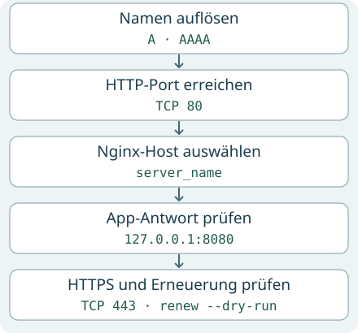

---
{
  "state": "draft",
  "language": "de",
  "translationKey": "2026-11-28-nginx-dns-https",
  "title": "Duck DNS mit Nginx verbinden: Mit KI von DNS bis HTTPS prüfen",
  "description": "Verfolge eine externe Anfrage bis zur App, grenze Zeitüberschreitungen von Proxyfehlern ab und prüfe anschließend Zertifikat und Erneuerung.",
  "sourcePath": "src/content/posts/en/2026-11-28-nginx-dns-https.md",
  "sourceSha256": "921090516e1cb08c80387f75bf13f1ef2b554b81ad242843948943262a48f77e"
}
---

Vorausgesetzt sind ein Linux-Server mit öffentlicher IPv4-Adresse, ein Duck-DNS-Name und eine für die Öffentlichkeit bestimmte App, die auf demselben Rechner wie Nginx unter `127.0.0.1:8080` lauscht. Die frühere Notiz-App war eine lokale Übung. Verwende hier eine separate App für den öffentlichen Betrieb.

## Die KI um einen überprüfbaren Ablauf bitten

> Ich möchte auf Linux mit öffentlicher IPv4-Adresse meinen Duck-DNS-Namen mit Nginx verbinden. Die App läuft auf demselben Host unter `127.0.0.1:8080`. Verwende `example.com` als Platzhalter. Gib Prüfkommandos und erwartete Ergebnisse für DNS-A-Eintrag, externe Port-Erreichbarkeit, Reverse Proxy und HTTPS in dieser Reihenfolge an. Wie unterscheide ich bei korrektem DNS einen Timeout von `502`? Zeige die kleinste nötige Konfigurationsänderung und den Rückweg. Frage bei unbekannten Werten nach und führe nichts aus.

Übermittle keine Tokens oder SSH-Schlüssel. Prüfe die Antwort für jeden Verbindungsabschnitt einzeln.



## DNS und lokale App prüfen

Ersetze `example.com` überall durch deinen Namen. Aktualisiere bei Duck DNS den A-Eintrag auf die öffentliche IPv4-Adresse. Veröffentliche AAAA erst, wenn IPv6 von außen bis zur App funktioniert. Nginx lauscht im Beispiel auf IPv4. Frage DNS mit dig ab und prüfe dann auf dem Server mit curl, ob die gewohnte Antwort der App kommt. [Duck DNS](https://www.duckdns.org/spec.jsp) · [Let’s Encrypt · IPv6](https://letsencrypt.org/docs/ipv6-support/)

```sh
dig +short example.com A
dig +short example.com AAAA
curl --fail --show-error http://127.0.0.1:8080/
```

## Die HTTP-Anfrage an die App leiten

Sichere die aktive Konfiguration. Ergänze diesen server-Block mit dem tatsächlichen Hostnamen im http-Kontext der Site. Prüfe mit `nginx -t` und lade die Konfiguration erst nach erfolgreichem Test über die Dienstverwaltung deines Systems neu. [NGINX · proxy_pass](https://nginx.org/en/docs/beginners_guide.html#proxy) · [nginx -t](https://nginx.org/en/docs/switches.html)

```nginx
server {
    listen 80;
    server_name example.com;

    location / {
        proxy_pass http://127.0.0.1:8080;
        proxy_set_header Host $host;
        proxy_set_header X-Forwarded-Proto $scheme;
    }
}
```

Rufe die Site aus einem anderen Netz über HTTP auf. Du solltest denselben Inhalt erhalten. Bei korrektem DNS und einem Timeout prüfe zuerst Anschluss, Portweiterleitung und Firewall. Antwortet Nginx mit `502`, prüfe die lokale App und den Upstream-Port. Für den Rückweg stelle die gesicherte Konfiguration wieder her, teste sie und lade sie neu.

```sh
curl --fail --show-error http://example.com/
```

## HTTPS prüfen und die Erneuerung testen

Mit installiertem Nginx-Plugin für Certbot und von außen erreichbarem TCP-Port `80` kann HTTP-01 den Namen validieren. Sichere zuerst die funktionierende HTTP-Konfiguration, da das Plugin das Zertifikat installieren und Nginx umkonfigurieren kann. Führe Certbot auf dem Server aus, prüfe HTTPS aus einem anderen Netz und teste die Erneuerung auf dem Server. [Let’s Encrypt · HTTP-01 / DNS-01](https://letsencrypt.org/docs/challenge-types/) · [Certbot](https://eff-certbot.readthedocs.io/en/stable/using.html)

```sh
sudo certbot --nginx -d example.com
```

```sh
curl --fail --show-error https://example.com/
```

```sh
sudo certbot renew --dry-run
```

Halte die externe HTTPS-Antwort, den Domainnamen im Zertifikat und das Ergebnis des Probelaufs fest. Ist TCP-Port `80` gesperrt, kann DNS-01 die Kontrolle über den Namen in einer von dir verwalteten DNS-Zone bestätigen. Besucher brauchen weiterhin einen funktionierenden HTTPS-Zugang, üblicherweise über TCP-Port `443`.

Wir haben den Ablauf mit der offiziellen Dokumentation abgeglichen. Wir haben keine produktiven DNS-, Firewall- oder Servereinstellungen geändert, Certbot nicht ausgeführt, kein Zertifikat ausgestellt und keine öffentliche Bereitstellung getestet.

[Lokale Notiz-App](https://youdozi.github.io/en/posts/2026-11-28-self-hosting-ai-notes/) · [Vier kostenlose Subdomain-Dienste für einen Nginx-Server zu Hause](https://youdozi.github.io/en/posts/2026-11-28-nginx-free-subdomains/)
