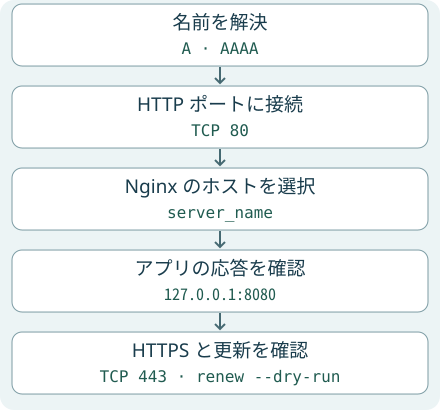

---
{
  "state": "draft",
  "language": "ja",
  "translationKey": "2026-11-28-nginx-dns-https",
  "title": "AI と進める Duck DNS と Nginx の接続：DNS から HTTPS まで",
  "description": "外部からのリクエストをアプリまでたどり、タイムアウトとプロキシエラーを切り分けてから、証明書と更新手順を確認します。",
  "sourcePath": "src/content/posts/en/2026-11-28-nginx-dns-https.md",
  "sourceSha256": "1afd017a347d250d7ed293c1a456355c47fa605f6f677aa12adda112db84165a"
}
---

グローバル IPv4 が使える Linux サーバーと Duck DNS 名を一つ用意したとします。Nginx と同じマシンの `127.0.0.1:8080` では公開用のアプリが起動済みです。前回のメモアプリはローカル実習用でした。ここでは公開を想定した別のアプリを使います。

## 確認できる手順を AI に依頼する

**プロンプト** グローバル IPv4 の Linux で Duck DNS 名を Nginx に接続したい。同じホストの `127.0.0.1:8080` でアプリが動いている。実際のドメインの代わりに `example.com` を使って。DNS の A レコード、外部からのポート接続、リバースプロキシ、HTTPS の順に確認コマンドと期待する結果を示して。DNS が正常なときにタイムアウトと `502` をどう切り分けるか、最小限の設定変更と元に戻す手順も説明して。不明な値は質問し、操作は実行しないで。

トークンや SSH 鍵は入力しません。返答は接続の区間ごとに確認してください。



## DNS とローカルアプリを確認する

以下の `example.com` はすべて自分の名前に置き換えます。Duck DNS の A がグローバル IPv4 を指すように更新します。AAAA を公開するのは外部から IPv6 でアプリまで到達できる場合だけです。例の Nginx は IPv4 で待ち受けます。dig で DNS を照会し、サーバー上で curl を実行して普段どおりの応答が返るか確認します。 [Duck DNS](https://www.duckdns.org/spec.jsp) · [Let’s Encrypt · IPv6](https://letsencrypt.org/docs/ipv6-support/)

```sh
dig +short example.com A
dig +short example.com AAAA
curl --fail --show-error http://127.0.0.1:8080/
```

## HTTP リクエストをアプリに渡す

現在の設定を保存します。サイトの http コンテキストに次の server ブロックを追加し、実際のホスト名に置き換えます。`nginx -t` に通ったら OS のサービス管理方式に合わせて再読み込みします。 [NGINX · proxy_pass](https://nginx.org/en/docs/beginners_guide.html#proxy) · [nginx -t](https://nginx.org/en/docs/switches.html)

```nginx
server {
    listen 80;
    server_name example.com;

    location / {
        proxy_pass http://127.0.0.1:8080;
        proxy_set_header Host $host;
        proxy_set_header X-Forwarded-Proto $scheme;
    }
}
```

別のネットワークから HTTP でアクセスすると同じアプリの内容が返るはずです。DNS が正しくてもタイムアウトするなら回線、ルーターのポート転送、ファイアウォールを先に確認します。Nginx が `502` を返すならローカルアプリの応答と転送先ポートから調べます。戻すときは保存した設定を復元し、テストに通ってから再読み込みします。

```sh
curl --fail --show-error http://example.com/
```

## HTTPS 接続と更新の予行演習

Certbot の Nginx プラグインを導入し、外部から TCP `80` に到達できれば HTTP-01 で名前を検証できます。プラグインは証明書をインストールして Nginx の設定を変更できるので、動作中の HTTP 設定を保存します。サーバーで Certbot を実行し、外部から HTTPS を確認した後、サーバーで更新をテストします。 [Let’s Encrypt · HTTP-01 / DNS-01](https://letsencrypt.org/docs/challenge-types/) · [Certbot](https://eff-certbot.readthedocs.io/en/stable/using.html)

```sh
sudo certbot --nginx -d example.com
```

```sh
curl --fail --show-error https://example.com/
```

```sh
sudo certbot renew --dry-run
```

外部からの HTTPS 応答、証明書のドメイン名、更新テストの結果を記録します。TCP `80` が遮断されていれば、管理できる DNS ゾーンで DNS-01 を使ってドメインの管理権限を検証できます。訪問者には通常 TCP `443` を通る HTTPS 接続経路も必要です。

手順は公式文書と照合しました。実環境の DNS・ファイアウォール・サーバーの設定変更、Certbot の実行、証明書の発行、外部公開の動作確認は行っていません。

[ローカルのメモアプリ実習](https://youdozi.github.io/en/posts/2026-11-28-self-hosting-ai-notes/) · [自宅の Nginx で使える無料サブドメイン４サービスを比較](https://youdozi.github.io/en/posts/2026-11-28-nginx-free-subdomains/)
