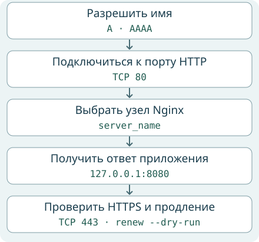

---
{
  "state": "draft",
  "language": "ru",
  "translationKey": "2026-11-28-nginx-dns-https",
  "title": "Как подключить Duck DNS к Nginx с помощью ИИ и проверить путь от DNS до HTTPS",
  "description": "Проследите путь внешнего запроса до приложения, отличите тайм-аут от ошибки прокси, затем проверьте сертификат и его продление.",
  "sourcePath": "src/content/posts/en/2026-11-28-nginx-dns-https.md",
  "sourceSha256": "1afd017a347d250d7ed293c1a456355c47fa605f6f677aa12adda112db84165a"
}
---

В примере есть сервер Linux с публичным IPv4 и одно имя Duck DNS. Приложение для внешних пользователей уже слушает на `127.0.0.1:8080` на том же узле, что и Nginx. Приложение для заметок из предыдущей статьи предназначалось для локальной практики. Здесь используется отдельное приложение, рассчитанное на публикацию.

## Попросите ИИ составить план с проверками

**Запрос** Хочу подключить имя Duck DNS к Nginx под Linux с публичным IPv4. Приложение работает на том же узле по адресу `127.0.0.1:8080`. Вместо реального домена используй `example.com`. Приведи команды и ожидаемые результаты по порядку: запись DNS типа A, доступ к порту извне, обратный прокси и HTTPS. Если DNS работает правильно, как отличить тайм-аут от ошибки `502`? Покажи минимальное изменение конфигурации и порядок отката. Если значение неизвестно, спроси. Ничего не выполняй.

Не отправляйте токены и ключи SSH. Проверяйте ответ отдельно для каждого участка соединения.



## Проверьте DNS и локальное приложение

Везде замените `example.com` своим именем. Обновите запись A в Duck DNS, чтобы она указывала на ваш публичный IPv4. Публикуйте AAAA, только если путь по IPv6 работает извне до самого приложения. В примере Nginx слушает по IPv4. Запросите записи с помощью dig, затем выполните curl на сервере и проверьте, что приложение отдаёт обычный ответ. [Duck DNS](https://www.duckdns.org/spec.jsp) · [Let’s Encrypt · IPv6](https://letsencrypt.org/docs/ipv6-support/)

```sh
dig +short example.com A
dig +short example.com AAAA
curl --fail --show-error http://127.0.0.1:8080/
```

## Передайте запрос HTTP приложению

Сохраните действующую конфигурацию. Добавьте блок server в контекст http сайта, указав настоящее имя узла. Проверьте конфигурацию с помощью `nginx -t`. Если проверка прошла, перечитайте настройки через менеджер служб вашей ОС. [NGINX · proxy_pass](https://nginx.org/en/docs/beginners_guide.html#proxy) · [nginx -t](https://nginx.org/en/docs/switches.html)

```nginx
server {
    listen 80;
    server_name example.com;

    location / {
        proxy_pass http://127.0.0.1:8080;
        proxy_set_header Host $host;
        proxy_set_header X-Forwarded-Proto $scheme;
    }
}
```

Откройте сайт по HTTP из другой сети. Ожидается то же содержимое приложения. Если DNS верен, но время ожидания истекает, начните с подключения, проброса порта и межсетевого экрана. Если Nginx вернул `502`, сначала проверьте локальный ответ приложения и порт, на который направлен запрос. Для отката восстановите сохранённую конфигурацию, проверьте её и перечитайте.

```sh
curl --fail --show-error http://example.com/
```

## Проверьте HTTPS и выполните пробное продление

Если установлен модуль Nginx для Certbot и порт TCP `80` доступен извне, можно подтвердить имя через HTTP-01. Сохраните рабочую конфигурацию HTTP: модуль может установить сертификат и изменить настройки Nginx. Запустите Certbot на сервере, проверьте HTTPS из другой сети и выполните пробное продление на сервере. [Let’s Encrypt · HTTP-01 / DNS-01](https://letsencrypt.org/docs/challenge-types/) · [Certbot](https://eff-certbot.readthedocs.io/en/stable/using.html)

```sh
sudo certbot --nginx -d example.com
```

```sh
curl --fail --show-error https://example.com/
```

```sh
sudo certbot renew --dry-run
```

Запишите ответ HTTPS из внешней сети, доменное имя в сертификате и результат пробного продления. Если порт TCP `80` закрыт, подтвердить контроль над именем можно через DNS-01 в доступной вам зоне DNS. Посетителям всё равно нужен рабочий путь по HTTPS, обычно через порт TCP `443`.

Мы сверили порядок действий с официальной документацией. Мы не меняли настройки DNS, межсетевого экрана и сервера в действующей системе, не запускали Certbot, не выпускали сертификат и не проверяли публичное развёртывание.

[Локальная практика с приложением для заметок](https://youdozi.github.io/en/posts/2026-11-28-self-hosting-ai-notes/) · [Четыре бесплатных сервиса поддоменов для домашнего сервера Nginx](https://youdozi.github.io/en/posts/2026-11-28-nginx-free-subdomains/)
