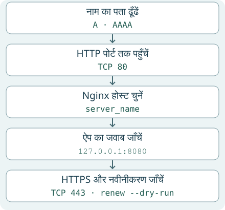

---
{
  "state": "draft",
  "language": "hi",
  "translationKey": "2026-11-28-nginx-dns-https",
  "title": "AI की मदद से Duck DNS को Nginx से जोड़ें और DNS से HTTPS तक जाँचें",
  "description": "बाहरी अनुरोध को ऐप तक चरणों में जाँचें, टाइमआउट और प्रॉक्सी की गड़बड़ी का अंतर पहचानें, फिर प्रमाणपत्र और उसके नवीनीकरण की जाँच करें।",
  "sourcePath": "src/content/posts/en/2026-11-28-nginx-dns-https.md",
  "sourceSha256": "921090516e1cb08c80387f75bf13f1ef2b554b81ad242843948943262a48f77e"
}
---

मान लें कि Linux सर्वर पर सार्वजनिक IPv4 है और आपके पास एक Duck DNS नाम है। Nginx वाली मशीन पर ही सार्वजनिक उपयोग के लिए तैयार ऐप `127.0.0.1:8080` पर चल रहा है। पिछले लेख का नोट्स ऐप स्थानीय अभ्यास के लिए था। यहाँ सार्वजनिक उपयोग के लिए अलग ऐप लें।

## AI से ऐसा क्रम माँगें जिसे आप जाँच सकें

> मुझे सार्वजनिक IPv4 वाले Linux पर अपना Duck DNS नाम Nginx से जोड़ना है। ऐप उसी होस्ट पर `127.0.0.1:8080` पर चल रहा है। असली डोमेन की जगह `example.com` लिखो। DNS A रिकॉर्ड, बाहर से पोर्ट तक पहुँच, रिवर्स प्रॉक्सी और HTTPS जाँचने के कमांड और अपेक्षित परिणाम इसी क्रम में दो। DNS सही हो तो टाइमआउट और `502` में अंतर कैसे पहचानूँ? कॉन्फ़िगरेशन में न्यूनतम बदलाव और उसे वापस लेने के चरण बताओ। जो मान पता न हो वह पूछो, कोई कमांड मत चलाओ।

टोकन या SSH कुंजियाँ प्रॉम्प्ट में न भेजें। कनेक्शन के हर हिस्से के लिए उत्तर अलग से जाँचें।



## DNS और स्थानीय ऐप जाँचें

हर उदाहरण में `example.com` की जगह अपना नाम लिखें। Duck DNS में A रिकॉर्ड को अपने सार्वजनिक IPv4 की ओर इंगित करें। AAAA तभी प्रकाशित करें जब बाहर से IPv6 पर पूरा रास्ता काम करता हो। इस उदाहरण में Nginx IPv4 पर सुनता है। dig से DNS देखें, फिर सर्वर पर curl चलाकर जाँचें कि ऐप का सामान्य जवाब मिलता है। [Duck DNS](https://www.duckdns.org/spec.jsp) · [Let’s Encrypt · IPv6](https://letsencrypt.org/docs/ipv6-support/)

```sh
dig +short example.com A
dig +short example.com AAAA
curl --fail --show-error http://127.0.0.1:8080/
```

## HTTP अनुरोध ऐप तक पहुँचाएँ

मौजूदा कॉन्फ़िगरेशन की प्रति सहेजें। साइट के http संदर्भ में नीचे का server ब्लॉक अपने असली होस्टनाम के साथ जोड़ें। `nginx -t` से जाँचें और सफल होने पर ही अपने सिस्टम के सेवा प्रबंधक से कॉन्फ़िगरेशन दोबारा लोड करें। [NGINX · proxy_pass](https://nginx.org/en/docs/beginners_guide.html#proxy) · [nginx -t](https://nginx.org/en/docs/switches.html)

```nginx
server {
    listen 80;
    server_name example.com;

    location / {
        proxy_pass http://127.0.0.1:8080;
        proxy_set_header Host $host;
        proxy_set_header X-Forwarded-Proto $scheme;
    }
}
```

दूसरे नेटवर्क से साइट को HTTP पर खोलें। वही ऐप सामग्री मिलनी चाहिए। DNS सही हो लेकिन समय समाप्त हो जाए, तो पहले कनेक्शन, राउटर की पोर्ट फ़ॉरवर्डिंग और फ़ायरवॉल देखें। Nginx से `502` मिले तो पहले ऐप का स्थानीय जवाब और उसका पोर्ट देखें। बदलाव वापस लेने के लिए सहेजा हुआ कॉन्फ़िगरेशन बहाल करें, जाँचें और दोबारा लोड करें।

```sh
curl --fail --show-error http://example.com/
```

## HTTPS जाँचें और नवीनीकरण का पूर्वाभ्यास करें

Certbot का Nginx प्लगइन इंस्टॉल हो और TCP पोर्ट `80` बाहर से सुलभ हो तो HTTP-01 से नाम सत्यापित हो सकता है। पहले काम कर रहा HTTP कॉन्फ़िगरेशन सहेजें क्योंकि प्लगइन प्रमाणपत्र इंस्टॉल कर सकता है और Nginx के कॉन्फ़िगरेशन में बदलाव कर सकता है। सर्वर पर Certbot चलाएँ, दूसरे नेटवर्क से HTTPS जाँचें और सर्वर पर नवीनीकरण का परीक्षण करें। [Let’s Encrypt · HTTP-01 / DNS-01](https://letsencrypt.org/docs/challenge-types/) · [Certbot](https://eff-certbot.readthedocs.io/en/stable/using.html)

```sh
sudo certbot --nginx -d example.com
```

```sh
curl --fail --show-error https://example.com/
```

```sh
sudo certbot renew --dry-run
```

बाहरी HTTPS जवाब, प्रमाणपत्र में डोमेन का नाम और नवीनीकरण के पूर्वाभ्यास का परिणाम दर्ज करें। TCP पोर्ट `80` बंद हो तो अपने नियंत्रण वाले DNS ज़ोन में DNS-01 से डोमेन पर नियंत्रण सिद्ध कर सकते हैं। आगंतुकों के लिए HTTPS का चालू रास्ता फिर भी चाहिए, जो आम तौर पर TCP पोर्ट `443` से जाता है।

हमने इस प्रक्रिया को आधिकारिक दस्तावेज़ों से मिलाया। हमने लाइव DNS, फ़ायरवॉल या सर्वर की सेटिंग नहीं बदलीं, Certbot नहीं चलाया, प्रमाणपत्र जारी नहीं किया और सार्वजनिक परिनियोजन नहीं परखा।

[स्थानीय नोट्स ऐप का अभ्यास](https://youdozi.github.io/en/posts/2026-11-28-self-hosting-ai-notes/) · [घर पर Nginx चलाने के लिए चार मुफ़्त सबडोमेन सेवाएँ](https://youdozi.github.io/en/posts/2026-11-28-nginx-free-subdomains/)
