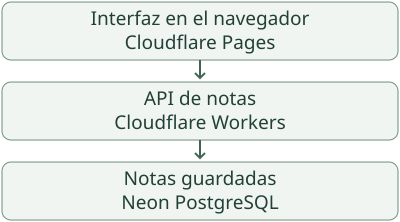

---
{
  "state": "draft",
  "language": "es",
  "translationKey": "2026-11-28-free-deployment-guide",
  "title": "Alojamiento gratuito: dónde desplegar un sitio estático, una API y PostgreSQL",
  "description": "Compara los límites de compilación, el primer acceso tras un periodo de inactividad y la conservación de datos según el proyecto.",
  "sourcePath": "src/content/posts/en/2026-11-28-free-deployment-guide.md",
  "sourceSha256": "0557a16ab0634eaf65f92ae9f1818ab52b9bcad87cf30fa8bfe95490ac381740"
}
---

Puedes publicar un blog o un portafolio en **GitHub Pages o Cloudflare Pages**. Si la aplicación también debe guardar notas, puedes ejecutar la API en **Cloudflare Workers o Render** y almacenar los datos en PostgreSQL con **Neon o Supabase**. Para una tarea o una demostración con fecha de cierre, Render Postgres también es una opción durante 30 días.

Los planes gratuitos se comportan de forma distinta cuando se alcanza un límite o cuando cae la actividad. Un alojamiento estático puede bloquear nuevas compilaciones. Una API puede tardar más en responder a la primera solicitud tras un periodo de inactividad. Algunas bases de datos se reactivan con la siguiente consulta, mientras que otras requieren una intervención en el panel de control.

*Comparación basada en la documentación y los precios oficiales del 28 de noviembre de 2026. Las configuraciones son ejemplos. No creamos cuentas, desplegamos ejemplos ni medimos tiempos de respuesta.*

## En un sitio estático se publican los archivos compilados

Si las páginas se generan durante la compilación, como en un blog con Astro o un portafolio HTML, basta con un alojamiento estático. Al elegirlo, considera el tamaño de los archivos, la frecuencia de compilación y el uso que le darás al sitio.

| Servicio | Proyectos adecuados | Condiciones del plan gratuito |
| --- | --- | --- |
| GitHub Pages | Blogs, documentación y portafolios en repositorios públicos | El sitio publicado puede ocupar hasta 1 GB y tiene un límite flexible de ancho de banda de 100 GB al mes. Hay restricciones para los sitios cuyo objetivo principal sea gestionar un comercio electrónico u ofrecer un SaaS comercial. [Límites de GitHub Pages](https://docs.github.com/en/pages/getting-started-with-github-pages/github-pages-limits) |
| Cloudflare Pages | Sitios estáticos de Astro o Vite y proyectos que necesitan vistas previas por rama | 500 compilaciones al mes, 1 a la vez y un máximo de 25 MiB por archivo. Las solicitudes de archivos estáticos que no invocan Functions son ilimitadas. [Límites de Pages](https://developers.cloudflare.com/pages/platform/limits/) · [Precios de los archivos estáticos y Functions](https://developers.cloudflare.com/pages/functions/pricing/) |
| Vercel Hobby | Proyectos personales no comerciales con Next.js | Puedes desplegar páginas estáticas y Functions en un mismo proyecto. Revisa las condiciones de uso de Hobby y el consumo de Functions. [Plan Hobby](https://vercel.com/docs/plans/hobby) · [Directrices de uso razonable](https://vercel.com/docs/limits/fair-use-guidelines) · [Precios de Vercel](https://vercel.com/pricing) |

GitHub Pages es un buen punto de partida si, como en este blog, generas los artículos antes de publicarlos. En una entrada anterior explicamos cómo separamos la compilación de la publicación. [De la publicación automática con Jekyll a la revisión de PR en borrador con Astro](../2026-04-07-jekyll-github-actions-content-pipeline/)

## Elige cómo ejecutar la API de backend

| Servicio | API adecuadas | Condiciones del plan gratuito |
| --- | --- | --- |
| Cloudflare Workers | API HTTP ligeras que validan la entrada, consultan una base de datos y devuelven JSON | 100.000 solicitudes al día y 10 ms de CPU por solicitud. El tiempo de CPU comprende la ejecución del código y excluye la espera de respuestas de red. Pages Functions comparte la cuota gratuita de solicitudes de Workers. [Límites de Workers](https://developers.cloudflare.com/workers/platform/limits/) · [Precios de Pages Functions](https://developers.cloudflare.com/pages/functions/pricing/) |
| Render Free Web Service | Demos con un proceso servidor HTTP, por ejemplo con FastAPI o Express | El servicio se suspende tras 15 minutos sin tráfico entrante. La siguiente solicitud lo inicia de nuevo, lo que tarda alrededor de un minuto según Render. Cada espacio de trabajo dispone de 750 horas de instancia gratuitas al mes. Los cambios en archivos locales se pierden al reiniciar, volver a desplegar o entrar en reposo. [Despliegue gratuito en Render](https://render.com/docs/free) |

Imagina que despliegas en Render la aplicación de notas en Python del artículo anterior. Aunque `GET /health` responda correctamente, las notas guardadas en un archivo SQLite local pueden desaparecer cuando el servidor entra en reposo y vuelve a arrancar. Para conservarlas, guárdalas en una base PostgreSQL externa y comprueba que puedes leer la misma nota después de un reinicio. [Alojar la aplicación de notas en tu propio servidor](../2026-11-28-self-hosting-ai-notes/) · [Sistema de archivos de Render](https://render.com/docs/free#local-files-lost-on-redeploy)

## En PostgreSQL importan tanto la capacidad como la inactividad

| Servicio | Recursos gratuitos | Qué ocurre si dejas de usarlo |
| --- | --- | --- |
| Neon Free | 1 GB de almacenamiento PostgreSQL y 100 horas de unidad de cómputo (CU) al mes por proyecto | Tras 5 minutos de inactividad, el cómputo se detiene y se reactiva automáticamente con la siguiente consulta. Si agotas la cuota mensual de cómputo, queda suspendido hasta el próximo periodo de facturación o hasta que cambies a un plan de pago. [Precios de Neon](https://neon.com/pricing) |
| Supabase Free | 500 MB de base de datos por proyecto, con PostgreSQL gestionado, Auth y la Data API | El proyecto puede quedar en pausa tras 7 días de poca actividad en la base. Puedes reactivarlo desde el panel de control. [Precios de Supabase](https://supabase.com/pricing) · [Pausa de proyectos](https://supabase.com/docs/guides/platform/free-project-pausing) |
| Render Free Postgres | 1 base gratuita por espacio de trabajo con 1 GB de almacenamiento | Caduca 30 días después de crearse, independientemente de su actividad. Si no pasas a un plan de pago en los 14 días posteriores al vencimiento, se eliminan los datos. [PostgreSQL gratuito en Render](https://render.com/docs/free#free-postgres) |

Si vas a crear un servidor de API independiente y escribir SQL directamente, puedes empezar por Neon. Si también necesitas inicio de sesión y una API de acceso a datos, considera Supabase. Para llamar a la Data API de Supabase desde el navegador, utiliza una clave publicable. Define políticas de seguridad por fila (RLS) que limiten qué filas puede leer y escribir cada usuario. Guarda la cadena de conexión y las claves secretas de administración en el servidor. [Claves de API de Supabase](https://supabase.com/docs/guides/getting-started/api-keys) · [Seguridad por fila](https://supabase.com/docs/guides/database/postgres/row-level-security)

## Combina los servicios según el proyecto

- **Blog técnico o sitio de documentación.** Despliega únicamente los archivos generados en GitHub Pages o Cloudflare Pages.
- **Aplicación ligera de notas.** Aloja la interfaz en Cloudflare Pages, la API en Workers y los datos en Neon. Después de un periodo largo de inactividad, muestra un indicador de carga hasta que termine la primera consulta.
- **Demostración de una API Python existente.** Ejecuta el servidor en Render y guarda los datos en Neon. Antes de la demo, comprueba cuánto tarda la primera solicitud tras un periodo de inactividad y si los datos siguen ahí al volver a desplegar.
- **Proyecto personal con inicio de sesión.** Despliega la interfaz en Cloudflare Pages y conéctala a Supabase Auth y la Data API. Inicia sesión con dos cuentas y verifica que ninguna pueda leer ni editar las notas de la otra.

Una vez que cargue la página de inicio, **guarda un registro nuevo, vuelve a desplegar la API y lee ese mismo registro**. Si necesitas los datos después de la demo, comprueba también cuándo caduca el plan gratuito y cómo exportarlos.
