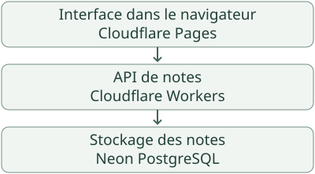

---
{
  "state": "draft",
  "language": "fr",
  "translationKey": "2026-11-28-free-deployment-guide",
  "title": "Hébergement gratuit : où déployer un site statique, une API et une base PostgreSQL ?",
  "description": "Pour héberger un blog, une application de notes ou une démo, comparez les quotas de compilation, la mise en veille et la durée de conservation des données.",
  "sourcePath": "src/content/posts/en/2026-11-28-free-deployment-guide.md",
  "sourceSha256": "0557a16ab0634eaf65f92ae9f1818ab52b9bcad87cf30fa8bfe95490ac381740"
}
---

Pour publier un blog ou un portfolio, **GitHub Pages ou Cloudflare Pages** peuvent suffire. Si les visiteurs doivent aussi pouvoir enregistrer des notes, vous pouvez héberger l’API sur **Cloudflare Workers ou Render** et les données dans une base PostgreSQL chez **Neon ou Supabase**. Pour un devoir ou une démo avec une échéance précise, Render Postgres est aussi une option pendant 30 jours.

Les offres gratuites réagissent différemment aux dépassements de quota et à l’inactivité. Un hébergeur de sites statiques peut bloquer les nouvelles compilations. Une API en veille peut tarder à répondre au premier appel. Certaines bases redémarrent à la requête suivante, d’autres nécessitent une intervention dans le tableau de bord.

*Comparaison fondée sur les documentations et tarifs officiels au 28 novembre 2026. Les configurations sont données à titre d’exemple. Nous n’avons ni créé de compte, ni déployé ces exemples, ni mesuré les temps de réponse.*

## Pour un site statique, publiez les fichiers générés

Si les pages sont produites à la compilation, comme pour un blog Astro ou un portfolio HTML, un hébergement statique suffit. Tenez compte de la taille des fichiers, de la fréquence des compilations et de l’usage prévu.

| Service | Projets adaptés | Conditions de l’offre gratuite |
| --- | --- | --- |
| GitHub Pages | Blogs, documentation de projet et portfolios dans des dépôts publics | Le site publié est limité à 1 Go, avec un seuil indicatif de bande passante de 100 Go par mois. Des restrictions s’appliquent aux sites dont l’objet principal est le commerce en ligne ou la fourniture d’un SaaS commercial. [Limites de GitHub Pages](https://docs.github.com/en/pages/getting-started-with-github-pages/github-pages-limits) |
| Cloudflare Pages | Sites statiques Astro ou Vite et projets nécessitant un aperçu par branche | 500 compilations par mois, 1 à la fois et 25 Mio par fichier au maximum. Le nombre de requêtes pour des fichiers statiques est illimité si elles ne déclenchent pas de Functions. [Limites de Pages](https://developers.cloudflare.com/pages/platform/limits/) · [Tarification des fichiers statiques et des Functions](https://developers.cloudflare.com/pages/functions/pricing/) |
| Vercel Hobby | Projets Next.js personnels à but non commercial | Un même projet peut héberger des pages statiques et des Functions. Vérifiez les conditions d’utilisation de Hobby ainsi que la consommation des Functions. [Offre Hobby](https://vercel.com/docs/plans/hobby) · [Règles d’utilisation équitable](https://vercel.com/docs/limits/fair-use-guidelines) · [Tarifs de Vercel](https://vercel.com/pricing) |

GitHub Pages est un point de départ simple pour un blog comme celui-ci, dont les articles sont compilés avant publication. Un article précédent explique comment nous avons séparé compilation et mise en ligne. [De la publication automatique avec Jekyll à la relecture des PR en brouillon avec Astro](../2026-04-07-jekyll-github-actions-content-pipeline/)

## Choisissez le mode d’exécution de l’API

| Service | API adaptées | Conditions de l’offre gratuite |
| --- | --- | --- |
| Cloudflare Workers | API HTTP légères qui valident une entrée, interrogent une base et renvoient du JSON | 100 000 requêtes par jour et 10 ms de temps CPU par requête. Seule l’exécution du code compte, hors attente des réponses du réseau. Pages Functions partage le quota gratuit de requêtes de Workers. [Limites de Workers](https://developers.cloudflare.com/workers/platform/limits/) · [Tarification de Pages Functions](https://developers.cloudflare.com/pages/functions/pricing/) |
| Render Free Web Service | Démos qui lancent un processus serveur HTTP avec FastAPI ou Express, par exemple | Après 15 minutes sans trafic entrant, le service se met en veille. La requête suivante le redémarre en une minute environ, selon Render. Chaque espace de travail dispose de 750 heures d’instance gratuites par mois. Les modifications de fichiers locaux sont perdues au redémarrage, au redéploiement ou à la mise en veille. [Déploiement gratuit sur Render](https://render.com/docs/free) |

Prenons l’application de notes en Python présentée précédemment. Sur Render, même si `GET /health` répond correctement, les notes enregistrées dans un fichier SQLite local peuvent disparaître après la mise en veille et le redémarrage. Pour les conserver, utilisez une base PostgreSQL externe et vérifiez que la même note reste accessible après un redémarrage. [Auto-héberger l’application de notes](../2026-11-28-self-hosting-ai-notes/) · [Système de fichiers de Render](https://render.com/docs/free#local-files-lost-on-redeploy)

## Pour PostgreSQL, examinez la capacité et les conditions de mise en veille

| Service | Ressources gratuites | En cas d’inactivité |
| --- | --- | --- |
| Neon Free | 1 Go de stockage PostgreSQL et un quota mensuel de calcul de 100 CU-heures par projet | Après 5 minutes d’inactivité, le calcul s’arrête et reprend automatiquement à la requête suivante. Une fois le quota mensuel de calcul épuisé, il reste suspendu jusqu’à la prochaine période de facturation ou au passage à une offre payante. [Tarifs de Neon](https://neon.com/pricing) |
| Supabase Free | 500 Mo de base de données par projet, avec PostgreSQL géré, Auth et la Data API | Si l’activité de la base reste faible pendant 7 jours, le projet peut être suspendu. Il se réactive depuis le tableau de bord. [Tarifs de Supabase](https://supabase.com/pricing) · [Suspension des projets](https://supabase.com/docs/guides/platform/free-project-pausing) |
| Render Free Postgres | 1 base gratuite par espace de travail, avec 1 Go de stockage | Quelle que soit son activité, la base expire 30 jours après sa création. Sans passage à une offre payante dans les 14 jours suivant l’expiration, les données sont supprimées. [PostgreSQL gratuit sur Render](https://render.com/docs/free#free-postgres) |

Si vous prévoyez d’exécuter votre propre serveur d’API et d’écrire directement du SQL, commencez par examiner Neon. Si vous avez aussi besoin d’une connexion utilisateur et d’une API d’accès aux données, envisagez Supabase. Depuis le navigateur, appelez la Data API de Supabase avec une clé publiable. Définissez des politiques de sécurité au niveau des lignes (RLS) pour contrôler les lignes que chaque utilisateur peut lire et modifier. Conservez la chaîne de connexion à la base et les clés secrètes d’administration sur le serveur. [Clés d’API de Supabase](https://supabase.com/docs/guides/getting-started/api-keys) · [Sécurité au niveau des lignes](https://supabase.com/docs/guides/database/postgres/row-level-security)

## Combiner les services selon le projet

- **Blog technique ou documentation.** Déployez uniquement les fichiers générés sur GitHub Pages ou Cloudflare Pages.
- **Petite application de notes.** Placez l’interface sur Cloudflare Pages, l’API sur Workers et les données sur Neon. Après une longue pause, affichez un indicateur de chargement jusqu’à la fin de la première requête.
- **Démo d’une API Python existante.** Hébergez le serveur sur Render et les données sur Neon. Avant la démo, chronométrez le premier appel après une période d’inactivité et vérifiez que les données survivent à un redéploiement.
- **Projet personnel avec connexion utilisateur.** Déployez l’interface sur Cloudflare Pages et reliez-la à Supabase Auth et à la Data API. Connectez-vous avec deux comptes pour vérifier qu’aucun ne peut lire ni modifier les notes de l’autre.

Une fois la page d’accueil accessible, **enregistrez une nouvelle donnée, redéployez l’API et relisez cette même donnée**. Si vous en avez encore besoin après la démo, vérifiez également la date d’expiration de l’offre gratuite et la procédure d’export.
