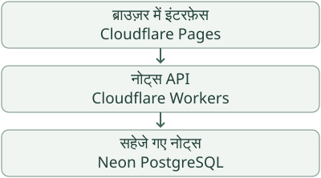

---
{
  "state": "draft",
  "language": "hi",
  "translationKey": "2026-11-28-free-deployment-guide",
  "title": "मुफ़्त होस्टिंग कैसे चुनें? स्टैटिक साइट, बैकएंड API और PostgreSQL के विकल्प",
  "description": "ब्लॉग, नोट्स ऐप या डेमो की होस्टिंग चुनते समय बिल्ड की सीमा, निष्क्रियता के बाद पहली रिक्वेस्ट और डेटा रखने की अवधि की तुलना करें।",
  "sourcePath": "src/content/posts/en/2026-11-28-free-deployment-guide.md",
  "sourceSha256": "0557a16ab0634eaf65f92ae9f1818ab52b9bcad87cf30fa8bfe95490ac381740"
}
---

ब्लॉग या पोर्टफ़ोलियो को **GitHub Pages या Cloudflare Pages** पर प्रकाशित कर सकते हैं। अगर ऐप में नोट्स भी सहेजने हैं, तो API को **Cloudflare Workers या Render** पर चला सकते हैं और डेटा **Neon या Supabase** की PostgreSQL डेटाबेस में रख सकते हैं। किसी असाइनमेंट या डेमो की समाप्ति तिथि तय है तो 30 दिनों तक चलने वाला Render Postgres भी एक विकल्प है।

मुफ़्त प्लान में सीमा पूरी होने या सेवा कुछ समय तक इस्तेमाल न होने पर अलग-अलग असर पड़ता है। स्टैटिक साइट का नया बिल्ड रुक सकता है। निष्क्रिय API को पहली रिक्वेस्ट का जवाब देने में ज़्यादा समय लग सकता है। कुछ डेटाबेस अगली क्वेरी पर अपने आप चालू हो जाते हैं, जबकि कुछ प्रोजेक्ट को डैशबोर्ड से फिर शुरू करना पड़ता है।

*तुलना 28 नवंबर 2026 के आधिकारिक दस्तावेज़ों और मूल्य सूचियों पर आधारित है। नीचे दिए गए संयोजन उदाहरण हैं। हमने सेवाओं पर खाते नहीं बनाए, उदाहरण डिप्लॉय नहीं किए और प्रतिक्रिया का समय नहीं मापा।*

## स्टैटिक साइट के लिए बिल्ड की फ़ाइलें प्रकाशित करें

अगर पेज बिल्ड के समय ही बन जाते हैं, जैसे Astro ब्लॉग या HTML पोर्टफ़ोलियो में, तो स्टैटिक होस्टिंग काफ़ी है। प्लेटफ़ॉर्म चुनते समय फ़ाइलों का आकार, बिल्ड की आवृत्ति और साइट का उद्देश्य देखें।

| सेवा | किन प्रोजेक्ट के लिए | मुफ़्त प्लान की शर्तें |
| --- | --- | --- |
| GitHub Pages | सार्वजनिक रिपॉज़िटरी में ब्लॉग, प्रोजेक्ट दस्तावेज़ और पोर्टफ़ोलियो | प्रकाशित साइट का अधिकतम आकार 1 GB है और बैंडविड्थ की सॉफ़्ट लिमिट प्रति माह 100 GB है। जिन साइटों का मुख्य उद्देश्य ई-कॉमर्स चलाना या व्यावसायिक SaaS देना है, उनके लिए उपयोग पर पाबंदियाँ हैं। [GitHub Pages की सीमाएँ](https://docs.github.com/en/pages/getting-started-with-github-pages/github-pages-limits) |
| Cloudflare Pages | Astro या Vite की स्टैटिक साइट और ऐसे प्रोजेक्ट जिन्हें हर ब्रांच का प्रीव्यू चाहिए | हर महीने 500 बिल्ड, एक समय में 1 बिल्ड और हर फ़ाइल का अधिकतम आकार 25 MiB है। Functions को कॉल किए बिना स्टैटिक फ़ाइलें माँगने वाली रिक्वेस्ट की संख्या पर कोई सीमा नहीं है। [Pages की सीमाएँ](https://developers.cloudflare.com/pages/platform/limits/) · [स्टैटिक फ़ाइलों और Functions की बिलिंग](https://developers.cloudflare.com/pages/functions/pricing/) |
| Vercel Hobby | Next.js के निजी, गैर-व्यावसायिक प्रोजेक्ट | एक ही प्रोजेक्ट में स्टैटिक पेज और Functions डिप्लॉय कर सकते हैं। Hobby की उपयोग शर्तों के साथ Functions की खपत भी देखें। [Hobby प्लान](https://vercel.com/docs/plans/hobby) · [उचित उपयोग के दिशानिर्देश](https://vercel.com/docs/limits/fair-use-guidelines) · [Vercel की मूल्य सूची](https://vercel.com/pricing) |

इस ब्लॉग की तरह लेख पहले बिल्ड करके प्रकाशित करते हैं तो GitHub Pages से शुरुआत करना आसान है। बिल्ड और प्रकाशन को अलग कैसे किया, यह पहले के लेख में बताया गया है। [Jekyll के स्वचालित प्रकाशन से Astro में ड्राफ़्ट PR की समीक्षा तक](../2026-04-07-jekyll-github-actions-content-pipeline/)

## पहले तय करें कि बैकएंड API कैसे चलेगी

| सेवा | किस तरह की API के लिए | मुफ़्त प्लान की शर्तें |
| --- | --- | --- |
| Cloudflare Workers | इनपुट की जाँच करने, डेटाबेस से जानकारी पढ़ने और JSON लौटाने वाली हल्की HTTP API | हर दिन 100,000 रिक्वेस्ट और हर रिक्वेस्ट के लिए 10 ms CPU समय मिलता है। CPU समय में कोड चलने का समय गिना जाता है, नेटवर्क के जवाब का इंतज़ार नहीं। Pages Functions भी Workers के इसी मुफ़्त रिक्वेस्ट कोटे का उपयोग करता है। [Workers की सीमाएँ](https://developers.cloudflare.com/workers/platform/limits/) · [Pages Functions की बिलिंग](https://developers.cloudflare.com/pages/functions/pricing/) |
| Render Free Web Service | FastAPI या Express जैसी तकनीक से HTTP सर्वर प्रोसेस चलाने वाले डेमो | 15 मिनट तक इनबाउंड ट्रैफ़िक न मिले तो सेवा सो जाती है। अगली रिक्वेस्ट पर वह फिर शुरू होती है। Render के मुताबिक इसमें लगभग एक मिनट लगता है। हर वर्कस्पेस को महीने में 750 मुफ़्त इंस्टेंस घंटे मिलते हैं। रीस्टार्ट, दोबारा डिप्लॉय करने या सेवा के सो जाने पर स्थानीय फ़ाइलों में किए बदलाव मिट जाते हैं। [Render पर मुफ़्त डिप्लॉयमेंट](https://render.com/docs/free) |

मान लें कि पहले वाले लेख का Python नोट्स ऐप Render पर डिप्लॉय किया जाता है। `GET /health` का जवाब सही आने पर भी स्थानीय SQLite फ़ाइल के नोट्स सर्वर के सो जाने और फिर चालू होने के बाद ग़ायब हो सकते हैं। नोट्स बनाए रखने के लिए उन्हें किसी बाहरी PostgreSQL डेटाबेस में रखें और रीस्टार्ट के बाद वही नोट पढ़कर देखें। [नोट्स ऐप को अपने सर्वर पर चलाना](../2026-11-28-self-hosting-ai-notes/) · [Render की फ़ाइल सिस्टम नीति](https://render.com/docs/free#local-files-lost-on-redeploy)

## PostgreSQL के लिए जगह और निष्क्रियता की शर्तें साथ देखें

| सेवा | मुफ़्त संसाधन | कुछ समय तक उपयोग न करने पर |
| --- | --- | --- |
| Neon Free | हर प्रोजेक्ट के लिए 1 GB PostgreSQL स्टोरेज और महीने में 100 CU-hours कंप्यूट | 5 मिनट तक निष्क्रिय रहने पर कंप्यूट रुक जाता है और अगली क्वेरी पर अपने आप शुरू हो जाता है। महीने का कंप्यूट कोटा ख़त्म होने पर अगले बिलिंग चक्र या प्लान अपग्रेड तक कंप्यूट निलंबित रहता है। [Neon की मूल्य सूची](https://neon.com/pricing) |
| Supabase Free | हर प्रोजेक्ट को 500 MB डेटाबेस स्पेस के साथ प्रबंधित PostgreSQL, Auth और Data API मिलते हैं | 7 दिनों तक डेटाबेस में गतिविधि कम रहे तो प्रोजेक्ट रोका जा सकता है। उसे डैशबोर्ड से फिर शुरू करें। [Supabase की मूल्य सूची](https://supabase.com/pricing) · [प्रोजेक्ट रोकने की नीति](https://supabase.com/docs/guides/platform/free-project-pausing) |
| Render Free Postgres | हर वर्कस्पेस में 1 मुफ़्त डेटाबेस, जिसमें 1 GB स्टोरेज है | उपयोग होता रहे तब भी निर्माण के 30 दिन बाद डेटाबेस की अवधि समाप्त हो जाती है। इसके बाद 14 दिनों के भीतर सशुल्क प्लान में अपग्रेड न करने पर डेटा मिटा दिया जाता है। [Render का मुफ़्त PostgreSQL](https://render.com/docs/free#free-postgres) |

अगर आप अलग API सर्वर चलाकर सीधे SQL लिखेंगे, तो शुरुआत में Neon पर विचार करें। लॉगिन और डेटा पढ़ने की API भी चाहिए तो Supabase एक विकल्प है। ब्राउज़र से Supabase Data API को कॉल करते समय सार्वजनिक इस्तेमाल के लिए बनी कुंजी लें। पंक्ति-स्तरीय सुरक्षा (RLS) की नीतियों से तय करें कि हर उपयोगकर्ता कौन-सी पंक्तियाँ पढ़ और लिख सकता है। डेटाबेस कनेक्शन स्ट्रिंग और प्रशासन की गोपनीय कुंजियाँ सर्वर पर रखें। [Supabase API कुंजियाँ](https://supabase.com/docs/guides/getting-started/api-keys) · [पंक्ति-स्तरीय सुरक्षा](https://supabase.com/docs/guides/database/postgres/row-level-security)

## प्रोजेक्ट के हिसाब से सेवाएँ मिलाएँ

- **तकनीकी ब्लॉग या दस्तावेज़ों की साइट।** केवल बिल्ड की फ़ाइलें GitHub Pages या Cloudflare Pages पर डिप्लॉय करें।
- **हल्का नोट्स ऐप।** इंटरफ़ेस Cloudflare Pages पर, API Workers पर और डेटा Neon पर रखें। लंबे अंतराल के बाद ऐप खुलने पर पहली क्वेरी पूरी होने तक लोडिंग संकेत दिखाएँ।
- **मौजूदा Python API का डेमो।** सर्वर Render पर चलाएँ और डेटा Neon पर रखें। डेमो से पहले देखें कि निष्क्रियता के बाद पहली रिक्वेस्ट का जवाब आने में कितना समय लगता है और दोबारा डिप्लॉय करने पर डेटा बचता है या नहीं।
- **लॉगिन वाला निजी प्रोजेक्ट।** इंटरफ़ेस Cloudflare Pages पर डिप्लॉय करके Supabase Auth और Data API से जोड़ सकते हैं। दो खातों से लॉगिन करके जाँचें कि कोई भी खाता दूसरे के नोट्स पढ़ या बदल न सके।

होम पेज खुलने के बाद **एक नया रिकॉर्ड सहेजें, API को फिर से डिप्लॉय करें और वही रिकॉर्ड दोबारा पढ़ें**। अगर डेमो के बाद भी डेटा चाहिए, तो मुफ़्त प्लान की समाप्ति तिथि और डेटा निर्यात करने का तरीका भी देख लें।
