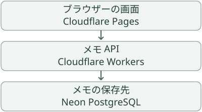

---
{
  "state": "draft",
  "language": "ja",
  "translationKey": "2026-11-28-free-deployment-guide",
  "title": "無料デプロイ先の選び方：静的サイト、バックエンド API、PostgreSQL",
  "description": "ブログやメモアプリ、デモの公開先を、ビルドの上限、休止後の初回応答、データの保持期間から比較します。",
  "sourcePath": "src/content/posts/en/2026-11-28-free-deployment-guide.md",
  "sourceSha256": "24880e57aa8ba66175d89a6364b0ddb3fa60d900e7253c9b1415923ba0206254"
}
---

ブログやポートフォリオは **GitHub Pages または Cloudflare Pages** で公開できます。メモを保存したい場合は、**Cloudflare Workers または Render** で API を動かし、**Neon または Supabase** の PostgreSQL にデータを保存する構成が考えられます。課題やデモなど終了日が決まっていれば、30 日間使える Render Postgres も候補です。

無料プランでも、上限に達した場合やしばらく利用しなかった場合の挙動は異なります。静的サイトでは新しいビルドが止まり、API では休止後の初回応答が遅くなることがあります。データベースには次のクエリで自動復帰するものも、ダッシュボードから再開するものもあります。

*2026年11月28日時点の公式ドキュメントと料金表に基づきます。以下は構成例です。サービスへの登録、実際のデプロイ、応答時間の計測は行っていません。*

## 静的サイトはビルド成果物を公開する

Astro のブログや HTML のポートフォリオのように、ビルド時にページができていれば、静的ホスティングで公開できます。配信するファイルのサイズ、ビルド頻度、サイトの用途を基準に選びます。

| サービス | 向いているプロジェクト | 無料プランの条件 |
| --- | --- | --- |
| GitHub Pages | 公開リポジトリのブログ、プロジェクト文書、ポートフォリオ | 公開サイトは最大 1 GB、月間帯域幅のソフトリミットは 100 GB です。電子商取引の運営や商用 SaaS の提供が主目的のサイトには用途制限があります。[GitHub Pages の上限](https://docs.github.com/en/pages/getting-started-with-github-pages/github-pages-limits) |
| Cloudflare Pages | Astro や Vite の静的サイト、ブランチ単位のプレビューが必要なプロジェクト | 月 500 ビルド、同時ビルド数は 1、ファイル当たり最大 25 MiB です。Functions を呼ばない静的ファイルへのリクエスト数は無制限です。[Pages の上限](https://developers.cloudflare.com/pages/platform/limits/) · [静的ファイルと Functions の料金](https://developers.cloudflare.com/pages/functions/pricing/) |
| Vercel Hobby | Next.js を使う個人の非商用プロジェクト | 静的ページと Functions を同じプロジェクトにデプロイできます。Hobby の用途制限と Functions の使用量を併せて確認します。[Hobby プラン](https://vercel.com/docs/plans/hobby) · [フェアユースのガイドライン](https://vercel.com/docs/limits/fair-use-guidelines) · [Vercel の料金表](https://vercel.com/pricing) |

このブログのように記事を事前にビルドして公開するなら、GitHub Pages から始めやすいでしょう。ビルドと本番公開を分ける手順は以前の記事で紹介しました。[Jekyll の自動公開から Astro のドラフト PR レビューへ](../2026-04-07-jekyll-github-actions-content-pipeline/)

## バックエンド API は実行方式から選ぶ

| サービス | 向いている API | 無料プランの条件 |
| --- | --- | --- |
| Cloudflare Workers | 入力を検証し、DB に問い合わせて JSON を返す軽量な HTTP API | リクエストは日次 100,000 件、CPU 時間はリクエスト当たり 10 ms です。CPU 時間はコードの実行時間で、ネットワークの応答待ちは含みません。Pages Functions も Workers の無料リクエスト枠を使います。[Workers の上限](https://developers.cloudflare.com/workers/platform/limits/) · [Pages Functions の料金](https://developers.cloudflare.com/pages/functions/pricing/) |
| Render Free Web Service | FastAPI や Express などの HTTP サーバープロセスを動かすデモ | 受信トラフィックが 15 分間ないと休止します。次のリクエストで起動し、Render の案内では約一分かかります。無料インスタンス時間はワークスペース当たり月 750 時間です。再起動、再デプロイ、休止の際にローカルファイルの変更は失われます。[Render の無料デプロイ](https://render.com/docs/free) |

以前作った Python のメモアプリを Render に載せる場合を考えます。`GET /health` が正常に応答しても、ローカルの SQLite ファイルに保存したメモは休止と再起動を経て消えることがあります。メモを残すには保存先を外部 PostgreSQL に移し、再起動後に同じメモを読み出せるか確認します。[メモアプリのセルフホスティング](../2026-11-28-self-hosting-ai-notes/) · [Render のファイルシステム](https://render.com/docs/free#local-files-lost-on-redeploy)

## PostgreSQL は容量と休止条件を併せて見る

| サービス | 無料枠 | しばらく利用しない場合 |
| --- | --- | --- |
| Neon Free | プロジェクト当たり PostgreSQL ストレージ 1 GB、コンピュートは月 100 CU-hours | 5 分間アイドル状態が続くとコンピュートが停止し、次のクエリで自動復帰します。月間のコンピュート枠を使い切ると、次の利用期間に入るかアップグレードするまで停止します。[Neon の料金表](https://neon.com/pricing) |
| Supabase Free | プロジェクト当たり DB 容量 500 MB。マネージド PostgreSQL、Auth、Data API を利用できます | 7 日間 DB の利用が少ないとプロジェクトが一時停止されることがあります。ダッシュボードで再開します。[Supabase の料金表](https://supabase.com/pricing) · [プロジェクトの一時停止](https://supabase.com/docs/guides/platform/free-project-pausing) |
| Render Free Postgres | ワークスペース当たり無料 DB は 1 個、容量 1 GB | 利用状況にかかわらず作成から 30 日で期限切れになります。期限切れ後 14 日以内に有料プランに移行しないとデータが削除されます。[Render の無料 PostgreSQL](https://render.com/docs/free#free-postgres) |

API サーバーを別に用意して SQL を直接書くなら、まず Neon が候補になります。ログインとデータ取得 API も必要なら Supabase を検討できます。ブラウザーから Supabase Data API を呼び出す際は公開用キーを使い、読み書きできる行を行レベルセキュリティ（RLS）ポリシーで制限します。DB 接続文字列と管理用のシークレットキーはサーバー側で保管します。[Supabase の API キー](https://supabase.com/docs/guides/getting-started/api-keys) · [行レベルセキュリティ](https://supabase.com/docs/guides/database/postgres/row-level-security)

## プロジェクト別の構成例

- **技術ブログやドキュメントサイト**では、ビルド成果物だけを GitHub Pages または Cloudflare Pages にデプロイします。
- **軽量なメモアプリ**では、画面を Cloudflare Pages、API を Workers、データを Neon に置きます。長く使わなかった後は最初のクエリが終わるまで読み込み中と表示します。
- **既存の Python API を公開するデモ**では、サーバーは Render、データは Neon に置きます。デモの前に休止後の初回応答までの時間と、再デプロイ後にデータが残ることを確認します。
- **ログイン機能のある個人プロジェクト**では、画面を Cloudflare Pages に置き、Supabase Auth と Data API に接続できます。二つのアカウントでログインして、互いのメモを読んだり編集したりできないことを確かめます。

デプロイ後はトップページを開き、**新しいデータを一件保存して、API の再デプロイ後に同じデータを読み出してみましょう**。デモが終わってからも必要なデータなら、無料プランの有効期限とエクスポート方法も確認しておきましょう。
