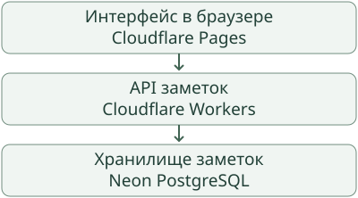

---
{
  "state": "draft",
  "language": "ru",
  "translationKey": "2026-11-28-free-deployment-guide",
  "title": "Бесплатный хостинг: где разместить статический сайт, API и PostgreSQL?",
  "description": "При выборе площадки для блога, приложения с заметками или демоверсии сравните лимиты сборки, запуск после простоя и сроки хранения данных.",
  "sourcePath": "src/content/posts/en/2026-11-28-free-deployment-guide.md",
  "sourceSha256": "0557a16ab0634eaf65f92ae9f1818ab52b9bcad87cf30fa8bfe95490ac381740"
}
---

Блог или портфолио можно опубликовать на **GitHub Pages или Cloudflare Pages**. Если посетители должны сохранять заметки, API можно запустить в **Cloudflare Workers или Render**, а данные хранить в PostgreSQL у **Neon или Supabase**. Для учебного задания или демонстрации с известной датой окончания подойдёт и Render Postgres, которым можно пользоваться 30 дней.

Бесплатные тарифы по-разному ведут себя при исчерпании квот и при простое. Хостинг статических сайтов может заблокировать новые сборки, а API после простоя может медленнее ответить на первый запрос. Одни базы просыпаются при следующем запросе, другие нужно возобновить вручную через панель управления.

*По официальной документации и тарифам на 28 ноября 2026 года. Приведены примеры конфигураций. Мы не регистрировали аккаунты, не развёртывали примеры и не измеряли время ответа.*

## Для статического сайта достаточно опубликовать результат сборки

Если страницы создаются при сборке, как в блоге на Astro или HTML-портфолио, достаточно статического хостинга. Учитывайте размер файлов, частоту сборок и назначение сайта.

| Сервис | Подходящие проекты | Условия бесплатного тарифа |
| --- | --- | --- |
| GitHub Pages | Блоги, документация и портфолио в публичных репозиториях | Опубликованный сайт может занимать до 1 ГБ. Мягкий лимит трафика — 100 ГБ в месяц. Для сайтов, чья основная цель — электронная торговля или предоставление коммерческого SaaS, действуют ограничения по использованию. [Ограничения GitHub Pages](https://docs.github.com/en/pages/getting-started-with-github-pages/github-pages-limits) |
| Cloudflare Pages | Статические сайты на Astro или Vite и проекты, где нужен предпросмотр каждой ветки | 500 сборок в месяц, одновременно выполняется 1 сборка, максимальный размер файла — 25 МиБ. Число запросов к статическим файлам без вызова Functions не ограничено. [Ограничения Pages](https://developers.cloudflare.com/pages/platform/limits/) · [Тарификация статики и Functions](https://developers.cloudflare.com/pages/functions/pricing/) |
| Vercel Hobby | Личные некоммерческие проекты на Next.js | Статические страницы и Functions можно развернуть в одном проекте. Проверьте условия использования Hobby и расход ресурсов Functions. [Тариф Hobby](https://vercel.com/docs/plans/hobby) · [Правила добросовестного использования](https://vercel.com/docs/limits/fair-use-guidelines) · [Тарифы Vercel](https://vercel.com/pricing) |

Если статьи, как в этом блоге, собираются до публикации, удобно начать с GitHub Pages. В предыдущей статье описано, как мы разделили сборку и публикацию. [Переход с автоматической публикации Jekyll на проверку черновых PR в Astro](../2026-04-07-jekyll-github-actions-content-pipeline/)

## Сначала выберите способ запуска API

| Сервис | Для каких API подходит | Условия бесплатного тарифа |
| --- | --- | --- |
| Cloudflare Workers | Лёгкие HTTP API, которые проверяют входные данные, обращаются к базе и возвращают JSON | 100 000 запросов в день и 10 мс процессорного времени на запрос. Учитывается исполнение кода, а ожидание ответа по сети не входит в процессорное время. Pages Functions расходуют ту же бесплатную квоту запросов Workers. [Ограничения Workers](https://developers.cloudflare.com/workers/platform/limits/) · [Тарификация Pages Functions](https://developers.cloudflare.com/pages/functions/pricing/) |
| Render Free Web Service | Демонстрации с отдельным процессом HTTP-сервера, например на FastAPI или Express | Через 15 минут без входящего трафика сервис останавливается. Следующий запрос запускает его снова. По данным Render, это занимает около минуты. На рабочее пространство выделяется 750 бесплатных часов работы экземпляров в месяц. Перезапуск, повторное развёртывание и переход в спящий режим приводят к потере локальных изменений файлов. [Бесплатное развёртывание в Render](https://render.com/docs/free) |

Представим, что мы разместили на Render приложение для заметок на Python из предыдущей статьи. Даже если `GET /health` отвечает успешно, заметки в локальном файле SQLite могут исчезнуть после остановки и пробуждения сервера. Для постоянного хранения перенесите их во внешнюю базу PostgreSQL и проверьте, что после перезапуска та же заметка доступна для чтения. [Самостоятельное размещение приложения для заметок](../2026-11-28-self-hosting-ai-notes/) · [Файловая система Render](https://render.com/docs/free#local-files-lost-on-redeploy)

## Для PostgreSQL важны и объём, и условия простоя

| Сервис | Что входит в бесплатный тариф | Что происходит при простое |
| --- | --- | --- |
| Neon Free | На проект выделяется 1 ГБ хранилища PostgreSQL и 100 CU-часов вычислений в месяц | После 5 минут простоя вычислительный ресурс останавливается и автоматически запускается при следующем запросе. При исчерпании месячной квоты вычисления приостанавливаются до следующего расчётного периода или перехода на платный тариф. [Тарифы Neon](https://neon.com/pricing) |
| Supabase Free | 500 МБ для базы данных на проект, управляемая PostgreSQL, Auth и Data API | Если активность базы низкая в течение 7 дней, проект может быть приостановлен. Возобновить его работу можно в панели управления. [Тарифы Supabase](https://supabase.com/pricing) · [Приостановка проектов](https://supabase.com/docs/guides/platform/free-project-pausing) |
| Render Free Postgres | 1 бесплатная база на рабочее пространство, объём хранилища — 1 ГБ | Срок действия истекает через 30 дней после создания независимо от активности. Если в течение 14 дней после этого не перейти на платный тариф, данные будут удалены. [Бесплатная PostgreSQL на Render](https://render.com/docs/free#free-postgres) |

Если вы пишете SQL и планируете отдельный сервер API, начните с Neon. Если также нужны вход в аккаунт и API доступа к данным, рассмотрите Supabase. Для обращения к Supabase Data API из браузера используйте публичный ключ. Политиками доступа на уровне строк (RLS) задайте, какие строки пользователь может читать и изменять. Строку подключения к базе и секретные ключи администратора храните на сервере. [Ключи API Supabase](https://supabase.com/docs/guides/getting-started/api-keys) · [Доступ на уровне строк](https://supabase.com/docs/guides/database/postgres/row-level-security)

## Сочетания сервисов для разных проектов

- **Технический блог или документация.** Опубликуйте только результат сборки на GitHub Pages или Cloudflare Pages.
- **Небольшое приложение для заметок.** Разместите интерфейс на Cloudflare Pages, API на Workers, данные на Neon. После долгого простоя показывайте индикатор загрузки до завершения первого запроса.
- **Демонстрация существующего API на Python.** Запустите сервер на Render и храните данные в Neon. Перед показом проверьте время первого ответа после простоя и сохранность данных после повторного развёртывания.
- **Личный проект с авторизацией пользователей.** Интерфейс на Cloudflare Pages можно подключить к Supabase Auth и Data API. Войдите под двумя учётными записями и проверьте, что ни одна не позволяет читать или редактировать чужие заметки.

После открытия главной страницы **сохраните новую запись, повторно разверните API и прочитайте ту же запись**. Если данные понадобятся и после демонстрации, уточните срок действия бесплатного тарифа и способ экспорта.
