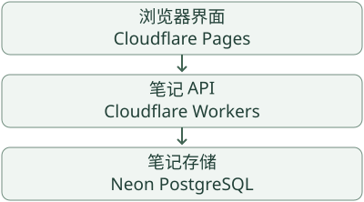

---
{
  "state": "draft",
  "language": "zh-CN",
  "translationKey": "2026-11-28-free-deployment-guide",
  "title": "免费部署怎么选：静态网站、后端 API 和 PostgreSQL 分别放在哪里？",
  "description": "从构建限额、空闲后的首次请求和数据保留期限，比较博客、笔记应用和演示项目的免费部署方案。",
  "sourcePath": "src/content/posts/en/2026-11-28-free-deployment-guide.md",
  "sourceSha256": "0557a16ab0634eaf65f92ae9f1818ab52b9bcad87cf30fa8bfe95490ac381740"
}
---

博客或作品集可以部署在 **GitHub Pages 或 Cloudflare Pages**。如果还需要保存笔记，可以在 **Cloudflare Workers 或 Render** 上运行 API，将数据存入 **Neon 或 Supabase** 的 PostgreSQL。对于有明确截止日期的作业或演示，可使用 30 天的 Render Postgres 也是一个选择。

免费套餐对超额或闲置的处理方式各不相同。静态网站可能无法再发起构建，API 闲置后的首次响应可能较慢。有的数据库收到下一次查询就会自动唤醒，有的则需要在控制台手动恢复。

*依据 2026年11月28日的官方文档和价格表。下文列举的是配置示例，未注册服务、实际部署示例或测量响应时间。*

## 将静态网站的构建产物发布到托管平台

如果页面在构建时就已生成，比如 Astro 博客或 HTML 作品集，用静态托管即可发布。选平台时要看文件大小、构建频率和网站用途。

| 服务 | 适合的项目 | 免费套餐条件 |
| --- | --- | --- |
| GitHub Pages | 公开仓库中的博客、项目文档和作品集 | 发布后的网站最大为 1 GB，每月带宽软上限为 100 GB。以经营电子商务或提供商业 SaaS 为主要目的的网站受到用途限制。[GitHub Pages 限额](https://docs.github.com/en/pages/getting-started-with-github-pages/github-pages-limits) |
| Cloudflare Pages | Astro、Vite 静态网站，以及需要按分支预览的项目 | 每月可构建 500 次，同时只能运行 1 次构建，单个文件最大为 25 MiB。未调用 Functions 的静态文件请求不限次数。[Pages 限额](https://developers.cloudflare.com/pages/platform/limits/) · [静态文件和 Functions 计费](https://developers.cloudflare.com/pages/functions/pricing/) |
| Vercel Hobby | 使用 Next.js 的个人非商业项目 | 同一项目可以部署静态页面和 Functions。需同时核对 Hobby 的用途限制和 Functions 用量。[Hobby 套餐](https://vercel.com/docs/plans/hobby) · [公平使用指南](https://vercel.com/docs/limits/fair-use-guidelines) · [Vercel 价格表](https://vercel.com/pricing) |

像本博客这样预先构建再发布文章的网站，可以从 GitHub Pages 入手。之前的文章介绍了如何将构建和正式发布分开。[从 Jekyll 自动发布迁移到 Astro 草稿 PR 审核](../2026-04-07-jekyll-github-actions-content-pipeline/)

## 先确定后端 API 的运行方式

| 服务 | 适合的 API | 免费套餐条件 |
| --- | --- | --- |
| Cloudflare Workers | 验证输入、查询数据库并返回 JSON 的轻量 HTTP API | 每天 100,000 次请求，每次请求的 CPU 时间为 10 ms。CPU 时间只计代码执行时间，不含等待网络响应的时间。Pages Functions 共用 Workers 的免费请求额度。[Workers 限额](https://developers.cloudflare.com/workers/platform/limits/) · [Pages Functions 计费](https://developers.cloudflare.com/pages/functions/pricing/) |
| Render Free Web Service | 用 FastAPI 或 Express 等运行 HTTP 服务进程的演示项目 | 连续 15 分钟没有入站流量，服务便会休眠。下一次请求会启动服务，按 Render 的说明大约需要一分钟。每个工作区每月有 750 个免费实例小时，重启、重新部署或休眠都会丢失本地文件的更改。[Render 免费部署](https://render.com/docs/free) |

假设把之前的 Python 笔记应用部署到 Render。即使 `GET /health` 返回正常，写入本地 SQLite 文件的笔记也可能在服务休眠并重启后消失。如果需要保留笔记，就将数据存入外部 PostgreSQL，并在重启后检查是否还能读到同一条笔记。[自行托管笔记应用](../2026-11-28-self-hosting-ai-notes/) · [Render 文件系统策略](https://render.com/docs/free#local-files-lost-on-redeploy)

## 选择 PostgreSQL 时兼顾容量和休眠条件

| 服务 | 免费额度 | 闲置后的情况 |
| --- | --- | --- |
| Neon Free | 每个项目有 1 GB PostgreSQL 存储空间，每月有 100 CU-hours 计算额度 | 空闲 5 分钟后计算实例停止，下次查询时自动唤醒。月度计算额度用尽后，计算服务会暂停，直到下个计费周期或升级套餐。[Neon 价格表](https://neon.com/pricing) |
| Supabase Free | 每个项目包含 500 MB 数据库空间，并提供托管 PostgreSQL、Auth 和 Data API | 如果数据库连续 7 天活动较少，项目可能会暂停。可在控制台恢复项目。[Supabase 价格表](https://supabase.com/pricing) · [项目暂停策略](https://supabase.com/docs/guides/platform/free-project-pausing) |
| Render Free Postgres | 每个工作区可用 1 个免费数据库，容量为 1 GB | 无论是否持续使用，数据库都会在创建 30 天后到期。到期后 14 天内未升级为付费方案，数据将被删除。[Render 免费 PostgreSQL](https://render.com/docs/free#free-postgres) |

如果打算单独搭建 API 服务器并直接编写 SQL，可以先看 Neon。如果还需要登录功能和数据查询 API，可以考虑 Supabase。在浏览器中调用 Supabase Data API 时，使用可公开的密钥，并用行级安全（RLS）策略限制每个用户可以读取和写入的行。数据库连接字符串和管理员密钥应存放在服务器端。[Supabase API 密钥](https://supabase.com/docs/guides/getting-started/api-keys) · [行级安全](https://supabase.com/docs/guides/database/postgres/row-level-security)

## 按项目组合服务

- **技术博客或文档网站**只需将构建产物部署到 GitHub Pages 或 Cloudflare Pages。
- **轻量笔记应用**可以把界面放在 Cloudflare Pages、API 放在 Workers、数据放在 Neon。长时间闲置后再次打开应用时，显示加载状态，直到首次查询完成。
- **演示已有的 Python API** 时，可以在 Render 上运行服务，在 Neon 中存储数据。演示前测一下闲置后首次请求的响应时间，并确认重新部署后数据仍在。
- **需要登录的个人项目**可以将界面部署到 Cloudflare Pages，接入 Supabase Auth 和 Data API。分别用两个账号登录，检查各自都无法读取或修改对方的笔记。

部署完成后，除了打开首页，还要**保存一条新记录，重新部署 API，再读取同一条记录**。如果演示结束后还需要这些数据，也请确认免费套餐的到期时间和数据导出方式。
