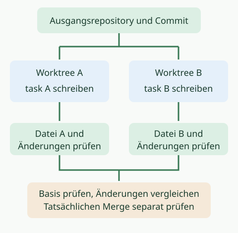

**Wenn Sie Codeänderungen pro Worktree sehen und Browser, Diff und PR auf einer Oberfläche verwalten möchten, bietet sich Orca an. Wenn Sie eine terminalorientierte Umgebung und die App-Oberfläche selbst erweitern möchten, lohnt sich ein Blick auf Herdr.** Beide Werkzeuge können mehrere Coding-Agenten ausführen und Git-Worktrees nutzen. Entscheidend ist weniger die Möglichkeit paralleler Ausführung als die Art, Arbeitsumgebung und Ergebnisse zu verwalten.

Verglichen werden [Orca](https://orca.dev/) und [Herdr](https://herdr.dev/). Herdr besteht aus einer Desktop-App, der terminalbasierten **Herdr TUI** und der separaten Terminal-Laufzeit **herdr-core**. Die folgenden Angaben beruhen auf den am 15. November 2026 geprüften offiziellen Dokumenten. Es handelt sich nicht um einen Leistungstest beider Apps mit identischen Aufgaben. Unterscheiden Sie zwischen den vom Anbieter beschriebenen Funktionen und den daraus abgeleiteten Auswahlkriterien.

## Die Unterschiede auf einen Blick

| Kriterium | Orca | Herdr |
| --- | --- | --- |
| Zentrale Oberfläche | Desktop-Entwicklungsumgebung mit Agenten, Editor, Diff und Browser | Desktop-App und separate TUI; herdr-core führt Terminals ohne Oberfläche aus |
| Aufgabentrennung | Erstellt Git-Worktrees pro Aufgabe und verbindet Branches, Terminals und Browser | App-Anleitung und TUI-Konfiguration bieten Worktree-Erstellung. Ein gewöhnlicher Terminal-Pane bedeutet nicht immer einen eigenen Worktree |
| Codeprüfung | Worktree-Diff, Kommentare zu geänderten Zeilen, Git- und PR-Oberflächen | Terminal oder selbst konfigurierte App-Oberfläche. Ob gleichwertige Diff-Funktionen im selben Umfang bestehen, ist in der installierten Konfiguration zu prüfen |
| Sitzungserhalt | Prozesse laufen nach App-Ende weiter, solange der Daemon lebt; ein Host-Neustart beendet sie | In der App hält herdr-core, in der TUI ein separater Server die Terminals am Leben; Server- oder Host-Neustarts beenden die ursprünglichen Prozesse |
| Erweiterung | CLI, Skills, Zeitpläne und Arbeitsoberflächen der App | App-Layouts und -Modi, TUI-Plugins, CLI und API von herdr-core |
| Lizenz | MIT | Apache 2.0 |

Die Übersicht beruht auf Orcas [Worktree-Dokumentation](https://orca.dev/docs/model/worktrees) und [Diff-Anleitung](https://orca.dev/docs/review/diff-viewer) sowie Herdrs [App-Anleitung](https://herdr.dev/guide/) und [TUI-Konfigurationsanleitung](https://herdr.dev/tui/docs/config-reference/). Die Tabelle ist keine Messung sämtlicher Funktionen beider Produkte in einer bestimmten Version.

## Unterschiedliche Abläufe bei derselben Aufgabe

Angenommen, Sie delegieren in einem Repository gleichzeitig eine API-Änderung und die Erweiterung von Tests. Wenn beide Aufgaben dieselben Dateien berühren könnten, legen Sie zunächst je einen Worktree an. Grenzen Sie ab, was jeder Agent lesen und schreiben darf, und prüfen Sie nach Abschluss die einzelnen Änderungen vor der Integration.

Orca bietet einen Ablauf, bei dem Sie für jede Aufgabe einen Worktree öffnen und Agent und Diff diesem Arbeitsbereich zuordnen. Die [Anleitung zur ersten Sitzung](https://orca.dev/docs/first-session) beschreibt, wie Sie Agenten in mehreren unabhängigen Worktrees starten und anschließend deren Diffs prüfen.

Für die Herdr-Desktop-App zeigt die offizielle Anleitung als Beispiel, wie die Erstellung aufgabenspezifischer Worktrees und der Start von Agenten angefragt werden. Die TUI verwaltet Workspaces, Tabs und Panes und bietet eine eigene Worktree-Funktion. Gehen Sie nicht davon aus, dass mehrere gewöhnliche Panes jeweils eigene Arbeitsverzeichnisse haben. Prüfen Sie vor Arbeitsbeginn Pfad und Branch. [App-Anleitung](https://herdr.dev/guide/) · [TUI-Worktree-Befehle](https://herdr.dev/tui/docs/cli-reference/)



Die Abbildung zeigt den Dateifluss des folgenden Git-Beispiels. Sie umfasst weder das Starten von Agenten noch das automatische Zusammenführen von Ergebnissen.

## Worktree-Trennung selbst prüfen

Das folgende Beispiel läuft in einer macOS- oder Linux-Shell mit installiertem Git. Es erstellt ein temporäres Repository und zwei Worktrees und verändert daher kein vorhandenes Projekt. Es ersetzt keine Installations- oder Konfigurationsanleitung für Orca oder Herdr.

```sh
#!/bin/sh
set -eu
case_dir=$(mktemp -d)
git init -q "$case_dir/repo"
git -C "$case_dir/repo" config user.name 'Example Author'
git -C "$case_dir/repo" config user.email 'example@example.invalid'
printf 'base\n' > "$case_dir/repo/app.txt"
git -C "$case_dir/repo" add app.txt
git -C "$case_dir/repo" commit -qm 'Initial commit'
git -C "$case_dir/repo" worktree add -qb task-a "$case_dir/task-a" HEAD
git -C "$case_dir/repo" worktree add -qb task-b "$case_dir/task-b" HEAD
printf 'task A\n' > "$case_dir/task-a/app.txt"
printf 'task B\n' > "$case_dir/task-b/app.txt"
printf 'A: '; cat "$case_dir/task-a/app.txt"
printf 'B: '; cat "$case_dir/task-b/app.txt"
printf 'base: '; cat "$case_dir/repo/app.txt"
printf 'A 변경 파일: '; git -C "$case_dir/task-a" diff --name-only
printf 'B 변경 파일: '; git -C "$case_dir/task-b" diff --name-only
```

Die in einer lokalen Shell überprüfte Ausgabe lautet:

```text
A: task A
B: task B
base: base
A 변경 파일: app.txt
B 변경 파일: app.txt
```

Die Dateiinhalte der Worktrees sind unabhängig, aber beide Aufgaben haben `app.txt` geändert. Beim Zusammenführen in einem echten Projekt können deshalb Konflikte oder inhaltliche Widersprüche entstehen. Worktrees trennen Dateiänderungen; sie isolieren nicht automatisch Datenbanken, Ports, externe Dienste oder Zugangsdaten und lösen keine Codekonflikte. Das Beispiel löscht das temporäre Verzeichnis nicht automatisch.

Prüfen Sie beim Aufräumen in einer tatsächlichen Arbeitsumgebung außerdem, was das jeweilige Werkzeug entfernt. Orca kann nach Bestätigung Worktree und Branch löschen. Die Herdr-TUI-Dokumentation erklärt dagegen, dass der Worktree-Entfernungsbefehl zwar den Checkout, aber nicht den Branch löscht. Prüfen Sie zuvor Änderungen und noch nicht zusammengeführte Commits. [Orca-Worktree](https://orca.dev/docs/model/worktrees) · [Herdr-TUI-CLI](https://herdr.dev/tui/docs/cli-reference/)

## Vorzüge und Abwägungen bei Orca

Orcas Stärke ist die **durchgehende Oberfläche von der Aufgabe bis zur Ergebnisprüfung**. Der [Diff-Viewer](https://orca.dev/docs/review/diff-viewer) zeigt geänderte Dateien und Zeilen und bietet Konfliktauflösung sowie teilweises Staging. Browser und Editor stehen im selben Arbeitsbereich bereit. Das eignet sich gut für einen Ablauf, bei dem Sie eine Weboberfläche ändern und direkt überprüfen.

Die [Anleitung zur Remote-Ausführung](https://orca.dev/docs/ways-to-run) beschreibt auch die Auswahl eines SSH-Hosts oder eines selbst verwalteten Servers. Remote-Arbeit zu ermöglichen bedeutet nicht, dass alle Umgebungen standardmäßig mit identischen Berechtigungen sicher isoliert sind. Konten, Geheimnisse und Netzwerkzugriff der Remote-Maschine müssen gesondert verwaltet werden.

Laut [Anleitung zur Sitzungswiederherstellung](https://orca.dev/docs/model/session-restore) laufen Agenten nach dem Schließen der App weiter, solange der Hintergrund-Daemon lebt. Wird der Host neu gestartet oder der Daemon beendet, gehen die laufenden Prozesse verloren. Im wiederhergestellten Arbeitsbereich müssen die Agenten erneut gestartet werden.

Zu bedenken ist, dass Sie die Desktop-Umgebung und ihre Funktionen kennenlernen müssen. Für eine einzelne Terminal-Aufgabe können mehrere Ansichten und Arbeitsbereiche unnötig sein. Mehrere gleichzeitig laufende Agenten können den Modellverbrauch erhöhen, und jedes unabhängig geänderte Ergebnis muss geprüft werden. Orca selbst garantiert nicht die Richtigkeit der Modellantworten.

## Vorzüge und Abwägungen bei Herdr

Herdrs Stärke ist die **flexible Gestaltung des Arbeitsbereichs bei weiterlaufenden Terminals und Agenten**. [herdr-core](https://herdr.dev/core/) hält verwaltete Terminals auch bei geschlossenem Fenster am Leben und beschreibt eine Schnittstelle, mit der Agenten weitere Aufgaben starten und Ergebnisse lesen können. Die [offizielle Anleitung](https://herdr.dev/guide/) stellt auch die Anpassung von App-Layouts und -Modi vor.

Bei Herdr müssen App und TUI unterschieden werden. Laut offizieller Website nutzt die Desktop-App herdr-core, während **Herdr TUI einen separaten Server verwendet; die Agentenlisten beider Umgebungen werden nicht geteilt.** Auch das Schließen der App unterscheidet sich vom Neustart des Computers oder der Laufzeit. Bei der Desktop-App bleiben Prozesse nach dem Schließen des Fensters oder einem App-Update bestehen, sofern core weiterläuft. Ein Geräteneustart oder das Stoppen von core beendet sie. Laut offizieller Website werden die App-Panes dann wiederhergestellt, die Agenten aber nicht automatisch neu gestartet. [Herdr-FAQ](https://herdr.dev/)

Für die TUI gelten eigene Wiederherstellungsregeln. Nach dem Trennen und erneuten Verbinden laufen die bestehenden Prozesse weiter, solange der Server lebt. Ein Serverneustart beendet die Prozesse; die Wiederherstellung des Layouts und die Fortsetzung unterstützter Agentensitzungen sind separate Funktionen. [TUI-Sitzungswiederherstellung](https://herdr.dev/tui/docs/session-state/)

Je stärker Sie die Umgebung anpassen, desto mehr Verantwortung tragen Sie dafür zu prüfen, welche Modi welche Berechtigungen und externen Verbindungen nutzen. Die Statusanzeige der Herdr-App hängt außerdem von Programmen ab, die [OSC 7501](https://herdr.dev/core/) melden. Nicht unterstützte Programme können zwar laufen, ihr Status wird aber möglicherweise nicht angezeigt. Setzen Sie die Agentenerkennung der TUI nicht mit der Statusanzeige der App gleich.

## Wann welches Werkzeug wählen?

- **Wenn Änderungsprüfung und Weboberflächen im Mittelpunkt stehen:** Beginnen Sie mit Orcas Ablauf aus Worktree-Diff, Browser und PR.
- **Wenn dauerhafte Terminals und Oberflächengestaltung im Mittelpunkt stehen:** Sehen Sie sich Herdr-App und core an; für die Verwaltung direkt im Terminal vergleichen Sie zusätzlich die separate TUI.
- **Wenn Sie mehrere Server und Agenten gemeinsam betreiben:** Beide Werkzeuge bieten Remote-Funktionen. Prüfen Sie Ihre tatsächliche SSH-Umgebung, Authentifizierung und Bedingungen zur Sitzungswiederherstellung.
- **Wenn Sie nur eine kurze Änderung benötigen:** Bestehendes Terminal und Git können genügen. Wägen Sie zusätzliche Komplexität und Komfort eines Verwaltungswerkzeugs ab.

Testen Sie beide Werkzeuge am besten mit demselben Repository, derselben Aufgabe, demselben Modell und denselben Berechtigungen im kleinen Maßstab. Verfolgen Sie jeweils Aufgabenerstellung, Rückkehr nach einer Unterbrechung, Änderungsprüfung und Integration. Wenn Sie tatsächlichen Zeitaufwand und Fehler notieren, können Sie passend zu Ihrer Arbeitsweise wählen. Solche Vergleichsmessungen wurden für diesen Artikel nicht durchgeführt.
