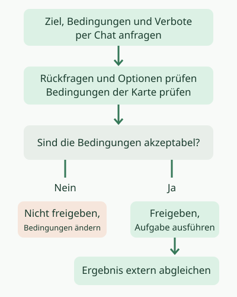

Pickle AI ist ein persönlicher KI-Agent, bei dem Sie per Chat Aufgaben wie Recherchen oder Reservierungen anfragen und den Fortschritt verfolgen können. Beginnen Sie am besten mit einer Recherche, die weder eine Zahlung noch eine Kontoverbindung erfordert, und prüfen Sie selbst, ob das Ergebnis stimmt. Wenn Sie den Umfang auf Reservierungen oder Einkäufe erweitern, geben Sie Datum, Budget und Bedingungen für Ihre Zustimmung mit an.

Diese Anleitung beruht auf der [offiziellen Pickle-Hilfe](https://www.pickle.com/help). Sie dokumentiert weder die Bedienung der App mit einem echten Konto noch die Ausführung der folgenden Beispiele. Oberflächen und verfügbare Funktionen können je nach App-Version, Konto und Region abweichen.

## Vor dem Start

Halten Sie die Pickle-App und ein Konto bereit und prüfen Sie die in der App verfügbaren Tarife und Nutzungslimits. Die koreanische [Tarifübersicht](https://www.pickle.com/help/credits/plans) beschreibt eine kostenlose Nutzung in Südkorea mit einem täglich zurückgesetzten Nutzungslimit. Bei Erreichen des Limits können geplante Aufgaben übersprungen werden. Prüfen Sie deshalb das verbleibende Kontingent und den Zeitpunkt der Rücksetzung im App-Tab **Mein Pickle**. Tarife und Limits können je nach Region und Zeitpunkt abweichen.

Laut [offizieller Vorstellung](https://www.pickle.com/help/start/what-is-pickle) nimmt Pickle Anfragen per Chat entgegen, arbeitet mit einem eigenen Webbrowser auf Websites und kann anrufen, wenn sich etwas nicht im Web erledigen lässt. Sie sollten sich darunter also nicht das direkte Antippen anderer Apps auf Ihrem iPhone vorstellen. Welche Regionen und Dienste unterstützt werden und ob Anrufe möglich sind, müssen Sie in der tatsächlichen Oberfläche prüfen.



Die Abbildung vereinfacht den Ablauf für den Fall, dass eine Bestätigungskarte erscheint. Sie bedeutet weder, dass jede Anfrage eine Karte erzeugt, noch, dass externe Aktionen immer gelingen. Der folgende Pseudocode ist ein Entscheidungsverfahren für Leserinnen und Leser und keine interne Implementierung von Pickle.

```text
Anfrage = Ziel, Datum und Ort, Budget, erlaubte und verbotene Aktionen
Anfrage an Pickle senden
Rückfragen oder Auswahlmöglichkeiten passend zu den Bedingungen beantworten
Wenn eine Bestätigungskarte erscheint:
    Inhalt und Bedingungen prüfen
    Bei unpassenden Bedingungen nicht zustimmen, sondern korrigieren
    Bei passenden Bedingungen zustimmen
Nach Eingang des Ergebnisses ursprüngliche Anfrage und externe Bestätigung abgleichen
```

## Erste Aufgabe: Kandidaten ohne Zahlung recherchieren

Wenn Sie beispielsweise ein Restaurant auswählen möchten, geben Sie Folgendes in Chat ein. Datum, Uhrzeit und Gegend sind Beispiele; ersetzen Sie sie durch Ihre tatsächlichen Bedingungen.

```text
Finde Restaurants in der Nähe des Bahnhofs Gangnam in Seoul für 2 Personen
am Samstag um 6 Uhr abends. Das Budget beträgt höchstens 30.000 Won pro Person.
Bevorzuge Restaurants mit vegetarischen Gerichten.
Nenne für jeden Kandidaten Name, Lage, Öffnungszeiten und einen Beleglink zur Speisekarte.
Reserviere nicht, rufe nicht an und zahle nichts. Kennzeichne unsichere Informationen.
```

Beantworten Sie Rückfragen von Pickle zum Datum oder anderen Bedingungen. Sobald Kandidaten vorliegen, prüfen Sie über die Links die Öffnungszeiten am betreffenden Tag und die Speisekarte. Fehlen Links oder lassen sich Bedingungen nicht bestätigen, fragen Sie nach: „Nenne mir die Quellen, mit denen du das geprüft hast. Rate nicht bei Angaben, die sich nicht bestätigen lassen.“ Das Ergebnis ist als Beispiel gedacht; die Ausführung dieses Prompts im tatsächlichen Dienst wurde nicht überprüft.

Laut [Anleitung zur Aufgabenübergabe](https://www.pickle.com/help/tasks/delegate) fragt Pickle nach fehlenden Angaben, wenn Sie Ihr Ziel in Chat mitteilen, und kann die geplante Aufgabe samt Bedingungen zur Bestätigung als Karte anzeigen. Die Aufgabenkarte erscheint im Chat, und die Arbeit kann auch nach dem Schließen der App weiterlaufen. Verwechseln Sie das Schließen der App nicht mit einem Abbruch. Wenn Sie die Arbeit stoppen müssen, prüfen Sie den aktuellen Status und ob ein Abbruch möglich ist.

## Reservierungen oder Einkäufe delegieren

Nachdem Sie die Rechercheergebnisse geprüft haben, grenzen Sie mit einer gesonderten Anfrage die erlaubten Aktionen ein.

```text
Prüfe die verfügbaren Reservierungszeiten für das Restaurant,
das ich unter den zuvor gefundenen ausgewählt habe.
Die Bedingungen sind 2 Personen, Samstag um 6 Uhr abends. Falls eine kostenpflichtige
Reservierungsanzahlung oder Zahlung nötig ist, fahre nicht fort, sondern zeige mir
zuerst Betrag und Stornobedingungen.
Wenn Uhrzeit oder Personenzahl geändert werden müssen, frage mich vor der Reservierung.
```

Erscheint eine Bestätigungskarte, lesen Sie Ort, Datum und Uhrzeit, Personenzahl, Betrag und Stornobedingungen. Stimmen Sie nur zu, wenn Sie diese akzeptieren können. Die offizielle Anleitung erklärt, dass vor schwer rückgängig zu machenden Aktionen wie Reservierungen oder Zahlungen die Bedingungen angezeigt und bestätigt werden. Dennoch verhindert ein Prompt nicht jeden Fehler. Prüfen Sie nach Ihrer Zustimmung den tatsächlichen Reservierungs- und Zahlungsstatus zusätzlich auf der Bestätigungsseite oder in der E-Mail des Restaurants beziehungsweise Händlers. Nehmen Sie auch bei einer Stornierungsanfrage nicht an, dass eine extern bereits ausgeführte Aktion automatisch rückgängig gemacht wird.

## Konten und Logins nur bei Bedarf verbinden

Für Aufgaben mit E-Mail oder Kalender können Sie laut [offizieller Anleitung](https://www.pickle.com/help/start/what-is-pickle) die benötigten Konten unter **Mein Pickle → Mit (Pickle-Name) verbundene Apps und Dienste** verbinden. Lesen Sie den angezeigten Berechtigungsumfang. Ist die Verbindung für die Aufgabe nicht erforderlich, stellen Sie sie nicht her. Zum Beispiel erfordert die bloße Suche nach Terminvorschlägen nicht unbedingt Kalenderzugriff.

Wenn eine Website-Anmeldung nötig ist, geben Sie weder Passwort noch Kartennummer in den Chat ein. Verwenden Sie die in der offiziellen Dokumentation beschriebenen sicheren Eingabemasken und Vault und prüfen Sie Website und angeforderte Angaben erneut. Laut [Hilfe zum Speichern von Logins](https://www.pickle.com/help/connect/save-login) ist Pickles Browser von den auf dem Smartphone gespeicherten Anmeldungen getrennt.

Auch der Schutz von Zugangsdaten hat Grenzen. Die offizielle Beschreibung besagt, dass Passwörter und Kartennummern nicht an das Modell weitergegeben werden. Der Verarbeitungsweg der Werte, die tatsächlich in Webformulare eingetragen werden müssen, ist jedoch gesondert zu betrachten. Den im öffentlichen Code erkennbaren Schutzumfang und seine Grenzen beschreibt [Funktionsweise von Pickle AI und Passwortschutz](/ko/posts/2026-11-13-pickle-ai-security/). Die Zugriffsregeln für Gespräche und Erinnerungen unterscheiden sich von der Speicherung von Zugangsdaten. Lesen Sie deshalb auch die [Datenschutzhinweise](https://pickle.com/privacy).

## Wiederkehrende Aufgaben und Nutzungsprotokolle prüfen

Für wiederkehrende Erinnerungen oder Zusammenfassungen können Sie in Chat sowohl die Aufgabe als auch den Rhythmus angeben. Grenzen Sie den Umfang beispielsweise so ein: „Suche jeden Montag um 9 Uhr nach öffentlichen Technikveranstaltungen und fasse die Neuigkeiten mit Links zusammen. Melde mich nirgendwo an und bezahle nichts.“ Prüfen Sie Zeitzone und tatsächliche Ausführungsbedingungen in den Details der erstellten Aufgabe.

Laut [Hilfe zu geplanten Aufgaben](https://www.pickle.com/help/tasks/scheduled) öffnen Sie über die Pickle-Figur oben im Bildschirm das Profil und dort unter **Geplante Aufgaben** die Aufgabe. Sie können sie pausieren, fortsetzen, ändern oder löschen und den Ausführungsverlauf prüfen. Bei erreichtem Nutzungslimit können Ausführungen übersprungen werden. Prüfen Sie deshalb den Status im Verlauf und gehen Sie nicht davon aus, dass eine ausgelassene Ausführung automatisch nachgeholt wurde.

Die Nutzung verbundener Konten oder Karten lässt sich laut [Access-log-Anleitung](https://pickle.com/help/privacy/activity) unter **Mein Pickle → Verbundene Apps und Dienste oder verbundene Zahlungsmittel → Verschlüsselungsbanner** prüfen. Der Eintrag wird unmittelbar vor einer Anfrage angelegt und beweist nicht, dass die Reservierung oder Zahlung tatsächlich erfolgreich war. Gleichen Sie deshalb auch das Aufgabenergebnis mit der Bestätigung des externen Dienstes ab.
