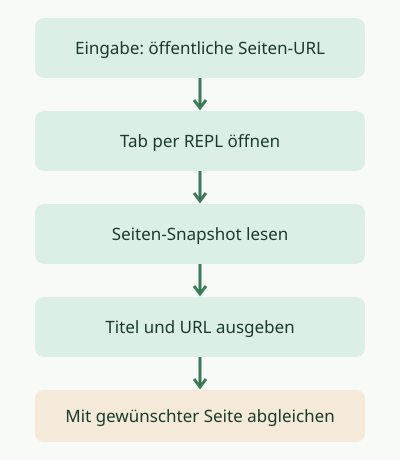

**Aside ist ein KI-Browser, der mehrstufige Aufgaben mithilfe angemeldeter Websites und des Browserkontexts ausführt.** Sie können mit Zusammenfassungen geöffneter Seiten und Recherchen beginnen und im erlaubten Umfang auch Formulareingaben und Dateiaufgaben delegieren. Entscheidend ist, neben dem Antworttext auch zu prüfen, auf welcher Seite was erledigt wurde.

Diese Einführung beruht auf der [offiziellen Hilfe](https://docs.aside.com/) und den Entwicklerhinweisen vom 16. November 2026. Das Beispiel zum Lesen einer öffentlichen Seite mit der lokalen CLI wurde ausgeführt. Die folgenden Arbeits-Prompts wurden weder mit angemeldeten Konten ausgeführt noch wurde die Erfolgsquote einzelner Dienste gemessen.

## Was ändert sich gegenüber einem gewöhnlichen Browser?

In einem gewöhnlichen Browser wechseln Menschen selbst zwischen Websites, kopieren Informationen und entscheiden über den nächsten Schritt. In Aside geben Sie gewünschtes Ergebnis und Umfang an; der Agent kann mehrere Seiten lesen und die Arbeit fortsetzen. Praktisch ist, Aufgaben auf Websites anfragen zu können, ohne selbst eine separate Dienst-API zu entwickeln. Das bedeutet jedoch nicht, dass die Automatisierung jeder Website immer gelingt.

Die [Aufgabenanleitung](https://docs.aside.com/help/tasks) beschreibt die Auswahl von Modus, Berechtigungen, Ordner und Modell sowie das Beantworten von Rückfragen oder Freigabeanfragen während der Ausführung. Sie unterscheidet außerdem Aufgaben im Standardprofil von Incognito-Aufgaben, die nicht den gewöhnlichen Anmeldestatus nutzen.

| Einsatz | Gewünschtes Ergebnis | Was Sie prüfen sollten |
| --- | --- | --- |
| Recherche öffentlicher Informationen | Vergleich nach Bedingungen mit Quellenlinks | Datum, Einheiten und tatsächliche Aussagen der Quelle |
| Abfrage eines angemeldeten Dashboards | Zahlen für einen vorgegebenen Zeitraum | Konto, Zeitraum, Filter und mögliche Lücken |
| Dokumente und Dateien aufbereiten | Benötigte Angaben und Entwurf extrahieren | Originalwerte und Speicherort |
| Antwort vorbereiten | Antwortentwurf passend zur Anfrage | Empfänger, Kontext und ob tatsächlich versendet wurde |

„Entwurf erstellen“ und „versenden“ in der letzten Zeile sind verschiedene Aufträge. Lernen Sie den Ablauf am besten zunächst mit Abfragen und Entwürfen kennen.

## Erste Aufgabe auf einer geöffneten Seite starten

Laut [Anleitung zum Seitenpanel](https://docs.aside.com/help/side-panel) können Sie eine Seite öffnen und im Aside-Panel eine Anfrage stellen, während die Seite als Anhang erhalten bleibt. An Titel und Host des Anhangs erkennen Sie die Ausgangsseite der Aufgabe.

Probieren Sie auf einer öffentlichen Produktdokumentation die folgende Anfrage aus. Dies ist ein selbst formulierter Beispiel-Prompt.

```text
Fasse aus der angehängten offiziellen Dokumentation die unterstützten Umgebungen,
Installationsvoraussetzungen und Einschränkungen zusammen.
Füge jeder Angabe einen Beleglink hinzu und kennzeichne Informationen,
die nicht in der Dokumentation stehen, als unbestätigt.
Erstelle kein Konto, lade nichts herunter und installiere nichts.
Zeige das Ergebnis in diesem Gespräch.
```

Öffnen Sie nach Erhalt des Ergebnisses die Links und prüfen Sie die Bedingungen. Werden andere Produkte oder alte Dokumente einbezogen, grenzen Sie Ziel-URL und zu prüfendes Datum ein und fragen Sie erneut. Lassen Sie Anweisungen in Dokumenten nicht den ursprünglichen Auftrag ersetzen; legen Sie fest, welche Inhalte nur als Quellenmaterial gelesen werden sollen.

## Komfort durch Erinnerungen und Passwortverwaltung

Aside bietet Funktionen, die Browserkontext und Erinnerungen nutzen. Dennoch werden nicht sämtliche Aufgaben fortgesetzt, wenn Sie sich auf einem anderen Computer mit demselben Konto anmelden. Die [Geräteanleitung](https://docs.aside.com/help/devices) unterscheidet Browser-Synchronisation etwa für Lesezeichen und Verlauf von Gesprächen, Erinnerungen und Aufgabenordnern, die auf dem jeweiligen Gerät bleiben. Laut Anleitung ist das unveränderte Übertragen lokaler Aufgaben auf einen anderen Computer oder in die Cloud derzeit nicht allgemein verfügbar.

[Aside Vault](https://docs.aside.com/help/password-manager) wird als Funktion beschrieben, die gespeicherte Zugangsdaten auf Websites automatisch einträgt, ohne dem Agenten das rohe Passwort zu übergeben. Die Nutzungsregeln für Agenten legen Sie unter `Settings > Passwords > Access policy for AI agents` fest. Manche Websites verlangen zusätzliche Authentifizierung oder eine Bestätigung durch Sie.

Passwörter vor dem Modell zu verbergen und Seiteninhalte nach der Anmeldung durch das Modell verarbeiten zu lassen sind verschiedene Dinge. Wenn Sie E-Mails zusammenfassen lassen, kann deren Inhalt Teil des Aufgabenkontexts werden. Legen Sie deshalb die tatsächlich benötigten Websites und Aufgaben fest, statt allein wegen des Anmeldekomforts für alle Konten denselben Zugriff zu erlauben.

## Was „lokal ausgerichtet“ umfasst

Die [Datenschutzerklärung](https://aside.com/policy/privacy) beschreibt die lokale Speicherung von Aufgabengesprächen und Ergebnissen, stellt aber auch klar, dass gehostete KI-Modellanbieter den für die Aufgabe nötigen Kontext erhalten. Dazu können Prompts, Werkzeugergebnisse sowie ausgewählte Browser-Snapshots, Screenshots und Dateien gehören. **Lokale Speicherung bedeutet nicht, dass die gesamte Verarbeitung offline erfolgt oder keinerlei Daten nach außen gehen.**

Auch Dateiberechtigungen und Aktionen auf Websites müssen unterschieden werden. Gehen Sie nicht allein wegen der Bezeichnung `Read only` davon aus, dass alle Änderungen auf Websites blockiert werden. Prüfen Sie Arbeitsauftrag und tatsächliche Freigabeanfragen. Den Ordnerzugriff von `Guard` und `Full access` prüfen Sie ebenfalls in der [Aufgabenanleitung](https://docs.aside.com/help/tasks) und den Einstellungen Ihrer installierten Version.

## Für Entwickler: CLI, MCP und REPL

Die [Entwicklerdokumentation](https://aside.com/developers) bietet eine CLI für natürlichsprachliche Aufgaben, MCP zur Anbindung vorhandener Agenten und eine REPL zur direkten Browsersteuerung. Sie können diese anbinden, wenn Sie bei Entwicklungsaufgaben Webdokumentation lesen oder Oberflächen prüfen müssen. Eine öffentliche HTTP-Download-API ist nicht dasselbe wie eine API zur Ausführung von Agentenaufgaben.



Führen Sie den folgenden Befehl in einer Umgebung aus, in der die CLI installiert und authentifiziert ist und sich mit Aside verbinden kann. Lesen Sie zunächst `aside guide` für die Grundlagen und `aside guide repl` für direkte Browsersteuerung.

```sh
aside repl 'await openTab("https://example.com"); console.log((await snapshot(page)).tree)'
```

Bei der Ausführung mit Aside CLI **1.26.1115.1556** unter macOS war der Exitcode 0. Titel und URL aus der Ausgabe lauteten wie folgt; übriger Seiteninhalt und Linkeinträge wurden weggelassen.

```text
- title: "Example Domain" [url=https://example.com/]
```

Die Abbildung folgt der Reihenfolge dieses Beispiels: Eingabe → Tab öffnen → Snapshot → Ergebnis abgleichen. Das Beispiel prüft weder Recherche-Erfolgsquoten des natürlichsprachlichen Agenten noch Anmeldung oder Zahlungsfunktionen. Die REPL-Sitzung ist laut CLI-Anleitung inkognito und ist daher von Aufgaben mit dem Anmeldestatus des Standardprofils zu unterscheiden.

## Welche Aufgabe zuerst delegieren?

Aside ist einen Versuch wert, wenn Sie Informationen aus mehreren Websites und Dokumenten zusammenstellen. Je klarer gewünschtes Ergebnis und Quellenumfang sind, desto leichter lässt sich die Erledigung beurteilen. Prüfen Sie bei festgelegter Massenverarbeitung dagegen auch, ob eine offizielle API oder ein eigenes Skript besser geeignet ist.

Wiederkehrende Aufgaben lassen sich mit [Routines](https://docs.aside.com/help/automation) planen. Sie sollten jedoch nicht davon ausgehen, dass sie bei schlafendem oder ausgeschaltetem lokalem Computer weiterlaufen. Die Geräteanleitung erklärt, dass der Computer für lokale Aufgaben laufen und mit dem Netzwerk verbunden sein muss. Nutzungslimits und Kosten angebundener Modelle prüfen Sie in der [Tarifübersicht](https://docs.aside.com/help/subscription) und in der App.

Für den Einstieg genügt eine quellenbelegte Zusammenfassung einer einzelnen öffentlichen Dokumentationsseite. Vergleichen Sie das Ergebnis mit dem Original und erweitern Sie den Umfang anschließend auf angemeldete Konten oder wiederkehrende Aufgaben. So können Sie konkret beurteilen, welche Arbeit Aside Ihnen abnimmt und was Sie selbst prüfen müssen.

Konkrete Rechercheanfragen sowie Beispiele für CSV-Prüfung und wiederkehrende Aufgaben finden Sie in [Aside-Browser praktisch nutzen](/ko/posts/2026-11-17-aside-browser-guide/).
