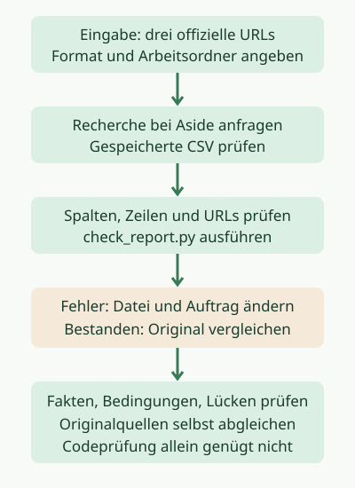

**Geben Sie Aside besser die zu nutzenden Seiten, das Ergebnisformat und die Abschlussbedingungen vor, statt nur „Recherchiere das für mich“ zu schreiben.** Beginnen Sie mit einer kleinen Aufgabe zu wenigen öffentlichen Dokumenten, gleichen Sie Original und Ergebnis ab und erweitern Sie den Umfang erst dann auf angemeldete Seiten oder wiederkehrende Aufgaben.

Dieser Artikel beruht auf der am 17. November 2026 geprüften offiziellen Hilfe. Die folgenden Prompts sind Anwendungsbeispiele und keine Ergebnisse tatsächlich ausgeführter Recherche-, Anmelde- oder Planungsaufgaben in Aside. Der Code zur CSV-Prüfung wurde mit separaten synthetischen Eingaben ausgeführt und überprüft.

## Vor Arbeitsbeginn den Umfang festlegen

Installieren Sie Aside und prüfen Sie das zu verwendende Modell sowie den Aufgabenordner. Wenn Sie auf der aktuellen Seite beginnen möchten, öffnen Sie das Seitenpanel und prüfen Sie Titel und Host der angehängten Seite. Bleibt sie angehängt, kann sie als Aufgabenkontext dienen. [Anleitung zum Seitenpanel](https://docs.aside.com/help/side-panel)

Für Recherchen ohne Anmeldung können Sie auch Incognito wählen. Um ein angemeldetes Konto abzufragen, verwenden Sie das Standardprofil mit diesem Konto. Die beiden Modi haben unterschiedliche Browserzustände. Soll eine Datei gespeichert werden, benötigen Sie außerdem Schreibrechte für den festgelegten Ordner. [Anleitung zu Aufgabenmodi](https://docs.aside.com/help/tasks)

Prüfen Sie sowohl die Datei-, Werkzeug- und Sandbox-Einstellungen unter `Settings > Agents` als auch die Einstellungen der jeweiligen Aufgabe. Laut offizieller Dokumentation arbeitet `Guard` in freigegebenen Ordnern und fragt vor dem Zugriff auf andere Ordner nach. `Read only` erlaubt laut Beschreibung keine Dateiänderungen und ist deshalb für das CSV-Speicherbeispiel möglicherweise ungeeignet. Schließen Sie aus dem Namen nicht, dass alle Änderungen auf Websites automatisch blockiert werden. [Berechtigungsanleitung](https://docs.aside.com/help/security)

## Beispiel 1: Drei offizielle Dokumentationsseiten als CSV aufbereiten

Wählen Sie einen leeren Aufgabenordner und senden Sie die folgende Anfrage. Ersetzen Sie den Speicherort durch Ihren tatsächlichen Ordner. Wenn bereits eine gleichnamige Datei existiert, vergeben Sie einen neuen Namen.

```text
Lies ausschließlich die folgenden drei offiziellen Dokumentationsseiten
und bereite sie als report.csv auf.
https://docs.aside.com/help/tasks
https://docs.aside.com/help/automation
https://docs.aside.com/help/devices

Die CSV soll UTF-8 verwenden, mit den Spalten in dieser Reihenfolge: topic,summary,source_url.
Verwende für topic jeweils tasks,automation,devices und schreibe genau eine Zeile pro Seite.
Schreibe summary als einen koreanischen Satz, der die wichtigsten Nutzungsbedingungen der Seite erklärt.
Felder mit Kommas müssen gemäß den CSV-Regeln in Anführungszeichen stehen.
Verwende für source_url unverändert die oben angegebene Adresse der jeweiligen Seite.

Speichere im ausgewählten Aufgabenordner, ohne bestehende Dateien zu überschreiben.
Wenn du ein Dokument nicht lesen kannst, ergänze nichts durch Vermutungen,
sondern nenne die nicht erreichbare Adresse.
Greife nicht auf Konten anderer Websites zu und sende keine Nachrichten.
Nenne nach Abschluss den Dateipfad und die drei geprüften Seiten.
```

Wenn sich eine Seite nicht öffnen lässt, beheben Sie zuerst den Zugriffsfehler. Prüfen Sie auch bei fehlenden Angaben im Ergebnis vor einem erneuten Versuch die Ziel-URL. Ein nicht gelesenes Dokument durch eine vermutete Zusammenfassung zu ersetzen gilt nicht als Erledigung.



Die Codeprüfung im Schaubild stellt fest, ob die Ergebnisdatei die vorgegebene Struktur und den Quellenumfang einhält. Speichern Sie den folgenden Code als `check_report.py`. Er verwendet nur die Python-3-Standardbibliothek und kommuniziert nicht nach außen.

```python
import csv
import sys

expected = {
    "tasks": "https://docs.aside.com/help/tasks",
    "automation": "https://docs.aside.com/help/automation",
    "devices": "https://docs.aside.com/help/devices",
}

with open(sys.argv[1], newline="", encoding="utf-8-sig") as stream:
    reader = csv.DictReader(stream)
    if reader.fieldnames != ["topic", "summary", "source_url"]:
        raise SystemExit("FAIL: columns")
    rows = list(reader)

if len(rows) != len(expected) or {r["topic"] for r in rows} != set(expected):
    raise SystemExit("FAIL: topics")
for row in rows:
    if (None in row or any(value is None for value in row.values())
            or not row["summary"].strip()
            or row["source_url"] != expected[row["topic"]]):
        raise SystemExit("FAIL: row")
print("PASS: 3 topics and allowed source URLs")
```

Übergeben Sie den tatsächlichen Pfad der erzeugten CSV als Argument.

```sh
python3 check_report.py report.csv
```

Mit einer synthetischen Eingabe aus drei Zeilen und den erlaubten URLs wurden Exitcode 0 und die folgende Ausgabe bestätigt. Diese Eingabe wurde nicht von Aside erzeugt.

```text
PASS: 3 topics and allowed source URLs
```

Eine synthetische Eingabe mit einer entfernten Zeile lieferte `FAIL: topics` und Exitcode 1. Der Code prüft Spalten, Themen, URLs und leere Zusammenfassungen, kann aber **weder die sachliche Richtigkeit der Zusammenfassungen noch das tatsächliche Lesen der Seiten feststellen.** Prüfen Sie nach erfolgreichem Durchlauf im Original selbst die Sätze, die jede Zusammenfassung belegen. Lockern Sie bei einem Codefehler nicht einfach die Prüfbedingungen, sondern suchen Sie zuerst nach Abweichungen zwischen Datei und Prompt.

## Beispiel 2: Nur Zahlen aus einem angemeldeten Dashboard abfragen

Grenzen Sie bei einer Kontoabfrage Website, Konto, Zeitraum und Filter ein. Das folgende Beispiel setzt ein geschäftliches Dashboard voraus, für das Sie Zugriffsrechte haben.

```text
Lies im aktuell angehängten Dashboard die Aufrufzahlen für das von mir angegebene
Konto im Zeitraum 2026-11-01~2026-11-07. Nenne auch Zeitzone und Filter der Oberfläche.
Zeige Datum, Zahl und Einheit in einer Tabelle und deute leere Felder nicht als 0.
Ändere keine Einstellungen, exportiere nichts und frage keine anderen Konten ab.
Kennzeichne Werte, die du nicht auf der Oberfläche bestätigen kannst, als unbestätigt.
```

Vergleichen Sie bei vorliegenden Zahlen zuerst, ob Gesamtsumme, Zeitraum, Zeitzone und Filter mit der Oberfläche übereinstimmen. Die Gesamtsumme kann von der Summe einiger oberster Zeilen abweichen; werten Sie eine solche Differenz nicht sofort als Fehler. Wenn ein Export nötig ist, legen Sie den Dateiumfang und den Speicherort fest und fordern Sie ihn gesondert an.

Fügen Sie keine Passwörter in den Prompt ein, wenn Zugangsdaten benötigt werden. Prüfen Sie gemäß der [Password-Manager-Anleitung](https://docs.aside.com/help/password-manager) die Regeln für gespeicherte Anmeldungen und erledigen Sie die zusätzliche Authentifizierung der Website. Die Aussage, dass Passwörter nicht an das Modell übergeben werden, ist von der Verarbeitung angemeldeter Seiteninhalte durch das Modell zu unterscheiden. Die [Datenschutzerklärung](https://aside.com/policy/privacy) erklärt, dass ausgewählter, für die Aufgabe benötigter Kontext an Anbieter gehosteter Modelle übermittelt werden kann.

## Anfragen während der Ausführung korrigieren

Wenn das Rechercheziel falsch ist oder Sie den Umfang reduzieren müssen, brauchen Sie nicht bis zum Abschluss zu warten. Die [Aufgabenanleitung](https://docs.aside.com/help/tasks) unterscheidet bei Folgenachrichten `Queue` und `Steer`. `Queue` wendet eine Folgeanfrage nach Ende der aktuellen Ausführung an; `Steer` übermittelt eine neue Nachricht an die laufende Aufgabe, um ihre Richtung zu ändern.

Geben Sie die Änderung konkret an, etwa: „Recherchiere keine anderen Websites und verwende nur die ursprünglichen drei Dokumente.“ Das Senden einer Korrektur macht bereits ausgeführte externe Aktionen nicht automatisch rückgängig. Prüfen Sie den tatsächlichen Status, bevor Sie über die nächste Anfrage entscheiden.

## Beispiel 3: Eine geprüfte Recherche als wiederkehrende Aufgabe einrichten

Wenn das einmalige Ergebnis brauchbar war, können Sie wiederkehrende Recherchen erwägen. Laut [Routines-Anleitung](https://docs.aside.com/help/automation) startet eine Cron-Routine planmäßig eine neue Aufgabe, während eine Heartbeat-Routine ein bestehendes Gespräch fortsetzt. Für unabhängige Wochenzusammenfassungen sollten Sie zunächst die Variante mit neuen Aufgaben prüfen.

Erstellen Sie unter `Settings > Routines` eine neue Routine und geben Sie etwa die folgenden Anweisungen ein. Intervall und Zeitzone stellen Sie separat in der tatsächlichen Oberfläche ein.

```text
Lies die drei festgelegten offiziellen Dokumentationsseiten und vergleiche sie
mit dem Ergebnis des letzten Durchlaufs. Nenne Änderungen an Nutzung oder Einschränkungen
mit Beleglinks.
Wenn kein vorheriges Ergebnis zum Vergleich vorliegt, halte dieses Ergebnis als Ausgangsbasis fest.
Wenn du Dokumente nicht lesen kannst, melde einen Zugriffsfehler statt „keine Änderungen“.
Ändere keine Kontoeinstellungen, sende keine Nachrichten und führe keine kostenpflichtigen Aufgaben aus.
```

Legen Sie außerdem fest, wo das vorige Ergebnis gespeichert wird und wie der nächste Durchlauf darauf zugreift. Gehen Sie nicht davon aus, dass ein voriges Gespräch automatisch als Vergleichsgrundlage dient, nur weil die Routine eine neue Aufgabe erstellt. Benennen Sie die Eingabe eindeutig, etwa einen früheren Bericht im vorgegebenen Ordner, oder lassen Sie sich zunächst nur Berichte liefern und vergleichen Sie selbst, statt automatisch vergleichen zu lassen.

Führen Sie die Routine in der Routinenliste sofort aus und prüfen Sie Eingaben, Ausgaben und Fehlerbehandlung, bevor Sie den Zeitplan aktivieren. Die offizielle Anleitung beschreibt das Überspringen überlappender Ausführungen. Laut [Geräteanleitung](https://docs.aside.com/help/devices) müssen für lokale Aufgaben der Computer eingeschaltet und online sowie Aside aktiv sein. Die Anmeldung auf einem anderen Computer oder ein kostenpflichtiger Tarif bewirken nicht, dass Aufgaben eines schlafenden Geräts in der Cloud fortgesetzt werden.

Für den Einstieg genügt es, den Ablauf aus Abfragen, Aufbereiten und Prüfen einmal kennenzulernen. Erst wenn dabei benötigte Eingaben und die Prüfung der Ergebnisse geklärt sind, lassen sich auch wiederkehrende Ausführungen verlässlich nutzen.
