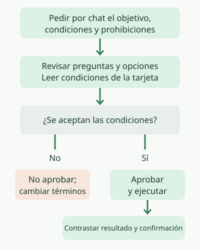

Pickle AI es un agente personal de IA al que puedes pedir por chat tareas como buscar información o hacer reservas y consultar su progreso. Conviene empezar con una búsqueda que no requiera pagos ni conectar cuentas y comprobar el resultado por tu cuenta. Si después delegas reservas o compras, incluye la fecha, el presupuesto y las condiciones de aprobación.

Esta guía se basa en la [ayuda oficial de Pickle](https://www.pickle.com/help). No es un registro de uso de la aplicación con una cuenta real ni de ejecución de los ejemplos siguientes. Las pantallas y las funciones disponibles pueden variar según la versión, la cuenta y la región.

## Antes de empezar

Prepara la aplicación y la cuenta de Pickle y consulta en la aplicación el plan y los límites disponibles. La [guía de planes en coreano](https://www.pickle.com/help/credits/plans) indica que en Corea el servicio es gratuito, con un límite de uso que se restablece cada día. Al alcanzarlo, pueden omitirse tareas programadas; comprueba el uso restante y la hora de restablecimiento en la pestaña **Mi Pickle**. Los planes y los límites pueden variar según la región y el momento.

Según la [presentación oficial](https://www.pickle.com/help/start/what-is-pickle), Pickle recibe solicitudes por chat, trabaja en sitios web mediante un navegador separado y puede llamar por teléfono cuando algo no se puede resolver en la web. Por tanto, no debes entenderlo como si pulsara directamente otras aplicaciones instaladas en tu iPhone. Comprueba en la interfaz la compatibilidad de cada región y servicio y la disponibilidad de llamadas.



El diagrama simplifica el flujo cuando el usuario recibe una tarjeta de confirmación. No significa que aparezca una tarjeta en todas las solicitudes ni que las acciones externas siempre tengan éxito. El siguiente pseudocódigo es un procedimiento de decisión para el lector, no la implementación interna de Pickle.

```text
Solicitud = objetivo, fecha y lugar, presupuesto, acciones permitidas y prohibidas
Enviar la solicitud a Pickle
Si hay preguntas adicionales u opciones, responder según las condiciones
Si aparece una tarjeta de confirmación:
    Revisar el contenido y las condiciones
    Si las condiciones no son correctas, no aprobar y modificarlas
    Si las condiciones son correctas, aprobar
Al recibir el resultado, comparar la solicitud original con la confirmación externa
```

## Primera tarea: buscar opciones sin pagar

Por ejemplo, si quieres elegir un restaurante, escribe lo siguiente en Chat. La fecha, la hora y la zona son ejemplos: sustitúyelas por tus condiciones reales.

```text
Busca un restaurante cerca de la estación de Gangnam, en Seúl, para 2 personas el sábado a las 6 de la tarde.
El presupuesto es de hasta 30,000 wones por persona; prioriza los locales con platos vegetarianos.
Para cada opción, indica nombre, ubicación, horario y enlace que respalde el menú.
No reserves, no llames ni pagues; señala la información incierta.
```

Si Pickle pregunta por la fecha u otras condiciones, responde. Cuando presente opciones, abre los enlaces y comprueba el horario de esa fecha y el menú. Si falta un enlace o no se ha podido confirmar una condición, añade: «Indica en qué fuente lo has comprobado. No supongas datos que no puedas verificar». Es un ejemplo; no se ha verificado la ejecución de este prompt en el servicio real.

Según la [guía para delegar tareas](https://www.pickle.com/help/tasks/delegate), al comunicar el objetivo en Chat, el servicio puede pedir los datos necesarios y mostrar una tarjeta con la tarea y sus condiciones para confirmarlas. La tarjeta aparece en el chat y la tarea puede continuar aunque cierres la aplicación. No interpretes cerrar la aplicación como cancelar: si necesitas detenerla, comprueba su estado actual y si aún se puede cancelar.

## Al delegar una reserva o una compra

Después de comprobar las opciones encontradas, limita las acciones mediante una solicitud aparte.

```text
Comprueba las horas disponibles para reservar en el restaurante que he elegido de la lista anterior.
Las condiciones son 2 personas, el sábado a las 6 de la tarde. Si hace falta un depósito de pago o pagar,
no continúes: muestra primero el importe y las condiciones de cancelación.
Si hay que cambiar la hora o el número de personas, pregúntame antes de reservar.
```

Si aparece una tarjeta de confirmación, revisa el lugar, la fecha y la hora, las personas, el importe y las condiciones de cancelación, y aprueba solo si estás de acuerdo. La guía oficial explica que, antes de acciones difíciles de revertir como reservar o pagar, se muestran las condiciones y se pide confirmación. Aun así, el texto de una solicitud no impide todos los errores. Tras aprobar, comprueba por separado el estado real de la reserva y del pago en la pantalla o el correo de confirmación del restaurante o vendedor. Tampoco supongas que pedir una cancelación revierte automáticamente una acción ya realizada en un servicio externo.

## Conectar cuentas y guardar accesos solo cuando sea necesario

Si la tarea usa correo o calendario, puedes conectar las cuentas necesarias en **Mi Pickle → Aplicaciones y servicios conectados a (nombre de Pickle)**, según la [guía oficial](https://www.pickle.com/help/start/what-is-pickle). Lee los permisos que muestra la pantalla de conexión y no conectes una cuenta si la tarea no lo necesita. Por ejemplo, buscar posibles horarios no requiere necesariamente acceso al calendario.

Si necesitas iniciar sesión en una web, no introduzcas contraseñas ni números de tarjeta en el chat. Usa la pantalla de entrada segura y Vault que describe la documentación oficial, y vuelve a comprobar el sitio y los datos solicitados. Según la [guía para guardar accesos](https://www.pickle.com/help/connect/save-login), el navegador de Pickle está separado de las sesiones guardadas en el teléfono.

La protección de credenciales también tiene límites. La explicación oficial dice que no se entregan contraseñas ni números de tarjeta al modelo, pero hay que examinar por separado la ruta que procesa los valores necesarios para rellenar formularios web. El alcance y los límites de protección observables en el código público se explican en [Cómo funciona Pickle AI y protege las contraseñas](/ko/posts/2026-11-13-pickle-ai-security/). La política de acceso a conversaciones y recuerdos difiere de la política de almacenamiento de credenciales; consulta también la [información de privacidad](https://pickle.com/privacy).

## Revisar tareas recurrentes e historial de uso

Para recordatorios o resúmenes recurrentes, puedes indicar en Chat la tarea y su periodicidad. Por ejemplo: «Cada lunes a las 9 de la mañana busca noticias de eventos tecnológicos públicos y resúmelas con enlaces. No te inscribas ni pagues». Comprueba la zona horaria y las condiciones reales de ejecución en los detalles de la tarea creada.

Según la [guía de tareas programadas](https://www.pickle.com/help/tasks/scheduled), puedes pulsar la imagen de Pickle en la parte superior para abrir el perfil y acceder a **Tareas programadas**. Al abrir una tarea puedes pausarla, reanudarla, modificarla, eliminarla y consultar su historial. Al alcanzar el límite de uso pueden omitirse ejecuciones: revisa el estado en el historial y no supongas que una ejecución omitida se ha recuperado automáticamente.

Puedes revisar el uso de cuentas y tarjetas conectadas en **Mi Pickle → Aplicaciones y servicios conectados o métodos de pago conectados → Aviso de cifrado**, la ruta indicada en la [guía de Access log](https://pickle.com/help/privacy/activity). El registro se crea justo antes de una solicitud y no demuestra que la reserva o el pago haya tenido éxito. Por eso debes contrastarlo también con el resultado de la tarea y la confirmación del servicio externo.
