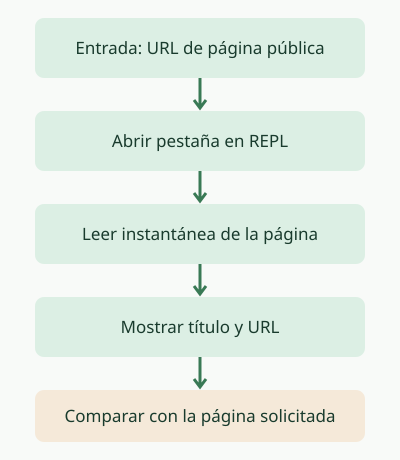

**Aside es un navegador de IA que realiza tareas de varios pasos utilizando los sitios donde has iniciado sesión y el contexto del navegador.** Puedes empezar resumiendo una página abierta o recopilando información y después delegar formularios y archivos dentro del alcance permitido. Lo esencial es comprobar qué se ha hecho en cada página, además del texto de la respuesta.

Esta presentación se basa en la [ayuda oficial](https://docs.aside.com/) y la documentación para desarrolladores del 16 de noviembre de 2026. Se ejecutó el ejemplo de lectura de una página pública con el CLI local. Los prompts de trabajo siguientes no se ejecutaron en cuentas autenticadas ni se midió la tasa de éxito de cada servicio.

## ¿Qué cambia frente a un navegador normal?

En un navegador habitual, la persona recorre sitios, copia información y decide la siguiente acción. En Aside, al pedir un resultado y definir su alcance, el agente puede leer varias páginas y continuar el trabajo. La comodidad está en pedir tareas en sitios web sin desarrollar directamente una integración con la API de cada servicio. Eso no significa que la automatización siempre funcione en todos los sitios.

La [guía de tareas](https://docs.aside.com/help/tasks) explica cómo elegir modo, permisos, carpeta y modelo, y responder a preguntas o solicitudes de aprobación durante la ejecución. Distingue las tareas del perfil predeterminado de las tareas Incognito, que no usan el estado habitual de inicio de sesión.

| Uso | Resultado solicitado | Qué debe comprobar el usuario |
| --- | --- | --- |
| Investigación de información pública | Comparación según condiciones y enlaces a fuentes | Fecha original, unidades y afirmaciones reales de la fuente |
| Consulta de un panel autenticado | Resumen de cifras de un periodo concreto | Cuenta, periodo, filtros y posibles omisiones |
| Organización de documentos y archivos | Extracción de elementos necesarios y borrador | Valores originales y ubicación de guardado |
| Preparación de respuestas | Borrador adecuado a la consulta | Destinatario, contexto y si se ha enviado realmente |

«Preparar un borrador» y «enviar» en la última fila son solicitudes distintas. Conviene aprender el flujo con consultas y borradores primero.

## Empezar la primera tarea desde una página abierta

Según la [guía del panel lateral](https://docs.aside.com/help/side-panel), puedes abrir una página y enviar una solicitud desde el panel Aside manteniéndola adjunta. Comprueba el título y el host adjuntos para saber qué página será el punto de partida.

Prueba esta solicitud en una documentación pública de producto. Es un prompt de ejemplo redactado para este artículo.

```text
Resume los entornos compatibles, requisitos de instalación y limitaciones de la documentación oficial adjunta.
Añade enlaces que respalden cada elemento y marca como no verificada la información ausente.
No crees cuentas, descargues ni instales nada; muestra el resultado en esta conversación.
```

Al recibir el resultado, abre los enlaces y comprueba las condiciones. Si se mezclan otros productos o documentación antigua, acota la URL y la fecha que quieres comprobar y vuelve a pedirlo. No permitas que las instrucciones de los documentos sustituyan la solicitud original: especifica qué se debe leer como material de referencia.

## La comodidad de la memoria y el gestor de contraseñas

Aside ofrece funciones que aprovechan el contexto de navegación y la memoria. Sin embargo, iniciar sesión con la misma cuenta en otro ordenador no continúa todas las tareas. La [guía de dispositivos](https://docs.aside.com/help/devices) distingue la sincronización de marcadores e historial del navegador de las conversaciones, la memoria y las carpetas que permanecen en cada dispositivo. Indica que trasladar directamente tareas locales a otro ordenador o a la nube todavía no está disponible de forma general.

[Aside Vault](https://docs.aside.com/help/password-manager) se describe como un sistema que rellena los datos de acceso guardados sin entregar al agente la contraseña en bruto. La política para agentes se configura en `Settings > Passwords > Access policy for AI agents`. Algunos sitios requieren autenticación adicional o confirmación del usuario.

Ocultar la contraseña al modelo y permitir que procese el contenido de las páginas después de entrar son cosas distintas. Si pides organizar correos, su contenido puede incluirse en el contexto de la tarea. Por eso conviene definir los sitios y las tareas necesarios, en lugar de conceder el mismo acceso a todas las cuentas por la comodidad de iniciar sesión.

## Qué significa centrarse en lo local

La [política de privacidad](https://aside.com/policy/privacy) explica que conversaciones y resultados se almacenan localmente, pero también que los proveedores de modelos de IA alojados reciben el contexto necesario para la tarea. Puede incluir prompts, resultados de herramientas, instantáneas y capturas seleccionadas del navegador, archivos y otros datos. **El almacenamiento local no significa que todo se procese sin conexión ni que ningún dato salga del dispositivo.**

También hay que distinguir permisos de archivos y acciones en sitios web. No supongas, solo por el nombre `Read only`, que se bloquean todos los cambios en sitios: revisa las instrucciones y las solicitudes reales de aprobación. Comprueba también el alcance de carpetas de `Guard` y `Full access` en la [guía de tareas](https://docs.aside.com/help/tasks) y en la versión instalada.

## Para desarrolladores: CLI, MCP y REPL

La [documentación para desarrolladores](https://aside.com/developers) ofrece un CLI para tareas en lenguaje natural, MCP para conectar agentes existentes y un REPL para manejar directamente el navegador. Puedes conectarlos cuando tu trabajo de desarrollo requiera consultar documentación web o comprobar pantallas. La API HTTP pública de descarga es distinta de una API que ejecuta tareas del agente.



Ejecuta el siguiente comando en un entorno con CLI instalado y autenticado y conexión disponible a Aside. Consulta antes `aside guide` para el uso básico y `aside guide repl` para el control directo del navegador.

```sh
aside repl 'await openTab("https://example.com"); console.log((await snapshot(page)).tree)'
```

Al ejecutarlo con Aside CLI **1.26.1115.1556** en macOS, el código de salida fue 0; el título y la URL aparecieron así. Se omiten el resto del contenido y los enlaces.

```text
- title: "Example Domain" [url=https://example.com/]
```

El diagrama sigue la secuencia del ejemplo: entrada → abrir pestaña → instantánea → contraste del resultado. No verifica la tasa de éxito de investigación del agente en lenguaje natural, el inicio de sesión ni los pagos. Según la guía de CLI, la sesión REPL es incognito, por lo que también se distingue de las tareas que usan la sesión del perfil normal.

## ¿Qué tareas delegar primero?

Aside merece una prueba en trabajos que organizan información entre varios sitios y documentos. Cuanto más claros estén el resultado y las fuentes, más fácil será decidir si está completo. Para procesamiento masivo fijo, evalúa también si conviene más una API oficial o un script específico.

Puedes programar tareas recurrentes con [Routines](https://docs.aside.com/help/automation), pero no debes suponer que siguen ejecutándose cuando el ordenador local se suspende o se apaga. La guía de dispositivos indica que las tareas locales necesitan el ordenador activo y conectado a la red. Comprueba los límites y el coste del modelo conectado en la [guía de precios](https://docs.aside.com/help/subscription) y en la aplicación.

Como primer uso basta con un resumen respaldado por fuentes de una página pública de documentación. Compáralo con el original antes de ampliar el alcance a cuentas autenticadas o tareas recurrentes. Así podrás determinar de forma concreta qué trabajo te ahorra Aside y qué debes comprobar personalmente.

Encontrarás solicitudes de investigación, validación de CSV y ejemplos de recurrencia en la [guía práctica del navegador Aside](/ko/posts/2026-11-17-aside-browser-guide/).
