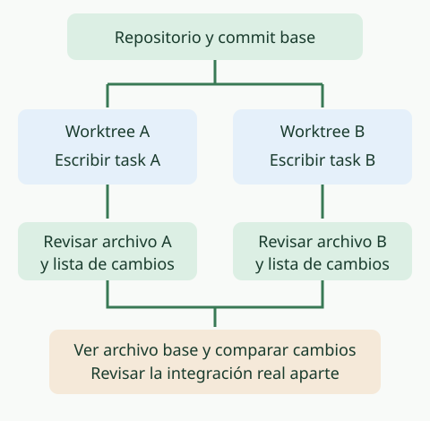

**T3 Code facilita seguir tareas, aprobaciones y cambios en un hilo de conversación; Orca destaca por reunir terminal, editor, navegador y diff por worktree. Herdr merece atención si quieres mantener terminales en ejecución y configurar tú mismo la interfaz y la automatización.** Las tres herramientas comparten funciones, por lo que conviene comparar cómo se inicia y revisa una tarea y cómo se vuelve tras una interrupción, en lugar de decidir por una sola función.

Comparamos [T3 Code](https://github.com/pingdotgg/t3code/tree/v0.1.9), [Orca](https://orca.dev/) y [Herdr](https://herdr.dev/). Son independientes de T3 Stack y de otros proyectos Hydra con nombres parecidos. Usamos documentación consultada el 16 de noviembre de 2026, limitando el comportamiento concreto de T3 Code a **la documentación de v0.1.9**. Para Orca y Herdr se consultó la documentación oficial vigente. Las ventajas y limitaciones siguientes son criterios derivados de los documentos, no mediciones de rendimiento de las tres aplicaciones en el mismo entorno.

## ¿En torno a qué se organiza el trabajo?

| Criterio | T3 Code | Orca | Herdr |
| --- | --- | --- | --- |
| Flujo principal | Solicitudes, aprobaciones y revisión de cambios en proyectos e hilos | Gestión de agentes, archivos, navegador y diff por worktree | Gestión de terminales y agentes en aplicación y TUI, con interfaz ampliable |
| Separación de tareas | Ofrece worktrees; hay que comprobar la ruta real de la tarea | Organiza ramas e interfaces en torno al worktree de cada tarea | Aplicación y TUI ofrecen worktrees; un panel no es por sí mismo un worktree |
| Revisión de cambios | Distinguir cambios del turno y alcance de la comparación de ramas | Diff por worktree, comentarios por línea y preparación parcial de cambios | Comprobar el flujo de revisión de la configuración elegida y las herramientas del terminal |
| Permisos | Comprobar el modo del hilo y el comportamiento de cada proveedor | Comprobar los permisos del agente y el alcance real de ejecución | Comprobar los permisos de agentes, comandos y extensiones ejecutados |
| Uso remoto | Conectar otros dispositivos al servidor | Hosts SSH y entorno Orca remoto | Funciones remotas separadas para aplicación/core y TUI |
| Evaluación de costes | Separar costes de aplicación y proveedor de modelos y condiciones de servicios conectados | Separar costes de aplicación, proveedor de modelos y computación remota | Separar costes de aplicación/core/TUI, proveedor de modelos y servidor |

Los flujos se basan en la [documentación de control de código](https://github.com/pingdotgg/t3code/blob/v0.1.9/docs/user/source-control.md) de T3 Code, la [documentación de worktrees](https://orca.dev/docs/model/worktrees) de Orca y la [guía de la aplicación](https://herdr.dev/guide/) de Herdr. Las funciones no comprobadas en la tabla no se declaran incompatibles. En particular, T3 Code también tiene worktrees e interfaz de revisión, y Herdr también tiene una aplicación de escritorio.

## T3 Code: seguir la conversación y la ejecución juntas

T3 Code conecta proveedores instalados con proyectos e hilos. El [README de v0.1.9](https://github.com/pingdotgg/t3code/blob/v0.1.9/README.md) describe clientes móviles, web y de escritorio, y conexiones con proveedores existentes como Codex y Claude Code. Entenderlo como una herramienta que proporciona el propio modelo puede causar confusión al instalar y autenticar.

Su ventaja es seguir la solicitud, la ejecución, las aprobaciones y los cambios en un solo hilo. La documentación de control de código distingue los cambios del turno de todos los cambios respecto a la rama base. Por ejemplo, si el agente obtiene primero código actualizado y después lo modifica, leer solo los cambios del turno no completa la revisión de toda la rama.

Hay que considerar que los modos de permisos no significan lo mismo para todos los proveedores. Elige el modo según la [documentación de permisos](https://github.com/pingdotgg/t3code/blob/v0.1.9/docs/user/permission-modes.md) y comprueba las solicitudes de aprobación reales. Una pantalla de aprobación no implica aislamiento del acceso a archivos y red del sistema operativo.

En remoto también importa la vida del servidor. La [documentación de acceso remoto](https://github.com/pingdotgg/t3code/blob/v0.1.9/docs/user/remote-access.md) indica que cerrar la última ventana de escritorio detiene el servidor local. Para ejecución continua hay que configurar un servicio independiente en segundo plano en un entorno compatible. Ese servicio no está disponible en Windows en esta versión, así que distingue los modos de ejecución. También hay que preparar la autenticación del proveedor y el repositorio en el servidor.

## Orca: reunir la interfaz de cada tarea y la revisión de cambios

Orca es un entorno de desarrollo que crea un worktree por tarea y permite manejar en él agente, editor, navegador y diff. La [documentación de diff](https://orca.dev/docs/review/diff-viewer) describe líneas modificadas, preparación parcial y resolución de conflictos. Facilita un flujo de desarrollo que modifica la UI, la comprueba en el navegador y revisa los cambios.

La ventaja es gestionar los archivos y la revisión de una tarea en el mismo contexto de worktree. Incluso con varios agentes, la interfaz ayuda a comprobar a qué rama corresponde cada cambio. También permite controlar espacios y terminales mediante CLI y habilidades. [Guía de CLI](https://orca.dev/docs/cli/overview)

Hay que aprender la configuración del entorno y el flujo de Git. En una única corrección breve, gestionar worktrees y varias interfaces puede costar más de lo que facilita. Más agentes pueden implicar más resultados que revisar y más recursos. La ejecución paralela no garantiza un ahorro de tiempo proporcional.

Según la [documentación de restauración de sesiones](https://orca.dev/docs/model/session-restore), los agentes continúan tras cerrar la aplicación mientras el demonio siga activo. Reiniciar el host o detener el demonio termina los procesos; restaurar el espacio y el historial del terminal no equivale a restaurar un proceso en ejecución. También hay [ejecución remota](https://orca.dev/docs/ways-to-run), pero las herramientas y la autenticación del host deben prepararse aparte.

## Herdr: configurar tú mismo terminales e interfaz de trabajo

En Herdr **hay que distinguir aplicación de escritorio, herdr-core y Herdr TUI**. La aplicación funciona sobre herdr-core y TUI usa un servidor separado. El FAQ oficial especifica que la aplicación y TUI no comparten la lista de agentes. [Sitio oficial de Herdr](https://herdr.dev/)

Su ventaja es ampliar por separado el entorno de ejecución de terminales y la interfaz. La [guía de core](https://herdr.dev/core/) describe ejecución de programas, inicio de otras tareas, lectura de resultados y conexión a máquinas remotas. La [guía de la aplicación](https://herdr.dev/guide/) también muestra cómo pedir a un agente que modifique diseños o funciones. Merece consideración si quieres crear tu panel manteniendo un entorno de desarrollo centrado en el terminal.

El aspecto a considerar es la mayor responsabilidad de entender componentes y extensiones. El estado de la aplicación depende de OSC 7501 informado por el programa; un programa sin informes de estado puede ejecutarse sin mostrarlo. No lo confundas con las reglas de detección de agentes de TUI. Comprueba también qué comandos y conexiones externas usan los modos personalizados y los plugins.

Los terminales siguen activos al cerrar la ventana si core continúa funcionando. Según el FAQ, reiniciar el dispositivo o detener core termina los procesos y la aplicación no reinicia automáticamente los agentes. TUI ofrece por separado restaurar el diseño y reanudar sesiones de agentes compatibles tras reiniciar el servidor. [Documentación de restauración de TUI](https://herdr.dev/tui/docs/session-state/)

## Los límites de worktree comunes a las tres herramientas

Cuando varios agentes cambian simultáneamente los mismos archivos, usar un worktree por tarea facilita seguir los cambios. Pero separar directorios no aísla automáticamente bases de datos, puertos de desarrollo, cuentas externas ni credenciales. Esta limitación se aplica a las tres herramientas.



El siguiente ejemplo comprueba la separación de archivos del diagrama. Crea un repositorio temporal en un shell de macOS o Linux con Git instalado, sin modificar el proyecto existente. No incluye ejecución de agentes ni comparación del rendimiento de productos.

```sh
#!/bin/sh
set -eu
case_dir=$(mktemp -d)
git init -q "$case_dir/repo"
git -C "$case_dir/repo" config user.name 'Example Author'
git -C "$case_dir/repo" config user.email 'example@example.invalid'
printf 'base\n' > "$case_dir/repo/app.txt"
git -C "$case_dir/repo" add app.txt
git -C "$case_dir/repo" commit -qm 'Initial commit'
git -C "$case_dir/repo" worktree add -qb task-a "$case_dir/task-a" HEAD
git -C "$case_dir/repo" worktree add -qb task-b "$case_dir/task-b" HEAD
printf 'task A\n' > "$case_dir/task-a/app.txt"
printf 'task B\n' > "$case_dir/task-b/app.txt"
printf 'A: '; cat "$case_dir/task-a/app.txt"
printf 'B: '; cat "$case_dir/task-b/app.txt"
printf 'base: '; cat "$case_dir/repo/app.txt"
printf 'A 변경 파일: '; git -C "$case_dir/task-a" diff --name-only
printf 'B 변경 파일: '; git -C "$case_dir/task-b" diff --name-only
```

Esta es la salida comprobada al ejecutarlo en el shell local.

```text
A: task A
B: task B
base: base
A 변경 파일: app.txt
B 변경 파일: app.txt
```

A y B conservan contenido distinto, pero han modificado el mismo archivo. Al integrar hay que revisar la intención de ambos cambios. El ejemplo no elimina automáticamente el directorio temporal.

## ¿Qué herramienta probar primero?

Puedes empezar por **T3 Code** si prefieres seguir solicitudes, aprobaciones y cambios en conversación; por **Orca** si prefieres revisar navegador, editor y diff separados por tarea; o por **Herdr** si prefieres configurar tú mismo terminales y paneles. Estas sugerencias se derivan de las funciones descritas en la documentación oficial.

Para verificar la elección, usa el mismo repositorio, tarea, modelo, permisos y condiciones de prueba en las tres herramientas. Fija la prueba que falla antes de modificar archivos y, al terminar, revisa resultados de ejecución, diff y cambios pendientes. Trata cerrar la ventana, desconectar el cliente, detener el servidor y reiniciar el host como pruebas distintas. Compara el tiempo de ejecución y también el esfuerzo de retomar y revisar para descubrir diferencias relevantes para tu forma de desarrollar.

Puedes continuar con los flujos individuales en el [ejemplo de T3 Code](/ko/posts/2026-11-12-t3-code-workflow/), la [guía de Orca](/ko/posts/2026-11-12-orca-worktree-guide/) y la [comparación detallada de Orca y Herdr](/ko/posts/2026-11-15-orca-herdr-comparison/).
