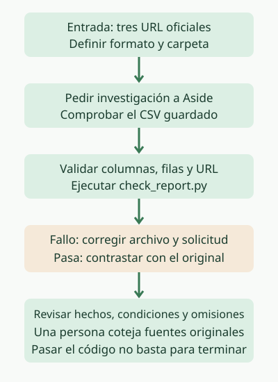

**Conviene indicar a Aside las páginas, el formato de salida y las condiciones de finalización, en lugar de pedir simplemente «investiga por tu cuenta».** Empieza organizando unos pocos documentos públicos, compara los resultados con las fuentes y después amplía el alcance a páginas autenticadas o tareas recurrentes.

Este artículo se basa en la ayuda oficial consultada el 17 de noviembre de 2026. Los prompts son ejemplos de uso, no resultados de ejecutar esas investigaciones, accesos a cuentas o tareas programadas en Aside. El código de validación de CSV se ejecutó por separado con entradas sintéticas.

## Definir el alcance antes de empezar

Instala Aside y comprueba el modelo y la carpeta de trabajo. Para partir de la página actual, abre el panel lateral y revisa el título y el host de la página adjunta. Mantenerla adjunta permite usarla como contexto de la tarea. [Guía del panel lateral](https://docs.aside.com/help/side-panel)

Puedes elegir Incognito para investigar sin iniciar sesión. Para consultar una cuenta autenticada, usa el perfil predeterminado que contiene esa cuenta. Ambos modos tienen estados de navegador distintos. Si vas a guardar archivos, también necesitas permiso de escritura en la carpeta elegida. [Guía de modos de tarea](https://docs.aside.com/help/tasks)

Revisa tanto los ajustes de archivos, herramientas y sandbox de `Settings > Agents` como los de cada tarea. La documentación oficial describe `Guard` como un modo que trabaja en carpetas permitidas y pide confirmación antes de acceder a otras. `Read only` no permite modificar archivos, por lo que podría no servir para guardar el CSV del ejemplo. No concluyas por el nombre que se bloquean automáticamente todas las acciones que cambian sitios web. [Guía de permisos](https://docs.aside.com/help/security)

## Ejemplo 1: organizar tres páginas oficiales en un CSV

Selecciona una carpeta vacía para trabajar y envía esta solicitud. Sustituye la ubicación por la carpeta real. Si ya existe un archivo con ese nombre, indica uno nuevo.

```text
Lee solo estas tres páginas de documentación oficial y organízalas en report.csv.
https://docs.aside.com/help/tasks
https://docs.aside.com/help/automation
https://docs.aside.com/help/devices

El CSV debe ser UTF-8, con las columnas en este orden: topic,summary,source_url.
Los valores de topic serán tasks,automation,devices, respectivamente; escribe solo una fila por página.
summary debe ser una frase en coreano que explique las condiciones principales de uso de cada página.
Encierra entre comillas los campos con comas según las reglas CSV.
Usa exactamente la dirección correspondiente de arriba para source_url.

Guárdalo en la carpeta de trabajo seleccionada sin sobrescribir archivos existentes.
Si no puedes leer un documento, no lo rellenes con suposiciones: indica la dirección que falló.
No accedas a cuentas de otros sitios ni envíes mensajes.
Al terminar, indica la ruta del archivo y las tres páginas comprobadas.
```

Si una página no abre, resuelve primero el problema de acceso. Si falta un elemento en el resultado, comprueba también la URL antes de reintentar. Completar un documento no leído con un resumen supuesto no cuenta como tarea terminada.



La comprobación con código del diagrama verifica que el archivo respeta la estructura y las fuentes definidas. Guarda lo siguiente como `check_report.py`. Solo utiliza la biblioteca estándar de Python 3 y no realiza comunicaciones externas.

```python
import csv
import sys

expected = {
    "tasks": "https://docs.aside.com/help/tasks",
    "automation": "https://docs.aside.com/help/automation",
    "devices": "https://docs.aside.com/help/devices",
}

with open(sys.argv[1], newline="", encoding="utf-8-sig") as stream:
    reader = csv.DictReader(stream)
    if reader.fieldnames != ["topic", "summary", "source_url"]:
        raise SystemExit("FAIL: columns")
    rows = list(reader)

if len(rows) != len(expected) or {r["topic"] for r in rows} != set(expected):
    raise SystemExit("FAIL: topics")
for row in rows:
    if (None in row or any(value is None for value in row.values())
            or not row["summary"].strip()
            or row["source_url"] != expected[row["topic"]]):
        raise SystemExit("FAIL: row")
print("PASS: 3 topics and allowed source URLs")
```

Pasa como argumento la ruta real del CSV generado.

```sh
python3 check_report.py report.csv
```

Con una entrada sintética de tres filas y las URL permitidas se comprobó el código de salida 0 y esta salida. Esa entrada no fue generada por Aside.

```text
PASS: 3 topics and allowed source URLs
```

Una entrada sintética a la que se quitó una fila devolvió `FAIL: topics` y código de salida 1. El código comprueba columnas, temas, URL y resúmenes vacíos, pero **no determina si los resúmenes son ciertos ni si se leyeron realmente las páginas.** Tras pasar la comprobación, busca personalmente las frases originales que respaldan cada resumen. Antes de relajar las condiciones para resolver un fallo, comprueba la discrepancia entre el archivo y el prompt.

## Ejemplo 2: consultar solo cifras en un panel autenticado

Acota sitio, cuenta, periodo y filtros al pedir una consulta. El siguiente ejemplo supone un panel de trabajo al que el usuario tiene permiso de acceso.

```text
En el panel adjunto actual, lee las visualizaciones de la cuenta que he indicado
para 2026-11-01~2026-11-07. Incluye la zona horaria y los filtros de la pantalla.
Muestra fecha, cifra y unidad en una tabla; no supongas que los campos vacíos son 0.
No cambies ajustes, exportes datos ni consultes otras cuentas.
Marca como no verificados los valores que no puedas confirmar en pantalla.
```

Al recibir las cifras, compara primero el total, el periodo, la zona horaria y los filtros con la pantalla. El total general puede diferir de la suma de unas filas principales; no declares inmediatamente que la diferencia es un error. Si necesitas exportar, define el contenido del archivo y dónde guardarlo y haz una solicitud aparte.

Si se necesitan datos de acceso, no pegues la contraseña en el prompt. Comprueba la política de uso de accesos guardados según la [guía de Password Manager](https://docs.aside.com/help/password-manager) y completa la autenticación adicional del sitio. Que la contraseña no se entregue al modelo es distinto de que este procese el contenido después de entrar. La [política de privacidad](https://aside.com/policy/privacy) explica que el contexto seleccionado necesario puede enviarse a proveedores de modelos alojados.

## Modificar la solicitud durante la ejecución

Si las fuentes son incorrectas o necesitas reducir el alcance, no hace falta esperar al final. La [guía de tareas](https://docs.aside.com/help/tasks) distingue `Queue` y `Steer` para mensajes de seguimiento. `Queue` aplica la solicitud después de terminar la ejecución actual; `Steer` entrega el mensaje nuevo a la tarea en curso para cambiar su dirección.

Indica concretamente el cambio, por ejemplo: «No investigues otros sitios; usa solo los tres primeros documentos». Enviar una corrección no cancela por sí solo las acciones externas que ya han ocurrido. Comprueba el estado real antes de decidir la siguiente solicitud.

## Ejemplo 3: convertir una investigación validada en tarea recurrente

Si el resultado puntual fue útil, puedes considerar repetir la investigación. Según la [guía de Routines](https://docs.aside.com/help/automation), una cron routine inicia una tarea nueva según el calendario y una heartbeat routine retoma una conversación existente. Para un resumen semanal independiente, empieza por evaluar la creación de una tarea nueva.

Crea una rutina en `Settings > Routines` e introduce instrucciones como estas. Ajusta por separado la frecuencia y la zona horaria en la pantalla real de configuración.

```text
Lee las tres páginas oficiales indicadas y compáralas con el resultado de la ejecución anterior.
Informa de cambios en las instrucciones de uso o las limitaciones con enlaces que los respalden.
Si no hay un resultado anterior para comparar, registra este como referencia inicial.
Si no puedes leer un documento, informa de un fallo de acceso, no de ausencia de cambios.
No cambies ajustes de cuentas, envíes mensajes ni realices tareas de pago.
```

También hay que decidir dónde guardar el resultado anterior y cómo lo leerá la siguiente ejecución. Crear una tarea nueva no implica que la conversación anterior se convierta automáticamente en material de comparación. Define una entrada clara, como el informe anterior en una carpeta concreta, o empieza recibiendo informes y comparándolos personalmente sin comparación automática.

Ejecuta de inmediato desde la lista de rutinas para comprobar entradas, salidas y gestión de fallos antes de activar el calendario. La guía oficial describe la omisión de ejecuciones solapadas. La [guía de dispositivos](https://docs.aside.com/help/devices) indica que el trabajo local requiere el ordenador encendido y conectado, con Aside en ejecución. Iniciar sesión en otro equipo o tener un plan de pago no significa por sí solo que el trabajo de un dispositivo suspendido continúe en la nube.

Al principio basta con aprender el flujo completo de consulta, organización y validación. Para confiar en la repetición, primero deben quedar claros los datos de entrada necesarios y la forma de comprobar el resultado.
