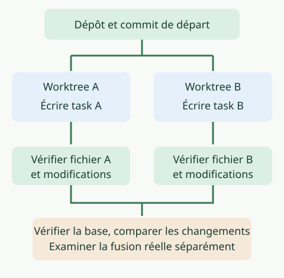

**Orca est pratique pour examiner les modifications par worktree et réunir navigateur, diff et PR dans une même interface. Herdr mérite votre attention si vous souhaitez étendre vous-même une configuration centrée sur le terminal et l’interface de l’application.** Les deux outils permettent d’exécuter plusieurs agents de développement et d’utiliser Git worktree. Le choix dépend moins de la possibilité de travailler en parallèle que de la manière de gérer l’environnement et les résultats.

La comparaison porte sur [Orca](https://orca.dev/) et [Herdr](https://herdr.dev/). Herdr comprend une application de bureau, **Herdr TUI** pour le terminal et un environnement d’exécution de terminal distinct, **herdr-core**. Les explications ci-dessous s’appuient sur la documentation officielle consultée le 15 novembre 2026. Il ne s’agit pas d’un test de performances réalisé avec une même tâche dans les deux applications. Distinguez les fonctions décrites par les fournisseurs des critères de choix qui en sont déduits.

## Les différences en un coup d’œil

| Critère | Orca | Herdr |
| --- | --- | --- |
| Interface centrale | Environnement de développement de bureau réunissant agents, éditeur, diff et navigateur | Application de bureau et TUI distincte ; herdr-core exécute les terminaux sans interface |
| Séparation des tâches | Crée un worktree Git par tâche et y associe branche, terminal et navigateur | Le guide de l’application et la configuration TUI proposent la création de worktrees. Un panneau de terminal ordinaire ne correspond pas toujours à un worktree indépendant |
| Vérification du code | Diff du worktree, commentaires sur les lignes modifiées, vues Git et PR | Terminal ou interface configurée par l’utilisateur. Vérifier dans la configuration installée si les fonctions de diff et leur portée sont équivalentes |
| Maintien des sessions | Les processus continuent après la fermeture de l’application si le démon reste actif ; un redémarrage de l’hôte les arrête | herdr-core pour l’application et un serveur distinct pour la TUI maintiennent les terminaux ; le redémarrage du serveur ou de l’hôte arrête les processus d’origine |
| Extensions | CLI, skills, planifications et vues de travail de l’application | Dispositions et modes de l’application, plugins TUI, CLI et API de herdr-core |
| Licence | MIT | Apache 2.0 |

Cette synthèse s’appuie sur la [documentation worktree](https://orca.dev/docs/model/worktrees) et le [guide du diff](https://orca.dev/docs/review/diff-viewer) d’Orca, ainsi que sur le [guide de l’application](https://herdr.dev/guide/) et le [guide de configuration TUI](https://herdr.dev/tui/docs/config-reference/) de Herdr. Le tableau ne résulte pas d’une mesure de toutes les fonctions des deux produits dans une version donnée.

## Des parcours différents pour une même tâche

Imaginons que vous confiiez en parallèle une modification d’API et un renforcement des tests dans un même dépôt. Si les deux tâches risquent de toucher les mêmes fichiers, commencez par créer un worktree pour chacune. Définissez ce que chaque agent peut lire et écrire, puis examinez séparément leurs modifications avant de les intégrer.

Orca propose d’ouvrir un worktree par tâche et d’associer l’agent et le diff à cet espace de travail. Le [guide de première session](https://orca.dev/docs/first-session) décrit l’exécution d’agents dans plusieurs worktrees indépendants, suivie de l’examen de chaque diff.

Pour l’application de bureau Herdr, le guide officiel donne comme exemple la demande de création de worktrees par tâche et le lancement d’agents. La TUI gère des workspaces, des onglets et des panneaux, et propose aussi une fonction worktree distincte. N’en déduisez pas que plusieurs panneaux ordinaires disposent chacun d’un répertoire de travail différent : vérifiez les chemins et les branches avant de commencer. [Guide de l’application](https://herdr.dev/guide/) · [Commandes worktree de la TUI](https://herdr.dev/tui/docs/cli-reference/)



Le schéma montre le parcours des fichiers dans l’exemple Git ci-dessous. Il n’inclut ni l’exécution d’agents ni la fusion automatique des résultats.

## Vérifier soi-même la séparation des worktrees

L’exemple suivant s’exécute dans un shell macOS ou Linux avec Git installé. Il crée un dépôt temporaire et deux worktrees, sans modifier de projet existant. Il ne remplace pas les instructions d’installation ou de configuration d’Orca ou de Herdr.

```sh
#!/bin/sh
set -eu
case_dir=$(mktemp -d)
git init -q "$case_dir/repo"
git -C "$case_dir/repo" config user.name 'Example Author'
git -C "$case_dir/repo" config user.email 'example@example.invalid'
printf 'base\n' > "$case_dir/repo/app.txt"
git -C "$case_dir/repo" add app.txt
git -C "$case_dir/repo" commit -qm 'Initial commit'
git -C "$case_dir/repo" worktree add -qb task-a "$case_dir/task-a" HEAD
git -C "$case_dir/repo" worktree add -qb task-b "$case_dir/task-b" HEAD
printf 'task A\n' > "$case_dir/task-a/app.txt"
printf 'task B\n' > "$case_dir/task-b/app.txt"
printf 'A: '; cat "$case_dir/task-a/app.txt"
printf 'B: '; cat "$case_dir/task-b/app.txt"
printf 'base: '; cat "$case_dir/repo/app.txt"
printf 'A 변경 파일: '; git -C "$case_dir/task-a" diff --name-only
printf 'B 변경 파일: '; git -C "$case_dir/task-b" diff --name-only
```

Voici la sortie vérifiée dans un shell local.

```text
A: task A
B: task B
base: base
A 변경 파일: app.txt
B 변경 파일: app.txt
```

Le contenu des fichiers est indépendant dans chaque worktree, mais les deux tâches ont modifié `app.txt`. Leur intégration dans un projet réel peut donc créer des conflits ou des contradictions de sens. Les worktrees séparent les modifications de fichiers ; ils n’isolent pas automatiquement les bases de données, les ports, les services externes ou les identifiants, et ne résolvent pas les conflits de code. L’exemple ne supprime pas automatiquement le répertoire temporaire.

Pour nettoyer les worktrees dans un environnement réel, vérifiez aussi ce que supprime chaque outil. Orca peut retirer le worktree et la branche après confirmation, tandis que la commande de suppression de worktree de Herdr TUI retire le checkout sans supprimer la branche, selon sa documentation. Vérifiez les modifications et les commits non fusionnés avant le nettoyage. [Worktree Orca](https://orca.dev/docs/model/worktrees) · [CLI Herdr TUI](https://herdr.dev/tui/docs/cli-reference/)

## Avantages et points à considérer pour Orca

Le point fort d’Orca est son **interface qui accompagne le travail jusqu’à la revue des résultats**. Le [visualiseur de diff](https://orca.dev/docs/review/diff-viewer) affiche les fichiers et les lignes modifiés et propose une vue de résolution des conflits ainsi que l’indexation partielle. L’accès au navigateur et à l’éditeur dans le même espace facilite un parcours où l’on modifie une interface web puis la vérifie directement.

Le [guide d’exécution à distance](https://orca.dev/docs/ways-to-run) explique aussi comment choisir un hôte SSH ou un serveur géré par l’utilisateur. Pouvoir travailler à distance ne signifie pas que tous les environnements sont isolés de manière sûre, par défaut, avec les mêmes autorisations. Les comptes, les secrets et les accès réseau de la machine distante doivent être gérés séparément.

Selon le [guide de restauration des sessions](https://orca.dev/docs/model/session-restore), les agents continuent après la fermeture de l’application si le démon d’arrière-plan reste actif. Un redémarrage de l’hôte ou l’arrêt du démon fait disparaître les processus en cours ; il faut relancer les agents dans l’espace restauré.

Il faut tenir compte de l’apprentissage de l’environnement de bureau et de ses fonctions. Pour une seule tâche dans un terminal, les multiples vues et espaces peuvent être superflus. Exécuter plusieurs agents simultanément peut augmenter l’usage des modèles, et chaque résultat modifié indépendamment doit être revu. Orca ne garantit pas lui-même l’exactitude des réponses du modèle.

## Avantages et points à considérer pour Herdr

Le point fort de Herdr est la **souplesse de configuration de l’espace tout en maintenant les terminaux et les agents en cours d’exécution**. [herdr-core](https://herdr.dev/core/) maintient les terminaux gérés même après la fermeture de la fenêtre et décrit une interface permettant aux agents de lancer d’autres tâches et d’en lire les résultats. Le [guide officiel](https://herdr.dev/guide/) présente aussi la personnalisation des dispositions et des modes de l’application.

Avec Herdr, il faut distinguer l’application et la TUI. Selon le site officiel, l’application de bureau utilise herdr-core, mais **Herdr TUI utilise un serveur séparé et les deux environnements ne partagent pas leurs listes d’agents.** Fermer l’application diffère aussi d’un redémarrage de l’ordinateur ou de l’environnement d’exécution. Côté application de bureau, les processus restent actifs après fermeture de la fenêtre ou mise à jour si core fonctionne encore ; ils s’arrêtent si l’appareil redémarre ou si core est arrêté. Le site officiel précise que les panneaux de l’application reviennent alors, mais que les agents ne redémarrent pas automatiquement. [FAQ Herdr](https://herdr.dev/)

La TUI a ses propres règles de restauration. Après déconnexion puis reconnexion, les processus restent actifs tant que le serveur fonctionne. Si le serveur redémarre, les processus s’arrêtent ; la restauration de la disposition et la reprise des sessions d’agents pris en charge sont des fonctions distinctes. [Restauration des sessions TUI](https://herdr.dev/tui/docs/session-state/)

Plus vous personnalisez l’environnement, plus il vous revient de vérifier les autorisations et les connexions externes utilisées par chaque mode. L’affichage d’état de l’application Herdr dépend aussi des programmes qui signalent [OSC 7501](https://herdr.dev/core/). Les programmes qui ne le prennent pas en charge peuvent s’exécuter sans que leur état soit affiché. Ne confondez pas la détection des agents de la TUI et l’affichage d’état de l’application.

## Dans quels cas choisir chaque outil ?

- **Si la revue des modifications et la vérification d’interfaces web sont centrales :** commencez par le parcours d’Orca associant diff par worktree, navigateur et PR.
- **Si le maintien des terminaux et la disposition des vues sont centraux :** examinez l’application Herdr et core, puis comparez la TUI séparée si vous préférez gérer le travail dans le terminal.
- **Si vous exploitez plusieurs serveurs et agents ensemble :** les deux outils offrent des fonctions distantes ; vérifiez votre environnement SSH réel, l’authentification et les conditions de récupération des sessions.
- **Si vous n’avez qu’une petite correction à faire :** votre terminal et Git peuvent suffire. Comparez le confort apporté par l’outil de gestion avec sa complexité supplémentaire.

Pour choisir, mieux vaut réaliser un petit essai avec le même dépôt, la même tâche, le même modèle et les mêmes autorisations. Suivez dans chaque outil la création de tâche, le retour après interruption, l’examen des modifications et l’intégration. En notant le temps réellement consacré et les erreurs, vous pourrez choisir selon votre façon de travailler. Cet article ne comporte pas de telles mesures comparatives.
