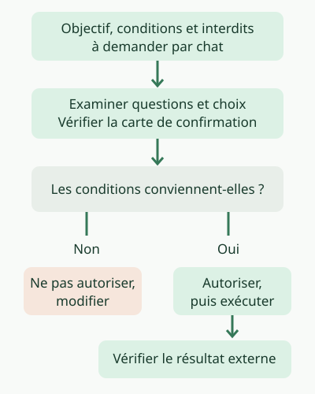

Pickle AI est un agent IA personnel auquel vous pouvez demander par chat des recherches ou des réservations et dont vous pouvez suivre l’avancement. Pour commencer, mieux vaut lui confier une recherche qui ne nécessite ni paiement ni connexion de compte, puis vérifier vous-même le résultat. Si vous étendez le périmètre aux réservations ou aux achats, précisez aussi les dates, le budget et les conditions d’autorisation.

Ce guide s’appuie sur [l’aide officielle de Pickle](https://www.pickle.com/help). Il ne relate ni une utilisation de l’application avec un compte réel ni l’exécution des exemples ci-dessous. L’interface et les fonctions disponibles peuvent varier selon la version de l’application, le compte et la région.

## Avant de commencer

Préparez l’application Pickle et un compte, puis vérifiez les offres et les limites disponibles dans l’application. La [présentation des offres en coréen](https://www.pickle.com/help/credits/plans) indique que l’utilisation est gratuite en Corée du Sud, avec une limite d’usage réinitialisée chaque jour. Lorsque la limite est atteinte, des tâches programmées peuvent être ignorées. Vérifiez donc le quota restant et l’heure de réinitialisation dans l’onglet **Mon Pickle** de l’application. Les offres et les limites peuvent varier selon la région et la période.

Selon la [présentation officielle](https://www.pickle.com/help/start/what-is-pickle), Pickle reçoit les demandes par chat, travaille sur les sites avec son propre navigateur web et peut téléphoner lorsqu’une démarche ne peut pas être effectuée sur le web. Il ne faut donc pas l’imaginer en train de toucher directement les autres applications installées sur votre iPhone. Vérifiez dans l’interface la disponibilité selon les régions et les services, ainsi que la possibilité de passer des appels.



Le schéma simplifie le déroulement dans le cas où une carte de confirmation apparaît. Il ne signifie ni que chaque demande affiche une carte ni que toute action externe réussira. Le pseudocode suivant décrit une procédure de décision à appliquer par le lecteur, et non l’implémentation interne de Pickle.

```text
Demande = objectif, date et lieu, budget, actions autorisées et interdites
Envoyer la demande à Pickle
Répondre aux questions ou aux choix en respectant les conditions
Si une carte de confirmation apparaît :
    Vérifier le contenu et les conditions
    Si les conditions ne conviennent pas, ne pas autoriser et les corriger
    Si les conditions conviennent, autoriser
À réception du résultat, comparer la demande initiale avec la confirmation externe
```

## Première tâche : rechercher des options sans paiement

Pour choisir un restaurant, par exemple, saisissez ceci dans Chat. La date, l’heure et le quartier sont des exemples : remplacez-les par vos conditions réelles.

```text
Trouve des restaurants près de la station Gangnam à Séoul pour 2 personnes
le samedi à 6 h du soir. Le budget est de 30 000 wons maximum par personne.
Privilégie ceux qui proposent des plats végétariens.
Pour chaque option, donne le nom, l’emplacement, les horaires et un lien justifiant le menu.
Ne réserve pas, ne téléphone pas et ne paie rien. Signale les informations incertaines.
```

Si Pickle demande la date ou d’autres précisions, répondez. Une fois les propositions reçues, consultez les liens pour vérifier les horaires du jour concerné et le menu. S’il manque des liens ou si certaines conditions n’ont pas été confirmées, ajoutez : « Indique les sources utilisées pour vérifier ces informations. Ne devine pas ce que tu ne peux pas confirmer. » Il s’agit d’un exemple ; le résultat de ce prompt n’a pas été vérifié dans le service réel.

Selon le [guide de délégation](https://www.pickle.com/help/tasks/delegate), lorsque vous communiquez votre objectif dans Chat, Pickle demande les informations nécessaires et peut ensuite afficher une carte présentant la tâche et ses conditions pour confirmation. Cette carte apparaît dans le chat, et le travail peut continuer après la fermeture de l’application. Fermer l’application ne revient pas à annuler la tâche. Pour l’interrompre, vérifiez son état actuel et la possibilité d’annulation.

## Déléguer une réservation ou un achat

Après avoir vérifié les résultats de recherche, limitez les actions autorisées dans une demande distincte.

```text
Vérifie les créneaux de réservation du restaurant que j’ai choisi
parmi ceux trouvés précédemment.
Les conditions sont 2 personnes, le samedi à 6 h du soir. Si un acompte payant
ou un paiement est nécessaire, ne poursuis pas et montre-moi d’abord
le montant et les conditions d’annulation.
Si l’heure ou le nombre de personnes doit changer, demande-moi avant de réserver.
```

Si une carte de confirmation apparaît, lisez le lieu, la date et l’heure, le nombre de personnes, le montant et les conditions d’annulation. N’autorisez l’action que si ces conditions vous conviennent. L’aide officielle explique que les conditions sont présentées et confirmées avant des actions difficiles à annuler, comme une réservation ou un paiement. Toutefois, un prompt ne prévient pas toutes les erreurs. Après autorisation, vérifiez séparément l’état réel de la réservation et du paiement sur la page de confirmation ou dans l’e-mail du restaurant ou du vendeur. Ne supposez pas non plus qu’une demande d’annulation annule automatiquement une action déjà effectuée auprès d’un service externe.

## Connecter uniquement les comptes et les identifiants nécessaires

Pour une tâche utilisant les e-mails ou le calendrier, vous pouvez connecter les comptes nécessaires sous **Mon Pickle → Applications et services connectés à (nom du Pickle)**, selon le [guide officiel](https://www.pickle.com/help/start/what-is-pickle). Lisez les autorisations indiquées sur l’écran de connexion et ne connectez pas de compte inutile à la tâche. Par exemple, rechercher seulement des propositions de créneaux ne nécessite pas forcément l’accès au calendrier.

Si une connexion à un site est nécessaire, ne saisissez ni mot de passe ni numéro de carte dans le chat. Utilisez l’écran de saisie sécurisé et Vault décrits dans la documentation officielle, puis revérifiez le site et les informations demandées. Selon le [guide d’enregistrement des identifiants](https://www.pickle.com/help/connect/save-login), le navigateur de Pickle est distinct des connexions enregistrées sur le téléphone.

La protection des identifiants a aussi ses limites. La description officielle indique que les mots de passe et numéros de carte ne sont pas transmis au modèle, mais le chemin de traitement des valeurs nécessaires à leur saisie dans les formulaires web doit être examiné séparément. [Fonctionnement de Pickle AI et protection des mots de passe](/ko/posts/2026-11-13-pickle-ai-security/) présente la protection et ses limites observables dans le code public. Les règles d’accès aux conversations et aux souvenirs diffèrent de celles de stockage des identifiants ; consultez aussi les [informations de confidentialité](https://pickle.com/privacy).

## Vérifier les tâches récurrentes et les journaux d’utilisation

Pour des rappels ou des résumés récurrents, vous pouvez indiquer dans Chat la tâche et sa fréquence. Délimitez par exemple le périmètre ainsi : « Chaque lundi à 9 h, recherche des annonces d’événements techniques publics et résume-les avec leurs liens. Ne m’inscris à rien et ne paie rien. » Vérifiez le fuseau horaire et les conditions réelles d’exécution dans les détails de la tâche créée.

Selon le [guide des tâches programmées](https://www.pickle.com/help/tasks/scheduled), touchez le personnage Pickle en haut de l’écran pour ouvrir le profil, puis ouvrez la tâche dans **Tâches programmées**. Vous pouvez la mettre en pause, la reprendre, la modifier, la supprimer et consulter son historique d’exécution. Une exécution peut être ignorée si la limite d’usage est atteinte. Vérifiez donc l’état dans l’historique et ne supposez pas qu’une exécution manquée a été automatiquement rattrapée.

Vous pouvez consulter l’utilisation des comptes ou des cartes connectés dans **Mon Pickle → Applications et services connectés ou moyens de paiement connectés → Bandeau de chiffrement**, chemin indiqué par le [guide Access log](https://pickle.com/help/privacy/activity). Le journal est créé juste avant une requête ; il ne prouve pas que la réservation ou le paiement a abouti. Comparez donc également le résultat de la tâche avec la confirmation du service externe.
