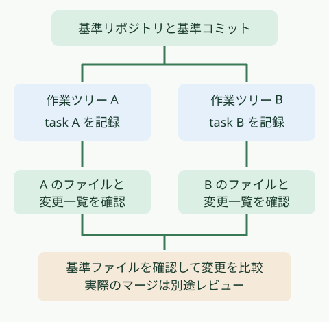

**T3 Code は会話スレッドで作業・承認・変更を追いやすく、Orca は worktree ごとのターミナル・エディター・ブラウザー・diff をまとめて扱う流れが特徴です。Herdr はターミナルの実行を維持しながら、作業画面や自動化を自分で構成したい場合に検討できます。** 三つのツールには重なる機能があるため、一つの機能の有無で優劣を決めるより、作業の開始、レビュー、中断後の復帰までの流れを比較するほうがよいでしょう。

比較対象は [T3 Code](https://github.com/pingdotgg/t3code/tree/v0.1.9)、[Orca](https://orca.dev/)、[Herdr](https://herdr.dev/) です。T3 Stack や名前の似た別の Hydra プロジェクトとは異なります。2026 年 11 月 16 日に確認した文書を基にし、T3 Code の具体的な動作は **v0.1.9 の文書**に範囲を固定しました。Orca と Herdr は現在の公式文書を参照しています。以下の利点と考慮点は文書に基づく選択基準であり、同じ環境で三つのアプリを実行した性能測定の結果ではありません。

## 何を中心に作業するか

| 基準 | T3 Code | Orca | Herdr |
| --- | --- | --- | --- |
| 主な利用の流れ | プロジェクトとスレッドで依頼・承認・変更確認 | worktree ごとにエージェント・ファイル・ブラウザー・diff を管理 | アプリ・TUI でターミナルとエージェントを管理し、画面構成を拡張 |
| 作業の分離 | worktree 機能を提供。作業の実際のパスを確認する必要がある | 作業ごとの worktree を中心にブランチと画面を構成 | アプリと TUI に worktree 機能がある。pane 自体が worktree ではない |
| 変更レビュー | 会話ターンの変更とブランチ比較の範囲を区別 | worktree diff・行単位のコメント・部分ステージング | 選んだアプリ構成とターミナルツールのレビュー手順を確認 |
| 権限の判断 | スレッドの権限モードとプロバイダーごとの動作を併せて確認 | エージェントの権限設定と実際の実行範囲を確認 | 実行したエージェント・コマンド・拡張機能の権限を確認 |
| リモート利用 | サーバーに別の端末を接続 | SSH ホスト・リモート Orca ランタイム | アプリ/core と TUI の別々のリモート機能 |
| 費用の判断 | アプリとモデル提供元の費用、連携サービスの条件を分けて確認 | アプリ・モデル提供元・リモート計算資源の費用を分けて確認 | アプリ/core/TUI とモデル提供元・サーバーの費用を分けて確認 |

T3 Code の[ソース管理文書](https://github.com/pingdotgg/t3code/blob/v0.1.9/docs/user/source-control.md)、Orca の [worktree 文書](https://orca.dev/docs/model/worktrees)、Herdr の[アプリガイド](https://herdr.dev/guide/)が各フローの根拠です。この表で確認していない機能を非対応とは断定していません。特に T3 Code にも worktree とレビュー画面があり、Herdr にもデスクトップアプリがあります。

## T3 Code：会話と実行結果を一緒に追いたいとき

T3 Code は、インストール済みのプロバイダーをプロジェクトとスレッドに接続して作業します。[v0.1.9 README](https://github.com/pingdotgg/t3code/blob/v0.1.9/README.md)は、モバイル・Web・デスクトップクライアントと、Codex・Claude Code など既存プロバイダーへの接続を説明しています。モデルそのものを提供するツールと理解すると、インストールや認証で混乱しやすくなります。

利点は、作業依頼と実行過程、承認、変更内容を一つのスレッドで追えることです。ソース管理文書では、ターン自体の変更と基準ブランチ全体の変更を区別しています。例えば、エージェントが最新コードを取得してから修正した場合、ターンの変更一覧だけを読んでブランチ全体のレビューが終わったと判断してはいけません。

考慮点は、権限モードの意味がプロバイダーごとに同じではないことです。[権限文書](https://github.com/pingdotgg/t3code/blob/v0.1.9/docs/user/permission-modes.md)を基にモードを選び、実際の承認要求を確認する必要があります。承認画面があることは、OS のファイル・ネットワークアクセスまで隔離されていることを意味しません。

リモート利用でもサーバーの寿命が重要です。[リモート接続文書](https://github.com/pingdotgg/t3code/blob/v0.1.9/docs/user/remote-access.md)では、デスクトップアプリの最後のウィンドウを閉じるとローカルサーバーが停止すると説明しています。継続実行が必要なら、対応環境で別のバックグラウンドサービスを構成します。このバージョンではそのサービスは Windows に提供されていないため、実行方法を区別してください。サーバーにはプロバイダーの認証とリポジトリも用意する必要があります。

## Orca：作業ごとの開発画面と変更レビューをまとめたいとき

Orca は、作業ごとに worktree を作り、その空間でエージェント・エディター・ブラウザー・diff を扱う開発環境です。[diff 文書](https://orca.dev/docs/review/diff-viewer)は、変更行、部分ステージング、競合解決画面などを説明しています。UI を修正しながらブラウザーで確認し、変更内容をレビューする開発フローを構成しやすいツールです。

利点は、作業のファイルとレビュー画面を同じ worktree の文脈で管理できることです。複数のエージェントを使っても、どのブランチの変更か確認する過程を画面と関連付けられます。CLI とスキルで作業空間やターミナルを制御する方法も提供しています。[CLI 案内](https://orca.dev/docs/cli/overview)

考慮点は、開発環境の構成と Git の流れに慣れる必要があることです。短い単一の修正なら、worktree と複数の画面を管理する負担が便利さを上回る場合があります。エージェントを増やすほど、レビューする結果と資源の使用量も増える可能性があります。並列実行によって同じ割合で時間が短縮される保証はありません。

[セッション復元文書](https://orca.dev/docs/model/session-restore)によると、アプリを閉じてもデーモンが動いていればエージェントは実行を続けます。ホストの再起動やデーモンの終了でプロセスは停止し、作業空間やスクロールバックの復元は、実行中プロセスの復元とは異なります。[リモート実行](https://orca.dev/docs/ways-to-run)も可能ですが、作業を実行するホストのツールと認証は別途用意する必要があります。

## Herdr：ターミナルと作業画面を自分で構成したいとき

Herdr は、**デスクトップアプリ・herdr-core・Herdr TUI を区別**する必要があります。アプリは herdr-core 上で動作し、TUI は別サーバーを使います。公式 FAQ では、アプリと TUI がエージェント一覧を共有しないと明記しています。[Herdr 公式サイト](https://herdr.dev/)

利点は、ターミナルの実行環境と画面構成を分けて拡張できることです。[core の案内](https://herdr.dev/core/)では、プログラムの実行、別の作業の開始、結果の読み取り、リモートマシンへの接続を説明しています。[アプリガイド](https://herdr.dev/guide/)は、レイアウトや機能を修正するようエージェントに依頼する使い方も紹介しています。ターミナル中心の既存開発環境を維持しながら、必要なダッシュボードを構成したい場合に検討できます。

考慮点は、構成要素と拡張機能を理解する責任が増えることです。アプリの状態表示はプログラムが報告する OSC 7501 に依存し、状態を報告しないプログラムは実行できても状態が表示されない場合があります。これを TUI のエージェント検出ルールと混同しないようにしてください。ユーザーモードやプラグインが使うコマンドと外部接続も確認します。

アプリのウィンドウを閉じても core が動いていればターミナルは維持されます。FAQ では、端末の再起動や core の停止でプロセスは終了し、アプリはエージェントを自動再起動しないと説明しています。TUI はサーバー再起動後のレイアウト復元と、対応エージェントのセッション再開を別の機能として提供します。[TUI 復元文書](https://herdr.dev/tui/docs/session-state/)

## 三つのツールに共通する worktree の境界

複数のエージェントが同じファイルを同時に変更する場合、作業ごとに worktree を使うほうが変更を追跡しやすくなります。ただし、ファイルのディレクトリを分けても、DB・開発サーバーのポート・外部アカウント・認証情報までは自動的に分離されません。この制約は三つのツールに共通します。



以下は、図のファイル分離を確認するコードです。Git をインストールした macOS・Linux のシェルで一時リポジトリを作り、既存プロジェクトは修正しません。エージェントの実行や製品の性能比較は含みません。

```sh
#!/bin/sh
set -eu
case_dir=$(mktemp -d)
git init -q "$case_dir/repo"
git -C "$case_dir/repo" config user.name 'Example Author'
git -C "$case_dir/repo" config user.email 'example@example.invalid'
printf 'base\n' > "$case_dir/repo/app.txt"
git -C "$case_dir/repo" add app.txt
git -C "$case_dir/repo" commit -qm 'Initial commit'
git -C "$case_dir/repo" worktree add -qb task-a "$case_dir/task-a" HEAD
git -C "$case_dir/repo" worktree add -qb task-b "$case_dir/task-b" HEAD
printf 'task A\n' > "$case_dir/task-a/app.txt"
printf 'task B\n' > "$case_dir/task-b/app.txt"
printf 'A: '; cat "$case_dir/task-a/app.txt"
printf 'B: '; cat "$case_dir/task-b/app.txt"
printf 'base: '; cat "$case_dir/repo/app.txt"
printf 'A 변경 파일: '; git -C "$case_dir/task-a" diff --name-only
printf 'B 변경 파일: '; git -C "$case_dir/task-b" diff --name-only
```

ローカルシェルで実行して確認した出力です。

```text
A: task A
B: task B
base: base
A 변경 파일: app.txt
B 변경 파일: app.txt
```

A と B は異なる内容を保持していますが、同じファイルを修正しています。統合時には両変更の意図をレビューする必要があります。この例は一時ディレクトリを自動削除しません。

## どのツールから試すか

作業依頼と承認・変更を会話で追う方法が合うなら **T3 Code**、ブラウザー・エディター・diff を作業ごとに分けて確認する方法が合うなら **Orca**、ターミナルとダッシュボードを自分で構成する方法が合うなら **Herdr** から試せます。これは公式文書の機能構成から導いた選択の提案です。

選択を検証するときは、三つのツールで同じリポジトリと作業、同じモデル・権限・テスト条件を使います。ファイルを修正する前に失敗するテストを固定し、完了後は実行結果・diff・残った変更を確認します。アプリのウィンドウ終了、クライアント切断、サーバー停止、ホスト再起動は、それぞれ別の試験として扱います。処理時間だけでなく、復帰の過程とレビューの手間も比較すると、自分の開発方法に合った違いが見えてきます。

個別の使い方は、[T3 Code の例](/ko/posts/2026-11-12-t3-code-workflow/)、[Orca の使い方](/ko/posts/2026-11-12-orca-worktree-guide/)、[Orca と Herdr の詳細比較](/ko/posts/2026-11-15-orca-herdr-comparison/)で確認できます。
