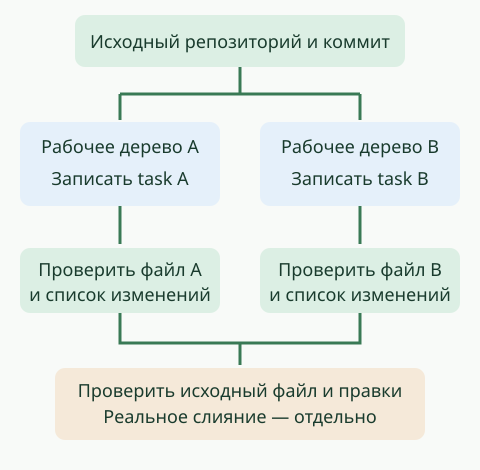

**Orca удобна, если вы хотите просматривать изменения по worktree и работать с браузером, diff и PR в одном интерфейсе. Herdr стоит рассмотреть, если вам важны терминал и возможность самостоятельно расширять интерфейс приложения.** Оба инструмента запускают несколько агентов для программирования и поддерживают Git worktree. Выбирать стоит скорее по способу управления рабочей средой и результатами, чем по наличию параллельного запуска.

Сравниваем [Orca](https://orca.dev/) и [Herdr](https://herdr.dev/). Herdr состоит из настольного приложения, терминального интерфейса **Herdr TUI** и отдельной среды исполнения терминалов **herdr-core**. Описание основано на официальной документации, проверенной 15 ноября 2026 года; это не тест производительности двух приложений на одинаковой задаче. Различайте заявленные разработчиками возможности и выведенные из них критерии выбора.

## Основные различия

| Критерий | Orca | Herdr |
| --- | --- | --- |
| Основной интерфейс | Настольная среда разработки с агентами, редактором, diff и браузером | Настольное приложение и отдельный TUI; herdr-core запускает терминалы без интерфейса |
| Разделение задач | Git worktree для каждой задачи, связанные с веткой, терминалом и браузером | Создание worktree описано в руководстве приложения и настройках TUI. Обычная терминальная панель не всегда означает отдельный worktree |
| Проверка кода | Diff worktree, комментарии к изменённым строкам, экраны Git и PR | Терминал или настроенный пользователем интерфейс приложения. Аналогичные возможности и охват diff нужно проверять в установленной конфигурации |
| Сохранение сеансов | Процессы продолжают работать после закрытия приложения, пока жив демон; перезагрузка хоста завершает процессы | В приложении терминалы сохраняет herdr-core, в TUI — отдельный сервер; перезапуск сервера или хоста завершает исходные процессы |
| Расширение | CLI, навыки, расписания и рабочий интерфейс приложения | Макеты и режимы приложения, плагины TUI, CLI и API herdr-core |
| Лицензия | MIT | Apache 2.0 |

Таблица составлена по [документации worktree](https://orca.dev/docs/model/worktrees) и [руководству diff](https://orca.dev/docs/review/diff-viewer) Orca, [руководству приложения](https://herdr.dev/guide/) и [настройкам TUI](https://herdr.dev/tui/docs/config-reference/) Herdr. Это не результат измерения всех функций обоих продуктов в конкретной версии.

## Как различается работа с одной задачей

Допустим, в одном репозитории нужно одновременно изменить API и дополнить тесты. Если обе задачи могут затронуть один файл, сначала выделите каждой отдельный worktree. Определите, что каждый агент может читать и изменять, а после завершения проверьте изменения по отдельности и объедините их.

Orca предлагает открыть worktree для каждой задачи и связать с этим рабочим пространством агента и diff. [Руководство по первому сеансу](https://orca.dev/docs/first-session) описывает запуск агентов в нескольких независимых worktree с последующей проверкой каждого diff.

Официальное руководство настольного Herdr приводит примеры запросов на создание worktree по задачам и запуск агентов. TUI управляет workspace, tab и pane и отдельно поддерживает worktree. Несколько обычных панелей сами по себе не означают разные рабочие каталоги: перед началом проверьте пути и ветки. [Руководство приложения](https://herdr.dev/guide/) · [Команды worktree в TUI](https://herdr.dev/tui/docs/cli-reference/)



Схема показывает движение файлов в следующем примере Git. Запуск агентов и автоматическое объединение результатов в неё не входят.

## Пример проверки разделения worktree

Пример выполняется в оболочке macOS или Linux с установленным Git. Он создаёт временный репозиторий и два worktree, не изменяя существующий проект. Он не заменяет инструкции по установке и настройке Orca или Herdr.

```sh
#!/bin/sh
set -eu
case_dir=$(mktemp -d)
git init -q "$case_dir/repo"
git -C "$case_dir/repo" config user.name 'Example Author'
git -C "$case_dir/repo" config user.email 'example@example.invalid'
printf 'base\n' > "$case_dir/repo/app.txt"
git -C "$case_dir/repo" add app.txt
git -C "$case_dir/repo" commit -qm 'Initial commit'
git -C "$case_dir/repo" worktree add -qb task-a "$case_dir/task-a" HEAD
git -C "$case_dir/repo" worktree add -qb task-b "$case_dir/task-b" HEAD
printf 'task A\n' > "$case_dir/task-a/app.txt"
printf 'task B\n' > "$case_dir/task-b/app.txt"
printf 'A: '; cat "$case_dir/task-a/app.txt"
printf 'B: '; cat "$case_dir/task-b/app.txt"
printf 'base: '; cat "$case_dir/repo/app.txt"
printf 'A 변경 파일: '; git -C "$case_dir/task-a" diff --name-only
printf 'B 변경 파일: '; git -C "$case_dir/task-b" diff --name-only
```

В локальной оболочке получен следующий вывод.

```text
A: task A
B: task B
base: base
A 변경 파일: app.txt
B 변경 파일: app.txt
```

Содержимое файлов каждого worktree независимо, но обе задачи изменили `app.txt`. При объединении результатов в реальном проекте поэтому возможны конфликты или смысловые противоречия. Worktree разделяет только файловые изменения: он не изолирует автоматически БД, порты, внешние сервисы и учётные данные и не разрешает конфликты кода. Пример не удаляет временный каталог автоматически.

При удалении worktree в реальной среде также проверяйте, что именно удаляет инструмент. Orca может после подтверждения удалить worktree и ветку, а команда удаления worktree в Herdr TUI, согласно описанию, удаляет рабочую копию, но оставляет ветку. Сначала проверьте незакоммиченные изменения и неслитые коммиты. [Orca worktree](https://orca.dev/docs/model/worktrees) · [Herdr TUI CLI](https://herdr.dev/tui/docs/cli-reference/)

## Преимущества и ограничения Orca

Сильная сторона Orca — **интерфейс, объединяющий выполнение задачи и проверку результата**. [Diff viewer](https://orca.dev/docs/review/diff-viewer) показывает изменённые файлы и строки, предоставляет экран разрешения конфликтов и частичное добавление в индекс. Отдельные браузер и редактор доступны в том же рабочем пространстве: это удобно для изменения веб-интерфейса, его просмотра и проверки изменений.

[Руководство по удалённому запуску](https://orca.dev/docs/ways-to-run) также описывает выбор SSH-хоста или собственного сервера. Возможность удалённой работы не означает, что все среды по умолчанию безопасно изолированы с одинаковыми правами. Аккаунты, секреты и сетевой доступ удалённой машины нужно контролировать отдельно.

Согласно [руководству по восстановлению сеансов](https://orca.dev/docs/model/session-restore), агенты продолжают работать после закрытия приложения, пока жив фоновый демон. Перезагрузка хоста или завершение демона прекращает работающие процессы; в восстановленном рабочем пространстве агентов нужно запустить заново.

Нужно учитывать время на освоение настольной среды и функций. Если нужна лишь одна терминальная задача, несколько экранов и рабочих пространств могут оказаться лишними. Одновременный запуск нескольких агентов способен увеличить использование моделей; каждый независимо изменённый результат требует проверки. Сама Orca не гарантирует точность ответов модели.

## Преимущества и ограничения Herdr

Сильная сторона Herdr — **гибкая настройка рабочего пространства с сохранением работающих терминалов и агентов**. [Herdr-core](https://herdr.dev/core/) описывает сохранение управляемых терминалов после закрытия окна и интерфейс, позволяющий агенту запускать другие задачи и читать результаты. Настройка макетов и режимов приложения также представлена в [официальном руководстве](https://herdr.dev/guide/).

В Herdr необходимо различать приложение и TUI. Согласно официальному сайту, настольное приложение использует herdr-core, но **Herdr TUI работает с отдельным сервером, и списки агентов двух сред не общие.** Закрытие приложения также отличается от перезапуска компьютера или среды исполнения. В настольной версии закрытие окна или обновление приложения не прекращает процессы, пока жив core; перезагрузка устройства или остановка core их завершает. Сайт поясняет, что панели приложения в таком случае восстанавливаются, но агенты автоматически не перезапускаются. [Herdr FAQ](https://herdr.dev/)

У TUI собственные правила восстановления. После отключения и повторного подключения исходные процессы сохраняются, пока жив сервер. Перезапуск сервера завершает процессы; восстановление макета и возобновление сеансов поддерживаемых агентов — отдельные функции. [Восстановление сеансов TUI](https://herdr.dev/tui/docs/session-state/)

Чем больше настроек, тем важнее проверять права и внешние подключения каждого режима. Кроме того, отображение статуса в приложении Herdr зависит от программ, сообщающих [OSC 7501](https://herdr.dev/core/). Неподдерживающие программы тоже могут работать, но их статус может не отображаться. Не считайте обнаружение агентов в TUI и отображение статуса в приложении одной и той же функцией.

## В каких случаях что выбрать?

- **Для проверки изменений и веб-интерфейса:** начните с diff, браузера и PR по worktree в Orca.
- **Для сохранения терминалов и настройки интерфейса:** рассмотрите приложение Herdr и core, а для управления внутри терминала сравните также отдельный TUI.
- **Для совместной работы с несколькими серверами и агентами:** оба инструмента поддерживают удалённую работу; проверьте реальную SSH-среду, аутентификацию и условия восстановления сеансов.
- **Для одной короткой правки:** существующего терминала и Git может быть достаточно. Сопоставьте удобство инструмента управления с добавляемой сложностью.

Перед выбором полезно выполнить небольшой тест в одном репозитории, с одной задачей, моделью и правами. Пройдите создание задачи, возврат после прерывания, проверку изменений и интеграцию, записывая реальное время и ошибки. Это поможет выбрать инструмент под свой способ работы. В этой статье такие сравнительные измерения не проводились.
