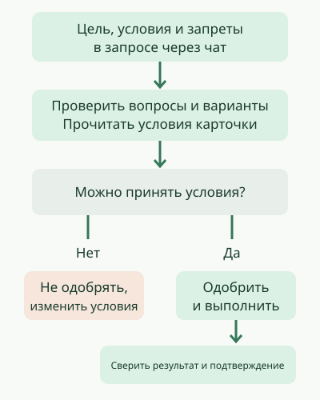

Pickle AI — персональный ИИ-агент: через чат ему можно поручить поиск информации или бронирование и следить за ходом работы. Для начала лучше выбрать поиск без оплаты и подключения аккаунтов, а результат проверить самостоятельно. Для бронирования или покупки укажите также дату, бюджет и условия одобрения.

Это руководство основано на [официальной справке Pickle](https://www.pickle.com/help). Оно не описывает работу в приложении с реальным аккаунтом или выполнение приведённых ниже примеров. Интерфейс и доступные функции могут зависеть от версии приложения, аккаунта и региона.

## Перед началом

Подготовьте приложение и аккаунт Pickle и проверьте доступный тариф и лимиты в приложении. В корейской [справке о тарифах](https://www.pickle.com/help/credits/plans) указано, что в Корее сервис бесплатный, но действует лимит использования, который сбрасывается ежедневно. При его достижении запланированные задачи могут пропускаться, поэтому проверяйте остаток лимита и время сброса на вкладке **«Мой Pickle»**. Тарифы и лимиты могут различаться в зависимости от региона и времени.

Согласно [официальному описанию](https://www.pickle.com/help/start/what-is-pickle), Pickle принимает запросы в чате, работает с сайтами в отдельном веб-браузере и может позвонить, если вопрос нельзя решить через интернет. Это не следует понимать как непосредственное нажатие кнопок в других приложениях на вашем iPhone. Поддержку конкретных регионов и сервисов, а также возможность звонков нужно проверять в самом интерфейсе.



Схема упрощённо показывает случай, когда пользователь получает карточку подтверждения. Она не означает, что карточка появляется при каждом запросе или что внешнее действие обязательно завершится успешно. Следующий псевдокод — порядок принятия решений для читателя, а не внутренняя реализация Pickle.

```text
Запрос = цель, дата и место, бюджет, разрешённые и запрещённые действия
Отправить запрос Pickle
Если есть дополнительные вопросы или варианты, ответить с учётом условий
Если появилась карточка подтверждения:
    Проверить содержание и условия
    Если условия не подходят, не одобрять и исправить их
    Если условия подходят, одобрить
После получения результата сопоставить исходный запрос с внешним подтверждением
```

## Первая задача: найти варианты без оплаты

Например, для выбора ресторана введите в Chat следующий запрос. Дата, время и район приведены для примера: замените их своими условиями.

```text
Найди ресторан рядом со станцией Каннам в Сеуле для ужина на 2 человек в субботу в 6 вечера.
Бюджет — не более 30,000 вон на человека; отдавай предпочтение местам с вегетарианскими блюдами.
Для каждого варианта укажи название, местоположение, часы работы и ссылку на источник меню.
Не бронируй, не звони и не оплачивай; отмечай неподтверждённую информацию.
```

Если Pickle уточняет дату или другие условия, ответьте. Получив варианты, откройте ссылки и проверьте часы работы на нужную дату и меню. Если ссылки нет или условие не проверено, добавьте: «Укажи, в каком источнике это проверено. Не предполагай значения, которые нельзя подтвердить». Это пример; выполнение данного запроса в реальном сервисе не проверялось.

Согласно [справке о делегировании задач](https://www.pickle.com/help/tasks/delegate), после указания цели в Chat сервис может запросить недостающие сведения и показать карточку с действиями и условиями для подтверждения. Карточка появляется в чате, а работа может продолжаться после закрытия приложения. Не считайте закрытие приложения отменой: если нужно остановить задачу, проверьте её текущее состояние и возможность отмены.

## Когда поручаете бронирование или покупку

Проверив найденные варианты, ограничьте допустимые действия отдельным запросом.

```text
Проверь доступное время бронирования в выбранном мной ресторане из предыдущего списка.
Условия: 2 человека, суббота, 6 вечера. Если нужен платный депозит или оплата,
не продолжай: сначала покажи сумму и условия отмены.
Если нужно изменить время или число гостей, спроси меня до бронирования.
```

Если появилась карточка подтверждения, прочитайте место, дату, время, число гостей, сумму и условия отмены и одобряйте только при согласии с ними. Официальная справка сообщает, что перед труднообратимыми действиями, такими как бронирование или оплата, условия показываются пользователю для подтверждения. Однако формулировка запроса не предотвращает все ошибки. После одобрения отдельно проверьте реальный статус бронирования и оплаты на экране подтверждения или в письме ресторана либо продавца. Не предполагайте также, что запрос отмены автоматически обращает уже совершённое внешнее действие.

## Подключайте аккаунты и сохраняйте вход только по необходимости

Для задач с почтой или календарём можно подключить нужный аккаунт в разделе **«Мой Pickle → Приложения и сервисы, подключённые к (имя Pickle)»**, указанном в [официальном описании](https://www.pickle.com/help/start/what-is-pickle). Прочитайте список разрешений на экране подключения и не подключайте аккаунт, если задача этого не требует. Например, для поиска вариантов времени встречи доступ к календарю не всегда необходим.

Если нужен вход на сайт, не вводите пароль или номер карты в чат. Используйте защищённый экран ввода и Vault, описанные в официальной документации, и перепроверьте сайт и запрашиваемые данные. Согласно [справке о сохранении входа](https://www.pickle.com/help/connect/save-login), браузер Pickle отделён от сохранённых на телефоне данных входа.

У защиты учётных данных тоже есть границы. Официальное описание утверждает, что пароли и номера карт не передаются модели, но отдельно нужно рассмотреть путь обработки значений, необходимых для заполнения веб-форм. Подтверждённые открытым кодом возможности и ограничения защиты разобраны в статье [«Как работает Pickle AI и защищает пароли»](/ko/posts/2026-11-13-pickle-ai-security/). Политика доступа к разговорам и памяти отличается от политики хранения учётных данных, поэтому прочитайте также [политику конфиденциальности](https://pickle.com/privacy).

## Повторяющиеся задачи и история использования

Если нужны повторяющиеся напоминания или сводки, в Chat можно одновременно указать задачу и периодичность. Например: «Каждый понедельник в 9 утра находи открытые технологические мероприятия и составляй сводку со ссылками. Не регистрируйся и не оплачивай». Проверьте часовой пояс и фактические условия запуска в подробностях созданной задачи.

Согласно [справке о запланированных задачах](https://www.pickle.com/help/tasks/scheduled), нажатием на изображение Pickle вверху экрана можно открыть профиль, затем **«Запланированные задачи»** и нужную задачу: там доступны пауза, возобновление, редактирование, удаление и история запусков. При достижении лимита запуск может быть пропущен: проверяйте статус в истории и не предполагайте, что пропущенный запуск автоматически выполнен позднее.

Использование подключённых аккаунтов и карт можно проверить по пути **«Мой Pickle → Подключённые приложения и сервисы или подключённые способы оплаты → Баннер шифрования»** из [справки Access log](https://pickle.com/help/privacy/activity). Запись создаётся непосредственно перед запросом и не доказывает, что бронирование или оплата действительно завершились успешно. Поэтому сопоставляйте её также с результатом задачи и подтверждением внешнего сервиса.
