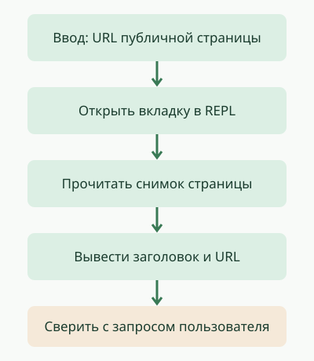

**Aside — ИИ-браузер, который выполняет многошаговые задачи, используя сайты с вашими открытыми сеансами и контекст браузера.** Можно начать со сводки открытой страницы или сбора материалов, затем в разрешённых пределах поручать заполнение форм и работу с файлами. Важно проверять не только формулировки ответа, но и то, на каких страницах что было сделано.

Обзор основан на [официальной справке](https://docs.aside.com/) и материалах для разработчиков от 16 ноября 2026 года. Пример чтения публичной страницы через локальный CLI выполнен. Приведённые ниже рабочие запросы не запускались в аккаунтах с авторизацией, а доля успешных выполнений по сервисам не измерялась.

## Чем это отличается от обычного браузера?

В обычном браузере человек переходит между сайтами, копирует сведения и решает, что делать дальше. В Aside можно описать нужный результат и границы работы, а агент сможет прочитать несколько страниц и продолжить задачу. Удобство в том, что работу на сайтах можно поручать без самостоятельной разработки интеграций с API сервисов. Это, однако, не означает, что автоматизация всегда успешно работает на любом сайте.

[Руководство по задачам](https://docs.aside.com/help/tasks) описывает выбор режима, прав, папки и модели, а также ответы на вопросы и запросы одобрения в ходе работы. Оно различает задачи основного профиля и задачи Incognito, не использующие обычное состояние авторизации.

| Применение | Запрашиваемый результат | Что проверяет пользователь |
| --- | --- | --- |
| Исследование открытых материалов | Сравнение по условиям и ссылки на источники | Даты оригиналов, единицы и реальные утверждения источника |
| Просмотр панели с авторизацией | Сводка показателей за заданный период | Аккаунт, период, фильтры и пропуски |
| Организация документов и файлов | Извлечение нужных пунктов и черновик | Значения в оригинале и место сохранения |
| Подготовка ответа | Черновик ответа на обращение | Получатель, контекст и факт отправки |

«Подготовить черновик» и «отправить» в последней строке — разные запросы. Сначала лучше освоить просмотр и подготовку черновиков.

## Первая задача с открытой страницы

Согласно [руководству боковой панели](https://docs.aside.com/help/side-panel), можно открыть страницу и отправить запрос в панели Aside, сохранив прикреплённую страницу. Проверка её заголовка и хоста помогает понять, с какой страницы начнётся работа.

На публичной странице документации продукта попробуйте следующий запрос. Это специально составленный пример.

```text
По прикреплённой официальной документации составь список поддерживаемых сред, условий установки и ограничений.
К каждому пункту добавь ссылку на источник; отсутствующие в документации сведения отметь как непроверенные.
Не создавай аккаунты, ничего не скачивай и не устанавливай; покажи результат в этом разговоре.
```

Получив результат, откройте ссылки и проверьте условия. Если в нём смешаны другие продукты или старые документы, сузьте целевой URL и дату проверки и повторите запрос. Не позволяйте инструкциям внутри документа подменять исходный запрос: явно определите, что читать как справочный материал.

## Удобство памяти и менеджера паролей

Aside предоставляет функции использования контекста браузера и памяти. Однако вход в тот же аккаунт на другом компьютере не переносит все задачи. [Руководство по устройствам](https://docs.aside.com/help/devices) различает синхронизацию закладок и истории браузера и разговоры, память и рабочие папки, остающиеся на конкретном устройстве. В нём указано, что прямой перенос локальной задачи на другой компьютер или в облако пока не общедоступен.

[Aside Vault](https://docs.aside.com/help/password-manager) описывается как средство автоматического заполнения сохранённых данных входа на сайтах без передачи агенту исходного пароля. Политика использования агентами задаётся в `Settings > Passwords > Access policy for AI agents`. Некоторым сайтам нужна дополнительная аутентификация или подтверждение пользователя.

Скрыть пароль от модели и разрешить модели обрабатывать содержимое страниц после входа — разные вещи. Если попросить упорядочить письма, их содержимое может стать частью контекста задачи. Поэтому лучше определить действительно нужные сайты и задачи, а не предоставлять одинаковый доступ ко всем аккаунтам только ради удобного входа.

## Что означает ориентация на локальную работу

[Политика конфиденциальности](https://aside.com/policy/privacy) сообщает о локальном хранении разговоров и результатов задач, одновременно уточняя, что поставщики размещённых ИИ-моделей получают необходимый для работы контекст. Он может включать запросы, результаты инструментов, выбранные снимки структуры и скриншоты браузера, файлы и другие данные. **Локальное хранение не означает, что вся обработка идёт офлайн или что никакие данные не покидают устройство.**

Также различайте права доступа к файлам и действия на сайтах. Одного названия `Read only` недостаточно, чтобы считать заблокированными все изменения на сайтах: проверяйте инструкции задачи и реальные запросы одобрения. Область доступа к папкам для `Guard` и `Full access` проверяйте по [руководству задач](https://docs.aside.com/help/tasks) и настройкам установленной версии.

## Для разработчиков: CLI, MCP и REPL

[Документация для разработчиков](https://aside.com/developers) предлагает CLI для задач на естественном языке, MCP для подключения существующих агентов и REPL для прямого управления браузером. Их можно подключать, когда в разработке нужно читать веб-документацию или проверять интерфейс. Публичный HTTP API загрузки отличается от API запуска задач агента.



Выполните следующую команду в среде с установленным и аутентифицированным CLI, который может подключиться к Aside. Сначала прочитайте общую справку через `aside guide`, а руководство прямого управления браузером — через `aside guide repl`.

```sh
aside repl 'await openTab("https://example.com"); console.log((await snapshot(page)).tree)'
```

При запуске в Aside CLI **1.26.1115.1556** на macOS код завершения был 0; заголовок и URL в выводе выглядели так. Остальное содержимое страницы и ссылки опущены.

```text
- title: "Example Domain" [url=https://example.com/]
```

Схема следует последовательности примера: ввод → открытие вкладки → снимок → сравнение результата. Пример не проверяет успешность исследований агента на естественном языке, авторизацию или оплату. Согласно руководству CLI, сеанс REPL работает в incognito, поэтому он также отличается от задач, использующих авторизацию обычного профиля.

## Какие задачи поручать сначала?

Aside стоит попробовать для работы, где нужно упорядочивать сведения из разных сайтов и документов. Чем яснее результат и круг источников, тем проще определить завершённость. Для фиксированной массовой обработки дополнительно оцените, не подходят ли лучше официальный API или специализированный скрипт.

Повторяющиеся задачи можно планировать через [Routines](https://docs.aside.com/help/automation), но нельзя предполагать, что они продолжат выполняться после сна или выключения локального компьютера. Руководство по устройствам сообщает, что локальной задаче нужны работающий компьютер и сеть. Лимиты использования и стоимость подключённой модели проверяйте в [информации о тарифах](https://docs.aside.com/help/subscription) и приложении.

Для начала достаточно сводки одной публичной страницы документации с подтверждениями. Сравните её с оригиналом и только затем расширяйте работу до просмотра аккаунтов с авторизацией или повторяющихся задач. Так можно конкретно понять, что Aside снимает с вас, а что требует самостоятельной проверки.

Примеры исследовательских запросов, проверки CSV и повторяющихся задач приведены в [практическом руководстве по браузеру Aside](/ko/posts/2026-11-17-aside-browser-guide/).
