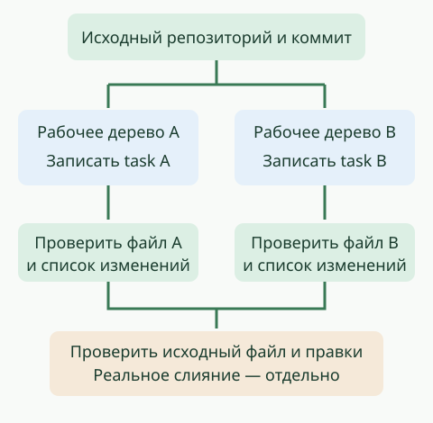

**В T3 Code удобно следить за задачей, одобрениями и изменениями в ветке диалога. Orca выделяется работой с терминалом, редактором, браузером и diff в контексте каждого worktree. Herdr стоит рассмотреть, если нужно сохранять работающие терминалы и самостоятельно настраивать рабочий интерфейс и автоматизацию.** Функции трёх инструментов пересекаются, поэтому лучше сравнивать запуск задачи, проверку и возврат после прерывания, а не ранжировать их по наличию одной возможности.

Сравниваем [T3 Code](https://github.com/pingdotgg/t3code/tree/v0.1.9), [Orca](https://orca.dev/) и [Herdr](https://herdr.dev/). Они не относятся к T3 Stack или другим проектам с похожим названием Hydra. Основа — документы, проверенные 16 ноября 2026 года; конкретное поведение T3 Code ограничено **документацией v0.1.9**. Для Orca и Herdr использована текущая официальная документация. Приведённые преимущества и ограничения — критерии выбора на основе документов, а не измерение производительности трёх приложений в одинаковой среде.

## Вокруг чего строится работа?

| Критерий | T3 Code | Orca | Herdr |
| --- | --- | --- | --- |
| Основной процесс | Запросы, одобрения и проверка изменений в проектах и ветках диалога | Управление агентами, файлами, браузером и diff по worktree | Управление терминалами и агентами в приложении и TUI, расширение интерфейса |
| Разделение задач | Есть worktree; необходимо проверять фактический путь задачи | Ветки и интерфейсы организованы вокруг worktree задач | Worktree есть в приложении и TUI; сама панель не является worktree |
| Проверка изменений | Различать изменения хода диалога и сравнение веток | Diff worktree, комментарии к строкам, частичное добавление в индекс | Проверять процесс ревью в выбранной конфигурации приложения и терминальных инструментах |
| Права | Проверять режим прав ветки диалога и поведение каждого провайдера | Проверять настройки прав агента и фактическую область выполнения | Проверять права запускаемых агентов, команд и расширений |
| Удалённая работа | Подключение других устройств к серверу | SSH-хосты и удалённая среда Orca | Раздельные удалённые функции приложения/core и TUI |
| Оценка стоимости | Отдельно проверять стоимость приложения и провайдера моделей, условия подключённых сервисов | Отдельно проверять стоимость приложения, провайдера моделей и удалённых вычислений | Отдельно проверять стоимость приложения/core/TUI, провайдера моделей и серверов |

Основа описания — [документация управления исходным кодом](https://github.com/pingdotgg/t3code/blob/v0.1.9/docs/user/source-control.md) T3 Code, [документация worktree](https://orca.dev/docs/model/worktrees) Orca и [руководство приложения](https://herdr.dev/guide/) Herdr. Не проверенные в таблице возможности не объявляются неподдерживаемыми. В частности, в T3 Code тоже есть worktree и интерфейс ревью, а у Herdr — настольное приложение.

## T3 Code: следить за диалогом и результатами выполнения вместе

T3 Code связывает установленных провайдеров с проектами и ветками диалога. [README v0.1.9](https://github.com/pingdotgg/t3code/blob/v0.1.9/README.md) описывает мобильный, веб- и настольный клиенты и подключение существующих провайдеров, включая Codex и Claude Code. Если считать его поставщиком самой модели, легко запутаться при установке и аутентификации.

Преимущество — возможность отслеживать запрос, выполнение, одобрения и изменения в одной ветке диалога. Документация управления исходным кодом различает изменения отдельного хода и все изменения относительно базовой ветки. Например, если агент сначала получил свежий код, а затем внёс правки, нельзя считать проверку всей ветки завершённой, просмотрев только изменения хода.

Нужно учитывать, что режимы прав не одинаковы у разных провайдеров. Выбирайте режим по [документации прав](https://github.com/pingdotgg/t3code/blob/v0.1.9/docs/user/permission-modes.md) и проверяйте реальные запросы на одобрение. Наличие экрана одобрения не означает изоляции доступа к файлам и сети на уровне операционной системы.

При удалённой работе важен срок жизни сервера. [Документация удалённого доступа](https://github.com/pingdotgg/t3code/blob/v0.1.9/docs/user/remote-access.md) сообщает, что закрытие последнего окна настольного приложения останавливает локальный сервер. Для непрерывного выполнения нужно настроить отдельную фоновую службу в поддерживаемой среде. В этой версии такая служба недоступна в Windows, поэтому различайте способы запуска. На сервере также должны быть подготовлены репозиторий и аутентификация провайдера.

## Orca: объединить рабочие интерфейсы задачи и проверку изменений

Orca — среда разработки, в которой для каждой задачи создаётся worktree с агентом, редактором, браузером и diff. [Документация diff](https://orca.dev/docs/review/diff-viewer) описывает изменённые строки, частичное добавление в индекс и экран разрешения конфликтов. Это удобно для изменения UI с проверкой в браузере и последующим ревью изменений.

Преимущество — управление файлами задачи и интерфейсом ревью в одном контексте worktree. Даже с несколькими агентами интерфейс помогает связать изменения с нужной веткой. Также доступны управление рабочими пространствами и терминалами через CLI и навыки. [Руководство CLI](https://orca.dev/docs/cli/overview)

Нужно освоить устройство среды разработки и процесс Git. Для одной короткой правки затраты на управление worktree и несколькими экранами могут превысить удобство. С ростом числа агентов могут расти объём результатов для проверки и потребление ресурсов. Параллельный запуск не гарантирует пропорциональной экономии времени.

Согласно [документации восстановления сеансов](https://orca.dev/docs/model/session-restore), агенты продолжают работать после закрытия приложения, пока жив демон. Перезагрузка хоста или остановка демона завершает процессы; восстановление рабочего пространства и истории терминала отличается от восстановления работающего процесса. [Удалённый запуск](https://orca.dev/docs/ways-to-run) тоже поддерживается, но инструменты и аутентификацию на выполняющем задачу хосте нужно подготовить отдельно.

## Herdr: самостоятельно настраивать терминалы и рабочий интерфейс

В Herdr **нужно различать настольное приложение, herdr-core и Herdr TUI**. Приложение работает поверх herdr-core, а TUI использует отдельный сервер. Официальный FAQ прямо указывает, что приложение и TUI не делят список агентов. [Официальный сайт Herdr](https://herdr.dev/)

Преимущество — возможность отдельно расширять терминальную среду и интерфейс. [Описание core](https://herdr.dev/core/) охватывает запуск программ, создание других задач, чтение результатов и подключение удалённых машин. [Руководство приложения](https://herdr.dev/guide/) также показывает, как просить агента изменить макет или функции. Это стоит рассмотреть, если вы хотите создать собственную панель управления, сохранив существующую терминальную среду разработки.

Ограничение — растущая ответственность за понимание компонентов и расширений. Отображение статуса в приложении зависит от OSC 7501, который сообщает программа; программа без таких отчётов может работать, но не показывать статус. Не путайте это с правилами обнаружения агентов в TUI. Проверяйте также команды и внешние подключения пользовательских режимов и плагинов.

После закрытия окна приложения терминалы сохраняются, пока жив core. Согласно FAQ, перезагрузка устройства или остановка core завершает процессы, а приложение не перезапускает агентов автоматически. После перезапуска сервера TUI отдельно предлагает восстановление макета и возобновление сеансов поддерживаемых агентов. [Документация восстановления TUI](https://herdr.dev/tui/docs/session-state/)

## Общие для трёх инструментов границы worktree

Если несколько агентов одновременно меняют одни и те же файлы, отдельный worktree для каждой задачи упрощает отслеживание изменений. Но разделение файловых каталогов не изолирует автоматически БД, порты серверов разработки, внешние аккаунты и учётные данные. Это ограничение общее для всех трёх инструментов.



Следующий пример проверяет разделение файлов на схеме. Он создаёт временный репозиторий в оболочке macOS или Linux с установленным Git, не меняя существующий проект. Он не включает запуск агентов или сравнение производительности продуктов.

```sh
#!/bin/sh
set -eu
case_dir=$(mktemp -d)
git init -q "$case_dir/repo"
git -C "$case_dir/repo" config user.name 'Example Author'
git -C "$case_dir/repo" config user.email 'example@example.invalid'
printf 'base\n' > "$case_dir/repo/app.txt"
git -C "$case_dir/repo" add app.txt
git -C "$case_dir/repo" commit -qm 'Initial commit'
git -C "$case_dir/repo" worktree add -qb task-a "$case_dir/task-a" HEAD
git -C "$case_dir/repo" worktree add -qb task-b "$case_dir/task-b" HEAD
printf 'task A\n' > "$case_dir/task-a/app.txt"
printf 'task B\n' > "$case_dir/task-b/app.txt"
printf 'A: '; cat "$case_dir/task-a/app.txt"
printf 'B: '; cat "$case_dir/task-b/app.txt"
printf 'base: '; cat "$case_dir/repo/app.txt"
printf 'A 변경 파일: '; git -C "$case_dir/task-a" diff --name-only
printf 'B 변경 파일: '; git -C "$case_dir/task-b" diff --name-only
```

Вывод, полученный при выполнении в локальной оболочке.

```text
A: task A
B: task B
base: base
A 변경 파일: app.txt
B 변경 파일: app.txt
```

A и B сохраняют разное содержимое, но изменили один и тот же файл. При интеграции нужно проверить намерение обеих правок. Пример не удаляет временный каталог автоматически.

## С какого инструмента начать?

Можно начать с **T3 Code**, если удобно отслеживать запросы, одобрения и изменения в диалоге; с **Orca**, если удобно разделять браузер, редактор и diff по задачам; с **Herdr**, если хочется самостоятельно настраивать терминалы и панели управления. Это рекомендации, выведенные из структуры функций в официальной документации.

Для проверки выбора используйте в трёх инструментах одинаковые репозиторий, задачу, модель, права и условия тестирования. Зафиксируйте падающий тест до изменения файлов, а после завершения проверьте результаты выполнения, diff и оставшиеся изменения. Закрытие окна приложения, отключение клиента, остановку сервера и перезагрузку хоста проверяйте как разные сценарии. Сравнивайте не только время выполнения, но и затраты на возврат к работе и ревью — так различия, важные для вашего подхода к разработке, станут заметнее.

Отдельные процессы подробнее описаны в [примере T3 Code](/ko/posts/2026-11-12-t3-code-workflow/), [руководстве Orca](/ko/posts/2026-11-12-orca-worktree-guide/) и [подробном сравнении Orca и Herdr](/ko/posts/2026-11-15-orca-herdr-comparison/).
