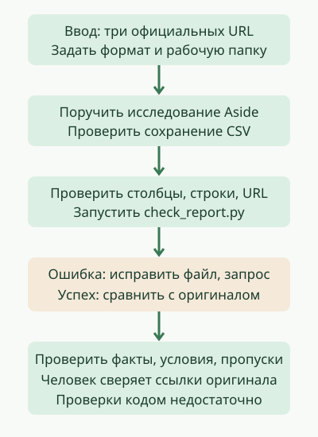

**В запросе к Aside лучше указывать страницы, формат результата и условия завершения, а не просто просить «исследовать самостоятельно».** Начните с небольшой задачи по нескольким публичным документам, сравните результат с оригиналом и затем расширяйте работу до просмотра страниц с авторизацией или повторяющихся задач.

Статья основана на официальной справке, проверенной 17 ноября 2026 года. Приведённые запросы — примеры применения, а не результаты выполнения исследований, входа в аккаунты или запланированных задач в Aside. Код проверки CSV выполнен отдельно на синтетических входных данных.

## Определить границы перед началом

Установите Aside и проверьте модель и рабочую папку. Чтобы начать с текущей страницы, откройте боковую панель и проверьте заголовок и хост прикреплённой страницы. Сохранённое вложение позволяет использовать её как контекст задачи. [Руководство боковой панели](https://docs.aside.com/help/side-panel)

Для исследования без входа в аккаунты можно выбрать Incognito. Для просмотра авторизованного аккаунта используйте основной профиль с этим аккаунтом. Состояния браузера в этих режимах различаются. Если задача сохраняет файлы, нужны и права записи в указанную папку. [Руководство по режимам задач](https://docs.aside.com/help/tasks)

Для прав совместно проверьте настройки файлов, инструментов и песочницы в `Settings > Agents` и настройки конкретной задачи. В официальной документации `Guard` работает в разрешённых папках и запрашивает подтверждение перед доступом к другим. `Read only` описан как режим без изменения файлов, поэтому для примера сохранения CSV он может не подойти. По одному названию нельзя заключать, что любые изменения на сайтах автоматически запрещены. [Руководство по правам](https://docs.aside.com/help/security)

## Пример 1: сохранить три страницы официальной документации в CSV

Выберите пустую рабочую папку и отправьте следующий запрос. Замените место сохранения реальной папкой. Если одноимённый файл уже существует, выберите другое имя.

```text
Прочитай только следующие три страницы официальной документации и сохрани результат в report.csv.
https://docs.aside.com/help/tasks
https://docs.aside.com/help/automation
https://docs.aside.com/help/devices

Формат — CSV в UTF-8, порядок столбцов: topic,summary,source_url.
Значения topic — соответственно tasks,automation,devices; по одной строке на страницу.
summary — одно предложение на корейском с основными условиями использования из страницы.
Поля с запятыми заключай в кавычки по правилам CSV.
В source_url используй точный адрес соответствующей страницы из списка выше.

Сохрани файл в выбранной рабочей папке, не перезаписывая существующие файлы.
Если документ не удалось прочитать, не заполняй его предположениями, а сообщи недоступный адрес.
Не заходи в аккаунты на других сайтах и не отправляй сообщения.
После завершения сообщи путь к файлу и три проверенные страницы.
```

Если страница не открывается, сначала устраните проблему доступа. Если в результате не хватает пункта, перед повторной попыткой также проверьте целевой URL. Сводка, придуманная вместо непрочитанного документа, не считается завершением.



Проверка кодом на схеме подтверждает соблюдение структуры файла и круга источников. Сохраните следующий код в `check_report.py`. Он использует только стандартную библиотеку Python 3 и не обращается к сети.

```python
import csv
import sys

expected = {
    "tasks": "https://docs.aside.com/help/tasks",
    "automation": "https://docs.aside.com/help/automation",
    "devices": "https://docs.aside.com/help/devices",
}

with open(sys.argv[1], newline="", encoding="utf-8-sig") as stream:
    reader = csv.DictReader(stream)
    if reader.fieldnames != ["topic", "summary", "source_url"]:
        raise SystemExit("FAIL: columns")
    rows = list(reader)

if len(rows) != len(expected) or {r["topic"] for r in rows} != set(expected):
    raise SystemExit("FAIL: topics")
for row in rows:
    if (None in row or any(value is None for value in row.values())
            or not row["summary"].strip()
            or row["source_url"] != expected[row["topic"]]):
        raise SystemExit("FAIL: row")
print("PASS: 3 topics and allowed source URLs")
```

Передайте фактический путь созданного CSV как аргумент.

```sh
python3 check_report.py report.csv
```

На синтетическом входе из трёх строк с разрешёнными URL получены код завершения 0 и следующий вывод. Этот вход не был создан Aside.

```text
PASS: 3 topics and allowed source URLs
```

Синтетический вход с удалённой строкой вернул `FAIL: topics` и код завершения 1. Код проверяет столбцы, темы, URL и пустые сводки, но **не определяет достоверность сводок и то, были ли страницы действительно прочитаны.** После успешной проверки самостоятельно найдите в оригиналах предложения, подтверждающие каждую сводку. Вместо ослабления условий проверки ради устранения ошибки сначала найдите расхождение между файлом и запросом.

## Пример 2: только прочитать показатели на панели с авторизацией

Для просмотра аккаунта ограничьте сайт, аккаунт, период и фильтры. Следующий пример предполагает рабочую панель, к которой у пользователя есть право доступа.

```text
На текущей прикреплённой панели прочитай просмотры для указанного мной аккаунта
за 2026-11-01~2026-11-07. Также укажи часовой пояс и фильтры на экране.
В таблице покажи дату, показатель и единицу; не считай пустые значения равными 0.
Не меняй настройки, не экспортируй данные и не просматривай другие аккаунты.
Значения, не подтверждённые на экране, отметь как непроверенные.
```

Получив числа, сначала сравните итог, период, часовой пояс и фильтры с экраном. Общий итог может отличаться от суммы нескольких верхних строк: не объявляйте такое различие ошибкой сразу. Если нужен экспорт, определите состав файла и место сохранения и сделайте отдельный запрос.

Если нужны данные входа, не вставляйте пароль в запрос. Проверьте политику использования сохранённых данных по [руководству Password Manager](https://docs.aside.com/help/password-manager) и пройдите дополнительную аутентификацию сайта. Утверждение о непередаче пароля модели отличается от обработки моделью содержимого после входа. [Политика конфиденциальности](https://aside.com/policy/privacy) сообщает, что выбранный необходимый для задачи контекст может передаваться поставщикам размещённых моделей.

## Как изменить запрос в процессе

Если выбраны неверные источники или нужно сузить работу, необязательно ждать завершения. [Руководство по задачам](https://docs.aside.com/help/tasks) различает `Queue` и `Steer` для последующих сообщений. `Queue` применяет новый запрос после текущего выполнения, а `Steer` передаёт новое сообщение в выполняющуюся задачу и меняет направление.

Например, конкретно укажите границы изменения: «Не исследуй другие сайты, используй только первые три документа». Сам факт отправки уточнения не отменяет внешние действия, которые уже произошли. Сначала проверьте реальное состояние и затем решите, что запросить дальше.

## Пример 3: превратить проверенный исследовательский запрос в повторяющуюся задачу

Если разовый результат полезен, можно рассмотреть повторяющееся исследование. Согласно [руководству Routines](https://docs.aside.com/help/automation), cron routine запускает новую задачу по расписанию, а heartbeat routine возобновляет существующий разговор. Для независимой еженедельной сводки сначала рассмотрите вариант создания новой задачи.

Создайте новую рутину в `Settings > Routines` и введите, например, следующие инструкции. Периодичность и часовой пояс отдельно задайте в реальном интерфейсе настроек.

```text
Прочитай три указанные страницы официальной документации и сравни с результатом прошлого запуска.
Сообщи об изменениях способов использования или ограничений со ссылками на подтверждение.
Если прошлого результата для сравнения нет, сохрани текущий как исходный уровень.
Если документ не удалось прочитать, сообщи об ошибке доступа, а не об отсутствии изменений.
Не меняй настройки аккаунтов, не отправляй сообщения и не выполняй платные действия.
```

Также определите, где хранится прошлый результат и как его прочитает следующий запуск. Создание новой задачи рутиной не означает, что предыдущий разговор автоматически станет материалом сравнения. Явно задайте вход, например прошлый отчёт в указанной папке, либо сначала получайте только отчёты и сравнивайте их вручную.

В списке рутин запустите её сразу, проверьте вход, выход и обработку ошибок, затем включайте расписание. Официальная справка описывает пропуск пересекающихся запусков. [Руководство по устройствам](https://docs.aside.com/help/devices) указывает, что для локальной задачи компьютер должен быть включён и подключён к сети, а Aside — работать. Вход на другом компьютере или платный тариф сами по себе не означают продолжения задачи спящего устройства в облаке.

Для начала достаточно освоить единый процесс просмотра, упорядочивания и проверки. Чтобы уверенно использовать повторяющиеся запуски, в этом процессе нужно определить необходимые входные данные и способ проверки результата.
