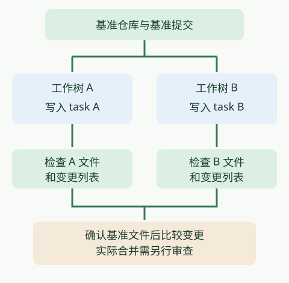

**如果想按 worktree 查看代码变更，并在同一界面中处理浏览器、diff 和 PR，Orca 更方便。如果偏重终端配置，想自行扩展应用界面，可以看看 Herdr。** 两款工具都能运行多个编码智能体并使用 Git worktree。选择的关键与其说是能否并行运行，不如说是如何管理工作环境和结果。

比较对象是 [Orca](https://orca.dev/) 与 [Herdr](https://herdr.dev/)。Herdr 分为桌面应用、终端用的 **Herdr TUI** 和独立的终端运行时 **herdr-core**。以下说明以 2026 年 11 月 15 日查阅的官方文档为准，并非让两款应用执行相同任务的直接性能测试。请区分提供方描述的功能与据此提出的选择标准。

## 差异一览

| 标准 | Orca | Herdr |
| --- | --- | --- |
| 核心界面 | 汇集智能体、编辑器、diff 和浏览器的桌面开发环境 | 桌面应用及独立 TUI；herdr-core 无界面运行终端 |
| 任务分离 | 为各任务创建 Git worktree，并关联分支、终端和浏览器 | 应用指南和 TUI 配置均有创建 worktree 的功能。普通终端 pane 并不总是独立 worktree |
| 代码检查 | worktree diff、向变更行发送意见、Git 和 PR 界面 | 以终端或用户配置的应用界面为主。是否具备相同 diff 功能及范围，需在安装的配置中确认 |
| 会话保持 | 守护进程存活时，退出应用后进程仍保持；主机重启时进程终止 | 应用由 herdr-core、TUI 由独立服务器保持终端；服务器或主机重启时原进程终止 |
| 扩展方式 | CLI、技能、计划任务及应用的工作界面 | 应用布局与模式、TUI 插件、herdr-core CLI 和 API |
| 许可证 | MIT | Apache 2.0 |

根据 Orca 的 [worktree 文档](https://orca.dev/docs/model/worktrees)和 [diff 说明](https://orca.dev/docs/review/diff-viewer)，以及 Herdr 的[应用指南](https://herdr.dev/guide/)和 [TUI 配置说明](https://herdr.dev/tui/docs/config-reference/)整理。此表并非针对特定版本实测两款产品所有功能的结果。

## 委托相同工作时，流程有何不同

例如，在一个仓库中同时委托 API 修改和测试补强。如果两项任务可能碰到同一文件，应先按任务划分 worktree。明确每个智能体的读写范围，完成后分别审查变更，再进行整合。

Orca 提供按任务打开 worktree，并将智能体和 diff 关联到该工作空间的流程。[首次任务说明](https://orca.dev/docs/first-session)介绍了在多个独立 worktree 中运行智能体，再审查各自 diff 的过程。

Herdr 桌面应用的官方指南以请求为每项任务创建 worktree 并运行智能体为例。TUI 管理 workspace、tab 和 pane，也另行提供 worktree 功能。不要因为打开了多个普通 pane，就假设它们各有不同的工作目录；开始任务前应确认路径和分支。[应用指南](https://herdr.dev/guide/) · [TUI worktree 命令](https://herdr.dev/tui/docs/cli-reference/)



图中展示了以下 Git 示例的文件流程，不包括运行智能体或自动合并结果的过程。

## 亲自确认 worktree 分离的示例

以下示例可在安装了 Git 的 macOS 或 Linux shell 中运行。它创建临时仓库和两个 worktree，不会修改现有项目，也不能替代 Orca 或 Herdr 的安装与配置说明。

```sh
#!/bin/sh
set -eu
case_dir=$(mktemp -d)
git init -q "$case_dir/repo"
git -C "$case_dir/repo" config user.name 'Example Author'
git -C "$case_dir/repo" config user.email 'example@example.invalid'
printf 'base\n' > "$case_dir/repo/app.txt"
git -C "$case_dir/repo" add app.txt
git -C "$case_dir/repo" commit -qm 'Initial commit'
git -C "$case_dir/repo" worktree add -qb task-a "$case_dir/task-a" HEAD
git -C "$case_dir/repo" worktree add -qb task-b "$case_dir/task-b" HEAD
printf 'task A\n' > "$case_dir/task-a/app.txt"
printf 'task B\n' > "$case_dir/task-b/app.txt"
printf 'A: '; cat "$case_dir/task-a/app.txt"
printf 'B: '; cat "$case_dir/task-b/app.txt"
printf 'base: '; cat "$case_dir/repo/app.txt"
printf 'A 변경 파일: '; git -C "$case_dir/task-a" diff --name-only
printf 'B 변경 파일: '; git -C "$case_dir/task-b" diff --name-only
```

在本地 shell 中确认的输出如下。

```text
A: task A
B: task B
base: base
A 변경 파일: app.txt
B 변경 파일: app.txt
```

各 worktree 的文件内容相互独立，但两项任务都修改了 `app.txt`。因此，在实际项目中整合两个结果时，仍可能出现冲突或语义矛盾。worktree 只分离文件变更，不会自动隔离数据库、端口、外部服务和凭据，也不会解决代码冲突。示例不会自动删除临时目录。

在实际工作环境中清理 worktree 时，还应确认各工具的删除范围。Orca 可以在确认后删除 worktree 和分支；Herdr TUI 的 worktree 删除命令则说明，即使删除检出目录，也不会删除分支。请检查修改内容和尚未合并的提交后再清理。[Orca worktree](https://orca.dev/docs/model/worktrees) · [Herdr TUI CLI](https://herdr.dev/tui/docs/cli-reference/)

## Orca 的优点与考虑因素

Orca 的优势在于**从任务到结果审查相衔接的界面**。[diff viewer](https://orca.dev/docs/review/diff-viewer)显示变更文件和行，并提供冲突解决界面与部分暂存功能。在同一工作空间中可以使用独立浏览器和编辑器，适合构建修改 Web UI 后直接检查的流程。

[远程运行说明](https://orca.dev/docs/ways-to-run)还介绍了选择 SSH 主机或用户自管服务器的方法。能够远程工作，并不等于所有环境默认都以相同权限安全隔离。远程机器的账号、秘密信息和网络访问仍需单独管理。

根据[会话恢复说明](https://orca.dev/docs/model/session-restore)，即使退出应用，只要后台守护进程仍存活，智能体就会继续运行。主机重启或守护进程终止时，运行中的进程会消失，需要在恢复的工作空间中重新启动智能体。

需要考虑的是，必须熟悉桌面环境及其功能。若只需要单一终端任务，多个界面和工作空间反而可能多余。同时运行多个智能体可能增加模型使用量，而且每项独立变更的结果都需要审查。Orca 本身并不保证模型回答的准确性。

## Herdr 的优点与考虑因素

Herdr 的优势在于**保持终端和智能体运行的同时，灵活配置工作空间**。[herdr-core](https://herdr.dev/core/)介绍了关闭窗口后仍保持受管理终端，以及让智能体启动其他任务并读取结果的接口。[官方指南](https://herdr.dev/guide/)还介绍了调整应用布局和模式的使用方式。

使用 Herdr 时，应区分应用与 TUI。根据官网，桌面应用使用 herdr-core，而 **Herdr TUI 使用独立服务器，两个环境不共享智能体列表。** 关闭应用与重启电脑或运行时也不同。在桌面应用一侧，关闭窗口或更新应用时，只要 core 仍存活，进程就会保持；设备重启或 core 停止时，进程会停止。官网说明，这种情况下应用的 pane 会恢复，但不会自动重新启动智能体。[Herdr FAQ](https://herdr.dev/)

TUI 有独立的恢复规则。断开后重新连接时，只要服务器仍存活，原有进程就会保持。服务器重启后进程会终止，布局恢复和受支持智能体的会话续接则是独立功能。[TUI 会话恢复](https://herdr.dev/tui/docs/session-state/)

定制越多，就越需要自行确认各模式使用什么权限和外部连接。此外，Herdr 应用的状态显示依赖程序报告 [OSC 7501](https://herdr.dev/core/)。不支持的程序也可运行，但可能不显示状态。不要将 TUI 的智能体检测方式与应用的状态显示认定为同一功能。

## 在什么情况下选择？

- **以审查变更和检查网页为主：** 先看看 Orca 按 worktree 组织的 diff、浏览器和 PR 流程。
- **以保持终端和配置界面为主：** 看看 Herdr 应用与 core；如果希望在终端内管理，也可比较独立的 TUI。
- **同时运营多台服务器与多个智能体：** 两款工具均提供远程功能，应确认实际 SSH 环境、认证方式和会话恢复条件。
- **只需要一次简短修改：** 现有终端和 Git 可能已经足够。比较管理工具增加的复杂度与便利。

选择两款工具时，适合使用同一仓库、同一任务、同一模型和权限做小规模试验。分别走完任务创建、中断后返回、检查变更和整合的过程，记录实际用时和错误，就能选择更适合自己工作方式的工具。本文没有进行此类对比测量。
