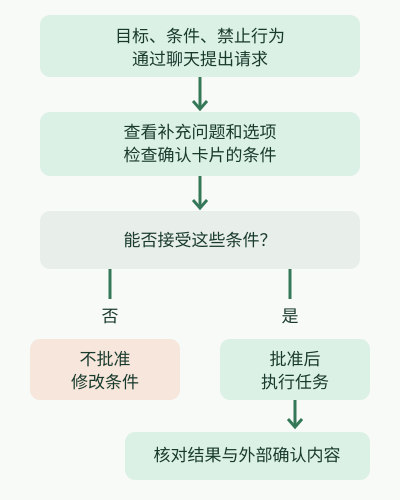

Pickle AI 是一款个人 AI 智能体，可以通过聊天请求调查、预约等任务，并查看进度。初次使用时，适合先委托无需付款或连接账号的调查，再亲自核对结果。扩展到预约或购买时，应一并写明日期、预算和批准条件。

本文是根据 [Pickle 官方帮助](https://www.pickle.com/help)撰写的使用指南，并非实际操作账号中的应用或运行以下示例的记录。界面和可用功能可能因应用版本、账号及地区而异。

## 开始之前

准备好 Pickle 应用和账号，并在应用内确认可用套餐和额度。韩语版[套餐说明](https://www.pickle.com/help/credits/plans)指出，在韩国可以免费使用，但有每日重置的使用量限制。达到上限时，预约任务可能被跳过，因此请在应用的 **我的 Pickle** 标签页中查看剩余额度和重置时间。套餐和额度可能随地区和时间而变化。

根据[官方介绍](https://www.pickle.com/help/start/what-is-pickle)，Pickle 接收聊天请求，在独立的网页浏览器中访问网站处理任务，无法在网上完成时可以拨打电话。因此，不必将它理解成直接点击自己 iPhone 上安装的其他应用。各地区、服务的支持情况及能否拨打电话，需要在实际界面中确认。



图中简化了用户收到确认卡片时的流程，并不表示所有请求都会出现卡片，也不表示外部操作一定成功。以下伪代码是读者可采用的判断步骤，并非 Pickle 的内部实现。

```text
请求 = 目标、日期与地点、预算、允许和禁止的行为
向 Pickle 发送请求
如有补充问题或选项，按条件回答
如出现确认卡片：
    检查内容和条件
    条件不符时不批准，而是修改
    条件相符时批准
结果到达后，将原始请求与外部确认记录进行核对
```

## 第一个任务：不付款，先调查候选项

例如选择餐厅时，可以在 Chat 中输入以下内容。日期、时间和地区均为示例，请替换成实际条件。

```text
帮我找首尔江南站附近适合 2 人在周六下午 6 点用餐的餐厅。
人均预算不超过 30,000 韩元，优先选择有素食菜单的餐厅。
请提供各候选餐厅的名称、位置、营业时间及菜单依据链接。
不要预约、打电话或付款；如信息不确定，请标明。
```

如果 Pickle 询问日期或其他条件，请回答；出现候选项后，打开链接核实当天的营业时间和菜单。若没有链接或无法确认条件，可追加请求：“请告诉我从什么来源确认的。无法确认的项目不要猜测。”这些结果仅为示例，并未在实际服务中验证该提示词的执行结果。

根据[任务委托说明](https://www.pickle.com/help/tasks/delegate)，在 Chat 中告知目标后，Pickle 会询问所需信息，也可能以卡片展示要执行的任务和条件以征求确认。任务卡片出现在聊天中，关闭应用后任务仍可能继续。不要把关闭应用视为取消任务；需要停止时，应确认任务当前状态及是否可以取消。

## 委托预约或购买时

核对候选调查结果后，另行提出请求，收窄可执行的行为范围。

```text
请确认之前找到的餐厅中，我选定的那一家有哪些可预约时段。
条件是 2 人、周六下午 6 点。如需付预约金或付款，
请不要继续，先展示金额和取消条件。
如需更改时间或人数，请在预约前询问我。
```

出现确认卡片时，阅读地点、日期与时间、人数、金额和取消条件，仅在可以接受时批准。官方说明称，会在预约、付款等难以撤回的操作前展示条件并征求确认。即使如此，请求文字也无法防止所有错误；批准后，仍需在餐厅或商家的确认页面、邮件中单独检查实际预约和付款状态。也不要假设取消请求会自动撤回外部已经完成的操作。

## 只连接必要的账号和登录信息

若任务使用邮件或日历，可按照[官方说明](https://www.pickle.com/help/start/what-is-pickle)，在 **我的 Pickle → 与（Pickle 名称）连接的应用和服务** 中连接所需账号。阅读连接界面显示的权限范围，任务不需要时就不连接。例如，只寻找可选日程的请求并不一定需要日历访问权限。

网站需要登录时，请勿在聊天中输入密码或银行卡号。使用官方文档指引的安全输入界面和 Vault，并再次确认请求的网站及信息。根据[保存登录信息说明](https://www.pickle.com/help/connect/save-login)，Pickle 浏览器与手机中保存的登录信息相互独立。

凭据保护方式也有边界。官方称不会向模型传递密码或银行卡号，但仍需另行检查实际网页表单输入所需值的处理路径。公开代码中可确认的保护范围和限制，整理在 [Pickle AI 工作原理与密码保护](/ko/posts/2026-11-13-pickle-ai-security/)一文中。对话和记忆的访问政策与凭据存储政策不同，因此也请查看[隐私说明](https://pickle.com/privacy)。

## 检查重复任务和使用记录

如果需要重复提醒或信息摘要，可以在 Chat 中同时提出任务和周期。例如：“每周一上午 9 点查找公开技术活动消息，并附链接汇总。不要报名或付款。”请明确限定范围。时区和实际执行条件，应在创建的任务详情页中确认。

根据[预约任务说明](https://www.pickle.com/help/tasks/scheduled)，点击屏幕上方的 Pickle 形象打开个人资料，可在 **已预约的任务** 中打开任务，查看暂停、恢复、修改、删除及执行历史。达到使用上限时可能跳过执行，因此应检查历史中的状态，不要假设漏掉的执行已自动补做。

连接账号或银行卡的使用情况，可在 [Access log 说明](https://pickle.com/help/privacy/activity)提供的路径 **我的 Pickle → 已连接的应用和服务或已连接的支付方式 → 加密横幅** 中查看。记录是在某个请求即将发出前留下的，并非该预约或付款实际成功的证据。因此还需结合任务结果和外部服务的确认内容进行核对。
