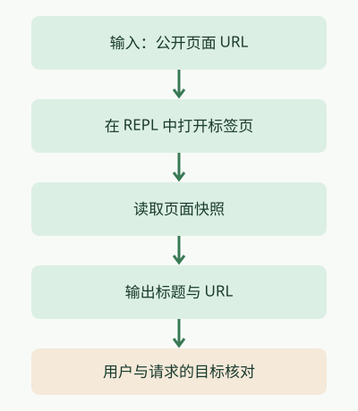

**Aside 是一款 AI 浏览器，利用用户已登录的网站和浏览器上下文执行多步骤任务。** 可以从总结当前页面、收集资料开始，在允许的范围内进一步委托表单填写和文件操作。重点不仅是回答的文字，还在于确认它在哪些页面处理了什么。

本文基于 2026 年 11 月 16 日的[官方帮助](https://docs.aside.com/)和开发者说明进行介绍。已通过本地 CLI 运行读取公开页面的示例，但未在已登录账号中执行以下工作提示词，也未测量各服务的成功率。

## 与普通浏览器有何不同？

在普通浏览器中，人需要在网站之间切换、复制信息并决定下一步操作。在 Aside 中，只要提出期望结果和范围，智能体就能阅读多个页面并继续处理任务。它的便利之处在于，无需自行开发独立的服务 API，就能请求在网站上完成工作。但这并不意味着所有网站的自动化都总能成功。

[任务说明](https://docs.aside.com/help/tasks)介绍了选择任务所用模式、权限、文件夹和模型，并在过程中回应问题或批准请求的流程。它也区分使用默认配置文件的任务与不使用普通登录状态的 Incognito 任务。

| 用途 | 请求的结果 | 用户应确认的内容 |
| --- | --- | --- |
| 公开资料调查 | 按条件比较并附来源链接 | 原文日期、单位及来源实际提出的主张 |
| 查询已登录仪表板 | 整理指定期间的数值 | 账号、期间、筛选条件及是否遗漏 |
| 整理文档和文件 | 提取必要项目并生成草稿 | 原始值及保存位置 |
| 准备回复 | 符合咨询内容的回复草稿 | 收件人、上下文及是否实际发送 |

最后一行的“撰写草稿”和“发送”是不同的请求。初次使用时，适合先通过查询和草稿任务熟悉流程。

## 从打开的页面开始第一个任务

根据[侧边栏说明](https://docs.aside.com/help/side-panel)，打开页面后，可以在 Aside 面板中保留页面附件并发出请求。检查附件的标题和主机名，就能了解任务以哪个页面为起点。

可以在公开产品文档中尝试如下请求。以下是撰写的示例提示词。

```text
请从附加的官方文档中整理支持环境、安装条件和限制。
每项附上依据链接，文档中没有的信息请标为未确认。
不要创建账号、下载或安装，请在本次对话中展示结果。
```

收到结果后，打开链接核实条件。若混入其他产品或旧文档，应收窄目标 URL 和需要确认的日期后再请求。不要让文档中的指令取代原始请求，而应明确将哪些内容仅作为资料阅读。

## 记忆与密码管理带来的便利

Aside 提供利用浏览上下文和记忆的功能，但即使在另一台电脑上登录同一账号，也不表示所有任务都能接续。[设备说明](https://docs.aside.com/help/devices)区分了书签、历史等浏览器同步数据，以及保留在各设备上的对话、记忆和任务文件夹。说明指出，将本地任务原样迁移到另一台电脑或云端的功能，目前尚未普遍提供。

[Aside Vault](https://docs.aside.com/help/password-manager)被描述为在网站中自动填入已保存的登录值，同时不将原始密码交给智能体的方式。智能体的使用政策在 `Settings > Passwords > Access policy for AI agents` 中设置。部分网站还需要额外认证或用户确认。

向模型隐藏密码，与模型处理登录后的页面内容，是两回事。请求整理邮件时，邮件内容可能包含在任务上下文中。因此，与其仅因登录便利就对所有账号开放同样的访问，不如明确实际需要的网站和任务。

## “以本地为中心”的范围

[隐私政策](https://aside.com/policy/privacy)说明，任务对话和产物保存在本地，同时明确指出，托管 AI 模型提供方会接收任务所需上下文。上下文可能包括提示词、工具结果、选中的浏览器快照、截图和文件等。**本地存储不表示所有处理都离线进行，也不表示没有任何数据向外传输。**

文件访问权限与网站上的行为也应区分。不要仅凭 `Read only` 这一名称，就假设网站上的所有修改行为都被禁止；应检查任务指令及实际批准请求。`Guard` 和 `Full access` 的文件夹访问范围，也应结合[任务说明](https://docs.aside.com/help/tasks)和安装版本的设置进行确认。

## 面向开发者的 CLI、MCP 和 REPL

[开发者文档](https://aside.com/developers)提供了自然语言任务用 CLI、连接现有智能体的 MCP，以及直接操作浏览器的 REPL。在开发中需要查询 Web 文档或检查页面时，可以进行连接。公开 HTTP 下载 API 与执行智能体任务的 API 不同。



在已安装并认证 CLI、且能连接 Aside 的环境中运行以下命令。基本用法先查看 `aside guide`，直接操作浏览器的说明先查看 `aside guide repl`。

```sh
aside repl 'await openTab("https://example.com"); console.log((await snapshot(page)).tree)'
```

在 macOS 的 Aside CLI **1.26.1115.1556** 中执行时，退出码为 0，输出中的标题和 URL 如下。省略了其余正文和链接项。

```text
- title: "Example Domain" [url=https://example.com/]
```

图中展示的是该示例的输入 → 打开标签页 → 快照 → 核对结果的顺序，并非验证自然语言智能体调查成功率、登录处理或付款功能的示例。根据 CLI 指南，REPL 会话为 incognito，因此也应与使用普通配置文件登录状态的任务区分。

## 适合从什么任务开始？

Aside 值得在跨多个网站和文档整理信息的工作中尝试。期望结果和来源范围越明确，越容易判断是否完成。反之，如果是固定的大批量处理，也应考虑官方 API 或专用脚本是否更适合。

重复任务可以通过 [Routines](https://docs.aside.com/help/automation)预约，但不能假设本地电脑睡眠或关闭后仍会继续运行。设备说明指出，本地任务需要电脑运行并连接网络。使用额度和所连接模型的费用，应在[费用说明](https://docs.aside.com/help/subscription)及应用界面中确认。

首次尝试只需对一页公开文档进行有依据的总结。将结果与原文比较后，再扩展到查询已登录账号或重复任务，就能具体判断 Aside 能减轻哪些工作，以及哪些仍需亲自确认。

具体的调查请求、CSV 验证和重复任务示例，可继续阅读 [Aside 浏览器使用方法](/ko/posts/2026-11-17-aside-browser-guide/)。
