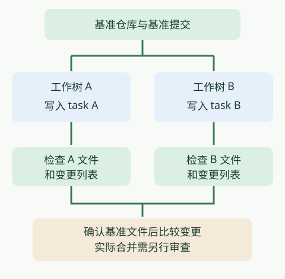

**T3 Code 便于在对话线程中跟进任务、批准和变更，Orca 的特点是按 worktree 一并管理终端、编辑器、浏览器和 diff。Herdr 则适合想保持终端运行，同时自行配置工作界面和自动化的人。** 三款工具的功能有所重叠，因此与其根据某项功能的有无判断高下，不如比较开始任务、审查结果及中断后返回的流程。

比较对象是 [T3 Code](https://github.com/pingdotgg/t3code/tree/v0.1.9)、[Orca](https://orca.dev/) 和 [Herdr](https://herdr.dev/)，与 T3 Stack 或其他名字相近的 Hydra 项目无关。本文基于 2026 年 11 月 16 日查阅的文档，T3 Code 的具体行为限定在 **v0.1.9 文档**范围内，Orca 与 Herdr 则参考当前官方文档。以下优缺点是基于文档的选择标准，并非在相同环境中运行三款应用得到的性能测量结果。

## 以什么为中心开展工作？

| 标准 | T3 Code | Orca | Herdr |
| --- | --- | --- | --- |
| 主要使用流程 | 在项目和线程中提出请求、批准并检查变更 | 按 worktree 管理智能体、文件、浏览器和 diff | 在应用和 TUI 中管理终端与智能体，扩展界面配置 |
| 任务分离 | 提供 worktree 功能；需确认任务的实际路径 | 以各任务的 worktree 为中心组织分支和界面 | 应用和 TUI 有 worktree 功能；pane 本身不是 worktree |
| 变更审查 | 区分对话轮次中的变更与分支比较范围 | worktree diff、逐行意见、部分暂存 | 确认所选应用配置及终端工具的审查流程 |
| 权限判断 | 同时确认线程权限模式和各提供方的行为 | 确认智能体权限设置与实际执行范围 | 确认运行的智能体、命令和扩展功能的权限 |
| 远程使用 | 将其他设备连接至服务器 | SSH 主机、远程 Orca 运行时 | 应用/core 与 TUI 各自独立的远程功能 |
| 成本判断 | 分别确认应用与模型提供方的费用、连接服务的条件 | 分别确认应用、模型提供方与远程计算费用 | 分别确认应用/core/TUI、模型提供方与服务器费用 |

T3 Code 的[源代码管理文档](https://github.com/pingdotgg/t3code/blob/v0.1.9/docs/user/source-control.md)、Orca 的 [worktree 文档](https://orca.dev/docs/model/worktrees)及 Herdr 的[应用指南](https://herdr.dev/guide/)是各流程的依据。此表未确认的功能，不应直接认定为不支持。尤其要注意，T3 Code 也有 worktree 和审查界面，Herdr 也有桌面应用。

## T3 Code：想一起跟进对话和执行结果时

T3 Code 将已安装的提供方连接到项目和线程来工作。[v0.1.9 README](https://github.com/pingdotgg/t3code/blob/v0.1.9/README.md)介绍了移动端、Web 和桌面客户端，以及连接 Codex、Claude Code 等现有提供方的方式。若将它理解为本身提供模型的工具，容易在安装和认证阶段产生混淆。

其优点是可以在同一线程中跟进任务请求、执行过程、批准及变更内容。源代码管理文档区分了当前轮次自身的变更与相对于基准分支的整体变更。例如，智能体先拉取最新代码再修改时，不能仅阅读该轮次的变更列表，就认为已经完成整个分支的审查。

需要考虑的是，权限模式的含义在各提供方之间并不相同。应根据[权限文档](https://github.com/pingdotgg/t3code/blob/v0.1.9/docs/user/permission-modes.md)选择模式，并检查实际的批准请求。存在批准界面，并不表示操作系统层面的文件和网络访问也已被隔离。

远程使用时，服务器的生命周期也很重要。[远程访问文档](https://github.com/pingdotgg/t3code/blob/v0.1.9/docs/user/remote-access.md)说明，关闭桌面应用的最后一个窗口后，本地服务器会停止。若需持续运行，应在受支持环境中单独配置后台服务。此版本在 Windows 上不提供该服务，因此需区分运行方式。服务器上也应准备好提供方认证和仓库。

## Orca：想将各任务的开发界面与变更审查结合时

Orca 是为每项任务创建 worktree，并在该空间中使用智能体、编辑器、浏览器和 diff 的开发环境。[diff 文档](https://orca.dev/docs/review/diff-viewer)介绍了变更行、部分暂存和冲突解决界面等功能，适合构建修改 UI、用浏览器检查、再审查变更的开发流程。

其优点是以同一 worktree 上下文管理任务文件和审查界面。即使使用多个智能体，也能将确认变更所属分支的过程与界面关联起来。此外，还提供通过 CLI 和技能控制工作空间与终端的方式。[CLI 说明](https://orca.dev/docs/cli/overview)

需要考虑的是，必须熟悉开发环境的配置和 Git 流程。对于简短的单项修改，管理 worktree 和多个界面的成本可能超过便利。智能体越多，需要审查的结果和资源消耗也可能越多。并行执行并不保证按相同比例节省时间。

根据[会话恢复文档](https://orca.dev/docs/model/session-restore)，关闭应用后，只要守护进程仍存活，智能体就会继续运行。主机重启或守护进程终止时，进程会停止；恢复工作空间和滚动历史，与恢复运行中的进程不同。它也支持[远程运行](https://orca.dev/docs/ways-to-run)，但执行任务的主机仍需单独准备工具和认证。

## Herdr：想自行配置终端和工作界面时

使用 Herdr 时，应**区分桌面应用、herdr-core 和 Herdr TUI**。应用运行在 herdr-core 之上，TUI 则使用独立服务器。官方 FAQ 明确指出，应用与 TUI 不共享智能体列表。[Herdr 官网](https://herdr.dev/)

其优点是可以将终端运行环境与界面配置分开扩展。[core 说明](https://herdr.dev/core/)介绍了运行程序、启动其他任务、读取结果和连接远程机器的功能。[应用指南](https://herdr.dev/guide/)还介绍了请求智能体修改布局或功能的用法。如果想保留以终端为主的现有开发环境，同时构建所需仪表板，可以考虑它。

需要考虑的是，对组件和扩展功能的理解责任也会增加。应用的状态显示依赖程序报告的 OSC 7501；不报告状态的程序即使可以运行，也可能不显示状态。不要将其与 TUI 的智能体检测规则混淆。同时应确认用户模式或插件使用了哪些命令和外部连接。

关闭应用窗口后，只要 core 仍存活，终端就会保持。FAQ 说明，设备重启或 core 停止时，进程会终止，应用不会自动重新启动智能体。TUI 则将服务器重启后的布局恢复与受支持智能体的会话续接作为独立功能提供。[TUI 恢复文档](https://herdr.dev/tui/docs/session-state/)

## 三款工具共同的 worktree 边界

多个智能体同时修改同一文件时，按任务使用 worktree 更便于追踪变更。但即使分开文件目录，数据库、开发服务器端口、外部账号和凭据也不会自动分离。这一限制适用于三款工具。



以下示例用于确认图中的文件分离。在安装 Git 的 macOS 或 Linux shell 中创建临时仓库，不修改现有项目，也不包括智能体运行或产品性能比较。

```sh
#!/bin/sh
set -eu
case_dir=$(mktemp -d)
git init -q "$case_dir/repo"
git -C "$case_dir/repo" config user.name 'Example Author'
git -C "$case_dir/repo" config user.email 'example@example.invalid'
printf 'base\n' > "$case_dir/repo/app.txt"
git -C "$case_dir/repo" add app.txt
git -C "$case_dir/repo" commit -qm 'Initial commit'
git -C "$case_dir/repo" worktree add -qb task-a "$case_dir/task-a" HEAD
git -C "$case_dir/repo" worktree add -qb task-b "$case_dir/task-b" HEAD
printf 'task A\n' > "$case_dir/task-a/app.txt"
printf 'task B\n' > "$case_dir/task-b/app.txt"
printf 'A: '; cat "$case_dir/task-a/app.txt"
printf 'B: '; cat "$case_dir/task-b/app.txt"
printf 'base: '; cat "$case_dir/repo/app.txt"
printf 'A 변경 파일: '; git -C "$case_dir/task-a" diff --name-only
printf 'B 변경 파일: '; git -C "$case_dir/task-b" diff --name-only
```

以下是在本地 shell 中运行并确认的输出。

```text
A: task A
B: task B
base: base
A 변경 파일: app.txt
B 변경 파일: app.txt
```

A 与 B 保留了不同内容，但修改的是同一文件。整合时，应审查两项变更的意图。示例不会自动删除临时目录。

## 先试哪款工具？

若适合在对话中跟进任务请求、批准与变更，可先试 **T3 Code**；若适合按任务分别检查浏览器、编辑器和 diff，可先试 **Orca**；若适合自行配置终端和仪表板，可先试 **Herdr**。这是从官方文档的功能组织方式推导出的选择建议。

验证选择时，三款工具应使用同一仓库和任务，以及相同模型、权限和测试条件。在修改文件前先固定能失败的测试，完成后检查执行结果、diff 和剩余变更。关闭应用窗口、断开客户端、停止服务器及重启主机，应作为不同测试对待。除了处理时间，还要比较返回任务的过程和审查投入，这样才能看出适合自身开发方式的差异。

各工具的具体使用流程，可继续阅读 [T3 Code 示例](/ko/posts/2026-11-12-t3-code-workflow/)、[Orca 使用指南](/ko/posts/2026-11-12-orca-worktree-guide/)和 [Orca 与 Herdr 详细对比](/ko/posts/2026-11-15-orca-herdr-comparison/)。
