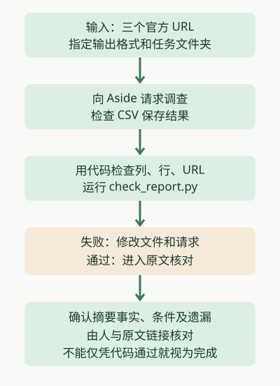

**向 Aside 提交请求时，与其只说“帮我自行调查”，更适合一并提供要使用的页面、结果格式和完成条件。** 先从整理少量公开文档的小任务开始，将原文与结果对照后，再扩展到查询登录页面或重复任务。

本文基于 2026 年 11 月 17 日查阅的官方帮助撰写。以下提示词是应用示例，并非在 Aside 中实际执行相应调查、登录或预约任务的结果。CSV 验证代码已使用另外构造的虚拟输入运行确认。

## 开始任务前确定范围

安装 Aside，确认所用模型和任务文件夹。如果从当前页面开始，打开侧边栏，检查页面附件的标题与主机名。保留附件即可将该页面用作任务上下文。[侧边栏说明](https://docs.aside.com/help/side-panel)

无需登录的资料调查也可以选择 Incognito。要查询已登录账号，应使用登录了该账号的默认配置文件。两种模式的浏览器状态不同。如果任务需要保存文件，还需具备向指定文件夹写入的权限。[任务模式说明](https://docs.aside.com/help/tasks)

权限方面，应同时检查 `Settings > Agents` 中的文件、工具、沙箱设置及各任务的设置。官方文档将 `Guard` 描述为在获准文件夹内工作，并在访问其他文件夹前征求确认的模式。`Read only` 被描述为不允许修改文件，因此可能不适合保存 CSV 的示例。不要仅凭名称就认定所有网站的修改行为都会自动被阻止。[权限说明](https://docs.aside.com/help/security)

## 示例 1：将三页官方文档整理为 CSV

选择一个空文件夹作为任务文件夹，然后发送以下请求。保存位置应换成实际文件夹；如已有同名文件，请指定新名称。

```text
请只阅读以下三页官方文档，整理成 report.csv。
https://docs.aside.com/help/tasks
https://docs.aside.com/help/automation
https://docs.aside.com/help/devices

使用 UTF-8 CSV，列顺序为 topic,summary,source_url。
topic 分别为 tasks,automation,devices，每个页面只写一行。
summary 用一个韩语句子说明各页面的核心使用条件。
包含逗号的字段请按 CSV 规则用引号包裹。
source_url 请原样使用上面给出的对应页面地址。

保存在选定的任务文件夹中，不要覆盖现有文件。
如有文档无法读取，不要靠猜测补全，请告知失败的地址。
不要访问其他网站的账号，也不要发送消息。
完成后请告知文件路径和已查阅的三个页面。
```

如果页面打不开，应先解决访问失败的问题。结果缺少特定项目时，也要在重试前确认目标 URL。用猜测的摘要填充未读到的文档，不能视为完成。



图中的代码检查用于确认结果文件是否遵守规定结构和来源范围。将以下代码保存为 `check_report.py`。它只使用 Python 3 标准库，不进行外部通信。

```python
import csv
import sys

expected = {
    "tasks": "https://docs.aside.com/help/tasks",
    "automation": "https://docs.aside.com/help/automation",
    "devices": "https://docs.aside.com/help/devices",
}

with open(sys.argv[1], newline="", encoding="utf-8-sig") as stream:
    reader = csv.DictReader(stream)
    if reader.fieldnames != ["topic", "summary", "source_url"]:
        raise SystemExit("FAIL: columns")
    rows = list(reader)

if len(rows) != len(expected) or {r["topic"] for r in rows} != set(expected):
    raise SystemExit("FAIL: topics")
for row in rows:
    if (None in row or any(value is None for value in row.values())
            or not row["summary"].strip()
            or row["source_url"] != expected[row["topic"]]):
        raise SystemExit("FAIL: row")
print("PASS: 3 topics and allowed source URLs")
```

将生成的 CSV 实际路径作为参数传入。

```sh
python3 check_report.py report.csv
```

使用包含三行及允许 URL 的虚拟输入时，确认退出码为 0，并得到以下输出。该输入并非 Aside 生成的产物。

```text
PASS: 3 topics and allowed source URLs
```

删除一行的虚拟输入返回了 `FAIL: topics` 和退出码 1。代码检查列、主题、URL 和空摘要，但**无法判断摘要是否符合事实，或页面是否真的被读取。** 通过后，仍应亲自在原文中找到支持各条摘要的句子。代码检查失败时，应先排查文件与提示词不一致之处，而不是放宽检查条件来解决。

## 示例 2：仅从已登录仪表板查询数值

查询账号时，应缩小到要使用的网站、账号、期间和筛选条件。以下示例假设是用户有权访问的工作仪表板。

```text
请从当前附加的仪表板读取我指定账号在 2026-11-01~2026-11-07
的浏览量，并写明界面上的时区和筛选条件。
表格中列出日期、数值和单位，不要将空白推测为 0。
不要修改设置、导出或查询其他账号。
界面上无法确认的值，请标为未确认。
```

得到数字后，先比较它是否与界面总计使用相同期间、时区和筛选条件。整体总计与部分排名靠前行的合计可能不同，不要立即将这种差异认定为错误。如需导出，应明确文件包含的范围和保存位置后另行请求。

需要登录信息时，不要把密码粘贴到提示词中。按照 [Password Manager 说明](https://docs.aside.com/help/password-manager)确认已保存登录信息的使用政策，并完成网站要求的额外认证。密码不传递给模型的说明，与模型处理登录后的页面内容是两回事。[隐私政策](https://aside.com/policy/privacy)说明，任务所需的选定上下文可能传递给托管模型提供方。

## 在执行过程中修改请求

如果调查对象不对，或需要缩小范围，不必等到完成后才说明。[任务说明](https://docs.aside.com/help/tasks)区分后续消息中的 `Queue` 和 `Steer`。`Queue` 在当前执行结束后应用后续请求，`Steer` 则将新消息传递给进行中的任务以改变方向。

例如，可以具体说明修改范围：“不要调查其他网站，只使用最初的三份文档。”发送了修改消息，并不意味着已经发生的外部操作会被取消。应确认实际状态后再决定下一个请求。

## 示例 3：将验证过的调查请求改为重复任务

如果一次性的结果有用，可以考虑重复调查。根据 [Routines 说明](https://docs.aside.com/help/automation)，cron routine 按计划启动新任务，而 heartbeat routine 会继续已有对话。若需要独立的每周摘要，可以先考虑创建新任务的方式。

在 `Settings > Routines` 中新建例程，并输入如下指令。周期和时区应在实际设置界面中另行调整。

```text
请阅读指定的三页官方文档，与上次执行结果比较，
附上依据链接，说明使用方法或限制发生变化的项目。
如果没有可比较的上次结果，请将本次结果记录为基准。
如果无法读取文档，请报告访问失败，不要视为没有变化。
不要修改账号设置、发送消息或执行付费任务。
```

还需确定上次结果保存在哪里，以及下次执行如何读取。不要因为例程创建新任务，就假设上次对话会自动成为比较资料。应明确输入，例如指定文件夹中的上一份报告；或者起初只接收报告并亲自比较，暂不自动对比。

在例程列表中立即运行，检查输入、输出和失败处理后，再启用计划。官方说明介绍了跳过重叠执行的行为。[设备说明](https://docs.aside.com/help/devices)指出，本地任务要求电脑开机、在线且 Aside 正在运行。并不会因为登录了另一台电脑或使用付费套餐，睡眠设备上的任务就能在云端接续执行。

最初只需熟悉一次从查询、整理到验证的完整流程。在这一过程中明确所需输入及结果检查方法，才能放心利用重复执行。
