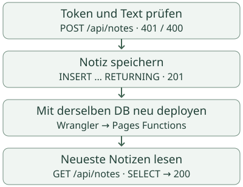

---
{
  "state": "draft",
  "language": "de",
  "translationKey": "2026-11-28-cloudflare-workers-neon-notes",
  "title": "Eine Notiz-App mit Cloudflare Workers und Neon bereitstellen",
  "description": "Oberfläche und API laufen unter derselben Cloudflare-Pages-Adresse. Nach einem erneuten Deployment lässt sich prüfen, ob die API eine in Neon gespeicherte Notiz wiederfindet.",
  "sourcePath": "src/content/posts/en/2026-11-28-cloudflare-workers-neon-notes.md",
  "sourceSha256": "71e5ccc2d896aa47ab412ccae04a8ee5e45ca38371038625108fb6befd488a52"
}
---

Cloudflare Pages liefert die statische Oberfläche aus. Eine Pages Function auf Workers verarbeitet Anfragen an `/api/notes`. Da Seite und API denselben Ursprung haben, kann der Browser die Liste ohne zusätzliche CORS-Konfiguration abrufen. Neon PostgreSQL speichert die Notizen. [Pages Functions](https://developers.cloudflare.com/pages/functions/get-started/)

Alle können die Liste lesen. Zum Schreiben ist ein Token erforderlich. Speichern Sie nur Übungsnotizen. Die folgenden Antworten sind nach dem Deployment zu erwarten.

## Notiztabelle und API anlegen

Legen Sie im SQL Editor einer Neon-Übungsdatenbank die Tabelle an.

```sql
CREATE TABLE notes (
  id integer GENERATED ALWAYS AS IDENTITY PRIMARY KEY,
  body text NOT NULL CHECK (char_length(body) BETWEEN 1 AND 200)
);
```

Führen Sie mit installiertem Node.js und npm diese Befehle im Stammverzeichnis des Projekts aus.

```bash
npm init -y
npm install @neondatabase/serverless
npm install --save-dev wrangler
mkdir -p functions/api public
```

Speichern Sie den Handler unter `functions/api/notes.js` im Projektstamm. Das Tagged Template des Neon-Treibers übergibt den Text der Notiz als SQL-Parameter. [Pages Functions](https://developers.cloudflare.com/pages/functions/routing/) · [Neon](https://neon.com/docs/serverless/serverless-driver)

```js
import { neon } from "@neondatabase/serverless";

export async function onRequest({ request, env }) {
  const reply = (data, status = 200) =>
    Response.json(data, {
      status,
      headers: { "Cache-Control": "no-store" },
    });

  if (request.method === "POST") {
    if (
      !env.DEMO_WRITE_TOKEN ||
      request.headers.get("Authorization") !== `Bearer ${env.DEMO_WRITE_TOKEN}`
    ) {
      return reply({ error: "Unauthorized" }, 401);
    }

    const input = await request.json().catch(() => null);
    const body = typeof input?.body === "string" ? input.body.trim() : "";

    if (!body || Array.from(body).length > 200) {
      return reply({ error: "Enter a note of 1 to 200 characters" }, 400);
    }

    const sql = neon(env.DATABASE_URL);
    const [note] = await sql`
      INSERT INTO notes (body) VALUES (${body}) RETURNING id, body
    `;
    return reply(note, 201);
  }

  if (request.method === "GET") {
    const sql = neon(env.DATABASE_URL);
    const notes = await sql`
      SELECT id, body FROM notes ORDER BY id DESC LIMIT 20
    `;
    return reply(notes);
  }

  return new Response(null, {
    status: 405,
    headers: { Allow: "GET, POST" },
  });
}
```

In `public/index.html` ruft die Seite die Liste ab und zeigt den Text jeder Notiz mit `textContent` an.

```html
<!doctype html>
<html lang="en">
<meta charset="utf-8">
<title>Notes</title>
<h1>Notes</h1>
<pre id="notes">Loading…</pre>
<script type="module">
  const output = document.querySelector("#notes");
  try {
    const response = await fetch("/api/notes");
    if (!response.ok) throw new Error();
    const notes = await response.json();
    output.textContent = notes.map((note) => note.body).join("\n") || "No notes";
  } catch {
    output.textContent = "Could not load notes.";
  }
</script>
</html>
```

## Dieselbe Notiz nach einem erneuten Deployment lesen



Melden Sie sich mit Wrangler an und erstellen Sie ein Pages-Projekt für Direct Upload. Ersetzen Sie den Beispielnamen durch Ihren Projektnamen. Hier dient `main` als Produktionsbranch.

```bash
PROJECT_NAME="my-neon-notes"
npx wrangler login
npx wrangler pages project create "$PROJECT_NAME" --production-branch main
```

Hinterlegen Sie in der Production-Umgebung des Pages-Projekts die Neon-Verbindungszeichenfolge als Secret `DATABASE_URL` und ein langes, zufällig erzeugtes Token als `DEMO_WRITE_TOKEN`. Starten Sie das Deployment im Projektstamm, damit Wrangler auch die Functions für die statische Seite baut. Deployments anderer Branches verwenden die Secrets der Preview-Umgebung. [Direct Upload](https://developers.cloudflare.com/pages/get-started/direct-upload/) · [Pages Secrets](https://developers.cloudflare.com/pages/functions/bindings/#secrets)

```bash
npx wrangler pages deploy public --project-name "$PROJECT_NAME" --branch main
```

Setzen Sie in der Shell `BASE_URL` auf die Produktionsadresse und `DEMO_WRITE_TOKEN` auf dasselbe Schreib-Token. Senden Sie dann die folgenden Anfragen.

```bash
curl -i "$BASE_URL/api/notes" \
  -H "Authorization: Bearer $DEMO_WRITE_TOKEN" \
  -H "Content-Type: application/json" \
  --data '{"body":"Keep this note after redeployment"}'

curl -i "$BASE_URL/api/notes"
```

Prüfen Sie, ob der Schreibzugriff den Status 201 und die ID der Notiz zurückgibt. Behalten Sie die Datenbank bei, deployen Sie das Projekt erneut auf dem Produktionsbranch und wiederholen Sie die Leseanfrage. Status 200 mit derselben ID und demselben Text zeigt, dass die neue API die gespeicherte Notiz lesen kann. Prüfen Sie die Anzeige im Browser und ob ein Schreibzugriff ohne Token den Status 401 liefert.

[Kostenlose Hostingangebote im Vergleich](../2026-11-28-free-deployment-guide/) · [Eine Notiz-App selbst hosten](../2026-11-28-self-hosting-ai-notes/)
