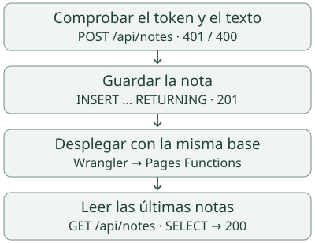

---
{
  "state": "draft",
  "language": "es",
  "translationKey": "2026-11-28-cloudflare-workers-neon-notes",
  "title": "Desplegar una aplicación de notas con Cloudflare Workers y Neon",
  "description": "Sirve la página y su API desde el mismo origen en Cloudflare Pages y comprueba si la API puede leer una nota de Neon después de otro despliegue.",
  "sourcePath": "src/content/posts/en/2026-11-28-cloudflare-workers-neon-notes.md",
  "sourceSha256": "71e5ccc2d896aa47ab412ccae04a8ee5e45ca38371038625108fb6befd488a52"
}
---

Cloudflare Pages sirve la interfaz estática. Una función de Pages que se ejecuta en Workers atiende las solicitudes a `/api/notes`. Como la página y la API comparten origen, el navegador puede leer la lista sin configurar CORS. Las notas se guardan en Neon PostgreSQL. [Pages Functions](https://developers.cloudflare.com/pages/functions/get-started/)

Cualquiera puede leer la lista, pero para escribir hace falta un token. Guarda solo notas de prueba. Las respuestas que se indican a continuación son las esperadas después del despliegue.

## Crear la tabla de notas y la API

Crea la tabla en el SQL Editor de una base de datos de Neon destinada al ejercicio.

```sql
CREATE TABLE notes (
  id integer GENERATED ALWAYS AS IDENTITY PRIMARY KEY,
  body text NOT NULL CHECK (char_length(body) BETWEEN 1 AND 200)
);
```

Con Node.js y npm instalados, ejecuta estos comandos desde la raíz del proyecto.

```bash
npm init -y
npm install @neondatabase/serverless
npm install --save-dev wrangler
mkdir -p functions/api public
```

Guarda el código en `functions/api/notes.js` dentro de la raíz del proyecto. La plantilla etiquetada del controlador de Neon pasa el texto de la nota como parámetro SQL. [Pages Functions](https://developers.cloudflare.com/pages/functions/routing/) · [Neon](https://neon.com/docs/serverless/serverless-driver)

```js
import { neon } from "@neondatabase/serverless";

export async function onRequest({ request, env }) {
  const reply = (data, status = 200) =>
    Response.json(data, {
      status,
      headers: { "Cache-Control": "no-store" },
    });

  if (request.method === "POST") {
    if (
      !env.DEMO_WRITE_TOKEN ||
      request.headers.get("Authorization") !== `Bearer ${env.DEMO_WRITE_TOKEN}`
    ) {
      return reply({ error: "Unauthorized" }, 401);
    }

    const input = await request.json().catch(() => null);
    const body = typeof input?.body === "string" ? input.body.trim() : "";

    if (!body || Array.from(body).length > 200) {
      return reply({ error: "Enter a note of 1 to 200 characters" }, 400);
    }

    const sql = neon(env.DATABASE_URL);
    const [note] = await sql`
      INSERT INTO notes (body) VALUES (${body}) RETURNING id, body
    `;
    return reply(note, 201);
  }

  if (request.method === "GET") {
    const sql = neon(env.DATABASE_URL);
    const notes = await sql`
      SELECT id, body FROM notes ORDER BY id DESC LIMIT 20
    `;
    return reply(notes);
  }

  return new Response(null, {
    status: 405,
    headers: { Allow: "GET, POST" },
  });
}
```

En `public/index.html`, recupera la lista y muestra el texto de cada nota con `textContent`.

```html
<!doctype html>
<html lang="en">
<meta charset="utf-8">
<title>Notes</title>
<h1>Notes</h1>
<pre id="notes">Loading…</pre>
<script type="module">
  const output = document.querySelector("#notes");
  try {
    const response = await fetch("/api/notes");
    if (!response.ok) throw new Error();
    const notes = await response.json();
    output.textContent = notes.map((note) => note.body).join("\n") || "No notes";
  } catch {
    output.textContent = "Could not load notes.";
  }
</script>
</html>
```

## Volver a leer la misma nota tras otro despliegue



Inicia sesión con Wrangler y crea un proyecto de Pages en modo Direct Upload. Sustituye el nombre del ejemplo por el de tu proyecto. En este caso la rama de producción es `main`.

```bash
PROJECT_NAME="my-neon-notes"
npx wrangler login
npx wrangler pages project create "$PROJECT_NAME" --production-branch main
```

En el entorno Production del proyecto de Pages, guarda la cadena de conexión de Neon como secreto `DATABASE_URL` y un token largo generado al azar como `DEMO_WRITE_TOKEN`. Ejecuta el despliegue desde la raíz para que Wrangler compile las funciones junto con la página estática. Los despliegues de otras ramas usan los secretos del entorno Preview. [Direct Upload](https://developers.cloudflare.com/pages/get-started/direct-upload/) · [Pages Secrets](https://developers.cloudflare.com/pages/functions/bindings/#secrets)

```bash
npx wrangler pages deploy public --project-name "$PROJECT_NAME" --branch main
```

En la terminal, asigna la URL de producción a `BASE_URL` y el mismo token de escritura a `DEMO_WRITE_TOKEN`. Envía las siguientes solicitudes.

```bash
curl -i "$BASE_URL/api/notes" \
  -H "Authorization: Bearer $DEMO_WRITE_TOKEN" \
  -H "Content-Type: application/json" \
  --data '{"body":"Keep this note after redeployment"}'

curl -i "$BASE_URL/api/notes"
```

Comprueba que la escritura devuelve el estado 201 y el identificador de la nota. Vuelve a desplegar el mismo proyecto en la rama de producción con la misma base de datos y repite la lectura. Si recibes un 200 con el mismo identificador y texto, la nueva API puede leer la nota guardada. Comprueba que aparece en el navegador y que escribir sin token devuelve 401.

[Comparativa de alojamientos gratuitos](../2026-11-28-free-deployment-guide/) · [Alojar una aplicación de notas en tu servidor](../2026-11-28-self-hosting-ai-notes/)
