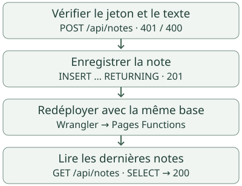

---
{
  "state": "draft",
  "language": "fr",
  "translationKey": "2026-11-28-cloudflare-workers-neon-notes",
  "title": "Déployer une application de notes avec Cloudflare Workers et Neon",
  "description": "Servez la page et son API depuis la même origine sur Cloudflare Pages, puis vérifiez que l’API redéployée peut relire une note dans Neon.",
  "sourcePath": "src/content/posts/en/2026-11-28-cloudflare-workers-neon-notes.md",
  "sourceSha256": "71e5ccc2d896aa47ab412ccae04a8ee5e45ca38371038625108fb6befd488a52"
}
---

Cloudflare Pages sert la page statique. Une fonction Pages exécutée sur Workers traite les requêtes vers `/api/notes`. La page et l’API ayant la même origine, le navigateur peut lire la liste sans configuration CORS supplémentaire. Neon PostgreSQL conserve les notes. [Pages Functions](https://developers.cloudflare.com/pages/functions/get-started/)

La liste est publique et l’écriture nécessite un jeton. Enregistrez uniquement des notes d’exercice. Les réponses ci-dessous sont celles attendues après le déploiement.

## Créer la table des notes et l’API

Dans le SQL Editor d’une base Neon réservée à l’exercice, créez la table des notes.

```sql
CREATE TABLE notes (
  id integer GENERATED ALWAYS AS IDENTITY PRIMARY KEY,
  body text NOT NULL CHECK (char_length(body) BETWEEN 1 AND 200)
);
```

Une fois Node.js et npm installés, exécutez ces commandes à la racine du projet.

```bash
npm init -y
npm install @neondatabase/serverless
npm install --save-dev wrangler
mkdir -p functions/api public
```

Enregistrez le code suivant dans `functions/api/notes.js` à la racine du projet. Avec le gabarit étiqueté du pilote Neon, le texte de la note est transmis comme paramètre SQL. [Pages Functions](https://developers.cloudflare.com/pages/functions/routing/) · [Neon](https://neon.com/docs/serverless/serverless-driver)

```js
import { neon } from "@neondatabase/serverless";

export async function onRequest({ request, env }) {
  const reply = (data, status = 200) =>
    Response.json(data, {
      status,
      headers: { "Cache-Control": "no-store" },
    });

  if (request.method === "POST") {
    if (
      !env.DEMO_WRITE_TOKEN ||
      request.headers.get("Authorization") !== `Bearer ${env.DEMO_WRITE_TOKEN}`
    ) {
      return reply({ error: "Unauthorized" }, 401);
    }

    const input = await request.json().catch(() => null);
    const body = typeof input?.body === "string" ? input.body.trim() : "";

    if (!body || Array.from(body).length > 200) {
      return reply({ error: "Enter a note of 1 to 200 characters" }, 400);
    }

    const sql = neon(env.DATABASE_URL);
    const [note] = await sql`
      INSERT INTO notes (body) VALUES (${body}) RETURNING id, body
    `;
    return reply(note, 201);
  }

  if (request.method === "GET") {
    const sql = neon(env.DATABASE_URL);
    const notes = await sql`
      SELECT id, body FROM notes ORDER BY id DESC LIMIT 20
    `;
    return reply(notes);
  }

  return new Response(null, {
    status: 405,
    headers: { Allow: "GET, POST" },
  });
}
```

Dans `public/index.html`, récupérez la liste et affichez le texte de chaque note avec `textContent`.

```html
<!doctype html>
<html lang="en">
<meta charset="utf-8">
<title>Notes</title>
<h1>Notes</h1>
<pre id="notes">Loading…</pre>
<script type="module">
  const output = document.querySelector("#notes");
  try {
    const response = await fetch("/api/notes");
    if (!response.ok) throw new Error();
    const notes = await response.json();
    output.textContent = notes.map((note) => note.body).join("\n") || "No notes";
  } catch {
    output.textContent = "Could not load notes.";
  }
</script>
</html>
```

## Relire la même note après un redéploiement



Connectez-vous avec Wrangler et créez un projet Pages en mode Direct Upload. Remplacez le nom de l’exemple par celui de votre projet. Ici, la branche de production est `main`.

```bash
PROJECT_NAME="my-neon-notes"
npx wrangler login
npx wrangler pages project create "$PROJECT_NAME" --production-branch main
```

Dans l’environnement Production du projet Pages, enregistrez la chaîne de connexion Neon dans le secret `DATABASE_URL` et un long jeton généré aléatoirement dans `DEMO_WRITE_TOKEN`. Lancez le déploiement depuis la racine pour que Wrangler compile aussi les Functions qui accompagnent la page statique. Les autres branches utilisent les secrets de l’environnement Preview. [Direct Upload](https://developers.cloudflare.com/pages/get-started/direct-upload/) · [Pages Secrets](https://developers.cloudflare.com/pages/functions/bindings/#secrets)

```bash
npx wrangler pages deploy public --project-name "$PROJECT_NAME" --branch main
```

Dans le shell, affectez à `BASE_URL` l’URL de production du projet et à `DEMO_WRITE_TOKEN` le même jeton d’écriture, puis envoyez ces requêtes.

```bash
curl -i "$BASE_URL/api/notes" \
  -H "Authorization: Bearer $DEMO_WRITE_TOKEN" \
  -H "Content-Type: application/json" \
  --data '{"body":"Keep this note after redeployment"}'

curl -i "$BASE_URL/api/notes"
```

Vérifiez que l’écriture renvoie le statut 201 et l’identifiant de la note. Gardez la même base, redéployez sur la branche de production du même projet et répétez la lecture. Une réponse 200 contenant le même identifiant et le même texte confirme que l’API redéployée peut lire la note enregistrée. Vérifiez son affichage dans le navigateur et assurez-vous qu’une écriture sans jeton renvoie 401.

[Comparer les hébergements gratuits](../2026-11-28-free-deployment-guide/) · [Auto-héberger une application de notes](../2026-11-28-self-hosting-ai-notes/)
