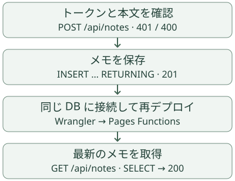

---
{
  "state": "draft",
  "language": "ja",
  "translationKey": "2026-11-28-cloudflare-workers-neon-notes",
  "title": "Cloudflare Workers と Neon でメモアプリをデプロイする",
  "description": "Cloudflare Pages で画面と API を同一オリジンから配信し、再デプロイ後も Neon に保存したメモを読み出せるか確かめます。",
  "sourcePath": "src/content/posts/en/2026-11-28-cloudflare-workers-neon-notes.md",
  "sourceSha256": "71e5ccc2d896aa47ab412ccae04a8ee5e45ca38371038625108fb6befd488a52"
}
---

静的な画面は Cloudflare Pages で配信し、`/api/notes` は Workers 上で動く Pages Functions で処理します。画面と API が同一オリジンなので、ブラウザーは CORS の追加設定なしでメモ一覧を取得できます。保存先は Neon PostgreSQL です。 [Pages Functions](https://developers.cloudflare.com/pages/functions/get-started/)

一覧は誰でも読めますが、書き込みにはトークンが必要です。練習用のメモだけを保存してください。以下の応答はデプロイ後に期待される結果です。

## メモのテーブルと API を作る

練習用の Neon データベースの SQL Editor でテーブルを作成します。

```sql
CREATE TABLE notes (
  id integer GENERATED ALWAYS AS IDENTITY PRIMARY KEY,
  body text NOT NULL CHECK (char_length(body) BETWEEN 1 AND 200)
);
```

Node.js と npm を用意し、プロジェクトのルートで次のコマンドを実行します。

```bash
npm init -y
npm install @neondatabase/serverless
npm install --save-dev wrangler
mkdir -p functions/api public
```

プロジェクトのルートにある `functions/api/notes.js` に次のコードを保存します。Neon ドライバーのタグ付きテンプレートは、メモの本文を SQL のパラメーターとして渡します。 [Pages Functions](https://developers.cloudflare.com/pages/functions/routing/) · [Neon](https://neon.com/docs/serverless/serverless-driver)

```js
import { neon } from "@neondatabase/serverless";

export async function onRequest({ request, env }) {
  const reply = (data, status = 200) =>
    Response.json(data, {
      status,
      headers: { "Cache-Control": "no-store" },
    });

  if (request.method === "POST") {
    if (
      !env.DEMO_WRITE_TOKEN ||
      request.headers.get("Authorization") !== `Bearer ${env.DEMO_WRITE_TOKEN}`
    ) {
      return reply({ error: "Unauthorized" }, 401);
    }

    const input = await request.json().catch(() => null);
    const body = typeof input?.body === "string" ? input.body.trim() : "";

    if (!body || Array.from(body).length > 200) {
      return reply({ error: "Enter a note of 1 to 200 characters" }, 400);
    }

    const sql = neon(env.DATABASE_URL);
    const [note] = await sql`
      INSERT INTO notes (body) VALUES (${body}) RETURNING id, body
    `;
    return reply(note, 201);
  }

  if (request.method === "GET") {
    const sql = neon(env.DATABASE_URL);
    const notes = await sql`
      SELECT id, body FROM notes ORDER BY id DESC LIMIT 20
    `;
    return reply(notes);
  }

  return new Response(null, {
    status: 405,
    headers: { Allow: "GET, POST" },
  });
}
```

`public/index.html` で一覧を取得し、各メモの本文を `textContent` で表示します。

```html
<!doctype html>
<html lang="en">
<meta charset="utf-8">
<title>Notes</title>
<h1>Notes</h1>
<pre id="notes">Loading…</pre>
<script type="module">
  const output = document.querySelector("#notes");
  try {
    const response = await fetch("/api/notes");
    if (!response.ok) throw new Error();
    const notes = await response.json();
    output.textContent = notes.map((note) => note.body).join("\n") || "No notes";
  } catch {
    output.textContent = "Could not load notes.";
  }
</script>
</html>
```

## 再デプロイ後に同じメモを読み出す



Wrangler にログインし、Pages の Direct Upload プロジェクトを作成します。例のプロジェクト名は自分で使う名前に置き換えてください。ここでは本番ブランチを `main` に設定します。

```bash
PROJECT_NAME="my-neon-notes"
npx wrangler login
npx wrangler pages project create "$PROJECT_NAME" --production-branch main
```

Pages プロジェクトの Production 環境で、Neon の接続文字列を `DATABASE_URL`、ランダムに生成した長いトークンを `DEMO_WRITE_TOKEN` というシークレットとして保存します。ルートからデプロイすると、Wrangler は静的ファイルを配信するための準備とともに Functions をビルドします。他のブランチへのデプロイには Preview 環境のシークレットが使われます。 [Direct Upload](https://developers.cloudflare.com/pages/get-started/direct-upload/) · [Pages Secrets](https://developers.cloudflare.com/pages/functions/bindings/#secrets)

```bash
npx wrangler pages deploy public --project-name "$PROJECT_NAME" --branch main
```

シェルで `BASE_URL` に本番 URL、`DEMO_WRITE_TOKEN` に同じ書き込みトークンを設定し、次のリクエストを送ります。

```bash
curl -i "$BASE_URL/api/notes" \
  -H "Authorization: Bearer $DEMO_WRITE_TOKEN" \
  -H "Content-Type: application/json" \
  --data '{"body":"Keep this note after redeployment"}'

curl -i "$BASE_URL/api/notes"
```

書き込みの応答で 201 とメモの ID を確認します。同じデータベースに接続したまま、同じプロジェクトの本番ブランチに再デプロイし、取得リクエストをもう一度送ります。200 と同じ ID・本文が返れば、新しい API から既存のメモを読み出せています。ブラウザーにも表示されること、トークンなしの書き込みが 401 になることを確認します。

[無料デプロイ環境の比較](../2026-11-28-free-deployment-guide/) · [メモアプリのセルフホスティング](../2026-11-28-self-hosting-ai-notes/)
