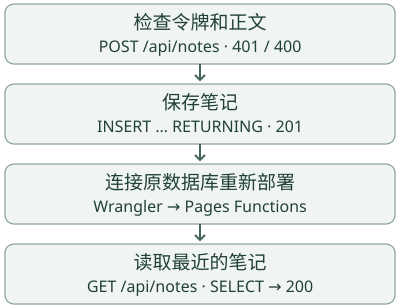

---
{
  "state": "draft",
  "language": "zh-CN",
  "translationKey": "2026-11-28-cloudflare-workers-neon-notes",
  "title": "用 Cloudflare Workers 和 Neon 部署笔记应用",
  "description": "在同一个 Cloudflare Pages 域名下提供页面和 API，重新部署后检查 API 能否读到 Neon 中原有的笔记。",
  "sourcePath": "src/content/posts/en/2026-11-28-cloudflare-workers-neon-notes.md",
  "sourceSha256": "71e5ccc2d896aa47ab412ccae04a8ee5e45ca38371038625108fb6befd488a52"
}
---

静态页面托管在 Cloudflare Pages 上，`/api/notes` 由运行在 Workers 上的 Pages Function 处理。页面和 API 同源，浏览器无需额外配置 CORS 就能读取笔记列表。笔记存储在 Neon PostgreSQL 中。 [Pages Functions](https://developers.cloudflare.com/pages/functions/get-started/)

任何人都能查看列表，写入则需要令牌。请只保存练习用的笔记。下文给出的是部署后的预期响应。

## 创建笔记表和 API

在练习用 Neon 数据库的 SQL Editor 中创建笔记表。

```sql
CREATE TABLE notes (
  id integer GENERATED ALWAYS AS IDENTITY PRIMARY KEY,
  body text NOT NULL CHECK (char_length(body) BETWEEN 1 AND 200)
);
```

安装 Node.js 和 npm 后，在项目根目录运行以下命令。

```bash
npm init -y
npm install @neondatabase/serverless
npm install --save-dev wrangler
mkdir -p functions/api public
```

将以下代码保存为项目根目录下的 `functions/api/notes.js`。Neon 驱动的标签模板会把笔记正文作为 SQL 参数传入。 [Pages Functions](https://developers.cloudflare.com/pages/functions/routing/) · [Neon](https://neon.com/docs/serverless/serverless-driver)

```js
import { neon } from "@neondatabase/serverless";

export async function onRequest({ request, env }) {
  const reply = (data, status = 200) =>
    Response.json(data, {
      status,
      headers: { "Cache-Control": "no-store" },
    });

  if (request.method === "POST") {
    if (
      !env.DEMO_WRITE_TOKEN ||
      request.headers.get("Authorization") !== `Bearer ${env.DEMO_WRITE_TOKEN}`
    ) {
      return reply({ error: "Unauthorized" }, 401);
    }

    const input = await request.json().catch(() => null);
    const body = typeof input?.body === "string" ? input.body.trim() : "";

    if (!body || Array.from(body).length > 200) {
      return reply({ error: "Enter a note of 1 to 200 characters" }, 400);
    }

    const sql = neon(env.DATABASE_URL);
    const [note] = await sql`
      INSERT INTO notes (body) VALUES (${body}) RETURNING id, body
    `;
    return reply(note, 201);
  }

  if (request.method === "GET") {
    const sql = neon(env.DATABASE_URL);
    const notes = await sql`
      SELECT id, body FROM notes ORDER BY id DESC LIMIT 20
    `;
    return reply(notes);
  }

  return new Response(null, {
    status: 405,
    headers: { Allow: "GET, POST" },
  });
}
```

在 `public/index.html` 中获取列表，用 `textContent` 显示每条笔记的正文。

```html
<!doctype html>
<html lang="en">
<meta charset="utf-8">
<title>Notes</title>
<h1>Notes</h1>
<pre id="notes">Loading…</pre>
<script type="module">
  const output = document.querySelector("#notes");
  try {
    const response = await fetch("/api/notes");
    if (!response.ok) throw new Error();
    const notes = await response.json();
    output.textContent = notes.map((note) => note.body).join("\n") || "No notes";
  } catch {
    output.textContent = "Could not load notes.";
  }
</script>
</html>
```

## 重新部署后读取同一条笔记



登录 Wrangler 并创建 Pages Direct Upload 项目。将示例项目名换成自己的名称。这里将生产分支设为 `main`。

```bash
PROJECT_NAME="my-neon-notes"
npx wrangler login
npx wrangler pages project create "$PROJECT_NAME" --production-branch main
```

在 Pages 项目的 Production 环境中，将 Neon 连接字符串存为密钥 `DATABASE_URL`，将随机生成的长令牌存为 `DEMO_WRITE_TOKEN`。在项目根目录部署，Wrangler 就会同时构建 Functions 并上传静态页面。部署到其他分支时使用 Preview 环境的密钥。 [Direct Upload](https://developers.cloudflare.com/pages/get-started/direct-upload/) · [Pages Secrets](https://developers.cloudflare.com/pages/functions/bindings/#secrets)

```bash
npx wrangler pages deploy public --project-name "$PROJECT_NAME" --branch main
```

在 shell 中将 `BASE_URL` 设为项目的生产地址，将 `DEMO_WRITE_TOKEN` 设为相同的写入令牌，然后发送以下请求。

```bash
curl -i "$BASE_URL/api/notes" \
  -H "Authorization: Bearer $DEMO_WRITE_TOKEN" \
  -H "Content-Type: application/json" \
  --data '{"body":"Keep this note after redeployment"}'

curl -i "$BASE_URL/api/notes"
```

检查写入响应是否包含状态码 201 和笔记 ID。保持数据库连接目标不变，重新部署到同一项目的生产分支，再次发送读取请求。若返回 200 且 ID 和正文一致，说明新部署的 API 能读取原有笔记。检查浏览器能否显示该笔记，以及不带令牌的写入请求是否返回 401。

[免费部署方案比较](../2026-11-28-free-deployment-guide/) · [自行托管笔记应用](../2026-11-28-self-hosting-ai-notes/)
