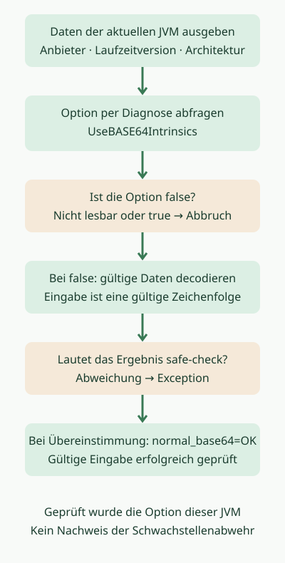

**Java4Shell ist eine Schwachstelle, die in OpenJDK auf bestimmten x86-64-Prozessoren bei der optimierten Base64-Decodierung Speicher beschädigen kann. Unter den passenden Bedingungen können dadurch Speicherinhalte offengelegt oder aus der Ferne Code ausgeführt werden. Prüfen Sie die eingesetzte Laufzeit, die CPU-Voraussetzungen und ob externe Eingaben diesen Pfad erreichen. Spielen Sie dann das korrigierte JDK Ihres Anbieters ein.** Dauert die Aktualisierung länger, kommt die vom Entdecker vorgeschlagene Option `-XX:-UseBASE64Intrinsics` als vorübergehende Maßnahme infrage.

Der Entdecker Calif nennt die Schwachstelle Java4Shell. Sie hat die Kennung **CVE-2026-114938** und wurde in der [Oracle-Sicherheitsmitteilung (2026-11)](https://www.oracle.com/security-alerts/cspunov2026.html) und in der [OpenJDK-Sicherheitsmitteilung](https://openjdk.org/groups/vulnerability/advisories/2026-11-17) veröffentlicht. Die folgenden Versionsangaben beruhen auf den am 18. November 2026 geprüften öffentlichen Quellen.

## Wie kommt es in Java zu Speicherbeschädigung?

HotSpot optimiert häufig ausgeführte Operationen per JIT. Für einige Operationen verwendet die JVM spezielle Implementierungen namens Intrinsics, die direkt auf CPU-Befehle zurückgreifen. Laut Calif **berechnet das x86-64-Intrinsic für Base64 beim Verarbeiten des Paddings die Schreibmaske für die Ausgabebytes falsch und schreibt dadurch über das Ende des Ausgabepuffers hinaus**. Die Java-Schicht kann eine ungültige Eingabe später noch mit einer `IllegalArgumentException` zurückweisen, doch der Speicher kann zu diesem Zeitpunkt bereits beschädigt sein. Ein Exception-Handler allein behebt die Schwachstelle deshalb nicht.

Oracle nennt die Komponente `Compiler`, OpenJDK führt sie unter `hotspot/compiler`. Auch eine Anwendung ohne Funktion zum Kompilieren externer Java-Quellen kann den betroffenen Pfad erreichen. Gewöhnliche Base64-Decodierung kann die interne JVM-Optimierung nutzen.

Calif nennt als Voraussetzung **AVX-512 VBMI auf einem x86-64-Prozessor**. Unter Linux empfiehlt Calif, alle vier CPU-Flags `avx512f`, `avx512bw`, `avx512vbmi` und `bmi2` zu prüfen. Laut der öffentlichen Beschreibung ist ARM64 von diesem fehlerhaften Pfad ausgenommen. Die CPU-Voraussetzung allein belegt keine Möglichkeit zur Ausführung von Code aus der Ferne. Eingabepfade und Voraussetzungen für eine Ausnutzung hängen von der Anwendung ab. Eine universelle Eingabe, die alle Produkte kompromittiert, lässt sich daraus nicht ableiten. Prüfen Sie in einer VM oder einem Container, welche CPU-Funktionen die JVM tatsächlich sieht.

Lesen Sie die Schweregradbewertung zusammen mit der CVSS-Version und der Stelle, die sie veröffentlicht hat.

| Bewertung von | Bewertung | Bedeutung |
| --- | --- | --- |
| Oracle CNA | CVSS 3.1 **8.1, High** | Angriff über das Netzwerk, hohe Angriffskomplexität, keine Anmeldung oder Benutzerinteraktion erforderlich |
| Calif | CVSS 4.0 **9.2, Critical** | Bewertung des Entdeckers nach einer anderen CVSS-Version |

Der Oracle-Vektor lautet `CVSS:3.1/AV:N/AC:H/PR:N/UI:N/S:U/C:H/I:H/A:H`. Die beiden Bewertungen stammen von verschiedenen Stellen und verwenden unterschiedliche CVSS-Versionen. [CVE-Originaleintrag](https://www.cve.org/CVERecord?id=CVE-2026-114938)

## Welches JDK muss ersetzt werden?

Die Tabelle zeigt die laut Oracle betroffenen unterstützten Versionen sowie die bestätigten korrigierten Releases. Prüfen Sie Build-Nummern anderer Distributionen anhand der Angaben des jeweiligen Anbieters.

| Produkt | Laut Oracle betroffene Version | Bestätigtes korrigiertes Oracle-Release |
| --- | --- | --- |
| Oracle Java SE 17 | `17.0.21.0.3` | [17.0.21.1+4](https://www.oracle.com/java/technologies/javase/17-0-21-1-relnotes.html) |
| Oracle Java SE 21 | `21.0.13.0.3` | [21.0.13.1+4](https://www.oracle.com/java/technologies/javase/21-0-13-1-relnotes.html) |
| Oracle Java SE 25 | `25.0.5.0.3` | [25.0.5.1+4](https://www.oracle.com/java/technologies/javase/25-0-5-1-relnotes.html) |
| Oracle Java SE 27 | `27.0.1.0.3` | [27.0.1.1+4](https://www.oracle.com/java/technologies/javase/27-0-1-1-relnotes.html) |
| Oracle Java SE 8 Performance Pack | `8u511b33-perf` | Genauer korrigierter Build hier nicht bestätigt |
| Oracle GraalVM for JDK | `17.0.21.0.3`, `21.0.13.0.3` | Sicherheitsupdate für das jeweilige Produkt prüfen |
| Oracle GraalVM Enterprise Edition | `21.3.20.0.3` | Sicherheitsupdate für das jeweilige Produkt prüfen |

**Die Tabelle ist keine vollständige Liste aller verwundbaren Versionen vor der Korrektur.** Oracle weist auch auf möglicherweise betroffene ältere Releases hin und empfiehlt das Update auf eine unterstützte Version. Unterscheiden Sie bei Java 8 zwischen regulären Builds und dem Performance Pack. [Oracle-Risikomatrix](https://www.oracle.com/security-alerts/cspunov2026.html#AppendixJAVA)

Prüfen Sie bei OpenJDK-basierten Distributionen wie Temurin, Corretto oder Zulu die Sicherheitsmitteilung und den korrigierten Build des Anbieters für diese CVE. Eine von der Oracle-Tabelle abweichende Versionsnummer reicht als Sicherheitsnachweis nicht aus. Auch Calif beschreibt einen bestimmten Hardware- und Laufzeitpfad. Bereits korrigierte Releases sind von dieser Einstufung ausgenommen.

## Patch und vorübergehende Maßnahme anwenden

Ermitteln Sie zuerst **das JDK, das der laufende Dienst tatsächlich nutzt**. Ein Aufruf von `java -version` in der Shell bezieht sich auf die ausführbare Datei im aktuellen PATH. Ein bereits laufender Dienst kann eine andere Laufzeit verwenden. Erfassen Sie den JVM-Startpfad, das Container-Image, die JVM-Version und den Anbieter gemeinsam.

Ersetzen Sie die Laufzeit durch das korrigierte JDK Ihrer Distribution. Bauen Sie Container mit dem aktualisierten Basis-Image neu und stellen Sie sie bereit. Prüfen Sie nach dem schrittweisen Austausch anhand der Laufzeitversion, dass keine alten JVMs mehr laufen. Allein eine Änderung an der Abhängigkeitsdatei der Anwendung oder die Installation eines JDK auf dem Host reicht nicht aus.

Dauert die Bereitstellung des Patches länger, prüfen Sie diese von Calif vorgeschlagene **JVM-Startoption**. Ersetzen Sie den JAR-Namen durch den Ihrer eigenen Anwendung.

```sh
java -XX:-UseBASE64Intrinsics -jar app.jar
```

Als vorübergehende Maßnahme deaktiviert die Option die hardwarebeschleunigte Base64-Codierung und -Decodierung. Die hier geprüfte Oracle-Sicherheitsmitteilung empfiehlt die Installation des Sicherheitsupdates. Ergänzen Sie die Option neben den vorhandenen JVM-Optionen, starten Sie die JVM neu und prüfen Sie den tatsächlich gesetzten Wert. Beobachten Sie bei Diensten mit intensiver Base64-Nutzung den Durchsatz, die CPU-Auslastung und die Latenz. Leistungsunterschiede wurden für diesen Artikel nicht gemessen.

Calif nennt auch `-XX:UseAVX=2` als Alternative und warnt davor, die Option außerhalb von **x86-64** zu verwenden. OpenJDK auf ARM erkennt sie unter Umständen nicht und kann deshalb den Start abbrechen. Setzen Sie die Option bei einer Bereitstellung mit unterschiedlichen Architekturen nicht pauschal. Calif führt auch die Pufferung des Request-Bodys in Nginx nicht als Maßnahme an, die alle Ausnutzungspfade blockiert.

## Einstellung mit einem Java-Beispiel prüfen

**Unter HotSpot-basierten JDKs ab Version 17 prüft das folgende Beispiel den Optionswert der aktuellen JVM und die Decodierung gültiger Base64-Daten.** Daraus lässt sich weder die Schwachstelle erkennen noch eine erfolgreiche Abwehr nachweisen. Wenn die Diagnoseschnittstelle oder die Option fehlt, bleibt der Status offen. Verwenden Sie dann die Verwaltungswerkzeuge Ihrer Laufzeit.



Fehlt die Diagnoseschnittstelle oder ist die Option weiterhin aktiviert, bricht das Programm mit einer Exception ab. Erst nach erfolgreicher Prüfung decodiert es eine gültige Zeichenfolge und vergleicht das Ergebnis mit dem erwarteten Wert.

Speichern Sie das Beispiel als `Base64MitigationCheck.java`.

```java
import com.sun.management.HotSpotDiagnosticMXBean;
import java.lang.management.ManagementFactory;
import java.nio.charset.StandardCharsets;
import java.util.Base64;

public class Base64MitigationCheck {
    public static void main(String[] args) {
        System.out.println("java.vendor=" + System.getProperty("java.vendor"));
        System.out.println("java.runtime.version="
                + System.getProperty("java.runtime.version"));
        System.out.println("os.arch=" + System.getProperty("os.arch"));

        HotSpotDiagnosticMXBean diagnostic = ManagementFactory
                .getPlatformMXBean(HotSpotDiagnosticMXBean.class);
        if (diagnostic == null) {
            throw new IllegalStateException("HotSpot diagnostic interface unavailable");
        }
        String enabled = diagnostic.getVMOption("UseBASE64Intrinsics").getValue();
        System.out.println("UseBASE64Intrinsics=" + enabled);
        if (!"false".equals(enabled)) {
            throw new IllegalStateException("Base64 intrinsic is not disabled");
        }

        String decoded = new String(
                Base64.getDecoder().decode("c2FmZS1jaGVjaw=="),
                StandardCharsets.UTF_8);
        if (!"safe-check".equals(decoded)) {
            throw new IllegalStateException("Unexpected Base64 result");
        }
        System.out.println("normal_base64=OK");
    }
}
```

Führen Sie die beiden Befehle mit `javac` und `java` desselben Ziel-JDKs aus.

```sh
javac --release 17 Base64MitigationCheck.java
java -XX:-UseBASE64Intrinsics Base64MitigationCheck
```

Die folgende Ausgabe stammt aus einem Lauf mit Zulu `21.0.1+12-LTS` unter macOS auf ARM64. Der ältere Build diente zur Prüfung des Beispiels. Für den Produktivbetrieb gelten die oben genannten Update-Empfehlungen. Mit Corretto `17.0.8.1+8-LTS` wurden der deaktivierte Optionswert und die Decodierung gültiger Daten ebenfalls bestätigt.

```text
java.vendor=Azul Systems, Inc.
java.runtime.version=21.0.1+12-LTS
os.arch=aarch64
UseBASE64Intrinsics=false
normal_base64=OK
```

Mit `-XX:+UseBASE64Intrinsics` endete der Lauf in beiden Umgebungen mit der Exception `Base64 intrinsic is not disabled` und dem Exitcode `1`. Auf ARM64 wurden **Optionsabfrage, Verzweigung und Verarbeitung gültiger Daten** geprüft. Speicherbeschädigung, Wirksamkeit der Maßnahme und Leistung auf betroffenem x86-64 wurden nicht untersucht.

Ein separat gestartetes Beispiel verrät nichts über die Optionen einer bereits laufenden Anwendung. Prüfen Sie in Produktion den Dienstprozess direkt, wenn Sie die nötigen Zugriffsrechte und ein kompatibles Diagnosewerkzeug haben. Schlägt die Abfrage wegen der JVM-Implementierung, deaktiviertem Attach, fehlender Rechte oder des Container-PID-Namensraums fehl, bleibt die Einstellung ungeklärt.

```sh
# JCMD는 대상 런타임과 호환되는 도구의 경로, PID는 서비스 JVM의 PID다.
"$JCMD" "$PID" VM.version
"$JCMD" "$PID" VM.flags -all | grep 'UseBASE64Intrinsics'
```

Prüfen Sie nach dem Rollout des korrigierten Builds die tatsächlich genutzte Laufzeitversion, den Austausch der Instanzen und zentrale Funktionen wie Anmeldung, Datei-Uploads und Integrationen sowie die Fehlerrate. Bestätigen Sie vor dem Entfernen einer temporären Option, dass der Herstellerpatch installiert ist und der Dienst normal funktioniert. Vergleichen Sie anschließend die Messwerte vor und nach der Änderung.
